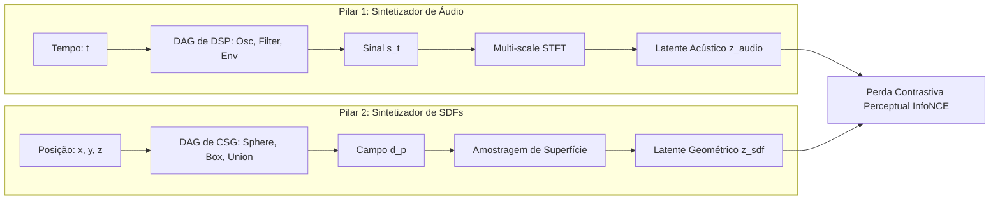
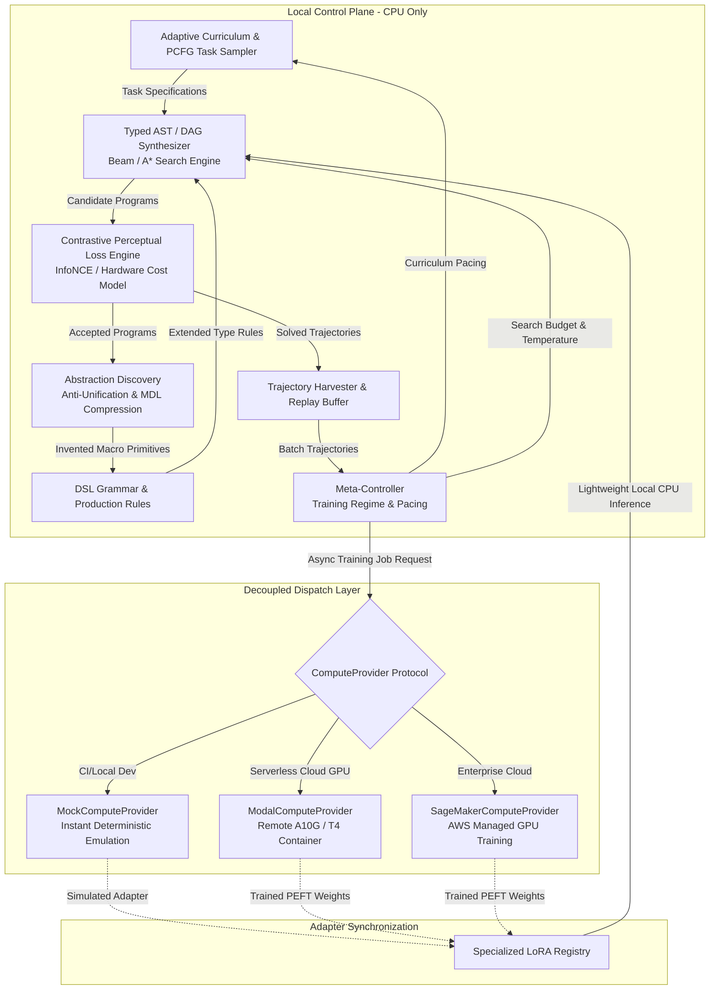

# SymForge: Síntese Neurosimbólica de Programas Procedurais

> **Cost-Aware Differentiable Neurosymbolic Program Synthesis with Lean 4 Formal IR, Contrastive Perceptual Loss, and Procedural Abstraction Discovery**

[](LICENSE)
[](https://leanprover.github.io/)
[](https://www.python.org/)
[](docs/architecture/unified_synthesis_architecture.md)

---

## 1. Visão Geral

O **SymForge** é um framework neurosimbólico universal projetado para a síntese procedural de programas estruturados (Árvores Sintáticas Abstratas - ASTs e Grafos Acíclicos Direcionados - DAGs tipados). O objetivo central é **descobrir automaticamente como combinar primitivas computacionais conhecidas e otimizar seus parâmetros contínuos livres** para reproduzir alvos complexos com fidelidade perceptual e custo computacional minimizado.

O sistema opera sob uma **isomorfia fundamental**: seja na geração de timbres de áudio analógico/FM (1D DSP), na modelagem de sólidos CAD e texturas procedurais (3D SDF/PBR), ou na superotimização de instruções básicas em hardware (Assembly/SIMD), a lógica é matematicamente idêntica:

```text
+---------------------------------------------------------------------------------------------------+
|                                  PARADIGMA UNIFICADO DO SYMFORGE                                  |
|                                                                                                   |
|  +--------------------+       +----------------------+       +---------------------------------+  |
|  |   PCFG / Context   | ----> |  Lean 4 Formal IR    | ----> |  Perda Diferenciável Perceptual |  |
|  | Gerador Sintético  |       | (AST / DAG Tipado)   |       |       Baseada em Contraste      |  |
|  +--------------------+       +----------+-----------+       +----------------+----------------+  |
|            ^                             | Transpilação                       |                   |
|            |                             v Metaprogramação                    v Gradientes        |
|            |                  +----------+-----------+               +--------+-------+           |
|            +----------------- | PyTorch/JAX Backend  | <------------ |   Otimizador   |           |
|            Novas Primitives   | & Abstraction Engine | Trajetórias   |   Contínuo     |           |
|            na Gramática       +----------------------+ Aceitas       +----------------+           |
+---------------------------------------------------------------------------------------------------+
```


---

## 2. As Três Divisões do Projeto

O SymForge está estruturado em três pilares fundamentais de desenvolvimento:

```text
+---------------------------------------------------------------------------------------------------+
|                              MAPA DE ISOMORFISMO: ÁUDIO vs. SDF                                   |
|                                                                                                   |
|  Conceito                 Sintetizador de Áudio (1D DSP)         Sintetizador de SDF (3D CSG)     |
|  -----------------------  -------------------------------------  -------------------------------- |
|  Entrada Espacial         t in R (Tempo)                         p = (x,y,z) in R^3 (Posição)     |
|  Saída Contínua           s(t) in [-1, 1] (Pressão Acústica)     d(p) in R (Distância à Superf.)  |
|  Operação Booleana/Mix    Mix(s1, s2, w) / RingMod(s1, s2)       Union / SmoothUnion(d1, d2, k)   |
|  Transformação de Domínio Shift Temporal / Pitch Shift           Translação / Rotação / Escala    |
|  Extrator Perceptual      Multi-scale STFT / Mel Filterbanks     Surface Sampling / Raymarching   |
|  Espaço de Contraste      Latente Espectral (Audio Latent)       Latente Geométrico (Shape Latent)|
+---------------------------------------------------------------------------------------------------+
```



### 2.1 Pilar 1: Sintetizador de Áudio (1D Procedural DSP & SFX)
- **Domínio:** Sinais de áudio contínuos $s(t) \in [-1, 1]$ amostrados a 44.1 kHz / 16 kHz.
- **Primitivas Conhecidas:** Osciladores analógicos (`Sine`, `Saw`, `Square`, `Noise`), envelopes (`ADSR`, `ExpDecay`), moduladores (`LFO`, `FM`) e filtros (`LowPass`, `Gain`, `Mix`).
- **Alvo:** Síntese inversa de efeitos sonoros (SFX), foley, instrumentos musicais e timbres acústicos a partir de referências.
- **Perda Perceptual:** STFT multi-resolução temporal-frequencial invariante a fase projetada em espaço latente acústico.

### 2.2 Pilar 2: Sintetizador de SDFs e Materiais (3D Implicit Geometry & PBR Textures)
- **Domínio:** Campos escalares contínuos de distância $d(\mathbf{p}) \in \mathbb{R}$ e propriedades de superfície PBR (cor, relevo, rugosidade) para $\mathbf{p} \in \mathbb{R}^3$.
- **Primitivas Conhecidas:** Formas analíticas (`Sphere`, `Box`, `Cylinder`, `Torus`), transformações afins (`Translate`, `Rotate`, `Scale`), combinadores CSG (`Union`, `Difference`, `SmoothUnion`) e geradores de ruído procedural (Perlin, Voronoi).
- **Alvo:** Reconstrução de modelos CAD, peças mecânicas e shaders com materiais fisicamente baseados via renderizadores analíticos (Raymarching, Cone-Marching).
- **Perda Perceptual:** Amostragem estratificada na isosuperfície ($\varepsilon$-boundary) e silhuetas renderizadas multivisão.

### 2.3 Pilar 3: Generalização (Core Neurosimbólico & Superotimização)
- **Domínio Universal:** Qualquer lógica procedural expressável como um grafo de módulos conhecidos com parâmetros livres.
- **Domínio Estendido (Hardware):** Superotimização de instruções básicas (Assembly x86/ARM/SIMD) e escalonamentos de loops tensoriais (TVM/Halide), minimizando latência e registradores sob equivalência semântica estrita.
- **Mecanismos Centrais:**
  1. **Lean 4 Formal IR:** Gramática com tipos dependentes garantindo invariantes estruturais (ex: estabilidade de filtros, aciclicidade, bounding boxes).
  2. **Transpilação Differentiável:** Geração automática de grafos PyTorch/JAX via metaprogramação Lean, isolando todos os parâmetros livres num tensor otimizável $\Theta$.
  3. **Descoberta de Abstrações (DreamCoder):** Identificação de subgrafos recorrentes via anti-unificação e compressão por Descrição Mínima (MDL) para criar novas macro-primitivas de ordem superior.
  4. **Currículo Adaptativo na ZPD:** Progressão automatizada de dificuldade na Zona de Desenvolvimento Proximal ($0.2 \le S(c) \le 0.8$).

---

## 3. A Solução com Lean 4 como Front-End Simbólico

Para garantir rigor matemático e prevenir a geração de candidatos com ciclos, tipos inválidos ou instabilidades numéricas, o **Lean 4** foi adotado como o Front-End Simbólico do SymForge:

```lean
-- Definição de Parâmetros Livres e Gramática Indutiva em Lean 4
structure FreeParam where
  id : String
  min : Float
  max : Float

inductive AudioNode : Type where
  | sine (freq : FreeParam) : AudioNode
  | noise (seed : Int) : AudioNode
  | lowpass (cutoff : FreeParam) (res : FreeParam) (input : AudioNode) : AudioNode
  | mix (ratio : FreeParam) (input1 : AudioNode) (input2 : AudioNode) : AudioNode

inductive SDFNode : Type where
  | sphere (radius : FreeParam) : SDFNode
  | box (width height depth : FreeParam) : SDFNode
  | union (smoothness : FreeParam) (a b : SDFNode) : SDFNode
```

### O Pipeline do Transpilador:
1. **Frontend Simbólico (Lean 4):** Valida tipos, deduplica nós idênticos em DAGs e formaliza o AST com seus parâmetros livres (`FreeParam`).
2. **Metaprogramação (`Lean.Elab`):** Visita a árvore sintática e emite o grafo computacional equivalente em PyTorch `nn.Module` ou JAX, consolidando todos os parâmetros livres no vetor contínuo $\Theta \in \mathbb{R}^K$.
3. **Backend Numérico (PyTorch / CUDA):** Executa a computação matricial em velocidade máxima na GPU, computa a perda contrastiva InfoNCE contra as referências e calcula gradientes via Autograd para refinar $\Theta$.

---

## 4. Perda Diferenciável Perceptual Baseada em Contraste (InfoNCE)

Perdas puras em amostras brutas ($L_1/L_2$ no tempo para áudio, ou distância ponto a ponto profunda em SDFs) falham catastroficamente na captura da intenção humana (pequenas mudanças de fase em áudio geram erro máximo mesmo com som idêntico; imperfeições no interior de um sólido 3D não afetam a geometria externa visível).

O SymForge ancora a similaridade em um **espaço latente perceptual contrastivo**:

$$\mathcal{L}_{\text{contrast}}(\hat{f}, f^*, \{f^-_j\}) = -\log \frac{\exp\left(\frac{\mathbf{z}_{\hat{f}} \cdot \mathbf{z}_{f^*}}{\tau}\right)}{\exp\left(\frac{\mathbf{z}_{\hat{f}} \cdot \mathbf{z}_{f^*}}{\tau}\right) + \sum_{j=1}^{K} \exp\left(\frac{\mathbf{z}_{\hat{f}} \cdot \mathbf{z}_{f^-_j}}{\tau}\right)}$$

A perda total multi-objetivo equilibra a fidelidade perceptual, a reconstrução local e o custo compilado de hardware:

$$\mathcal{J}(G, \theta) = \lambda_{\text{contrast}} \mathcal{L}_{\text{contrast}} + \lambda_{\text{rec}} \mathcal{L}_{\text{rec}}(\hat{f}, f^*) + \lambda_{\text{cost}} C_H(G)$$

---

## 5. Catálogo de Datasets e Benchmarks

Para viabilizar o aprendizado e a validação em múltiplos níveis de complexidade, o framework apoia-se em três estratos de dados:

| Nível | Categoria | Datasets Principais | Função Primária |
|---|---|---|---|
| **Nível 1** | **Procedural PCFG (Zero-Disk)** | `Audio-PCFG`, `SDF-PCFG`, Bancos Negativos Contrastivos | Treinamento contínuo, currículo adaptativo ZPD, pares contrastivos infinitos em memória RAM (< 200 MB). |
| **Nível 2** | **Benchmarks Controlados** | `NSynth`, `TorchSynth`, `Dexed/Synth1 Patches`, `CSGNet 3D`, `DreamCoder Suite` | Validação de recuperação exata de programas, acurácia de parâmetros contínuos e comparação com baselines da literatura. |
| **Nível 3** | **Generalização Real (OOD)** | `ABC CAD Dataset (1M)`, `ShapeNet/PartNet`, `MatSynth`, `Shadertoy 100k`, `BHive (x86)`, `FSD50K/ESC-50` | Prova de generalização fora da distribuição, aproximação de objetos/timbres reais e superotimização de código. |

*Para mais detalhes, consulte o catálogo completo em `docs/architecture/datasets_and_benchmarks.md` e `docs/architecture/extended_datasets_and_lean4_ir.md`.*

---

## 6. Arquitetura Desacoplada: Zero Treinamento Pesado Local

Para assegurar desenvolvimento ágil e responsivo sem esgotar os recursos de máquinas de desenvolvimento:
- **Local Control Plane (CPU):** Executa o compilador Lean 4, a busca simbólica (Beam Search / A*), a avaliação rápida em NumPy e o compressor MDL do DreamCoder.
- **Decoupled Compute Plane (Nuvem / Mock):** O ajuste de parâmetros contínuos por gradiente e o fine-tuning de adaptadores LoRA são encapsulados pelo protocolo assíncrono `ComputeProvider`. Suporta execução instantânea em mock determinístico (zero custo para CI/CD) ou despacho para GPU serverless sob demanda (Modal, AWS SageMaker).

```text
+-------------------------------------------------------------------------------------------------+
|                                    LOCAL CONTROL PLANE (CPU-ONLY)                               |
|                                                                                                 |
|   +-----------------------+       +------------------------+       +------------------------+   |
|   |  Adaptive Curriculum  | ----> |  Typed Beam / A* Synth | ----> |  Abstraction Discovery |   |
|   |  (PCFG Task Generator)|       |  (Lean 4 Formal IR)    |       |  (DreamCoder / MDL)    |   |
|   +-----------------------+       +-----------+------------+       +-----------+------------+   |
|               ^                               |                                |                |
|               | Task Feedback                 v Evaluation & Loss              v New Primitives |
|   +-----------+-----------+       +-----------+------------+       +-----------+------------+   |
|   |    Meta-Controller    | <---  | Contrastive Perceptual |       |    DSL Grammar Library |   |
|   | (Pacing & Regimes)    |       | Loss Engine (InfoNCE)  | ----> | (Lean 4 Inductive Env) |   |
|   +-----------+-----------+       +-----------+------------+       +------------------------+   |
|               |                               |                                                 |
+---------------|-------------------------------|-------------------------------------------------+
                | Replay Trajectories           | Download Weights
                v                               v
+-------------------------------------------------------------------------------------------------+
|                                 REMOTE COMPUTE & DISPATCH PLANE                                 |
|                                                                                                 |
|                          +------------------------------------------+                           |
|                          |     ComputeProvider (Async Protocol)     |                           |
|                          +--------------------+---------------------+                           |
|                                               |                                                 |
|                 +-----------------------------+-----------------------------+                   |
|                 |                             |                             |                   |
|                 v                             v                             v                   |
|   +---------------------------+ +---------------------------+ +---------------------------+     |
|   |    MockComputeProvider    | |    ModalComputeProvider   | |  SageMakerComputeProvider |     |
|   |    (Local 0-Cost / CI)    | |   (Serverless GPU A10G)   | |   (AWS Cloud Cluster)     |     |
|   +---------------------------+ +---------------------------+ +---------------------------+     |
+-------------------------------------------------------------------------------------------------+
```



---

## 7. Estrutura do Repositório e Documentação

- `conductor/`: Governança do projeto, registros de faixas e planos de implementação Spec-Driven.
  - `tracks/curriculum_abstraction_remote_training_202505/`: Especificação detalhada (`spec.md`) e plano de tarefas (`plan.md`).
- `docs/architecture/`:
  - `unified_synthesis_architecture.md`: Formulações matemáticas, isomorfismo estrutural e motor contrastivo.
  - `datasets_and_benchmarks.md`: Catálogo de dados procedurais e benchmarks de áudio e SDF.
  - `extended_datasets_and_lean4_ir.md`: Especificação do transpilador Lean 4 e domínios expandidos (Shaders, Hardware, SFX).
- `src/`: Implementação do núcleo em Python e pacotes Lean 4 (`SymForge.IR`).
- `tests/`: Bateria de testes TDD garantindo $\ge 80\%$ de cobertura e conformidade arquitetural.

---

## 8. Licença

Este projeto é distribuído sob os termos da licença [Apache 2.0](LICENSE).
