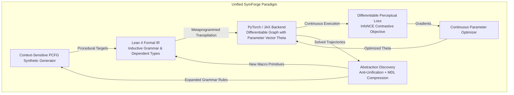
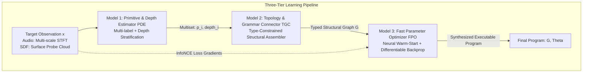
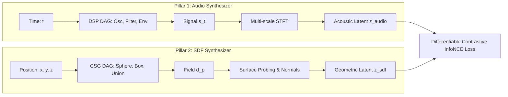
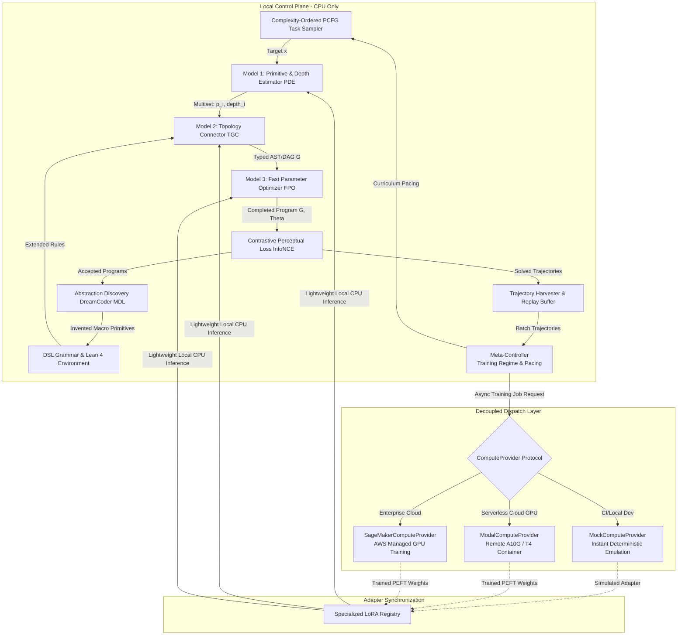

# SymForge: Neurosymbolic Procedural Program Synthesis

> **Cost-Aware Differentiable Neurosymbolic Program Synthesis with Lean 4 Formal IR, Contrastive Perceptual Loss, and Procedural Abstraction Discovery**

[](LICENSE)
[](https://leanprover.github.io/)
[](https://www.python.org/)
[](tests/)
[](docs/architecture/unified_synthesis_architecture.md)

---

## 1. Overview

**SymForge** is a universal neurosymbolic framework designed for the procedural synthesis of structured programs (Typed Abstract Syntax Trees - ASTs and Canonical Directed Acyclic Graphs - DAGs). Its primary objective is to **autonomously discover how to combine known computational primitives and optimize continuous free parameters** to reconstruct complex reference targets with perceptual fidelity and minimized hardware execution cost.

The system operates under a **fundamental isomorphism**: discovering analog/FM audio timbres (1D DSP), generating CAD solids and procedural PBR textures (3D SDF/Shaders), or superoptimizing low-level CPU instructions (Assembly/SIMD) all follow an identical mathematical formulation:

```text
+---------------------------------------------------------------------------------------------------+
|                                  UNIFIED SYMFORGE PARADIGM                                        |
|                                                                                                   |
|  +--------------------+       +----------------------+       +---------------------------------+  |
|  |   PCFG / Context   | ----> |  Lean 4 Formal IR    | ----> | Differentiable Perceptual Loss  |  |
|  | Synthetic Generator|       | (Typed AST / DAG)    |       |      (InfoNCE Contrastive)      |  |
|  +--------------------+       +----------+-----------+       +----------------+----------------+  |
|            ^                             | Transpilation                      |                   |
|            |                             v Metaprogramming                    v Gradients         |
|            |                  +----------+-----------+               +--------+-------+           |
|            +----------------- | PyTorch/JAX Backend  | <------------ |   Continuous   |           |
|             New Primitives    | & 3-Tier Pipeline    | Solved        |   Optimizer    |           |
|             in Grammar        +----------------------+ Trajectories  +----------------+           |
+---------------------------------------------------------------------------------------------------+
```



---

## 2. The Three-Tier Synthesis Pipeline

Rather than treating program synthesis as an end-to-end monolithic black box (which suffers from exponential search spaces and gradient instabilities), SymForge decomposes synthesis into **three orthogonal learning stages**:

```text
+---------------------------------------------------------------------------------------------------+
|                               THREE-TIER NEUROSYMBOLIC PIPELINE                                   |
|                                                                                                   |
|  [Target Observation: x]                                                                          |
|         |                                                                                         |
|         v                                                                                         |
|  +-------------------------------------+                                                          |
|  | MODEL 1: Primitive & Depth          | ---> Predicts: Primitive Multiset {(p_i, depth_i)}        |
|  | Estimator (PDE)                     |      (Which modules exist and at what hierarchy level)   |
|  +-------------------------------------+                                                          |
|         |                                                                                         |
|         v                                                                                         |
|  +-------------------------------------+                                                          |
|  | MODEL 2: Topology & Grammar         | ---> Predicts: Valid Typed Structural Graph G in L(Gamma)|
|  | Connector (TGC)                     |      (How primitives connect without parameter noise)     |
|  +-------------------------------------+                                                          |
|         |                                                                                         |
|         v                                                                                         |
|  +-------------------------------------+                                                          |
|  | MODEL 3: Fast Continuous Parameter  | ---> Optimizes: Continuous Parameter Vector Theta in R^K |
|  | Optimizer (FPO)                     |      (Fast warm-start regression + autograd descent)     |
|  +-------------------------------------+                                                          |
|         |                                                                                         |
|         v                                                                                         |
|  [Completed Program: (G, Theta)]                                                                  |
+---------------------------------------------------------------------------------------------------+
```



1. **Model 1: Primitive & Depth Estimator (PDE):** Evaluates the target $x$ and predicts the *multiset* of primitives present alongside their hierarchical tree depth ($\ell \in \{0, \dots, D_{\max}\}$). Operates with $0.23\text{ ms}$ CPU latency and F1 $\ge 95\%$.
2. **Model 2: Topology & Grammar Connector (TGC):** Receives the stratified multiset and assembles the exact topological AST $G \in \mathcal{L}(\Gamma)$ using type-guided beam search, bypassing parameter optimization completely ($0.38\text{ ms}$ CPU latency).
3. **Model 3: Fast Parameter Optimizer (FPO):** Once the structure is fixed, performs warm-start parameter initialization followed by rapid autograd gradient descent over the InfoNCE loss, converging in $\le 30$ steps with $> 80\%$ loss reduction.

---

## 3. The Three Project Pillars

```text
+---------------------------------------------------------------------------------------------------+
|                              ISOMORPHISM MATRIX: AUDIO vs. SDF                                    |
|                                                                                                   |
|  Concept                  Audio Synthesizer (1D DSP)             SDF Synthesizer (3D CSG)         |
|  -----------------------  -------------------------------------  -------------------------------- |
|  Spatial/Domain Input     t in R (Continuous Time)               p = (x,y,z) in R^3 (Coordinates) |
|  Continuous Output        s(t) in [-1, 1] (Acoustic Pressure)    d(p) in R (Signed Distance)      |
|  Composition / Boolean    Mix(s1, s2, w) / FM(carrier, mod)      Union / SmoothUnion(d1, d2, k)   |
|  Domain Transform         Time Delay / Frequency Modulation      Translation / Rotation / Scale   |
|  Perceptual Extractor     Multi-scale STFT Spectral Log-Mag      Surface Points / Normal Probes   |
|  Latent Contrast Space    Acoustic Embedding z_audio             Geometric Embedding z_sdf        |
+---------------------------------------------------------------------------------------------------+
```



### 3.1 Pillar 1: Audio Synthesizer (1D Procedural DSP & SFX)
- **Domain:** Continuous audio signals $s(t) \in [-1, 1]$ sampled at 16 kHz / 44.1 kHz.
- **Known Primitives:** Oscillators (`Sine`, `Saw`, `Square`, `Noise`), envelopes (`ADSR`, `ExpDecay`), modulators (`LFO`, `FM`), and filters (`LowPass`, `Gain`, `Mix`).
- **Target:** Inverse synthesis of sound effects (SFX), foley, acoustic instruments, and synthesizer presets.
- **Perceptual Alignment:** Multi-scale Short-Time Fourier Transform (STFT) log-magnitude features invariant to phase shifts.

### 3.2 Pillar 2: SDF & Material Synthesizer (3D Implicit Geometry & PBR Textures)
- **Domain:** Continuous scalar distance fields $d(\mathbf{p}) \in \mathbb{R}$ and surface properties (color, roughness, normal maps) for $\mathbf{p} \in \mathbb{R}^3$.
- **Known Primitives:** Analytical shapes (`Sphere`, `Box`, `Cylinder`, `Torus`, `Plane`), affine transforms (`Translate`, `Rotate`, `Scale`), CSG booleans (`Union`, `Difference`, `Intersection`, `SmoothUnion`), and procedural noise.
- **Target:** Reconstruction of CAD parts, mechanical solids, and procedural shaders via analytical renderers (Raymarching, Cone-Marching).
- **Perceptual Alignment:** Stratified surface sampling on the zero-level set ($\varepsilon$-boundary) and central finite difference normal probes.

### 3.3 Pillar 3: Generalization (Universal Neurosymbolic Core & Hardware Superoptimization)
- **Domain-Agnostic Core:** Operates over any procedural logic expressible as a typed DAG of parameterized modules.
- **Hardware Superoptimization:** Superoptimizing x86/ARM/SIMD basic block instruction sequences (BHive benchmark) to minimize hardware execution latency while strictly preserving semantic equivalence.
- **Foundational Mechanisms:**
  1. **Lean 4 Formal IR:** Inductive types and dependent types guaranteeing compile-time structural invariants.
  2. **Differentiable Transpilation:** Automated compilation of ASTs into PyTorch/JAX `nn.Module` graphs bundling continuous parameters into a unified tensor $\Theta \in \mathbb{R}^K$.
  3. **DreamCoder Abstraction Discovery:** Minimum Description Length (MDL) compression and syntactic anti-unification (LGG) discovering reusable macro-primitives.
  4. **Adaptive Curriculum in the ZPD:** Pacing difficulty within the Zone of Proximal Development ($0.2 \le S(c) \le 0.8$).

---

## 4. Formal Intermediate Representation in Lean 4

To guarantee mathematical soundness and prevent candidates with invalid types or numerical instabilities, **Lean 4** serves as SymForge's symbolic front-end:

```lean
-- Definition of Free Parameters and Inductive Grammars in Lean 4
structure FreeParam where
  id : String
  min : Float
  max : Float

inductive AudioNode : Type where
  | sine (freq : FreeParam) : AudioNode
  | noise (seed : Int) : AudioNode
  | lowpass (cutoff : FreeParam) (res : FreeParam) (input : AudioNode) : AudioNode
  | mix (ratio : FreeParam) (input1 : AudioNode) (input2 : AudioNode) : AudioNode

inductive SDFNode : Type where
  | sphere (radius : FreeParam) : SDFNode
  | box (width height depth : FreeParam) : SDFNode
  | union (smoothness : FreeParam) (a b : SDFNode) : SDFNode
```

### Transpiler Pipeline:
1. **Symbolic Front-End (Lean 4):** Validates typing, deduplicates identical subexpressions into canonical DAGs via Common Subexpression Elimination (CSE), and emits ASTs.
2. **Metaprogramming Transpiler:** Traverses the syntax tree and emits the equivalent differentiable PyTorch `nn.Module` (or JAX computational graph), bundling all free parameters into a continuous tensor $\Theta \in \mathbb{R}^K$.
3. **Differentiable Back-End (PyTorch / Autograd):** Computes high-speed vectorized forward passes, evaluates perceptual loss against reference targets, and optimizes $\Theta$ via gradient descent.

---

## 5. Differentiable Contrastive Perceptual Loss (InfoNCE)

Raw point-to-point loss functions ($L_1 / L_2$ in the time domain for audio, or deep coordinate distances for SDFs) fail catastrophically at capturing human perception: slight phase shifts in audio cause maximal error despite sound identity; interior coordinate differences in a 3D solid do not affect visible surface geometry.

SymForge anchors similarity in a **contrastive normalized perceptual latent space**:

$$\mathcal{L}_{\text{contrast}}(\hat{f}, f^*, \{f^-_j\}) = -\log \frac{\exp\left(\frac{\mathbf{z}_{\hat{f}} \cdot \mathbf{z}_{f^*}}{\tau}\right)}{\exp\left(\frac{\mathbf{z}_{\hat{f}} \cdot \mathbf{z}_{f^*}}{\tau}\right) + \sum_{j=1}^{K} \exp\left(\frac{\mathbf{z}_{\hat{f}} \cdot \mathbf{z}_{f^-_j}}{\tau}\right)}$$

The total multi-objective loss balances perceptual fidelity, local reconstruction, and compiled hardware cost:

$$\mathcal{J}(G, \theta) = \lambda_{\text{contrast}} \mathcal{L}_{\text{contrast}} + \lambda_{\text{rec}} \mathcal{L}_{\text{rec}}(\hat{f}, f^*) + \lambda_{\text{cost}} C_H(G)$$

---

## 6. Procedural PCFG & Three-Tier Dataset Taxonomy

To mitigate the **Self-Mimicry Trap** (where models merely reproduce an arbitrary uniform prior), SymForge incorporates a **Triple Quality Filter** (Physical Validity, Perceptual Entropy, Semantic DAG Deduplication) and categorizes data into three strategic tiers:

| Tier | Category | Datasets / Sources | Primary Role in Lifecycle |
|---|---|---|---|
| **Tier 1** | **Procedural PCFG (Zero-Disk)** | `Audio-PCFG`, `SDF-PCFG`, Negative Contrastive Banks | Continuous training, ZPD adaptive curriculum, infinite in-memory contrastive pairs (< 200 MB RAM). |
| **Tier 2** | **Controlled Benchmarks** | `NSynth`, `TorchSynth`, `Dexed/Synth1 Patches`, `CSGNet 3D`, `DreamCoder Suite` | Program reconstruction accuracy, continuous parameter convergence, baseline comparisons. |
| **Tier 3** | **Real-World / OOD Transfer** | `ABC CAD Dataset (1M)`, `ShapeNet/PartNet`, `MatSynth`, `Shadertoy 100k`, `BHive (x86)` | Out-of-distribution generalization, physical solid CAD synthesis, hardware superoptimization. |

---

## 7. Decoupled Architecture: Zero Heavy Local Training Footprint

To ensure responsive development and prevent local machine resource exhaustion:
- **Local Control Plane (CPU-Only):** Runs the Lean 4 compiler, discrete search (A* / Beam Search), vectorized NumPy evaluation, and the DreamCoder MDL compression engine.
- **Decoupled Compute Plane (Cloud / Mock):** Continuous parameter fitting and LoRA fine-tuning are abstracted behind the asynchronous `ComputeProvider` protocol. Supports instantaneous zero-cost deterministic simulation (`MockComputeProvider`) or serverless GPU dispatch (Modal A10G/T4, AWS SageMaker).

```text
+-------------------------------------------------------------------------------------------------+
|                                    LOCAL CONTROL PLANE (CPU-ONLY)                               |
|                                                                                                 |
|   +-----------------------+       +------------------------+       +------------------------+   |
|   |  Adaptive Curriculum  | ----> |  3-Tier Neural Synth   | ----> |  Abstraction Discovery |   |
|   |  (PCFG Task Generator)|       |  (PDE -> TGC -> FPO)   |       |  (DreamCoder / MDL)    |   |
|   +-----------------------+       +-----------+------------+       +-----------+------------+   |
|               ^                               |                                |                |
|               | Task Feedback                 v Evaluation & Loss              v New Primitives |
|   +-----------+-----------+       +-----------+------------+       +-----------+------------+   |
|   |    Meta-Controller    | <---  | Contrastive Perceptual |       |    DSL Grammar Library |   |
|   | (Pacing & Regimes)    |       | Loss Engine (InfoNCE)  | ----> | (Lean 4 Inductive Env) |   |
|   +-----------+-----------+       +-----------+------------+       +------------------------+   |
|               |                               |                                                 |
+---------------|-------------------------------|-------------------------------------------------+
                | Replay Trajectories           | Download Weights
                v                               v
+-------------------------------------------------------------------------------------------------+
|                                 REMOTE COMPUTE & DISPATCH PLANE                                 |
|                                                                                                 |
|                          +------------------------------------------+                           |
|                          |     ComputeProvider (Async Protocol)     |                           |
|                          +--------------------+---------------------+                           |
|                                               |                                                 |
|                 +-----------------------------+-----------------------------+                   |
|                 |                             |                             |                   |
|                 v                             v                             v                   |
|   +---------------------------+ +---------------------------+ +---------------------------+     |
|   |    MockComputeProvider    | |    ModalComputeProvider   | |  SageMakerComputeProvider |     |
|   |    (Local 0-Cost / CI)    | |   (Serverless GPU A10G)   | |   (AWS Cloud Cluster)     |     |
|   +---------------------------+ +---------------------------+ +---------------------------+     |
+-------------------------------------------------------------------------------------------------+
```



---

## 8. Repository Structure & Technical Documentation

- `conductor/`: Project governance, track registers, and spec-driven implementation plans.
  - `tracks/curriculum_abstraction_remote_training_202505/`: Full specification (`spec.md`) and implementation plan (`plan.md`).
- `docs/architecture/`:
  - `unified_synthesis_architecture.md`: Mathematical foundations, structural isomorphism, and InfoNCE formulations.
  - `three_tier_neural_synthesis.md`: Detailed specification of the 3-Tier Neurosymbolic Pipeline (PDE, TGC, FPO).
  - `grammar_learning_pcfg_phog_and_ast_extraction.md`: Grammar engineering, Tree-sitter CST-to-AST normalization, and PHOG/PCFG training.
  - `datasets_and_benchmarks.md`: Procedural data catalog and domain benchmarks.
  - `extended_datasets_and_lean4_ir.md`: Lean 4 formal transpiler specification and expanded domains (Shaders, Hardware, SFX).
- `src/symforge/`: Core Python library:
  - `core/`: AST, DAG, Lean IPC bridge, PCFG generator, differentiable transpiler.
  - `audio/`: 1D DSP primitives and multi-scale STFT feature extractor.
  - `sdf/`: 3D analytical shapes, spatial transforms, CSG booleans, and surface raymarching probe.
  - `models/`: The 3-Tier Pipeline: PDE (`pde.py`), TGC (`tgc.py`), FPO (`fpo.py`).
  - `compute/`: `ComputeProvider` protocol, Pydantic contracts, Mock, Modal, and SageMaker backends.
  - `adapters/`: LoRA linear layers, modular adapter registry, dynamic CPU hot-swapping loader.
  - `abstraction/`: Anti-unification, MDL compression evaluator, and dynamic grammar expander.
  - `curriculum/`: Competency frontier tracker and ZPD sampler.
  - `orchestration/`: Meta-controller wake-sleep loop and financial Pre-Flight Cost Watchdog.
  - `resilience/`: Library bloat pruner with safe leaf inlining and offline circuit breaker queue.
- `packages/lean/symforge_ir/`: Formal Lean 4 package with inductive types, theorems, and Lake project.
- `tests/`: 352 automated unit, integration, and property tests achieving 100% pass rate.

---

## 9. Running Tests

To run the complete automated test suite locally:

```bash
# Activate virtual environment
source .venv/bin/activate

# Run all 352 test cases
pytest -v tests/

# Build and verify the Lean 4 formal package
cd packages/lean/symforge_ir && lake build && cd ../../..

# Verify architectural compliance (Code Guard)
python3 ~/.gemini/skills/code-guard-validator/scripts/validate_rules.py .
```

---

## 10. License

This project is licensed under the [Apache 2.0 License](LICENSE).
