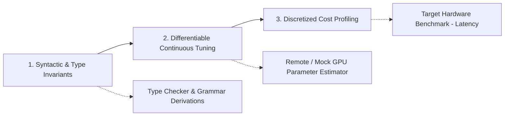

# Product Guidelines: SymForge

## 1. Design & Engineering Philosophy

- **Symbolic Integrity Over Black-Box Approximations:** Continuous relaxations and neural models are guidance tools, never the final arbiters of truth. Every output program must be a valid, type-safe, interpretable symbolic AST/DAG.
- **Cost-First Architecture:** Shorter code is not necessarily faster code. Execution cost metrics must reflect actual target hardware profiling (arithmetic intensity, branch divergence, compiled latency) rather than trivial node counts.
- **Zero Local Waste (Compute Decoupling):** Local machines must remain responsive and lightweight. All heavy continuous gradient optimizations across large datasets or LoRA updates must be strictly abstracted behind cloud jobs or mockable asynchronous dispatchers.
- **Deterministic Reproducibility:** Every synthesis experiment, curriculum progression, and abstraction discovery run must be fully seedable, auditable, and replayable from structured JSON/YAML run manifests.

## 2. Architecture & Quality Principles

```text
+-------------------+      +-------------------+      +-------------------+
|  1. Syntactic &   | ---> | 2. Differentiable | ---> |   3. Discretized  |
|   Type Invariants |      |  Continuous Tuning|      | Cost Profiling    |
+-------------------+      +-------------------+      +-------------------+
          |                          |                          |
          v                          v                          v
   Type Checker &            Remote / Mock GPU          Target Hardware
  Grammar Derivations       Parameter Estimator       Benchmark (Latency)
```



1. **Symmetrical Validation:** Every operation (AST serialization, DAG normalization, parameter packing) must possess a proven inverse and round-trip invariant check ($f^{-1}(f(x)) = x$).
2. **Fail-Fast Typing:** Ill-typed expressions are pruned at generation time, not at evaluation time.
3. **Resilient Asynchronous Boundaries:** Any remote compute dispatch (e.g. AWS SageMaker or Modal API) must have hard timeouts, exponential backoff with jitter, retry caps, and fallbacks to deterministic mock policies.
4. **Introspective Error Reporting:** Exceptions must log the AST state, type context, active hole, and parameter bounds to enable frictionless debugging.

## 3. CLI & Developer Experience

- **Intuitive Workflows:** Clear command-line interface (`symforge synth`, `symforge curriculum`, `symforge compress`, `symforge train --remote`).
- **Real-Time Progress & ETA:** Iterative search and batch jobs must report throughput, current depth/frontier, and dynamic ETA without terminal spam.
- **Dry-Run & Cost Pre-Flight Checks:** Every cloud training dispatch must prompt or inspect estimated costs (via pricing metadata) prior to remote execution.
