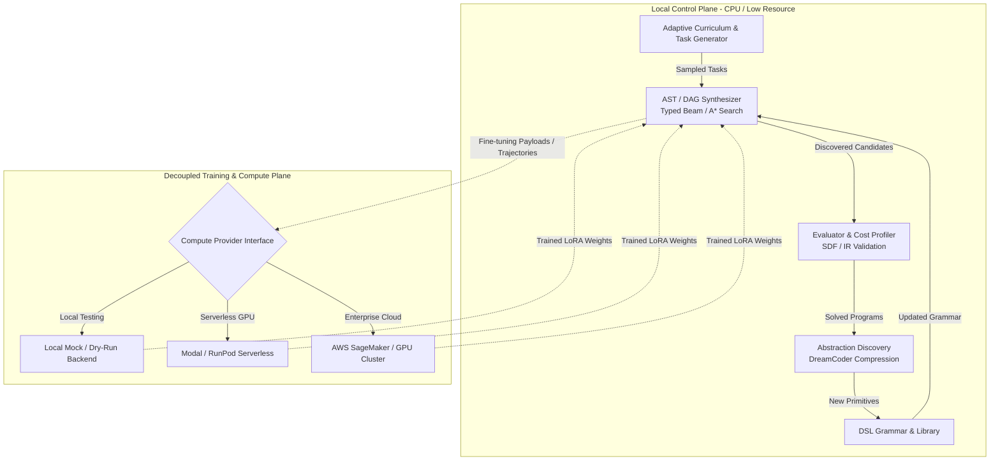

# Product Definition: SymForge

## 1. Executive Summary

**SymForge** is a neurosymbolic program synthesis framework that discovers executable, typed programs (ASTs and DAGs) from input-output observations under explicit execution cost constraints. By combining typed grammar expansion, continuous parameter optimization via differentiable relaxations, subexpression sharing in Directed Acyclic Graphs (DAGs), and amortized neural search policies, SymForge produces verifiable, interpretable, and computationally efficient programs.

SymForge is explicitly architected with a **decoupled, hybrid execution model**:
- **Local Control Plane:** Executes typed discrete search, dynamic AST/DAG expansion, subexpression deduplication, program verification, DreamCoder-style abstraction compression, and curriculum orchestration on local consumer hardware without requiring heavy local GPUs.
- **Remote / Cloud Compute Plane (Pluggable):** Delegates compute-intensive continuous parameter fine-tuning, neural policy updates, and specialized Low-Rank Adaptation (LoRA) training to remote execution providers (e.g., AWS SageMaker, Modal, RunPod, or remote GPU clusters) or deterministic local mock backends.

```text
+--------------------------------------------------------------------------+
|                            LOCAL CONTROL PLANE                           |
|                                                                          |
|  +--------------------+    +---------------------+    +---------------+  |
|  | Adaptive Curriculum| -> | AST / DAG Synthesizer| -> |  Abstraction  |  |
|  | & Task Generator   |    | (Typed Beam/A* Search)    |   Discovery   |  |
|  +--------------------+    +----------+----------+    +-------+-------+  |
|                                       |                       |          |
|                                       v                       v          |
|                             +--------------------+    +---------------+  |
|                             | Evaluator & Cost   |    | New Primitives|  |
|                             | Profiler (SDF/IR)  |    | Library (DSL) |  |
|                             +---------+----------+    +---------------+  |
+---------------------------------------|----------------------------------+
                                        | Dispatches Fine-tuning & Weights
                                        v
+--------------------------------------------------------------------------+
|                     DECOUPLED COMPUTE / CLOUD PLANE                      |
|                                                                          |
|  +----------------------+  +---------------------+  +-----------------+  |
|  | Local Mock Provider  |  | Remote GPU Runner   |  | AWS SageMaker / |  |
|  | (Deterministic/Test) |  | (Modal / RunPod API)|  | Custom Cluster  |  |
|  +----------------------+  +---------------------+  +-----------------+  |
+--------------------------------------------------------------------------+
```



## 2. Core Capabilities & Value Proposition

1. **Typed Grammar Guidance:** Guaranteed syntactic and semantic validity by construction. Holes are filled strictly with type-compatible productions.
2. **Dynamic Structural Growth (AST to DAG):** Programs grow dynamically with topological ordering, enabling subexpression reuse without combinatorial adjacency-matrix explosion.
3. **Adaptive Curriculum with Competency Frontiers:** Automated teacher-student difficulty pacing that generates increasingly challenging synthesis tasks tailored to the current capability frontier.
4. **Abstraction Discovery (Library Learning):** Automatic extraction of common programmatic subgraphs, compressing them into reusable macro-primitives that expand the DSL grammar.
5. **Incremental Fine-Tuning with Specialized LoRAs:** Modulates neural search heuristics using domain-specific LoRA adapters without catastrophic forgetting or full checkpoint retraining.
6. **Zero Local Training Footprint:** Decoupled training engine protocol allowing 100% local development, testing, and synthesis while abstracting model training behind cloud APIs.

## 3. The Three Project Pillars & Unified Paradigm

SymForge addresses program synthesis across two concrete, physically disparate modalities by casting them into an identical mathematical and neurosymbolic framework, followed by domain-agnostic generalization:

### 3.1 Pillar 1: Audio Synthesizer (1D Procedural DSP)
- **Domain:** Continuous 1D time-series signals $s(t) \in [-1, 1]$.
- **Primitives:** Generators (Sine, Saw, Square, Noise), Envelopes (ADSR, Exponential Decay), Filters (LowPass, HighPass, BandPass), Modulators (LFO, FM, AM).
- **Perceptual Alignment:** Multi-scale Short-Time Fourier Transform (STFT) log-magnitude and phase-invariant spectral embeddings.
- **Contrastive Objective:** Discriminates target acoustic timbres against synthetic distractors in normalized spectral latent space.

### 3.2 Pillar 2: SDF Synthesizer (3D Implicit Geometry)
- **Domain:** Continuous spatial fields $f(\mathbf{p}) \in \mathbb{R}$ where $\mathbf{p} \in \mathbb{R}^3$.
- **Primitives:** Analytical shapes (Sphere, Box, Cylinder, Torus), Affine Transforms (Translate, Rotate, Scale), CSG Combinators (Union, Difference, SmoothUnion).
- **Perceptual Alignment:** $\varepsilon$-boundary surface distance evaluation and multi-angle ray-marched silhouettes/depth.
- **Contrastive Objective:** Discriminates target geometric forms against topological distractors and non-matching CSG variants.

### 3.3 Pillar 3: Generalization (Universal Neurosymbolic Core)
- **Domain-Agnostic Engine:** Typed AST and DAG representation with dynamic hole filling (`Hole[T]`) and structural deduplication.
- **Procedural Task Generation:** Probabilistic Context-Free Grammars (PCFG) and Context-Sensitive Attribute Grammars generating infinite synthetic benchmark tasks with guaranteed physical and numerical stability.
- **Unified Contrastive Perceptual Loss:** Generic InfoNCE formulation anchoring program outputs in perceptual embedding space.
- **Abstraction Discovery (Library Learning):** Syntactic anti-unification and Minimum Description Length (MDL) compression promoting recurrent subgraphs into first-class reusable macro-primitives.
- **Decoupled Training Dispatch:** Zero local heavy training footprint; asynchronous delegation of LoRA fine-tuning to remote compute providers.

For comprehensive architectural design and mathematical formulations, refer to `docs/architecture/unified_synthesis_architecture.md`.
