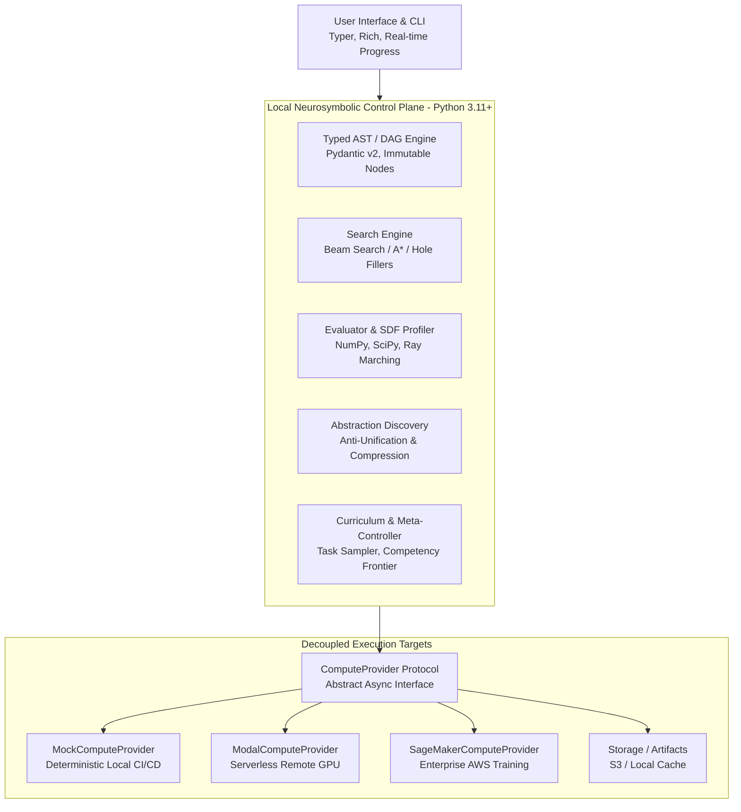

# Technology Stack: SymForge

## 1. Core Technical Components

```text
+--------------------------------------------------------------------------+
|                            USER INTERFACE & CLI                          |
|  - Typer / Click CLI                                                     |
|  - Rich (Console Formatting & Real-time Progress Tracking)               |
+--------------------------------------------------------------------------+
                                     |
                                     v
+--------------------------------------------------------------------------+
|                     LOCAL NEUROSYMBOLIC CONTROL PLANE                    |
|  - Python 3.11+ (Strict typing, structural pattern matching)             |
|  - Pydantic v2 (Schema validation, immutable AST/DAG models)             |
|  - Typed Graph Engine (NetworkX / Canonical DAG & Anti-Unification)       |
|  - NumPy & SciPy (Fast spatial evaluations, SDF ray tracing math)        |
|  - Lightweight CPU Inference (ONNX Runtime / PyTorch CPU)                |
+--------------------------------------------------------------------------+
                                     |
                                     v
+--------------------------------------------------------------------------+
|                  REMOTE COMPUTE DISPATCH & STORAGE LAYER                 |
|  - ComputeProvider Protocol (Async Python Protocol / ABC)                |
|  - Providers: MockProvider, ModalProvider, SageMakerProvider, S3Provider |
|  - HTTPX / Aiohttp (Resilient async client with timeouts & retries)      |
+--------------------------------------------------------------------------+
```



## 2. Technology Selection & Rationales

| Layer | Technology | Rationale |
|---|---|---|
| **Language** | Python 3.11+ | Native structural pattern matching, robust async support, rich scientific ecosystem. |
| **Data Modeling** | Pydantic v2 & Dataclasses | Strict runtime validation, high serialization performance, immutable AST models. |
| **Graph & Symbolic IR** | Pure Python Typed Graphs / NetworkX | Fast topological sorting, subexpression deduplication, canonical string serialization without heavy native bindings. |
| **Numeric & Evaluator** | NumPy, SciPy | High-performance vectorized evaluation of SDF points and geometry without requiring GPU overhead for discrete evaluation. |
| **Inference (Local)** | ONNX Runtime / PyTorch (CPU) | Minimal footprint, sub-millisecond local forward passes for production prior distributions and heuristics. |
| **Remote Orchestration** | Asynchronous ComputeProvider | Complete decoupling of heavy gradient updates and LoRA fine-tuning from local execution. |
| **Async Networking** | HTTPX | Fully typed, HTTP/2 support, explicit connection/read timeouts, connection pooling. |
| **Testing & Quality** | Pytest, Pytest-Asyncio, Hypothesis, Ruff | Property-based testing for symbolic symmetry, fast async testing, strict formatting and linting. |

## 3. Environment & Dependency Management

- **Package Manager:** `pip` / `uv` with `pyproject.toml`
- **Configuration:** Environment variables (`.env`) validated via `pydantic-settings`
- **Linting & Formatting:** `ruff check` and `ruff format`
- **Type Checking:** `mypy --strict`
