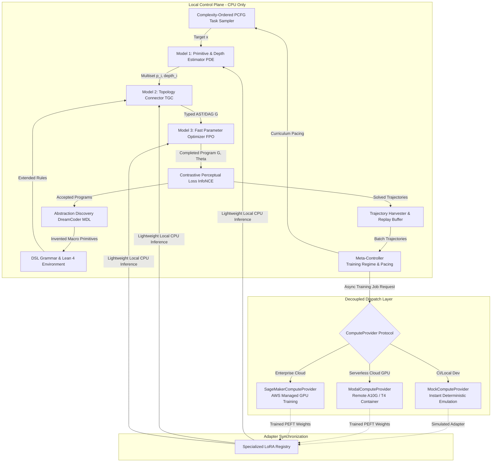
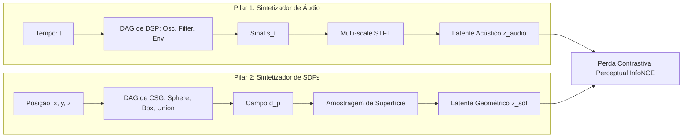

# Specification: Adaptive Curriculum with Abstraction Discovery and Remote Decoupled Fine-Tuning

**Track ID:** `curriculum_abstraction_remote_training_202505`  
**Type:** Feature / Architecture  
**Status:** Approved  
**Date:** 2026-10-16  

---

## 1. Executive Summary & Problem Statement

The goal of **SymForge** is cost-aware differentiable program synthesis over typed grammars with dynamic structural growth and subexpression sharing. To establish a universal framework, the project solves both **Audio (1D Procedural DSP)** and **SDF (3D Implicit Geometry)** in parallel, governed by a unified **3-Tier Neurosymbolic Pipeline**:

1. **Model 1: Primitive & Depth Estimator (PDE):** Identifies *which* primitives are present in the target observation and at *what hierarchical level / depth* of the composition each primitive resides.
2. **Model 2: Topology & Grammar Connector (TGC):** Assembles the predicted multiset of primitives and depth strata into a valid typed AST/DAG $G \in \mathcal{L}(\Gamma)$.
3. **Model 3: Fast Parameter Optimizer (FPO):** Rapidly predicts warm-start continuous parameters $\Theta_0$ and executes fast differentiable autograd refinement over the InfoNCE perceptual loss.

```text
+-------------------------------------------------------------------------------------------------+
|                                    LOCAL CONTROL PLANE (CPU-ONLY)                               |
|                                                                                                 |
|   +-----------------------+       +------------------------+       +------------------------+   |
|   | Complexity Curriculum | ----> |  3-Tier Neural Synth   | ----> |  Abstraction Discovery |   |
|   | (PCFG Task Generator) |       |  (PDE -> TGC -> FPO)   |       |  (DreamCoder / MDL)    |   |
|   +-----------------------+       +-----------+------------+       +-----------+------------+   |
|               ^                               |                                |                |
|               | Task Feedback                 v Evaluation & Loss              v New Primitives |
|   +-----------+-----------+       +-----------+------------+       +-----------+------------+   |
|   |    Meta-Controller    | <---  | Contrastive Perceptual |       |    DSL Grammar Library |   |
|   | (Pacing & Regimes)    |       | Loss Engine (InfoNCE)  | ----> | (Lean 4 Inductive Env) |   |
|   +-----------+-----------+       +-----------+------------+       +------------------------+   |
|               |                               |                                                 |
+---------------|-------------------------------|-------------------------------------------------+
                | Replay Trajectories           | Download Weights
                v                               v
+-------------------------------------------------------------------------------------------------+
|                                 REMOTE COMPUTE & DISPATCH PLANE                                 |
|                                                                                                 |
|                          +------------------------------------------+                           |
|                          |     ComputeProvider (Async Protocol)     |                           |
|                          +--------------------+---------------------+                           |
|                                               |                                                 |
|                 +-----------------------------+-----------------------------+                   |
|                 |                             |                             |                   |
|                 v                             v                             v                   |
|   +---------------------------+ +---------------------------+ +---------------------------+     |
|   |    MockComputeProvider    | |    ModalComputeProvider   | |  SageMakerComputeProvider |     |
|   |    (Local 0-Cost / CI)    | |   (Serverless GPU A10G)   | |   (AWS Cloud Cluster)     |     |
|   +---------------------------+ +---------------------------+ +---------------------------+     |
+-------------------------------------------------------------------------------------------------+
```



---

## 2. The Three Project Pillars

```text
+---------------------------------------------------------------------------------------------------+
|                              MAPA DE ISOMORFISMO: ÁUDIO vs. SDF                                   |
|                                                                                                   |
|  Conceito                 Sintetizador de Áudio (1D DSP)         Sintetizador de SDF (3D CSG)     |
|  -----------------------  -------------------------------------  -------------------------------- |
|  Entrada Espacial         t in R (Tempo)                         p = (x,y,z) in R^3 (Posição)     |
|  Saída Contínua           s(t) in [-1, 1] (Pressão Acústica)     d(p) in R (Distância à Superf.)  |
|  Operação Booleana/Mix    Mix(s1, s2, w) / RingMod(s1, s2)       Union / SmoothUnion(d1, d2, k)   |
|  Transformação de Domínio Shift Temporal / Pitch Shift           Translação / Rotação / Escala    |
|  Extrator Perceptual      Multi-scale STFT / Mel Filterbanks     Surface Sampling / Raymarching   |
|  Espaço de Contraste      Latente Espectral (Audio Latent)       Latente Geométrico (Shape Latent)|
+---------------------------------------------------------------------------------------------------+
```



### 2.1 Pilar 1: Sintetizador de Áudio (DSP Procedural 1D)
- **Representação:** Grafo computacional acíclico (DAG) mapeando tempo discreto $t \in [0, T]$ para sinal de áudio $s(t) \in [-1, 1]$.
- **Primitivas Conhecidas:**
  - *Fontes Sonoras:* `Sine(freq, phase)`, `Saw(freq)`, `Square(freq, pulse_width)`, `Noise(seed)`.
  - *Envelopes & Moduladores:* `ADSR(attack, decay, sustain, release)`, `ExpDecay(half_life)`, `LFO(freq, waveform)`, `FM(carrier, modulator, depth)`.
  - *Filtros & Misturas:* `LowPass(cutoff, resonance)`, `HighPass(cutoff, resonance)`, `Gain(amplitude)`, `Mix(sig1, sig2, ratio)`.
- **Perda Perceptual de Contraste:** Extrai características de magnitude espectral via STFT em múltiplas resoluções temporais (ex: 512, 1024, 2048 samples) e calcula distância contrastiva InfoNCE contra ruídos e distratores harmônicos.

### 2.2 Pilar 2: Sintetizador de SDFs (Geometria Implícita 3D)
- **Representação:** Grafo computacional acíclico (DAG) mapeando coordenadas espaciais $\mathbf{p} \in \mathbb{R}^3$ para distância com sinal $d(\mathbf{p}) \in \mathbb{R}$.
- **Primitivas Conhecidas:**
  - *Formas Analíticas:* `Sphere(radius)`, `Box(half_extents)`, `Cylinder(radius, height)`, `Torus(r_major, r_minor)`, `Plane(normal, offset)`.
  - *Transformações Afins:* `Translate(sdf, offset)`, `Rotate(sdf, angles)`, `Scale(sdf, factor)`.
  - *Operadores Booleanos & Suavização:* `Union(sdf1, sdf2)`, `Difference(sdf1, sdf2)`, `Intersection(sdf1, sdf2)`, `SmoothUnion(sdf1, sdf2, k)`.
- **Perda Perceptual de Contraste:** Amostragem estratificada na isosuperfície ($\varepsilon$-boundary) e silhuetas renderizadas por raymarching com contraste InfoNCE contra formas geometricamente dissimilares.

### 2.3 Pilar 3: Generalização (Universal Neurosymbolic Core)
- **Gramática Tipada e Hole Expansion:** Expansão progressiva de buracos tipados `Hole[T]` em ASTs com conversão canônica para DAGs (deduplicação de subexpressões puras).
- **Gerador Procedural por PCFG:** Amostragem dirigida por regras probabilísticas com restrições contextuais (impedindo clipping em áudio e interseções vazias em SDFs).
- **Descoberta de Abstrações (DreamCoder):** Identificação de subgrafos isomórficos por anti-unificação e compressão por Descrição Mínima (MDL), promovendo-os a novas produções na gramática.
- **Treinamento Desacoplado:** Protocolo assíncrono para delegar ajuste contínuo e PEFT/LoRA para provedores remotos, mantendo zero consumo de GPU local.

---

## 3. Formulação Matemática da Perda Contrastiva e PCFG

### 3.1 Gerador de Dados Sintéticos via PCFG com Contexto
Dado um conjunto de símbolos não-terminais $V$, terminais $\Sigma$, regras de produção $R$ e símbolo inicial $S$, a Probabilistic Context-Free Grammar com Restrições Contextuais define:

$$\mathbb{P}(A \to \alpha \mid \text{context}) = \frac{\exp(\mathbf{w}_{A \to \alpha} \cdot \mathbf{\phi}(\text{context}))}{\sum_{\beta \in \text{Valid}(A, \text{context})} \exp(\mathbf{w}_{A \to \beta} \cdot \mathbf{\phi}(\text{context}))}$$

Onde $\text{Valid}(A, \text{context})$ aplica filtros de estabilidade do domínio:
- Em áudio: Filtros com pólos estáveis ($|z| < 1$), ganho global normalizado ($|s(t)| \le 1.0$).
- Em SDFs: Bounding boxes sobrepostas para operadores booleanos (evitando nós mortos).

### 3.2 Perda Contrastiva Perceptual InfoNCE
Para qualquer programa candidato $(G, \theta)$ que gera função $\hat{f}$ e alvo $f^*$:
1. O extrator perceptual diferenciável $\Phi(\cdot)$ computa o vetor latente normalizado $\mathbf{z}_{\hat{f}} = \Phi(\hat{f}) / \|\Phi(\hat{f})\|_2$.
2. O objetivo contrastivo contra $K$ programas negativos $\{f^-_j\}_{j=1}^K$ com temperatura $\tau$ é dado por:

$$\mathcal{L}_{\text{contrast}}(\hat{f}, f^*, \{f^-_j\}) = -\log \frac{\exp\left(\frac{\mathbf{z}_{\hat{f}} \cdot \mathbf{z}_{f^*}}{\tau}\right)}{\exp\left(\frac{\mathbf{z}_{\hat{f}} \cdot \mathbf{z}_{f^*}}{\tau}\right) + \sum_{j=1}^{K} \exp\left(\frac{\mathbf{z}_{\hat{f}} \cdot \mathbf{z}_{f^-_j}}{\tau}\right)}$$

3. A perda global incorpora o modelo de custo computacional de hardware compilado $C_H(G)$:

$$\mathcal{J}(G, \theta) = \lambda_{\text{contrast}} \mathcal{L}_{\text{contrast}} + \lambda_{\text{rec}} \mathcal{L}_{\text{rec}}(\hat{f}, f^*) + \lambda_{\text{cost}} C_H(G)$$

---

## 4. Subprocessos e Interfaces do Sistema

### 4.1 Protocolo do Provedor de Computação Desacoplada
```python
class ComputeProvider(Protocol):
    async def submit_training_job(
        self, 
        payload: TrainingPayload, 
        config: RemoteJobConfig
    ) -> str: ...
    
    async def poll_job_status(
        self, 
        job_id: str
    ) -> JobStatusResponse: ...
    
    async def fetch_job_artifacts(
        self, 
        job_id: str, 
        destination_dir: Path
    ) -> AdapterArtifact: ...
    
    async def cancel_job(
        self, 
        job_id: str
    ) -> bool: ...
```

Provedores concretos suportados:
1. `MockComputeProvider`: Execução em < 10ms local, zero custo, ideal para testes TDD e CI/CD.
2. `ModalComputeProvider`: Serverless GPU sob demanda (NVIDIA A10G/T4).
3. `SageMakerComputeProvider`: Treinamento corporativo AWS SageMaker com persistência em S3.

### 4.2 Descoberta de Abstrações via Anti-Unificação & MDL
- **Anti-unificação:** Determina o Generalizador Menos Geral (LGG) entre soluções que atingiram limiar de perda perceptual.
- **Métrica de Descrição Mínima (MDL):**
$$\Delta \text{MDL}(\alpha) = \text{Size}(\alpha) - \sum_{p \in \mathcal{D}_{\text{solved}}} (\text{Size}(p) - \text{Size}(p[\alpha])) < 0$$
- Abstrações aceitas são registradas na gramática tipada com novas probabilidades PCFG e assinaturas formais.

---

## 5. Diretrizes de Qualidade e Critérios de Aceite

1. **Test-Driven Development (TDD):** Cobertura de testes unitários $\ge 80\%$, cobrindo nós do AST, canonicalização de DAGs, gerador PCFG, perda contrastiva e provedores remotos.
2. **Isolamento de Recursos:** Nenhum processo de treinamento pesado bloqueia a CPU local; execução sob limites estritos de memória e timeouts explícitos em todas as chamadas assíncronas.
3. **Validação Simétrica:** Serialização e desserialização de programas preservam $f(x) \equiv f^{-1}(f(x))$.
