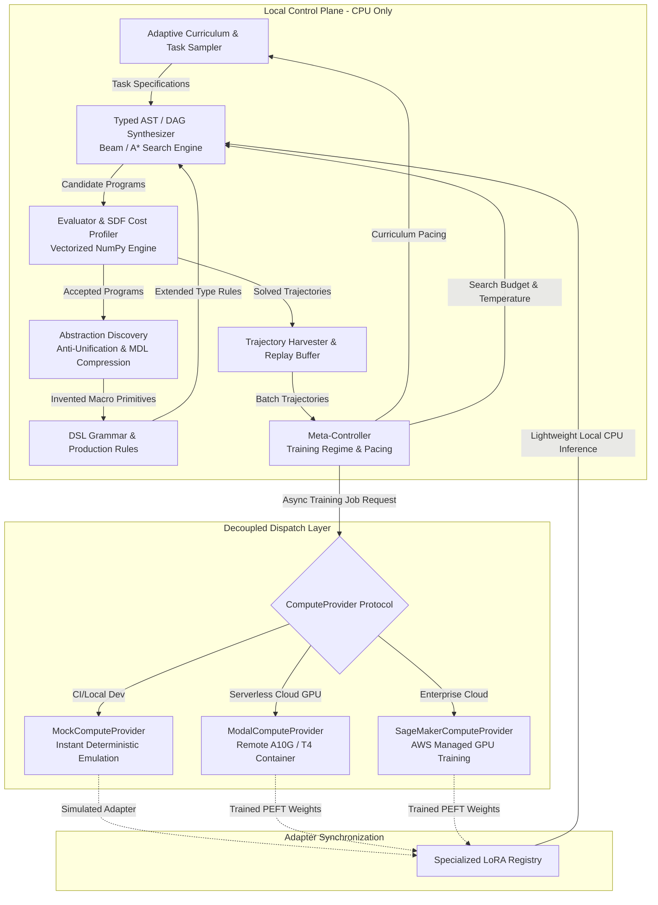

# Specification: Adaptive Curriculum with Abstraction Discovery and Remote Decoupled Fine-Tuning

**Track ID:** `curriculum_abstraction_remote_training_202505`  
**Type:** Feature / Architecture  
**Status:** In Review  
**Date:** 2025-05-18  

---

## 1. Executive Summary & Problem Statement

The goal of `symforge` is cost-aware differentiable program synthesis over typed grammars (initially Signed Distance Functions - SDFs) with dynamic structural growth and subexpression sharing. To achieve scalable neurosymbolic generalization without combinatorial explosion, the system integrates:
1. **Adaptive Curriculum:** Dynamically generating synthesis tasks along the learner's competency frontier.
2. **Incremental Fine-Tuning:** Continuously training neural search heuristics on successful trajectories without catastrophic forgetting.
3. **Specialized LoRA Adapters:** Parameter-Efficient Fine-Tuning (PEFT) targeting domain-specific structural families.
4. **Abstraction Discovery:** DreamCoder-style library learning via anti-unification and Minimum Description Length (MDL) compression to invent reusable macro-primitives.
5. **Meta-Learning of Training Regime:** Dynamically balancing search budgets, exploration temperatures, and training trigger schedules.

### The Critical Architectural Constraint
Running heavy neural training workloads (gradient backpropagation across large replay buffers, LoRA adapter tuning, full transformer checkpoint optimization) on a developer's local machine leads to thread blockage, severe thermal throttling, out-of-memory (OOM) crashes, and high execution latency.

**The Solution:** SymForge enforces a strict **Decoupled Architecture**. The local machine acts solely as the **Control Plane** (executing symbolic AST/DAG search, discrete evaluator verification, anti-unification compression, and curriculum generation). All heavy continuous parameter fine-tuning and LoRA training workloads are abstracted behind a pluggable `ComputeProvider` protocol. These workloads can run in a zero-cost local deterministic mock (for testing and CI/CD) or be dispatched asynchronously to remote serverless/cloud GPU backends (Modal, RunPod, AWS SageMaker) via resilient network interfaces.

---

## 2. Decoupled Architecture & System Topology

```text
+-------------------------------------------------------------------------------------------------+
|                                    LOCAL CONTROL PLANE (CPU-ONLY)                               |
|                                                                                                 |
|   +-----------------------+       +------------------------+       +------------------------+   |
|   |  Adaptive Curriculum  | ----> |  Typed Beam / A* Synth | ----> |  Abstraction Discovery |   |
|   |  (Competency Frontier)|       |  (Dynamic AST/DAG)     |       |  (DreamCoder / MDL)    |   |
|   +-----------------------+       +-----------+------------+       +-----------+------------+   |
|               ^                               |                                |                |
|               | Task Feedback                 v Evaluation & Cost              v New Primitives |
|   +-----------+-----------+       +-----------+------------+       +-----------+------------+   |
|   |    Meta-Controller    | <---  | Evaluator & SDF Engine |       |    DSL Grammar Library |   |
|   | (Pacing & Regimes)    |       | (NumPy Vectorized)     | ----> | (Typed Hole Expansions)|   |
|   +-----------+-----------+       +-----------+------------+       +------------------------+   |
|               |                               |                                                 |
+---------------|-------------------------------|-------------------------------------------------+
                | Replay Trajectories           | Download Weights
                v                               v
+-------------------------------------------------------------------------------------------------+
|                                 REMOTE COMPUTE & DISPATCH PLANE                                 |
|                                                                                                 |
|                          +------------------------------------------+                           |
|                          |     ComputeProvider (Async Protocol)     |                           |
|                          +--------------------+---------------------+                           |
|                                               |                                                 |
|                 +-----------------------------+-----------------------------+                   |
|                 |                             |                             |                   |
|                 v                             v                             v                   |
|   +---------------------------+ +---------------------------+ +---------------------------+     |
|   |    MockComputeProvider    | |    ModalComputeProvider   | |  SageMakerComputeProvider |     |
|   |    (Local 0-Cost / CI)    | |   (Serverless GPU A10G)   | |   (AWS Cloud Cluster)     |     |
|   +---------------------------+ +---------------------------+ +---------------------------+     |
+-------------------------------------------------------------------------------------------------+
```



---

## 3. Core Subsystems & Technical Requirements

### 3.1 Adaptive Curriculum & Competency Frontier
- **Competency Metric:** The curriculum tracks learner performance across parameterized difficulty bins $c \in [1, C]$.
- **Zone of Proximal Development (ZPD):** Tasks are sampled from bands where the empirical moving-average success rate $S(c)$ satisfies:
  $$0.2 \le S(c) \le 0.8$$
  Tasks with $S(c) > 0.8$ are considered mastered; tasks with $S(c) < 0.2$ are considered unmasterable at the current stage.
- **Dynamic Task Generation:** Programmatic generation of target geometries (e.g. primitive counts, CSG nesting depth, target noise levels, surface resolution).
- **Teacher-Student Policy:** The teacher generates task variants that challenge the current boundary of the frontier while preventing catastrophic regression.

### 3.2 Local AST/DAG Synthesizer & Cost Profiler
- **Typed Hole Replacement:** Incomplete programs $G = \text{Hole}[\tau]$ are expanded strictly by type-matching productions $\mathcal{R}(\tau)$.
- **Subexpression Deduplication:** DAG normalization ensures identical subgraphs share node identity, reducing memory footprint and duplicate computation.
- **Local Cost Function:** Multi-objective evaluation combining functional geometric loss ($L_{\text{field}}$) and compiled hardware cost ($C_H$):
  $$\mathcal{J}(G, \theta) = L_{\text{geom}}(G, \theta) + \lambda_c C_H(G) + \lambda_s |G|$$
- **Zero Local Neural Training:** Discrete beam search or A* exploration runs on CPU; neural heuristics are queried either via lightweight ONNX CPU inference or remote endpoint.

### 3.3 Abstraction Discovery (Library Learning)
- **Anti-Unification Engine:** Takes pairs of successful synthesis solutions and extracts the Least General Generalization (LGG), identifying structural isomorphisms.
- **Parameterized Macro Extraction:** Converts recurring subtrees into typed combinators with free variables:
  $$\lambda (x_1, x_2). \; \text{SmoothUnion}(x_1, x_2, \theta_{\text{learned}})$$
- **Minimum Description Length (MDL) Scoring:** An abstraction $\alpha$ is admitted into the DSL library if and only if the total description length decreases:
  $$\Delta \text{MDL}(\alpha) = \text{Size}(\alpha) - \sum_{p \in \mathcal{D}_{\text{solved}}} (\text{Size}(p) - \text{Size}(p[\alpha])) < 0$$
- **Grammar Injection:** Automatically generates production rules and updates the grammar distribution $\mathcal{L}(\Gamma)$.

### 3.4 Incremental Fine-Tuning & Specialized LoRA Adapters
- **Domain-Specific Adapters:** Instead of full model retraining, the system instantiates modular Low-Rank Adapters (LoRA) of rank $r \in \{4, 8, 16\}$ for specific operational families:
  - `lora_primitives`: Shapes, transforms, rotations.
  - `lora_booleans`: CSG union, difference, intersection.
  - `lora_blends`: Smooth unions, rounding, chamfering.
  - `lora_deformations`: Bending, twisting, spatial warping.
- **Catastrophic Forgetting Mitigation:** Retains an experience replay buffer with prioritized trajectory sampling across all previous curriculum bands.
- **Lightweight Local Deployment:** LoRA adapter weights (< 15 MB) are downloaded and injected into the local CPU inference engine without requiring local GPU training.

### 3.5 Meta-Learning of Training Regime (Meta-Controller)
- **Regime Hyperparameters:** Dynamically adjusts:
  - Synthesis search budget (beam size $B \in [5, 50]$, max node depth $D \in [3, 12]$).
  - Exploration temperature $\tau$ in production selection distributions.
  - Training dispatch triggers: Replay buffer size threshold $N_{\text{trigger}}$, loss variance threshold.
  - Abstraction discovery schedule: Periodic wake-sleep compression cycles (e.g. every 20 solved tasks).

### 3.6 Remote Compute Dispatcher Protocol (`ComputeProvider`)
- **Abstract Asynchronous Interface:**
  ```python
  class ComputeProvider(Protocol):
      async def submit_training_job(
          self, 
          payload: TrainingPayload, 
          config: RemoteJobConfig
      ) -> str: ...
      
      async def poll_job_status(
          self, 
          job_id: str
      ) -> JobStatusResponse: ...
      
      async def fetch_job_artifacts(
          self, 
          job_id: str, 
          destination_dir: Path
      ) -> AdapterArtifact: ...
      
      async def cancel_job(
          self, 
          job_id: str
      ) -> bool: ...
  ```
- **Pluggable Providers:**
  1. `MockComputeProvider`: Local deterministic simulation, executes in < 5ms, returns valid dummy LoRA weights for zero-cost CI and local development.
  2. `ModalComputeProvider`: Serverless GPU provider executing containerized PyTorch scripts on remote NVIDIA A10G/T4 GPUs.
  3. `RunPodComputeProvider`: On-demand pod dispatcher for remote GPU worker execution.
  4. `SageMakerComputeProvider`: Enterprise AWS SageMaker Training Job dispatcher with S3 artifact tracking.

---

## 4. Data Design & Schemas

### 4.1 Synthesis Task Schema
```json
{
  "task_id": "sdf_shape_ring_0042",
  "difficulty_level": 3,
  "domain": "csg_primitives",
  "observation_points": 1024,
  "target_sdf_samples_path": "data/tasks/sdf_shape_ring_0042.npz",
  "timeout_seconds": 15.0,
  "max_cost_budget": 150.0,
  "metadata": {
    "expected_primitives": ["Cylinder", "Difference"],
    "created_at": "2025-05-18T10:00:00Z"
  }
}
```

### 4.2 Training Trajectory & Replay Schema
```json
{
  "trajectory_id": "traj_89f1a0e4",
  "task_id": "sdf_shape_ring_0042",
  "curriculum_stage": 3,
  "steps": [
    {
      "step_idx": 0,
      "hole_type": "SDF",
      "available_rules": ["Sphere", "Box", "Cylinder", "Difference"],
      "chosen_rule": "Difference",
      "policy_prior": [0.1, 0.1, 0.2, 0.6],
      "reward": 1.25,
      "cost": 12.0
    }
  ],
  "final_program_canonical": "Difference(Cylinder(r=1.0, h=0.5), Cylinder(r=0.6, h=0.6))",
  "solved": true,
  "execution_cost": 24.5
}
```

### 4.3 LoRA Adapter Manifest Schema
```json
{
  "adapter_id": "lora_csg_booleans_v2",
  "domain": "csg_primitives",
  "base_model_version": "symforge_base_v1.0",
  "rank": 8,
  "alpha": 16,
  "target_modules": ["q_proj", "v_proj"],
  "artifact_checksum": "sha256:e3b0c44298fc1c149afbf4c8996fb92427ae41e4649b934ca495991b7852b855",
  "storage_uri": "s3://symforge-models/adapters/lora_csg_booleans_v2.tar.gz",
  "training_cost_usd": 0.14,
  "created_at": "2025-05-18T10:00:00Z"
}
```

### 4.4 Macro Primitive Schema (Abstraction Discovery)
```json
{
  "primitive_id": "HollowCylinder",
  "signature": {
    "inputs": [
      {"name": "outer_r", "type": "Float", "bounds": [0.1, 10.0]},
      {"name": "thickness", "type": "Float", "bounds": [0.01, 2.0]},
      {"name": "height", "type": "Float", "bounds": [0.1, 10.0]}
    ],
    "output_type": "SDF"
  },
  "body_dag_canonical": "Difference(Cylinder(r=outer_r, h=height), Cylinder(r=outer_r - thickness, h=height + 0.01))",
  "mdl_compression_score": 42.8,
  "usage_count": 14,
  "invented_at_cycle": 3
}
```

---

## 5. Non-Functional Requirements & Safety Guardrails

### 5.1 Financial & Compute Safeguards
1. **Pre-Flight Cost Gating:** Remote training dispatch requires explicit budget limits (`max_cost_usd_per_job <= $1.00`). If projected costs exceed the budget, the job is aborted and converted to a local warning.
2. **Local CPU Throttling:** Local execution must not exceed 4 threads or 40% CPU utilization, keeping the developer workstation responsive.
3. **No Direct Remote Spawning Without Confirmation:** By default, the system initializes with `MockComputeProvider`. Remote dispatch requires explicit configuration (`SYMFORGE_COMPUTE_PROVIDER=modal|sagemaker`).

### 5.2 Asynchronous Guardrails & Resilient Loops
1. **Hard Network Timeouts:** Remote job submission has a 10s connection timeout and 30s read timeout. Job polling enforces a max poll duration (e.g. 15 minutes) with a hard iteration cap ($N \le 90$ polls).
2. **Exponential Backoff with Jitter:** Remote status polling follows:
   $$t_{\text{wait}} = \min(60, 2^{\text{poll\_iteration}} + \text{random}(0, 2))$$
3. **Resource Severance:** HTTP clients and connections must be closed in `finally` blocks; hanging connections are forcibly severed.

### 5.3 Symmetrical Invariant Validation
- **AST/DAG Round-Trip Symmetry:** For all programs $p$, $\text{deserialize}(\text{serialize}(p)) \equiv p$.
- **Abstraction Round-Trip Preservation:** Substituting an invented abstraction into a program and inlining it must preserve exact operational semantics ($f^{-1}(f(x)) = x$).

---

## 6. Financial & Cloud Cost Estimation

| Execution Target | Hardware Profile | Hourly Cost | Avg Job Duration | Cost per LoRA Fine-Tune | 1,000 Step Curriculum Cost |
|---|---|---|---|---|---|
| **Local MockProvider** | CPU / Simulation | $0.00 / hr | 0.005 sec | **$0.00** | **$0.00** |
| **Modal Serverless GPU** | NVIDIA A10G (24GB) | $1.10 / hr | ~ 90 sec | **$0.0275** | **$0.55** (20 updates) |
| **RunPod Serverless** | NVIDIA RTX 4090 | $0.74 / hr | ~ 60 sec | **$0.0123** | **$0.25** (20 updates) |
| **AWS SageMaker Training** | `ml.g5.xlarge` (A10G) | $1.408 / hr | ~ 120 sec (incl setup) | **$0.0469** | **$0.94** (20 updates) |

*Cost Optimization Strategy:* Abstractions and curriculum filtering reduce the total number of required neural training updates by >70% compared to brute-force reinforcement learning, keeping full curriculum runs under $1.00.

---

## 7. Acceptance Criteria & Quality Gates

- [ ] **AC-1:** Local control plane executes typed AST/DAG synthesis without GPU dependencies.
- [ ] **AC-2:** `ComputeProvider` protocol fully implemented with `MockComputeProvider` passing 100% of unit tests.
- [ ] **AC-3:** `ModalComputeProvider` and `SageMakerComputeProvider` implementations adhere to strict timeouts, retry caps, and exponential backoff.
- [ ] **AC-4:** Adaptive curriculum demonstrates automatic difficulty progression along the $0.2 \le S(c) \le 0.8$ frontier.
- [ ] **AC-5:** Abstraction discovery engine successfully anti-unifies repeating subgraphs, verifies MDL compression $> 0$, and injects valid macro-primitives into the grammar.
- [ ] **AC-6:** Specialized LoRA adapter manager loads remote weights into local CPU runtime without memory leaks.
- [ ] **AC-7:** End-to-end integration test passes in under 10 seconds using `MockComputeProvider`.

---

## 8. Out of Scope

- Real-time video/multi-camera volumetric rendering (deferred to future render tracks).
- Distributed multi-node model-parallel pretraining from scratch (we utilize PEFT/LoRA on top of frozen or small base models).
- GUI visual editor for CAD shapes (pure CLI / Python API for this track).
