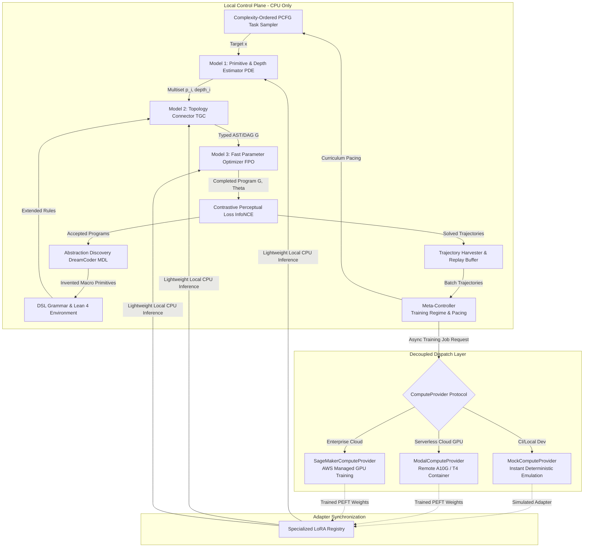
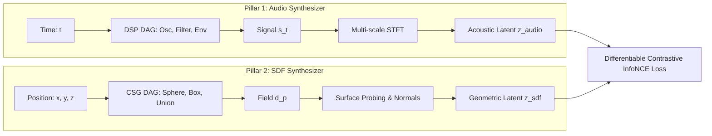

# Specification: Adaptive Curriculum with Abstraction Discovery and Remote Decoupled Fine-Tuning

**Track ID:** `curriculum_abstraction_remote_training_202505`  
**Type:** Feature / Architecture  
**Status:** Approved  
**Date:** 2026-10-16  

---

## 1. Executive Summary & Problem Statement

The goal of **SymForge** is cost-aware differentiable program synthesis over typed grammars with dynamic structural growth and subexpression sharing. To establish a universal framework, the project solves both **Audio (1D Procedural DSP)** and **SDF (3D Implicit Geometry)** in parallel, governed by a unified **3-Tier Neurosymbolic Pipeline**:

1. **Model 1: Primitive & Depth Estimator (PDE):** Identifies *which* primitives are present in the target observation and at *what hierarchical level / depth* of the composition each primitive resides.
2. **Model 2: Topology & Grammar Connector (TGC):** Assembles the predicted multiset of primitives and depth strata into a valid typed AST/DAG $G \in \mathcal{L}(\Gamma)$.
3. **Model 3: Fast Parameter Optimizer (FPO):** Rapidly predicts warm-start continuous parameters $\Theta_0$ and executes fast differentiable autograd refinement over the InfoNCE perceptual loss.

```text
+-------------------------------------------------------------------------------------------------+
|                                    LOCAL CONTROL PLANE (CPU-ONLY)                               |
|                                                                                                 |
|   +-----------------------+       +------------------------+       +------------------------+   |
|   | Complexity Curriculum | ----> |  3-Tier Neural Synth   | ----> |  Abstraction Discovery |   |
|   | (PCFG Task Generator) |       |  (PDE -> TGC -> FPO)   |       |  (DreamCoder / MDL)    |   |
|   +-----------------------+       +-----------+------------+       +-----------+------------+   |
|               ^                               |                                |                |
|               | Task Feedback                 v Evaluation & Loss              v New Primitives |
|   +-----------+-----------+       +-----------+------------+       +-----------+------------+   |
|   |    Meta-Controller    | <---  | Contrastive Perceptual |       |    DSL Grammar Library |   |
|   | (Pacing & Regimes)    |       | Loss Engine (InfoNCE)  | ----> | (Lean 4 Inductive Env) |   |
|   +-----------+-----------+       +-----------+------------+       +------------------------+   |
|               |                               |                                                 |
+---------------|-------------------------------|-------------------------------------------------+
                | Replay Trajectories           | Download Weights
                v                               v
+-------------------------------------------------------------------------------------------------+
|                                 REMOTE COMPUTE & DISPATCH PLANE                                 |
|                                                                                                 |
|                          +------------------------------------------+                           |
|                          |     ComputeProvider (Async Protocol)     |                           |
|                          +--------------------+---------------------+                           |
|                                               |                                                 |
|                 +-----------------------------+-----------------------------+                   |
|                 |                             |                             |                   |
|                 v                             v                             v                   |
|   +---------------------------+ +---------------------------+ +---------------------------+     |
|   |    MockComputeProvider    | |    ModalComputeProvider   | |  SageMakerComputeProvider |     |
|   |    (Local 0-Cost / CI)    | |   (Serverless GPU A10G)   | |   (AWS Cloud Cluster)     |     |
|   +---------------------------+ +---------------------------+ +---------------------------+     |
+-------------------------------------------------------------------------------------------------+
```



---

## 2. The Three Project Pillars

```text
+---------------------------------------------------------------------------------------------------+
|                              ISOMORPHISM MATRIX: AUDIO vs. SDF                                    |
|                                                                                                   |
|  Concept                  Audio Synthesizer (1D DSP)             SDF Synthesizer (3D CSG)         |
|  -----------------------  -------------------------------------  -------------------------------- |
|  Spatial/Domain Input     t in R (Continuous Time)               p = (x,y,z) in R^3 (Coordinates) |
|  Continuous Output        s(t) in [-1, 1] (Acoustic Pressure)    d(p) in R (Signed Distance)      |
|  Composition / Boolean    Mix(s1, s2, w) / RingMod(s1, s2)       Union / SmoothUnion(d1, d2, k)   |
|  Domain Transform         Time Shift / Pitch Modulation          Translation / Rotation / Scale   |
|  Perceptual Extractor     Multi-scale STFT / Mel Filterbanks     Surface Probing / Raymarching    |
|  Latent Contrast Space    Acoustic Latent z_audio                Geometric Latent z_sdf           |
+---------------------------------------------------------------------------------------------------+
```



### 2.1 Pillar 1: Audio Synthesizer (1D Procedural DSP)
- **Representation:** Directed acyclic computational graph (DAG) mapping discrete time $t \in [0, T]$ to audio signal $s(t) \in [-1, 1]$.
- **Known Primitives:**
  - *Sound Sources:* `Sine(freq, phase)`, `Saw(freq)`, `Square(freq, pulse_width)`, `Noise(seed)`.
  - *Envelopes & Modulators:* `ADSR(attack, decay, sustain, release)`, `ExpDecay(half_life)`, `LFO(freq, waveform)`, `FM(carrier, modulator, depth)`.
  - *Filters & Combinators:* `LowPass(cutoff, resonance)`, `HighPass(cutoff, resonance)`, `Gain(amplitude)`, `Mix(sig1, sig2, ratio)`.
- **Contrastive Perceptual Loss:** Multi-scale Short-Time Fourier Transform (STFT) log-magnitude feature extractor projected into an acoustic embedding space with InfoNCE contrastive separation against negative distractors.

### 2.2 Pillar 2: SDF Synthesizer (3D Implicit Geometry)
- **Representation:** Directed acyclic computational graph (DAG) mapping spatial coordinates $\mathbf{p} \in \mathbb{R}^3$ to signed distance $d(\mathbf{p}) \in \mathbb{R}$.
- **Known Primitives:**
  - *Analytical Shapes:* `Sphere(radius)`, `Box(half_extents)`, `Cylinder(radius, height)`, `Torus(r_major, r_minor)`, `Plane(normal, offset)`.
  - *Affine Transforms:* `Translate(sdf, offset)`, `Rotate(sdf, angles)`, `Scale(sdf, factor)`.
  - *Boolean Operators & Blends:* `Union(sdf1, sdf2)`, `Difference(sdf1, sdf2)`, `Intersection(sdf1, sdf2)`, `SmoothUnion(sdf1, sdf2, k)`.
- **Contrastive Perceptual Loss:** Stratified surface point probing near the zero-level set ($\varepsilon$-boundary) and raymarching silhouettes evaluated against geometric distractors.

### 2.3 Pillar 3: Generalization (Universal Neurosymbolic Core)
- **Typed Grammar & Hole Expansion:** Incremental expansion of typed holes `Hole[T]` in ASTs with canonical conversion to DAGs (Common Subexpression Elimination).
- **Procedural PCFG Task Generator:** Rule-based stochastic sampling with context-sensitive physical stability constraints (preventing digital audio clipping and disjoint empty booleans).
- **Abstraction Discovery (DreamCoder):** Syntactic anti-unification (LGG) and Minimum Description Length (MDL) compression promoting recurrent subgraphs into first-class macros.
- **Decoupled Asynchronous Training:** Asynchronous protocol delegating continuous parameter optimization and PEFT/LoRA fine-tuning to remote providers, maintaining zero local GPU consumption.

---

## 3. Mathematical Formulation of Contrastive Loss & PCFG

### 3.1 Context-Sensitive PCFG Task Generator
Given nonterminals $V$, terminals $\Sigma$, production rules $R$, and start symbol $S$, the Context-Sensitive Probabilistic Grammar defines:

$$\mathbb{P}(A \to \alpha \mid \text{context}) = \frac{\exp(\mathbf{w}_{A \to \alpha} \cdot \mathbf{\phi}(\text{context}))}{\sum_{\beta \in \text{Valid}(A, \text{context})} \exp(\mathbf{w}_{A \to \beta} \cdot \mathbf{\phi}(\text{context}))}$$

Where $\text{Valid}(A, \text{context})$ enforces domain stability invariants:
- In Audio: Stable filter poles ($|z| < 1$), normalized gain ($|s(t)| \le 1.0$).
- In SDF: Overlapping bounding boxes for boolean operators (preventing dead nodes).

### 3.2 Differentiable Contrastive Perceptual Loss (InfoNCE)
For any candidate program $(G, \theta)$ generating function $\hat{f}$ and reference target $f^*$:
1. A differentiable feature extractor $\Phi(\cdot)$ computes normalized latent vector $\mathbf{z}_{\hat{f}} = \Phi(\hat{f}) / \|\Phi(\hat{f})\|_2$.
2. The InfoNCE contrastive objective against $K$ negative programs $\{f^-_j\}_{j=1}^K$ with temperature $\tau$ is:

$$\mathcal{L}_{\text{contrast}}(\hat{f}, f^*, \{f^-_j\}) = -\log \frac{\exp\left(\frac{\mathbf{z}_{\hat{f}} \cdot \mathbf{z}_{f^*}}{\tau}\right)}{\exp\left(\frac{\mathbf{z}_{\hat{f}} \cdot \mathbf{z}_{f^*}}{\tau}\right) + \sum_{j=1}^{K} \exp\left(\frac{\mathbf{z}_{\hat{f}} \cdot \mathbf{z}_{f^-_j}}{\tau}\right)}$$

3. The overall multi-objective loss incorporates the compiled hardware cost model $C_H(G)$:

$$\mathcal{J}(G, \theta) = \lambda_{\text{contrast}} \mathcal{L}_{\text{contrast}} + \lambda_{\text{rec}} \mathcal{L}_{\text{rec}}(\hat{f}, f^*) + \lambda_{\text{cost}} C_H(G)$$

---

## 4. Subsystems and Interfaces

### 4.1 Decoupled ComputeProvider Protocol
```python
class ComputeProvider(Protocol):
    async def submit_training_job(
        self, 
        payload: TrainingPayload, 
        config: RemoteJobConfig
    ) -> str: ...
    
    async def poll_job_status(
        self, 
        job_id: str
    ) -> JobStatusResponse: ...
    
    async def fetch_job_artifacts(
        self, 
        job_id: str, 
        destination_dir: Path
    ) -> AdapterArtifact: ...
    
    async def cancel_job(
        self, 
        job_id: str
    ) -> bool: ...
```

Supported concrete providers:
1. `MockComputeProvider`: Local in-memory execution in < 10ms, $0.00 USD, for TDD test suites and CI/CD.
2. `ModalComputeProvider`: On-demand serverless GPU containers (NVIDIA A10G/T4).
3. `SageMakerComputeProvider`: Managed enterprise AWS SageMaker training clusters with S3 artifact storage.

### 4.2 Abstraction Discovery via Anti-Unification & MDL
- **Anti-Unification:** Computes the Least General Generalization (LGG) across solved programs that satisfy the perceptual loss threshold.
- **Minimum Description Length (MDL) Metric:**
$$\Delta \text{MDL}(\alpha) = \text{Size}(\alpha) - \sum_{p \in \mathcal{D}_{\text{solved}}} (\text{Size}(p) - \text{Size}(p[\alpha])) < 0$$
- Approved abstractions are registered into the typed grammar with updated PCFG prior distributions and formal signatures.

---

## 5. Quality Standards and Acceptance Criteria

1. **Test-Driven Development (TDD):** Automated unit and integration test coverage $\ge 80\%$, validating AST nodes, canonical DAGs, PCFG generators, contrastive losses, and remote providers.
2. **Resource Isolation:** Zero heavy training runs locally; execution bounded by strict memory limits and explicit timeouts on all asynchronous calls.
3. **Symmetrical Validation:** Program serialization and deserialization strictly preserve identity: $f^{-1}(f(x)) \equiv x$.
