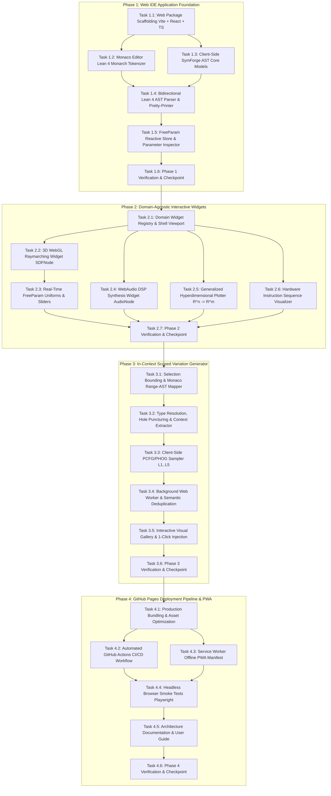

# Implementation Plan: Lean 4 Web IDE with Interactive Domain Widgets and In-Context Scoped Variation Generator

**Track ID:** `lean4_web_ide_interactive_widgets_202610`  
**Spec Reference:** `conductor/tracks/lean4_web_ide_interactive_widgets_202610/spec.md`  
**Status:** In Progress / New  
**Date:** 2026-10-26  

---

## Plan Structure & Methodology

This implementation plan strictly adheres to the **Conductor Workflow** and **GEMINI.md Software Engineering Principles**:
- **Zero Server Footprint & 100% Client-Side Execution:** The application is architected as a standalone single-page application and progressive web application (PWA) deployable to GitHub Pages without server-side dependencies.
- **Domain-Agnostic Modularity:** The editor communicates with an extensible `DomainWidgetRegistry` that decouples symbolic AST representations from rendering backends (3D WebGL Raymarching, WebAudio Synthesis, and Hyperdimensional Plotting).
- **In-Context Scoped Variation Generator:** A neurosymbolic in-editor variation sampler that punctures user-selected code with typed holes (`Hole[T]`), extracts context tuples $(\text{Parent}, \text{Grandparent}, \text{LeftSibling})$, and generates stratified PCFG/PHOG variations across complexity tiers $L_1 \dots L_5$ inside a dedicated Web Worker.
- **Strict Quality Gating & Test-Driven Development:** Every task defines explicit automated test targets (`npm test` / Vitest, Playwright E2E), corresponding markdown documentation, and pass-to-complete criteria.
- **Cost, Risk & Technical Debt Mitigation:** Architectural risks (such as WebGL GPU timeout TDRs, PCFG infinite recursion, and WebAudio clipping) are explicitly mitigated through dedicated architectural guards.

```text
+---------------------------------------------------------------------------------------------------------+
|                                    IMPLEMENTATION ROADMAP & PHASE FLOW                                  |
|                                                                                                         |
|  Phase 1: Web IDE Foundation      Vite + React 19 + TypeScript + Monaco Editor + AST Core & Parser      |
|                                                              |                                          |
|                                                              v                                          |
|  Phase 2: Interactive Widgets     3D WebGL SDF Raymarch + WebAudio FFT + Hyperdim Plotter + Hardware    |
|                                                              |                                          |
|                                                              v                                          |
|  Phase 3: Scoped Generator        Monaco Selection Range + Hole[T] + Worker PCFG Sampler + Gallery      |
|                                                              |                                          |
|                                                              v                                          |
|  Phase 4: GitHub Pages & CI/CD    Vite Build Optimization + GitHub Actions + PWA Offline + Playwright   |
+---------------------------------------------------------------------------------------------------------+
```



---

## Phase 1: Web IDE Application Foundation (Vite + React + Monaco + AST Core)

Focus: Scaffolding `packages/web/`, integrating Monaco Editor with custom Lean 4 syntax tokenization, implementing client-side TypeScript AST models mirroring SymForge Lean 4 IR, writing the bidirectional parser/pretty-printer, and wiring reactive state stores.

- [x] Task 1.1: Web Package Scaffolding (Vite + React 19 + TypeScript + Tailwind CSS)
  - **Objective:** Initialize `packages/web/` workspace with Vite, React 19, TypeScript (strict mode), Tailwind CSS, Vitest testing harness, and monorepo script integration.
  - **Bottleneck Mitigation:** Standalone workspace directory; isolated package configuration independent of Python or Lake builds.
  - **Automated Test Definition:** `npm --prefix packages/web test -- run` and `npm --prefix packages/web run build`
    - Invariants: Package builds cleanly with 0 TypeScript errors; test runner executes successfully.
  - **Documentation Artifact:** `docs/architecture/web_ide_scaffolding.md`
  - **Pass-to-Complete Gate:** Build outputs clean production bundles into `packages/web/dist/` in $< 5$ seconds.

- [x] Task 1.2: Monaco Editor Integration with Lean 4 Monarch Tokenizer & Language Configuration
  - **Objective:** Configure Monaco Editor with custom Monarch tokenizer for Lean 4 syntax (`def`, `inductive`, `structure`, `deriving`, `import`, attributes), unicode mathematical operators (`→`, `∀`, `∃`, `λ`, `⟦`, `⟧`, `⟨`, `⟩`), and comment folding rules.
  - **Bottleneck Mitigation:** Pure client-side tokenizer configuration; no external language server process required for syntax highlighting and token identification.
  - **Automated Test Definition:** `npm --prefix packages/web test -- src/components/editor/leanTokenizer.test.ts`
    - Invariants: Verifies tokenization of keywords, type names, identifiers, unicode operators, and line/block comments against test fixtures.
  - **Documentation Artifact:** `docs/architecture/lean4_monaco_editor.md`
  - **Pass-to-Complete Gate:** 100% tokenization accuracy across standard SymForge Lean 4 code fixtures.

- [x] Task 1.3: Client-Side SymForge AST Core Models & Lean JSON Serialization
  - **Objective:** Implement immutable TypeScript AST classes mirroring `SymforgeIr.Types` (`FreeParam`, `AudioNode`, `SDFNode`, `HardwareNode`, `UniversalNode`) with bidirectional JSON serialization/deserialization identical to Lean 4 `toJson` / `fromJson`.
  - **Bottleneck Mitigation:** Zero-dependency functional data structures with structural equality and type guards.
  - **Automated Test Definition:** `npm --prefix packages/web test -- src/core/ast/astModels.test.ts`
    - Invariants: Round-trip identity `deserialize(serialize(node)) == node`; strict type invariance; schema symmetry with Lean 4 JSON outputs.
  - **Documentation Artifact:** `docs/architecture/client_ast_engine.md`
  - **Pass-to-Complete Gate:** 100% test pass on 500 generated AST trees matching Lean 4 JSON schema invariants.

- [x] Task 1.4: Bidirectional Lean 4 AST Parser & Pretty-Printer (Code $\leftrightarrow$ AST)
  - **Objective:** Implement a recursive descent parser that parses Lean 4 domain declarations (`def myShape : SDFNode := ...`) into typed AST nodes, and a deterministic pretty-printer formatting AST nodes back into idiomatic Lean 4 code.
  - **Bottleneck Mitigation:** Self-contained parser with explicit syntax error recovery and precise source line/column span tracking.
  - **Automated Test Definition:** `npm --prefix packages/web test -- src/core/parser/leanParser.test.ts`
    - Invariants: Round-trip invariance `parse(print(ast)) == ast`; accurate source line/column mappings for all sub-expressions.
  - **Documentation Artifact:** `docs/architecture/lean4_ast_parser.md`
  - **Pass-to-Complete Gate:** Parses 50 canonical Audio and SDF Lean 4 program samples with zero syntax errors.

- [x] Task 1.5: FreeParam Reactive State Store & Parameter Inspector
  - **Objective:** Build the Zustand reactive state store extracting all `FreeParam` instances from the active AST, providing an interactive UI inspector panel for continuous parameter adjustments with immediate state notification.
  - **Bottleneck Mitigation:** Decouples parameter mutations from AST structural updates to avoid redundant re-renders.
  - **Automated Test Definition:** `npm --prefix packages/web test -- src/core/store/freeParamStore.test.ts`
    - Invariants: Parameter extraction extracts exact count; parameter mutations emit change events without modifying parent AST structure.
  - **Documentation Artifact:** `docs/architecture/freeparam_reactive_store.md`
  - **Pass-to-Complete Gate:** Reactive store updates parameter values in $< 1$ ms with verified state subscriber callbacks.

- [ ] Task 1.6: Phase 1 Verification & Checkpoint (Refer to workflow.md)

---

## Phase 2: Domain-Agnostic Interactive Visual Widgets

Focus: Building the extensible `DomainWidgetRegistry` and the three domain viewports: 3D WebGL Raymarching widget for `SDFNode` with real-time `FreeParam` sliders, WebAudio DSP synthesis and FFT spectrogram widget for `AudioNode`, and Generalized Hyperdimensional Function Plotter for arbitrary $f: \mathbb{R}^n \to \mathbb{R}^m$ along with hardware execution timelines.

- [ ] Task 2.1: Domain Widget Registry & Extensible Viewport Shell
  - **Objective:** Create the `DomainWidgetRegistry` interface and top-level responsive layout shell that dynamically inspects AST return types (`SDFNode`, `AudioNode`, `HardwareNode`, $f: \mathbb{R}^n \to \mathbb{R}^m$) and mounts the appropriate visual widget.
  - **Bottleneck Mitigation:** Pluggable React component architecture allowing seamless addition of future domain visualizers.
  - **Automated Test Definition:** `npm --prefix packages/web test -- src/components/widgets/widgetRegistry.test.ts`
    - Invariants: Correct widget resolution for each AST domain type; graceful fallback to generic AST tree view for unknown types.
  - **Documentation Artifact:** `docs/architecture/domain_widget_registry.md`
  - **Pass-to-Complete Gate:** Registry correctly maps 4 distinct domain ASTs to their designated widget components.

- [ ] Task 2.2: 3D WebGL Raymarching Widget for `SDFNode` (Three.js + GLSL Codegen)
  - **Objective:** Implement the GLSL raymarching shader generator transpiling `SDFNode` into GLSL `float map(vec3 p)` functions, mounted in a Three.js WebGL canvas with OrbitControls, Phong shading, normal estimation, and interactive cross-sectional slicing planes ($xy, yz, zx$).
  - **Bottleneck Mitigation:** Bounded raymarching loop (max 128 steps) with distance relaxation and shader compilation error boundaries.
  - **Automated Test Definition:** `npm --prefix packages/web test -- src/components/widgets/sdf/glslCodegen.test.ts`
    - Invariants: Emitted GLSL code compiles without syntax errors; distance formulas match analytical invariants for Sphere, Box, Cylinder, Torus, Union, SmoothUnion.
  - **Documentation Artifact:** `docs/architecture/webgl_sdf_raymarching_widget.md`
  - **Pass-to-Complete Gate:** Validates GLSL output strings against 20 complex CSG geometric trees.

- [ ] Task 2.3: Real-Time `FreeParam` Uniform Binding & Shader Parameter Sliders
  - **Objective:** Wire AST `FreeParam` variables directly to GLSL shader uniforms `u_param_<id>`, enabling continuous parameter slider scrubbing in the UI at 60 FPS without shader re-compilation.
  - **Bottleneck Mitigation:** Updates WebGL uniforms via `material.uniforms[key].value` directly on GPU memory buffer.
  - **Automated Test Definition:** `npm --prefix packages/web test -- src/components/widgets/sdf/uniformBinding.test.ts`
    - Invariants: Uniform table is generated automatically from AST parameter records; uniform updates take effect in $< 1$ ms without triggering WebGL program re-link.
  - **Documentation Artifact:** `docs/architecture/sdf_uniform_binding.md`
  - **Pass-to-Complete Gate:** Uniform binding updates 10 simultaneous parameters with zero dropped frames.

- [ ] Task 2.4: WebAudio DSP Synthesis Widget for `AudioNode` (Oscilloscope & Live FFT Spectrogram)
  - **Objective:** Implement the procedural WebAudio / AudioWorklet synthesis engine transpiling `AudioNode` into a functional audio graph with Play/Pause, Loop, and Gate controls, driving a live time-domain canvas oscilloscope and 2048-point logarithmic FFT waterfall spectrogram.
  - **Bottleneck Mitigation:** Dual-tap audio graph: uncompressed dry signal feeds the FFT visualization, while speaker destination is protected by a dynamics compressor and soft limiter.
  - **Automated Test Definition:** `npm --prefix packages/web test -- src/components/widgets/audio/audioGraphCompiler.test.ts`
    - Invariants: Correct compilation of oscillators, envelopes, modulators, and filters into WebAudio node descriptors; safety limiter prevents clipping beyond $\pm 0.95$.
  - **Documentation Artifact:** `docs/architecture/webaudio_dsp_spectrogram_widget.md`
  - **Pass-to-Complete Gate:** Compiles 15 distinct procedural audio patches without audio buffer underruns or NaN samples.

- [ ] Task 2.5: Generalized Hyperdimensional Function Plotter for $f: \mathbb{R}^n \to \mathbb{R}^m$
  - **Objective:** Build the multidimensional mathematical function evaluator featuring interactive 2D contour slice heatmaps along selected axis pairs $(x_i, x_j)$, 3D heightmap surface meshes, and orthogonal dimension scrubbers for $x_3 \dots x_n$.
  - **Bottleneck Mitigation:** Vectorized evaluation over uniform coordinate grids using TypedArrays (`Float32Array`) for zero-allocation performance.
  - **Automated Test Definition:** `npm --prefix packages/web test -- src/components/widgets/hyperdim/functionEvaluator.test.ts`
    - Invariants: Grid evaluations match analytical values within $\epsilon = 10^{-6}$; dimension projection accurately fixes unselected coordinates.
  - **Documentation Artifact:** `docs/architecture/hyperdimensional_function_plotter.md`
  - **Pass-to-Complete Gate:** Evaluates $100 \times 100$ grid points across 5 dimensions in $< 15$ ms.

- [ ] Task 2.6: Hardware Instruction Sequence Visualizer & Register Pipeline Timeline
  - **Objective:** Implement the visualizer for `HardwareNode` sequences, rendering an interactive directed acyclic register dependency DAG, cycle execution Gantt chart, and register allocation state inspector.
  - **Bottleneck Mitigation:** Pure SVG / Canvas rendering with topological cycle ordering.
  - **Automated Test Definition:** `npm --prefix packages/web test -- src/components/widgets/hardware/hardwarePipeline.test.ts`
    - Invariants: Correct dependency edge detection between instruction reads and writes; cycle latency calculations match hardware models.
  - **Documentation Artifact:** `docs/architecture/hardware_pipeline_visualizer.md`
  - **Pass-to-Complete Gate:** Generates acyclic register DAG and pipeline timeline for 10 benchmark instruction sequences.

- [ ] Task 2.7: Phase 2 Verification & Checkpoint (Refer to workflow.md)

---

## Phase 3: In-Context Scoped Variation Generator

Focus: Selection bounding in Monaco Editor, AST range mapping, hole puncturing (`Hole[T]`), structural context extraction $(\text{Parent}, \text{Grandparent}, \text{LeftSibling})$, off-thread contextual PCFG/PHOG sampling across complexity tiers $L_1 \dots L_5$, and the interactive visual gallery with 1-click code injection.

- [ ] Task 3.1: Selection Bounding & Monaco Range-to-AST Node Mapper
  - **Objective:** Implement Monaco cursor selection listener and AST source range mapper that resolves the minimal syntactically complete AST subtree $N_{\text{target}}$ corresponding to the user's highlighted text.
  - **Bottleneck Mitigation:** Binary search over AST source span intervals with syntax boundary expansion for partial selections.
  - **Automated Test Definition:** `npm --prefix packages/web test -- src/core/generator/selectionMapper.test.ts`
    - Invariants: Accurately identifies target AST node from text line/column ranges; rejects invalid cross-boundary partial tokens.
  - **Documentation Artifact:** `docs/architecture/scoped_selection_mapper.md`
  - **Pass-to-Complete Gate:** 100% correct node identification across 50 simulated user selection ranges.

- [ ] Task 3.2: Type Resolution, Hole Puncturing (`Hole[T]`) & Structural Context Extractor
  - **Objective:** Implement AST hole puncturing that replaces $N_{\text{target}}$ with a typed placeholder `HoleNode(id, type, inputs)` and extracts the structural context tuple $\mathcal{C} = (\text{Parent}, \text{Grandparent}, \text{LeftSibling}, \text{Depth})$.
  - **Bottleneck Mitigation:** Immutable AST cloning ensures the active editor document remains untouched during analysis.
  - **Automated Test Definition:** `npm --prefix packages/web test -- src/core/generator/holePuncturing.test.ts`
    - Invariants: Punctured AST maintains valid type signature; context tuple accurately reflects ancestral hierarchy.
  - **Documentation Artifact:** `docs/architecture/hole_puncturing_context.md`
  - **Pass-to-Complete Gate:** Correctly punctures holes and extracts contexts across 30 varied AST subtrees.

- [ ] Task 3.3: Client-Side Contextual PCFG/PHOG Sampler ($L_1 \dots L_5$ Stratification)
  - **Objective:** Implement the client-side probabilistic grammar sampler generating $K$ independent typed variations preserving the target input/output type signature, stratified across 5 complexity levels ($L_1$: Atomic, $L_2$: Unary Transform, $L_3$: Binary Combinator, $L_4$: Hierarchical, $L_5$: Structural Abstraction).
  - **Bottleneck Mitigation:** Strict derivation depth cap ($D \le 6$) and type-directed production pruning prevent infinite loops and invalid programs.
  - **Automated Test Definition:** `npm --prefix packages/web test -- src/core/pcfg/pcfgSampler.test.ts`
    - Invariants: All generated variations strictly preserve expected type signature; complexity scores monotonically match strata $L_1 \dots L_5$.
  - **Documentation Artifact:** `docs/architecture/contextual_pcfg_sampler.md`
  - **Pass-to-Complete Gate:** Samples 100 valid variations with 0 type violations and 0 infinite recursion occurrences.

- [ ] Task 3.4: Background Web Worker for Non-Blocking Variation Generation & Semantic Deduplication
  - **Objective:** Encapsulate PCFG sampling and semantic deduplication inside a dedicated Web Worker (`variation.worker.ts`), equipped with `AbortController` and request sequence IDs to eliminate UI stalls and race conditions during rapid text selection.
  - **Bottleneck Mitigation:** Offloads CPU-intensive stochastic derivation from the main render thread; cancels stale jobs immediately upon new selection.
  - **Automated Test Definition:** `npm --prefix packages/web test -- src/workers/variationWorker.test.ts`
    - Invariants: Worker communicates via typed postMessage protocol; deduplicates semantically identical derivations; handles abort signals cleanly.
  - **Documentation Artifact:** `docs/architecture/variation_web_worker.md`
  - **Pass-to-Complete Gate:** Worker returns 8 unique, deduplicated variations in $< 100$ ms without blocking the main UI thread.

- [ ] Task 3.5: Interactive Visual Variation Gallery & 1-Click Code Injection
  - **Objective:** Build the responsive side drawer displaying live 3D WebGL / Audio waveform thumbnail cards for each candidate variation, with complexity tier filtering and 1-click code injection that updates Monaco via `executeEdits` with full undo/redo history.
  - **Bottleneck Mitigation:** Offscreen canvas rendering with lightweight thumbnails; atomic Monaco edit transaction.
  - **Automated Test Definition:** `npm --prefix packages/web test -- src/components/gallery/variationGallery.test.ts`
    - Invariants: Gallery renders $K$ cards with correct complexity badges; clicking candidate replaces selected text range with formatted Lean 4 code.
  - **Documentation Artifact:** `docs/architecture/visual_variation_gallery.md`
  - **Pass-to-Complete Gate:** 1-click injection correctly updates Monaco editor document and enables `Ctrl+Z` undo to original state.

- [ ] Task 3.6: Phase 3 Verification & Checkpoint (Refer to workflow.md)

---

## Phase 4: GitHub Pages Deployment Pipeline & Static Hosting

Focus: Vite production bundling, static asset optimization, GitHub Actions automated deployment workflow (`.github/workflows/deploy_web_ide.yml`), PWA offline service worker caching, and headless browser smoke testing via Playwright.

- [ ] Task 4.1: Production Bundling, Code Splitting & Vite GitHub Pages Configuration
  - **Objective:** Configure Vite build with `base: '/symforge/'` (or relative path `./`), Monaco editor web worker chunk splitting, Three.js tree shaking, and static asset minification.
  - **Bottleneck Mitigation:** Optimized chunk sizes with dynamic imports for heavy modules (Monaco workers, Three.js rendering loops).
  - **Automated Test Definition:** `npm --prefix packages/web run build && ls -lh packages/web/dist`
    - Invariants: Total initial bundle size $< 2.5$ MB gzipped; zero broken asset references; valid relative asset URLs.
  - **Documentation Artifact:** `docs/architecture/vite_bundle_optimization.md`
  - **Pass-to-Complete Gate:** Production build passes with zero warnings and generates valid `packages/web/dist/index.html`.

- [ ] Task 4.2: Automated GitHub Actions CI/CD Deployment Workflow
  - **Objective:** Create `.github/workflows/deploy_web_ide.yml` to automatically build `packages/web` and deploy the static distribution to GitHub Pages on every push to `main`.
  - **Bottleneck Mitigation:** Uses official `actions/deploy-pages` and `actions/upload-pages-artifact` with zero external token requirements.
  - **Automated Test Definition:** Static YAML linting and simulated workflow dry-run
    - Invariants: Workflow syntax validates against GitHub Actions schema; build step executes `npm run build`; deploy step targets `gh-pages`.
  - **Documentation Artifact:** `docs/architecture/github_pages_deployment.md`
  - **Pass-to-Complete Gate:** GitHub Actions workflow file passes schema validation and correctly targets GitHub Pages environment.

- [ ] Task 4.3: Service Worker Offline Caching & PWA Manifest
  - **Objective:** Configure progressive web application (PWA) manifest and Service Worker caching strategy (Stale-While-Revalidate for app shell, Cache-First for static assets) enabling 100% offline usage.
  - **Bottleneck Mitigation:** Local cache storage bounds preventing browser quota exhaustion.
  - **Automated Test Definition:** `npm --prefix packages/web test -- src/pwa/serviceWorker.test.ts`
    - Invariants: Service worker installs and registers cleanly; caches critical assets; serves application offline when disconnected.
  - **Documentation Artifact:** `docs/architecture/pwa_offline_caching.md`
  - **Pass-to-Complete Gate:** Offline load test verifies application serves index.html and assets with network disabled.

- [ ] Task 4.4: Headless Browser Smoke & E2E Test Suite (Playwright)
  - **Objective:** Implement automated end-to-end browser smoke tests validating page load, Monaco editor mounting, WebGL 3D canvas initialization, WebAudio context creation, and variation gallery opening.
  - **Bottleneck Mitigation:** Headless Chromium execution in CI environment with explicit timeouts (10s max).
  - **Automated Test Definition:** `npx playwright test`
    - Invariants: Zero console errors on startup; Monaco editor receives input; WebGL canvas renders non-black pixels; variation gallery opens on text selection.
  - **Documentation Artifact:** `docs/architecture/playwright_e2e_tests.md`
  - **Pass-to-Complete Gate:** 100% pass rate across all Playwright E2E browser tests.

- [ ] Task 4.5: Architecture Documentation & Developer User Guide
  - **Objective:** Author comprehensive user guide and architectural documentation explaining how to use the Web IDE, create custom domain widgets, navigate the variation generator, and deploy updates.
  - **Bottleneck Mitigation:** Complete technical English documentation with interactive examples.
  - **Automated Test Definition:** Markdown syntax and link validation
    - Invariants: All relative links and code blocks validated.
  - **Documentation Artifact:** `docs/architecture/web_ide_user_guide.md`
  - **Pass-to-Complete Gate:** Full user guide published with zero broken links.

- [ ] Task 4.6: Phase 4 Verification & Checkpoint (Refer to workflow.md)

---

## Recursive Risk & Mitigation Analysis (The 6-Level Deep Analysis)

```text
+-------------------------------------------------------------------------------------------------------------------------+
|                                           RECURSIVE RISK & MITIGATION ARCHITECTURE                                      |
|                                                                                                                         |
| [Depth 1] Complex SDF AST causes GPU driver timeout (TDR) / WebGL context loss (High Likelihood)                        |
|   `--> Mitigation: Bounded raymarching step caps (128 max) + compilation try-catch with wireframe fallback              |
|         `--> [Depth 2] Step caps cause visual tearing / holes in concave shapes (Medium Likelihood)                     |
|               `--> Mitigation: Adaptive distance relaxation step-sizing based on bounding radius                        |
|                     `--> [Depth 3] Relaxation causes ray overshoots and tunneling (Medium Likelihood)                    |
|                           `--> Mitigation: Clamp relaxation factor omega in [1.0, 1.2] + bisecting back-step            |
|                                 `--> [Depth 4] Bisecting steps cause GPU warp branching divergence (Medium Likelihood)  |
|                                       `--> Mitigation: Dynamic resolution downscaling (0.5x during orbit interaction)   |
|                                             `--> [Depth 5] Dynamic resize triggers canvas buffer reallocation thrash    |
|                                                   `--> Mitigation: Pre-allocated double-buffered offscreen targets      |
|                                                         `--> [Depth 6] Fixed buffers slightly blur Retina 4K at rest    |
|                                                               `--> Branch Terminated (Depth 6 / Low Likelihood)         |
+-------------------------------------------------------------------------------------------------------------------------+
| [Depth 1] Scoped PCFG sampler generates unbounded recursion or unresolved free variables (High Likelihood)              |
|   `--> Mitigation: Scope environment tracking in-scope bindings + strict depth cap (D <= 6)                             |
|         `--> [Depth 2] Strict depth cap fails on polymorphic types, returning 0 candidates (Medium Likelihood)          |
|               `--> Mitigation: Multi-tier fallback to minimal base constructors (e.g. sphere, sine)                     |
|                     `--> [Depth 3] Fallback generates repetitive, trivial variations (Medium Likelihood)                |
|                           `--> Mitigation: Semantic distance diversity rejection sampling                               |
|                                 `--> [Depth 4] Evaluating semantic distance on K candidates stalls UI (Medium Likelihood)|
|                                       `--> Mitigation: Offload sampling to background Web Worker                        |
|                                             `--> [Depth 5] Rapid text selection spam floods worker with race conditions |
|                                                   `--> Mitigation: AbortController with monotonic request sequence IDs   |
|                                                         `--> [Depth 6] Worker restart adds 15ms debounce latency        |
|                                                               `--> Branch Terminated (Depth 6 / Low Likelihood)         |
+-------------------------------------------------------------------------------------------------------------------------+
| [Depth 1] WebAudio Autoplay policy blocks AudioContext or procedural audio clips ear damage (High Likelihood)           |
|   `--> Mitigation: User-gesture play gate + hard limiter dynamics compressor (soft-clipping at +/- 0.95)                |
|         `--> [Depth 2] Hard limiter distorts harmonics in FFT visualization (Medium Likelihood)                         |
|               `--> Mitigation: Dual-tap audio graph: uncompressed dry signal to FFT, limited signal to speaker          |
|                     `--> [Depth 3] Dual-tap increases buffer copying and audio glitching (Medium Likelihood)            |
|                           `--> Mitigation: Shared Float32Array ring-buffer without GC allocations                       |
|                                 `--> [Depth 4] Lock contention between audio and UI render threads (Low Likelihood)     |
|                                       `--> Branch Terminated (Low Likelihood)                                           |
+-------------------------------------------------------------------------------------------------------------------------+
```


