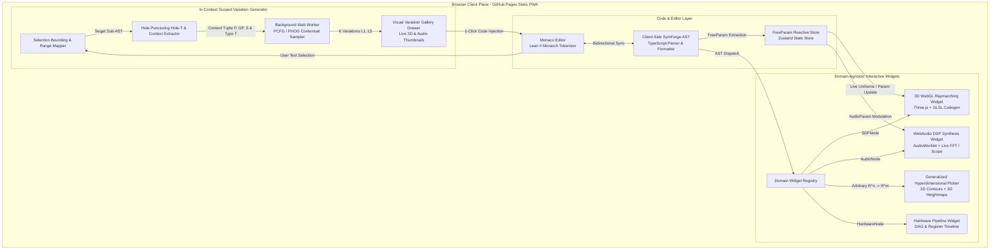
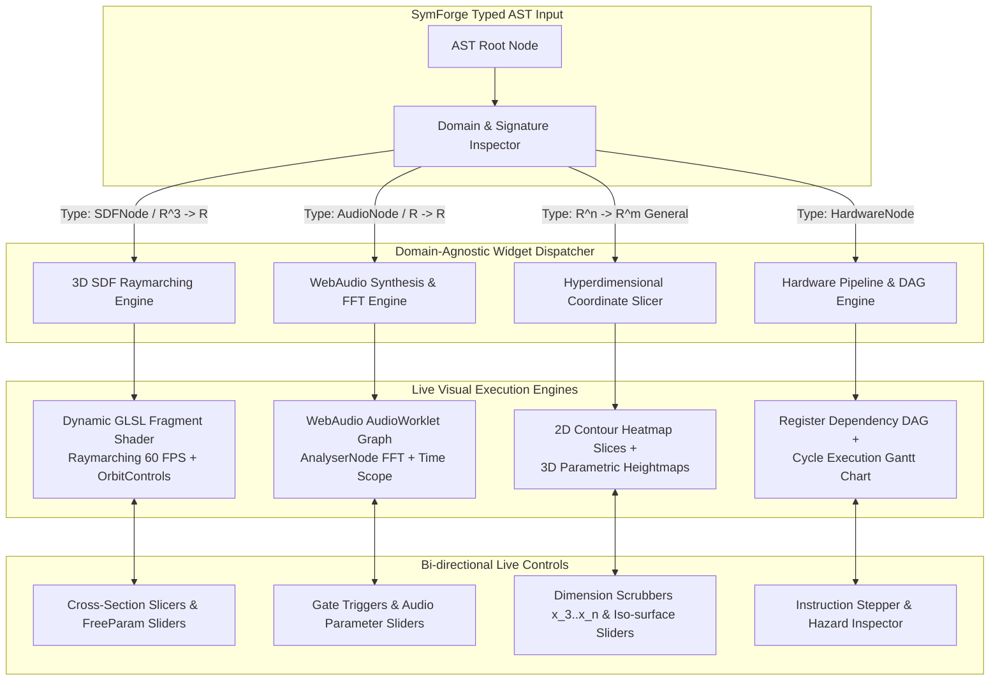

# Specification: Lean 4 Web IDE with Interactive Domain Widgets and In-Context Scoped Variation Generator

**Track ID:** `lean4_web_ide_interactive_widgets_202610`  
**Type:** Feature / Frontend Architecture  
**Status:** Approved  
**Date:** 2026-10-26  

---

## 1. Executive Summary & Problem Statement

SymForge establishes a unified neurosymbolic program synthesis paradigm that maps observations into verifiable, typed programs represented in Lean 4 formal Intermediate Representation (IR). Today, SymForge supports procedural synthesis across **1D Procedural DSP Audio**, **3D Implicit Geometry (SDF)**, **Hardware Instruction Superoptimization**, and generalized mathematical functions $f: \mathbb{R}^n \to \mathbb{R}^m$.

However, these synthesis results, formal AST definitions, continuous parameter relaxations ($\Theta$), and inductive abstractions currently live within Python CLI logs, Lake compilation outputs, and serialized JSON matrices. Researchers and developers lack an immediate, zero-installation, visual medium to interact with, explore, and manipulate these procedural programs.

### The Vision: Client-Side Web IDE on GitHub Pages
This track delivers a high-performance, browser-native **Web IDE for Lean 4 and SymForge** hosted entirely as a static Progressive Web Application (PWA) via **GitHub Pages**. The application requires zero local installation and zero server-side infrastructure.

The core innovations of this track are twofold:
1. **Domain-Agnostic Interactive Visual Widgets:** Pluggable, real-time rendering viewports that inspect formal AST signatures and provide live domain-specific feedback:
   - **3D WebGL Raymarching Widget for `SDFNode`:** Dynamic GLSL raymarching compilation, 60 FPS OrbitControls, interactive cutting planes / cross-section slices, and real-time continuous `FreeParam` parameter sliders updating shader uniforms with zero recompilation lag.
   - **WebAudio Synthesis & Live FFT Spectrogram Widget for `AudioNode`:** Client-side WebAudio / AudioWorklet DSP compilation, live time-domain oscilloscope, and logarithmic 2D/3D frequency-domain FFT spectrogram waterfall with interactive pitch/gate controls.
   - **Generalized Hyperdimensional Function Plotter for $f: \mathbb{R}^n \to \mathbb{R}^m$:** Dynamic multidimensional evaluator featuring interactive 2D contour slices, 3D heightmap surface meshes, dimension projection scrubbers ($x_3 \dots x_n$), and hardware register dependency DAG / execution timeline visualizers.
2. **In-Context Scoped Variation Generator:** A neurosymbolic code mutation engine operating directly inside the code editor:
   - **Selection Bounding & AST Range Mapping:** The user highlights any code block, function, or sub-expression in the Monaco Editor.
   - **Hole Puncturing & Type Resolution:** The IDE maps the text selection to the exact AST subtree $N_{\text{target}}$, verifies input/output type contracts $T_{\text{in}} \to T_{\text{out}}$, replaces $N_{\text{target}}$ with a typed hole `Hole[T]`, and extracts the structural context tuple $(\text{Parent}, \text{Grandparent}, \text{LeftSibling}, \text{Depth})$.
   - **Contextual PCFG/PHOG Sampler:** Generates $K$ independent typed variations preserving dimension and type semantics, stratified across 5 discrete complexity levels ($L_1 \dots L_5$) conditioned on the contextual grammar.
   - **Interactive Visual Variation Gallery:** Renders a responsive side drawer displaying live, interactive 3D and audio thumbnail cards for each candidate variation. Clicking any candidate performs a 1-click code injection into the Monaco Editor, preserving full undo/redo history.

```text
+---------------------------------------------------------------------------------------------------------+
|                                  BROWSER CLIENT PLANE (GITHUB PAGES PWA)                                |
|                                                                                                         |
|   +-------------------------------------------------------+   +-------------------------------------+   |
|   |                  CODE & EDITOR ENGINE                 |   |    DOMAIN-AGNOSTIC WIDGET ENGINE    |   |
|   |                                                       |   |                                     |   |
|   |  +-------------------------------------------------+  |   |  +-------------------------------+  |   |
|   |  | Monaco Editor (Lean 4 Monarch Tokenizer)        |  |   |  | 3D WebGL Raymarching Widget   |  |   |
|   |  | - Unicode Math Symbols (->, forall, exists, etc)|  |   |  | - GLSL Codegen / OrbitControls|  |   |
|   |  | - Scoped Text Selection Bounds                  |  |   |  | - Cross-Sections & Sliders    |  |   |
|   |  +------------------------+------------------------+  |   |  +-------------------------------+  |   |
|   |                           |                           |   |  +-------------------------------+  |   |
|   |                           v                           |   |  | WebAudio DSP & FFT Spectrogram|  |   |
|   |  +-------------------------------------------------+  |   |  | - AudioWorklet DSP Graph      |  |   |
|   |  | Client-Side SymForge AST Engine (TypeScript)    |  |   |  | - Real-time Oscilloscope & FFT|  |   |
|   |  | - Lean 4 IR Bidirectional Parser & Formatter    |  |   |  +-------------------------------+  |   |
|   |  | - FreeParam Reactive Parameter Store (Zustand) |  |   |  +-------------------------------+  |   |
|   |  +------------------------+------------------------+  |   |  | Generalized Hyperdim Plotter  |  |   |
|   |                           |                           |   |  | - 2D Slices, 3D Heightmaps    |  |   |
|   +---------------------------|---------------------------+   |  | - Hardware Pipeline Timeline  |  |   |
|                               |                               |  +-------------------------------+  |   |
|                               v                               +-------------------------------------+   |
|   +-------------------------------------------------------------------------------------------------+   |
|   |                         IN-CONTEXT SCOPED VARIATION GENERATOR ENGINE                            |   |
|   |                                                                                                 |   |
|   |  [Monaco Selection] ---> [AST Range Mapper] ---> [Hole Puncturing & Context Extraction (P, GP)] |   |
|   |                                                                |                                |   |
|   |                                                                v                                |   |
|   |  [Monaco Code Injection] <--- [Live Visual Gallery] <--- [Web Worker: PCFG/PHOG Sampler L1..L5] |   |
|   |  (1-Click Substitution)       (3D & Audio Cards)         (K Independent Typed Variations)       |   |
|   +-------------------------------------------------------------------------------------------------+   |
+---------------------------------------------------------------------------------------------------------+
```



---

## 2. Domain-Agnostic Interactive Visual Widgets

SymForge treats all procedural programs through unified algebraic and categorical structures. The Web IDE operationalizes this by decoupling the editor from concrete rendering engines through an extensible **Domain Widget Registry**.

```text
+---------------------------------------------------------------------------------------------------+
|                            DOMAIN-AGNOSTIC WIDGET DISPATCH ARCHITECTURE                           |
|                                                                                                   |
|  AST Inductive Type        Signature                Dispatched Widget         Interactive Controls|
|  ------------------------  -----------------------  ------------------------  --------------------|
|  SDFNode                   p in R^3 -> d in R       3D WebGL Raymarching      Orbit, Sliders, Cuts|
|  AudioNode                 t in R -> s in [-1, 1]   WebAudio DSP & FFT        Play, Gate, Scope   |
|  General Function          x in R^n -> y in R^m     Hyperdimensional Plotter  Axis Select, Slices |
|  HardwareNode              Seq[Instruction]         Hardware Pipeline Visual  Step, DAG, Latency  |
+---------------------------------------------------------------------------------------------------+
```



### 2.1 3D WebGL Raymarching Widget for `SDFNode`
- **Dynamic GLSL Codegen:** Compiles `SDFNode` structures into an optimized GLSL fragment shader distance estimator `float map(vec3 p)`. Analytical primitives (Sphere, Box, Cylinder, Torus) map directly to Inigo Quilez distance functions. Affine transformations (Translate, Rotate, Scale) and CSG operators (Union, Intersection, Difference, SmoothUnion) are composed algebraically.
- **Rendering Loop:** Rendered on a full-viewport Three.js WebGL canvas utilizing a screen-aligned quad with Phong illumination, normal estimation via tetrahedron finite differences, and soft ambient occlusion.
- **Continuous `FreeParam` Uniform Binding:** All continuous parameters are registered as GLSL uniforms `uniform float u_param_<id>`. Scrubbing parameter sliders modifies uniform values directly in GPU memory at 60 FPS without shader re-compilation.
- **Cross-Sectional Plane Slicing:** Interactive cutting planes along $xy$, $yz$, or $zx$ planes reveal interior distance fields with isoline color contouring.

### 2.2 WebAudio Synthesis & Live FFT Spectrogram Widget for `AudioNode`
- **AudioWorklet / AudioNode Graph Compiler:** Compiles `AudioNode` structures into a WebAudio synthesis graph. Oscillators (Sine, Saw, Square, Noise) and modulators (FM, AM, LowPass filter, ADSR envelope) run on the browser audio thread.
- **Oscilloscope (Time-Domain):** Uses `AnalyserNode.getByteTimeDomainData` to render a high-precision, zero-latency canvas waveform oscilloscope.
- **Live FFT Spectrogram (Frequency-Domain):** Uses `AnalyserNode.getByteFrequencyData` with a 2048-point Fast Fourier Transform to render a real-time logarithmic waterfall spectrogram across 20 Hz – 20 kHz.
- **Playback Controls:** Interactive Play/Pause, Loop toggle, musical keyboard note trigger (MIDI/keyboard input), and master volume controls with safety limiting.

### 2.3 Generalized Hyperdimensional Function Plotter for $f: \mathbb{R}^n \to \mathbb{R}^m$
- **Multidimensional Domain Projections:** For functions with $n > 3$ inputs, the user selects two active exploration axes $(x_i, x_j)$ while freezing orthogonal dimensions $(x_k)$ via interactive slider scrubbers.
- **Dual Representation Viewports:**
  - **2D Contour Slice:** Real-time heatmaps with colored isocontours representing scalar outputs or magnitude $\|f(x)\|$.
  - **3D Parametric Heightmap Mesh:** Three.js dynamic surface geometry whose vertex elevations $z = f(x_i, x_j)$ are updated on CPU/GPU buffer threads.
- **Hardware Instruction & Pipeline Visualizer:** For `HardwareNode` sequences, renders a directed acyclic register dependency graph, pipeline cycle execution Gantt chart, and register allocation state inspector.

---

## 3. In-Context Scoped Variation Generator

The user needs to select any arbitrary code block or sub-expression in the Monaco editor and generate semantically valid, type-preserving variations that explore the synthetic problem domain according to the contextual grammar (PCFG/PHOG) at different complexity levels.

```text
+---------------------------------------------------------------------------------------------------------+
|                               IN-CONTEXT VARIATION GENERATION PIPELINE                                  |
|                                                                                                         |
|  Step 1: Editor Selection       User highlights code block in Monaco (Lines L1..L2, Cols C1..C2)        |
|  Step 2: AST Range Resolution   Locates smallest enclosing AST node N_target & verifies validity        |
|  Step 3: Type & Context Match   Extracts T_in -> T_out, replaces N_target with typed Hole[T]            |
|  Step 4: Structural Context     Captures tuple (Parent, Grandparent, LeftSibling, ASTDepth)             |
|  Step 5: PCFG/PHOG Sampling     Web Worker generates K candidate sub-ASTs across complexity L1..L5      |
|  Step 6: Visual Gallery         Renders interactive 3D WebGL / Audio waveform cards in side drawer      |
|  Step 7: 1-Click Code Injection Clicking card injects formatted Lean 4 snippet back into Monaco         |
+---------------------------------------------------------------------------------------------------------+
```



```mermaid
graph LR
    subgraph SelectionStage [1. Scoped Selection]
        CODE[Lean 4 Source Code in Monaco] -->|Highlight Block| RANGE[Text Range: Line L1..L2, Col C1..C2]
        RANGE --> PARSE[AST Source Range Matcher]
    end

    subgraph HolePuncturing [2. Context & Type Invariance]
        PARSE --> TARGET[Target Sub-AST Node N_target]
        TARGET --> TYPE[Infer Type Signature T_in -> T_out]
        TARGET --> HOLE[Puncture AST: Replace N_target with Hole-T]
        TARGET --> CTX[Extract Context: Parent, Grandparent, Sibling, Depth]
    end

    subgraph PCFGSampling [3. Contextual Variation Sampling]
        HOLE --> SAMPLER[Contextual PCFG / PHOG Sampler]
        CTX --> SAMPLER
        TYPE --> SAMPLER
        SAMPLER -->|Stratified Sampling| TIERS[Complexity Strata L1..L5]
        TIERS -->|Generate K Candidates| DEDUP[Semantic & Structural Deduplication]
    end

    subgraph InteractiveGallery [4. Live Visual Thumbnails & Injection]
        DEDUP --> GALLERY[Visual Variation Gallery Drawer]
        GALLERY --> THUMBS[Live Render: Mini-SDF Raymarch / Mini-Audio Scope]
        THUMBS -->|Click Candidate Card| INJECT[1-Click Monaco Code Injection & History Undo]
        INJECT --> CODE
    end
```

### 3.1 Selection Bounding & AST Range Resolution
- Monaco selection change listeners track active cursor spans `[startLine, startCol, endLine, endCol]`.
- The AST Source Range Mapper traverses the parsed SymForge AST to find the minimal containing expression node $N_{\text{target}}$.
- Validates that the selection forms a syntactically self-contained expression (preventing partial identifier or bracket fragments).

### 3.2 Hole Puncturing & Context Extraction
- The AST is cloned, replacing $N_{\text{target}}$ with a typed placeholder `HoleNode(id, type, expectedInputs)`.
- The structural context tuple is extracted:
  $$\mathcal{C} = \left(\text{ParentType}, \text{GrandparentType}, \text{LeftSiblingType}, \text{Depth}\right)$$
- The type invariant $\tau(N_{\text{target}})$ is enforced: any generated variation $V$ must satisfy $\tau(V) \equiv \tau(N_{\text{target}})$ and have compatible dimensionality.

### 3.3 Contextual PCFG/PHOG Sampler (Web Worker)
- Runs off-thread inside a dedicated Web Worker (`variation-sampler.worker.ts`) to maintain 60 FPS UI responsiveness.
- Samples candidate sub-trees from the Probabilistic Context-Free Grammar conditioned on context $\mathcal{C}$ and production probabilities $P(r \mid \mathcal{C})$.
- **Stratified Complexity Levels ($L_1 \dots L_5$):**
  - **Level 1 (Atomic):** Single primitive replacement (e.g. `sphere` $\to$ `box` or `sine` $\to$ `saw`) with mutated continuous parameters.
  - **Level 2 (Simple Transform):** Single unary transform wrapper (e.g. `translate(dx, dy, dz, child)` or `gain(g, child)`).
  - **Level 3 (Binary Composition):** Binary combinator joining two sub-primitives (e.g. `union(k, a, b)` or `mix(ratio, a, b)`).
  - **Level 4 (Hierarchical):** Nested 3-depth composition combining multiple operators.
  - **Level 5 (Structural Abstraction):** Deep multi-branch composition invoking library macros.
- **Semantic Deduplication:** Computes canonical string representations and samples test vectors to eliminate duplicates and degenerate outputs before sending candidates to the UI.

### 3.4 Interactive Visual Variation Gallery
- An expandable side drawer or floating overlay displays $K$ variation cards (e.g., $K=8$ or $K=12$).
- Each card displays:
  - **Complexity Tier Badge:** $L_1$ through $L_5$.
  - **Live Visual Thumbnail:** An offscreen Three.js WebGL canvas rendering a mini 3D raymarching preview (for SDFs) or an animated mini-canvas waveform (for audio).
  - **Lean 4 Code Preview:** Formatted snippet of the proposed candidate.
  - **Complexity & Cost Score:** Computed AST size and parameter count.
- **1-Click Code Injection:** Clicking any candidate invokes Monaco's `editor.executeEdits()`, cleanly substituting the selection with the new code, triggering AST re-parse, and pushing a reversible transaction to Monaco's undo/redo history.

---

## 4. Frontend Architecture & Technology Stack

The application is structured as a dedicated package `packages/web/` within the SymForge repository.

```text
+-------------------------------------------------------------------------------------------------+
|                                 WEB APPLICATION DIRECTORY STRUCTURE                             |
|                                                                                                 |
|   packages/web/                                                                                 |
|   |-- index.html                     # Application HTML entry point                             |
|   |-- package.json                   # Web workspace dependencies (Vite, React, Monaco, Three)  |
|   |-- vite.config.ts                 # Bundler config with GitHub Pages base path               |
|   |-- tsconfig.json                  # Strict TypeScript configuration                          |
|   |-- public/                        # Static assets, PWA icons, manifest.json                  |
|   `-- src/                                                                                      |
|       |-- main.tsx                   # React root mount point                                   |
|       |-- App.tsx                    # Top-level IDE layout (Editor, Viewports, Gallery Drawer) |
|       |-- components/                                                                           |
|       |   |-- editor/                # Monaco Editor integration & Lean 4 Monarch config        |
|       |   |-- widgets/               # Domain-Agnostic Widgets (SDF, Audio, Hyperdim, Hardware) |
|       |   |-- gallery/               # In-Context Scoped Variation Gallery & Thumbnail Cards    |
|       |   `-- controls/              # FreeParam Sliders, Playback, and Axis Scrubbers          |
|       |-- core/                                                                                 |
|       |   |-- ast/                   # Client-side SymForge AST models & JSON Ser/De            |
|       |   |-- parser/                # Lean 4 AST Parser & Formatter                            |
|       |   |-- pcfg/                  # Client-side PCFG/PHOG grammar rules & sampler            |
|       |   `-- store/                 # Zustand reactive state stores                            |
|       `-- workers/                                                                              |
|           `-- variation.worker.ts    # Background Web Worker for non-blocking PCFG sampling     |
+-------------------------------------------------------------------------------------------------+
```

### 4.1 Core Dependencies & Libraries
- **Build Tool:** Vite 6+ (Fast ESM bundling, tree shaking, static HTML/JS/CSS output).
- **UI Framework:** React 19 / TypeScript 5.5+ (Strict mode, functional components, hooks).
- **Code Editor:** `@monaco-editor/react` + `monaco-editor` with custom Monarch tokenizer for Lean 4 syntax.
- **3D Graphics:** `three` (Three.js) + `@types/three` for WebGL canvas and shader materials.
- **Audio Synthesis:** Web Audio API (`AudioContext`, `AudioWorkletNode`, `AnalyserNode`).
- **State Management:** `zustand` for high-performance reactive state without React re-render cascades.
- **Styling:** Tailwind CSS with dark-mode optimized aesthetics (JetBrains/VS Code style IDE).
- **Testing:** Vitest for fast unit testing; Playwright for headless browser smoke tests.

---

## 5. Non-Functional Requirements & Performance Budgets

1. **Zero Server Footprint:** 100% client-side execution. The application operates as a static website hosted on GitHub Pages with zero required backend servers, cloud databases, or API keys.
2. **Rendering Performance (60 FPS):** WebGL raymarching canvas must maintain $\ge 55$ FPS during active camera rotation on modern consumer hardware (Intel Iris Xe, Apple Silicon M1+, NVidia GTX 1060+).
3. **Continuous Parameter Latency:** Scrubbing `FreeParam` sliders must update GLSL uniforms and WebAudio parameters within $< 16$ ms without dropping frames or recompiling shaders.
4. **PCFG Sampler Latency:** Generating $K = 8$ variations across complexity levels $L_1 \dots L_5$ in the background Web Worker must complete in $< 150$ ms.
5. **Memory Bounds:** WebGL texture allocations and render targets must remain under 150 MB. Web Workers must not leak memory across repetitive sampling queries.
6. **Offline Capability (PWA):** Application must install and run offline via Service Worker asset caching, allowing researchers to explore Lean 4 models without internet connectivity.

---

## 6. Acceptance Criteria

- [ ] `packages/web/` builds cleanly via `npm run build` with zero TypeScript or Vite errors.
- [ ] Monaco Editor renders with full Lean 4 syntax highlighting, unicode operator support, and responsive resizing.
- [ ] Editing Lean 4 code parses into a typed SymForge AST and updates the active Domain Widget in real time.
- [ ] 3D SDF widget renders raymarched shapes (spheres, boxes, unions, smooth unions) with OrbitControls, slicing planes, and continuous `FreeParam` sliders.
- [ ] WebAudio widget compiles procedural synthesis graphs, renders live time-domain oscilloscope and FFT spectrogram, and responds to play/gate controls.
- [ ] Generalized hyperdimensional plotter displays 2D contour slices and 3D heightmaps for arbitrary mathematical functions $f: \mathbb{R}^n \to \mathbb{R}^m$.
- [ ] Selecting any code block in Monaco activates the In-Context Scoped Variation Generator, punctures the AST with a typed hole, and displays $K$ valid variations across complexity levels $L_1 \dots L_5$ in the side gallery.
- [ ] Clicking any variation thumbnail injects the generated Lean 4 code into Monaco at the exact selection range and supports undo/redo (`Ctrl+Z` / `Ctrl+Y`).
- [ ] GitHub Actions workflow `.github/workflows/deploy_web_ide.yml` automatically builds and deploys the static site to GitHub Pages upon push to `main`.
- [ ] Automated headless browser smoke tests (Playwright) verify page load, Monaco editor initialization, WebGL context creation, and WebAudio node creation.

---

## 7. Out of Scope

- Running the full 4GB Lean 4 compiler binary (Lake / Lean Server) inside WebAssembly in the browser (this track utilizes the high-speed client-side SymForge AST parser and formal IR generator).
- Remote cloud GPU training or fine-tuning from within the browser (handled asynchronously via the backend `ComputeProvider` architecture from track 1).
- Cloud user authentication, database persistence, and multi-user collaborative editing (persisted locally via browser `localStorage` and URL query hash sharing).
