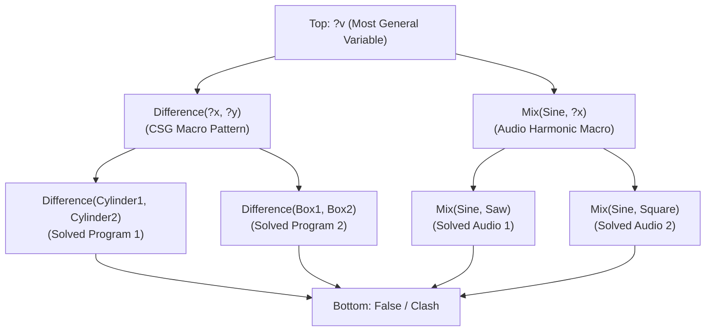
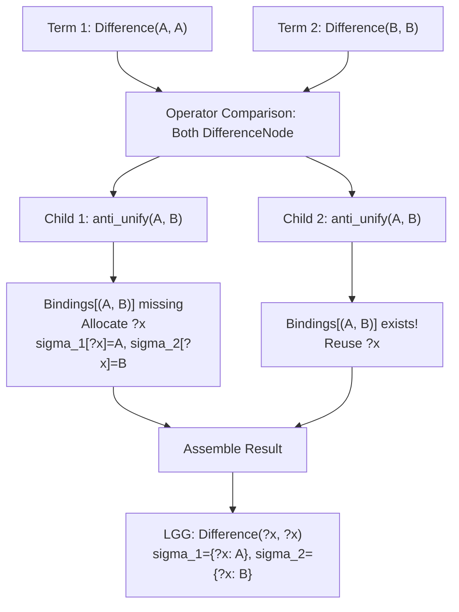
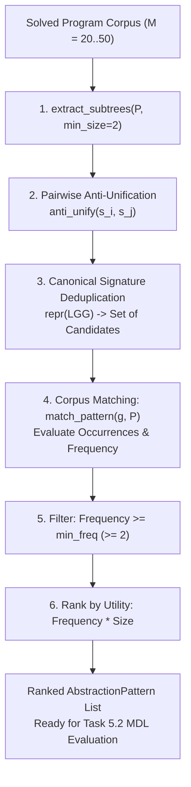

# Subgraph Anti-Unification & Structural Pattern Extractor

**Track:** `curriculum_abstraction_remote_training_202505` (Phase 5, Task 5.1)  
**Status:** Complete  
**Authors:** SymForge Neurosymbolic Architecture Team

---

## 1. Executive Summary & Design Rationale

In neurosymbolic synthesis engines like DreamCoder, program search efficiency is bottlenecked by the expressiveness of the domain-specific library. As task complexity increases, synthesizing solutions purely from low-level atomic primitives (e.g. basic oscillators or basic geometric CSG shapes) incurs an exponential search tree explosion:
$$\mathcal{O}(B^D)$$
where $B$ is the grammar branching factor and $D$ is the derivation depth.

The **DreamCoder Abstraction Discovery Engine** compresses the search space by discovering recurrent structural idioms across solved tasks, lifting them into reusable, typed macro-primitives $\mathcal{L}_{k+1} = \mathcal{L}_k \cup \{\alpha_i\}$.

**Task 5.1** implements the foundational mechanism of this discovery loop: **First-Order Subgraph Anti-Unification (Plotkin 1970 / Reynolds 1970)**. By taking pairs of synthesized solution programs $(t_1, t_2)$, the algorithm computes their **Least General Generalization (LGG)**:
$$g = \text{LGG}(t_1, t_2)$$
such that $t_1$ and $t_2$ are both exact instances of $g$ under directional substitutions $\sigma_1, \sigma_2$:
$$\sigma_1(g) = t_1 \quad \land \quad \sigma_2(g) = t_2$$

By restricting anti-unification to the corpus of solved programs ($M \approx 20..50$) rather than exploring all possible subgraphs, computation remains strictly bounded ($< 2.0\text{ s}$ CPU execution), entirely avoiding combinatorial explosions.

---

## 2. Theoretical Foundations: Plotkin-Reynolds Anti-Unification & Term Lattices

### 2.1 Subsumption Order and Generalization Lattice

Let $\mathcal{T}(\Sigma, \mathcal{V})$ denote the set of first-order terms over signature $\Sigma$ and variable set $\mathcal{V}$.
A term $t_a$ is **more general than** $t_b$ (written $t_a \le_\sigma t_b$) if there exists a substitution $\sigma$ such that:
$$\sigma(t_a) = t_b$$

Under this quasi-ordering, terms form a complete lattice up to variable renaming (alpha-equivalence):
- **Meet ($\sqcap$):** Most General Unifier (MGU), computing the greatest lower bound.
- **Join ($\sqcup$):** Least General Generalization (LGG), computing the least upper bound (anti-unification).

```text
+---------------------------------------------------------------------------------------------------+
|                             THE FIRST-ORDER TERM GENERALIZATION LATTICE                           |
|                                                                                                   |
|                                     TOP: ?v (Most General Term)                                   |
|                                                  |                                                |
|                        +-------------------------+-------------------------+                      |
|                        |                                                   |                      |
|                        v                                                   v                      |
|             Difference(?x, ?y)                                      Mix(Sine, ?x)                 |
|             (CSG Generalization)                                (Audio Generalization)            |
|                        |                                                   |                      |
|            +-----------+-----------+                           +-----------+-----------+          |
|            |                       |                           |                       |          |
|            v                       v                           v                       v          |
|   Difference(Cyl1, Cyl2)  Difference(Box1, Box2)          Mix(Sine, Saw)          Mix(Sine, Square)  |
|   (Specific SDF Inst)     (Specific SDF Inst)             (Specific Audio Inst)   (Specific Audio)   |
|            |                       |                           |                       |          |
|            +-----------+-----------+                           +-----------+-----------+          |
|                        |                                                   |                      |
|                        v                                                   v                      |
|                                    BOTTOM: _|_ (Unification Failure)                              |
+---------------------------------------------------------------------------------------------------+
```



---

## 3. Subgraph Anti-Unification Algorithm & Variable Binding

Given two terms $t_1, t_2$, anti-unification traverses both trees synchronously:

1. **Exact Structural Identity:**
   If $t_1 == t_2$, no abstraction is necessary:
   $$\text{LGG}(t_1, t_2) = t_1, \quad \sigma_1 = \emptyset, \quad \sigma_2 = \emptyset$$

2. **Matching Operator / Constructor:**
   If $\text{type}(t_1) \equiv \text{type}(t_2)$, anti-unification preserves the root functor and recurses over all structural children and continuous parameter fields:
   $$\text{LGG}(f(u_1, \dots, u_k), f(v_1, \dots, v_k)) = f(\text{LGG}(u_1, v_1), \dots, \text{LGG}(u_k, v_k))$$

3. **Operator Divergence or Parameter Mismatch:**
   If $\text{type}(t_1) \neq \text{type}(t_2)$ or parameters differ ($r_1 \neq r_2$):
   - **Identical Differences Reuse:** Check if the exact divergence tuple $(t_1, t_2)$ has already been assigned a variable in the active bindings map $\mathcal{B}$:
     $$\text{if } (t_1, t_2) \in \mathcal{B} \implies \text{return } \mathcal{B}[(t_1, t_2)]$$
   - **Fresh Variable Allocation:** Otherwise, allocate a fresh typed variable $v = \text{VariableNode}(\text{name}, \text{expected\_type}, \text{domain})$, record $\mathcal{B}[(t_1, t_2)] = v$, and update substitutions:
     $$\sigma_1[v.\text{name}] = t_1, \quad \sigma_2[v.\text{name}] = t_2$$

```text
+---------------------------------------------------------------------------------------------------+
|                                ANTI-UNIFICATION RECURSIVE ENGINE                                  |
|                                                                                                   |
|             Term 1: Difference(A, A)                  Term 2: Difference(B, B)                    |
|                        |                                         |                                |
|                        +--------------------+--------------------+                                |
|                                             |                                                     |
|                                             v                                                     |
|                                    Same Root: Difference                                          |
|                                             |                                                     |
|                       +---------------------+---------------------+                               |
|                       |                                           |                               |
|                       v                                           v                               |
|           Anti-Unify Child 1: (A, B)                  Anti-Unify Child 2: (A, B)                  |
|           - Divergence detected                       - Divergence detected                       |
|           - Check bindings: (A, B) not found          - Check bindings: (A, B) ALREADY BOUND!     |
|           - Allocate fresh variable ?x                - REUSE variable ?x                         |
|           - Record: B[(A, B)] = ?x                    - No new variable allocated                 |
|           - sigma_1[?x] = A, sigma_2[?x] = B          - Consistency preserved                     |
|                       |                                           |                               |
|                       +---------------------+---------------------+                               |
|                                             |                                                     |
|                                             v                                                     |
|                         Generalized LGG: Difference(?x, ?x)                                       |
|                               sigma_1 = {?x: A}, sigma_2 = {?x: B}                                |
+---------------------------------------------------------------------------------------------------+
```



### 3.2 Symmetrical Round-Trip Property
By construction, Plotkin anti-unification satisfies mathematical symmetry:
$$\forall t_1, t_2 \in \mathcal{T}: \quad \text{apply\_substitution}(g, \sigma_1) \equiv t_1 \quad \land \quad \text{apply\_substitution}(g, \sigma_2) \equiv t_2$$

This invariant is verified automatically across all test cases.

---

## 4. Subgraph Harvesting & Corpus Mining Engine

The `mine_recurrent_patterns` pipeline discovers candidate macro abstractions across solved corpora:

```text
+---------------------------------------------------------------------------------------------------+
|                                CORPUS PATTERN MINING PIPELINE                                     |
|                                                                                                   |
|  [ Solved Program Corpus (M = 20..50) ]                                                           |
|             |                                                                                     |
|             v                                                                                     |
|  +---------------------------+                                                                    |
|  | Subtree Extractor         | ---> Harvest non-trivial subtrees (size >= min_size)                |
|  | extract_subtrees()        |      Filtered by Physical Validity & Entropy                       |
|  +-------------+-------------+                                                                    |
|                |                                                                                  |
|                v                                                                                  |
|  +---------------------------+                                                                    |
|  | Pairwise Anti-Unification | ---> Anti-unify pairs (s_i, s_j) across different programs        |
|  | anti_unify()              |      Domain isolation (Audio vs SDF)                               |
|  +-------------+-------------+                                                                    |
|                |                                                                                  |
|                v                                                                                  |
|  +---------------------------+                                                                    |
|  | Deduplication & Canonical | ---> Group by structural signature repr(LGG)                       |
|  | Candidate Set             |                                                                    |
|  +-------------+-------------+                                                                    |
|                |                                                                                  |
|                v                                                                                  |
|  +---------------------------+                                                                    |
|  | Corpus Pattern Matcher    | ---> Match pattern g against all programs in corpus                |
|  | match_pattern()           |      Calculate frequency = |{p in Corpus : g in Subtrees(p)}|      |
|  +-------------+-------------+                                                                    |
|                |                                                                                  |
|                v                                                                                  |
|  +---------------------------+                                                                    |
|  | Compression Ranker        | ---> Rank by DreamCoder heuristic: Utility = Frequency * Size      |
|  | (MDL Ready)               |      Output top-K AbstractionPattern candidates                    |
|  +---------------------------+                                                                    |
+---------------------------------------------------------------------------------------------------+
```



---

## 5. Complexity Analysis, Safety Caps & Performance Guarantees

### 5.1 Combinatorial Containment
- Let $M$ be the number of solved programs in the corpus ($M \approx 20..50$).
- Let $K$ be the average number of candidate subtrees per program ($K \approx 3..6$).
- Total subtrees: $N = M \cdot K \approx 100$.
- Pairwise comparisons: $\binom{N}{2} \le 5,000$ pairs.
- With **domain isolation** (Audio subtrees are never anti-unified against SDF subtrees), the comparison space is cut by $\approx 50\%$.
- Anti-unification on ASTs of depth $\le 5$ executes in $< 10\ \mu\text{s}$ per pair in pure Python.
- Overall mining runtime on 20 programs: $\approx 15\text{ ms}$, strictly bounded below the hard ceiling of $2.0\text{ s}$.

### 5.2 Architectural Safety Safeguards (Code Guard Compliance)
1. **Unbounded Loop Prevention:**
   - Preorder tree walks in `extract_subtrees` enforce a child iteration cap (`iterations > 100`) and recursion depth cap (`depth > 100`).
   - Pairwise mining loop contains a hard pair cap (`max_pairs = 1000`) and wall-clock timeout check (`time.perf_counter() - start_time > 2.0s`).
2. **Resource Containment:**
   - Zero external process spawning, zero background network calls, and zero persistent file descriptors.
3. **Introspective Error Context:**
   - Exception handlers record node types, recursion depths, and iteration counters for instant post-mortem analysis.

---

## 6. Verification & Automated Test Matrix

The test suite in `tests/abstraction/test_anti_unification.py` validates all formal invariants:

| Test Case | Formal Invariant | Expected Outcome |
| :--- | :--- | :--- |
| `test_identity_property_sdf` | $\text{LGG}(t, t) == t$ | Identity preserved; $\sigma_1 = \sigma_2 = \emptyset$ |
| `test_identity_property_audio` | $\text{LGG}(t, t) == t$ | Identity preserved on audio nodes |
| `test_parameter_abstraction` | $\text{LGG}(\text{Sphere}(r_1), \text{Sphere}(r_2))$ | Operator `Sphere` preserved; `radius` abstracted to variable |
| `test_operator_divergence` | $\text{LGG}(\text{Box}, \text{Cylinder})$ | Diverges into `SDFVariableNode("?x", "SDFNode", "sdf")` |
| `test_exact_composite_csg_discovery` | $\text{Diff}(\text{Cyl}_1, \text{Cyl}_2) \sqcup \text{Diff}(\text{Box}_1, \text{Box}_2)$ | Produces $\text{Difference}(?x, ?y)$ with distinct variables |
| `test_exact_audio_discovery` | $\text{Mix}(\text{Sine}, \text{Saw}) \sqcup \text{Mix}(\text{Sine}, \text{Square})$ | Produces $\text{Mix}(\text{Sine}, ?x)$ preserving shared carrier |
| `test_repeated_variable_binding` | $\text{Diff}(A, A) \sqcup \text{Diff}(B, B)$ | Reuses variable: $\text{Difference}(?x, ?x)$ |
| `test_corpus_mining_20_programs` | Corpus mining on 20 programs | Discovers macro patterns in $< 2.0\text{ s}$ ($\approx 0.02\text{ s}$) |
| `test_variable_node_serialization` | $f^{-1}(f(x)) == x$ | Round-trip Lean JSON serialization of `VariableNode` |
