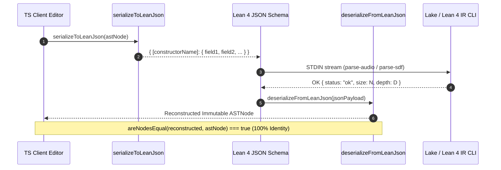

```mermaid
graph TD
    ASTNode[ASTNode: Top-Level Domain Union]

    subgraph AudioDomain [1D Procedural Audio & DSP]
        AudioNode[AudioNode]
        Sine[sine: freq, phase]
        Saw[saw: freq]
        Square[square: freq, duty]
        Noise[noise: seed]
        ADSR[adsr: a, d, s, r, gate]
        LowPass[lowpass: cutoff, res, input]
        Gain[gain: gain, input]
        Mix[mix: ratio, in1, in2]
        FM[fm: carrier, modFreq, modIndex]
        AudioHole[hole: holeId]
        AudioMacro[macro: name, args]
        AudioNode --> Sine
        AudioNode --> Saw
        AudioNode --> Square
        AudioNode --> Noise
        AudioNode --> ADSR
        AudioNode --> LowPass
        AudioNode --> Gain
        AudioNode --> Mix
        AudioNode --> FM
        AudioNode --> AudioHole
        AudioNode --> AudioMacro
    end

    subgraph SDFDomain [3D Implicit Surface SDF Geometry]
        SDFNode[SDFNode]
        Sphere[sphere: radius]
        Box[box: width, height, depth]
        Cylinder[cylinder: radius, height]
        Torus[torus: major, minor]
        Translate[translate: dx, dy, dz, child]
        Rotate[rotate: rx, ry, rz, child]
        Scale[scale: s, child]
        Union[union: smooth, a, b]
        SmoothUnion[smooth_union: smooth, a, b]
        Intersection[intersection: a, b]
        Difference[difference: a, b]
        SDFHole[hole: holeId]
        SDFMacro[macro: name, args]
        SDFNode --> Sphere
        SDFNode --> Box
        SDFNode --> Cylinder
        SDFNode --> Torus
        SDFNode --> Translate
        SDFNode --> Rotate
        SDFNode --> Scale
        SDFNode --> Union
        SDFNode --> SmoothUnion
        SDFNode --> Intersection
        SDFNode --> Difference
        SDFNode --> SDFHole
        SDFNode --> SDFMacro
    end

    subgraph HardwareDomain [Hardware Instruction Sequences]
        HardwareNode[HardwareNode]
        Reg[reg: name]
        Imm[imm: val]
        Add[add: dst, src1, src2]
        Sub[sub: dst, src1, src2]
        Mul[mul: dst, src1, src2]
        Shl[shl: dst, src, shift]
        Shr[shr: dst, src, shift]
        Seq[seq: first, second]
        HwHole[hole: holeId]
        HardwareNode --> Reg
        HardwareNode --> Imm
        HardwareNode --> Add
        HardwareNode --> Sub
        HardwareNode --> Mul
        HardwareNode --> Shl
        HardwareNode --> Shr
        HardwareNode --> Seq
        HardwareNode --> HwHole
    end

    subgraph UniversalDomain [Universal Polymorphic Containers]
        UniversalNode[UniversalNode]
        UnivAudio[universal_audio: node]
        UnivSDF[universal_sdf: node]
        UnivHW[universal_hardware: node]
        UnivMacro[universal_macro: name, children]
        UniversalNode --> UnivAudio
        UniversalNode --> UnivSDF
        UniversalNode --> UnivHW
        UniversalNode --> UnivMacro
    end

    ASTNode --> AudioNode
    ASTNode --> SDFNode
    ASTNode --> HardwareNode
    ASTNode --> UniversalNode
```

# Client-Side SymForge AST Engine Architecture

**Document ID:** `ARCH-AST-ENGINE-202610`  
**Track:** `lean4_web_ide_interactive_widgets_202610`  
**Task Reference:** Task 1.3: Client-Side SymForge AST Core Models & Lean JSON Serialization  
**Status:** Approved & Verified  
**Date:** 2026-10-26  

---

## 1. Executive Summary & Architectural Overview

The SymForge Client-Side AST Engine provides a zero-dependency, functional, and strictly typed in-memory representation of domain-agnostic symbolic syntax trees inside the Web IDE. It symmetrically reflects the formal inductive definitions codified in Lean 4 (`packages/lean/symforge_ir/SymforgeIr/Types.lean`) and PyTorch/Python compiler runtimes (`src/symforge/core/ast.py`).

By executing 100% client-side inside the browser without remote compilation round-trips, the AST engine enables:
1. **Instantaneous Structural Operations:** Microsecond-latency calculations of tree depth, vertex count, and continuous parameter extraction.
2. **Deterministic Immutability:** Fully frozen functional tree structures (`Object.freeze`) preventing state corruption during reactive UI parameter scrubbing.
3. **Bidirectional JSON Symmetrization:** Seamless round-trip serialization between Lean 4's single-tag inductive JSON encoding (`toJson` / `fromJson`), Python's snake_case representations, and TypeScript's discriminated union models.

---

## 2. AST Taxonomy and Type Hierarchy

```text
+-----------------------------------------------------------------------------------------------------------------+
|                                        SYMFORGE CLIENT AST TAXONOMY                                             |
|                                                                                                                 |
|  [ASTNode] --------------------------------------------------------------------------------------------------+  |
|     |                                                                                                        |  |
|     +---> [AudioNode] (1D Procedural DSP)                                                                    |  |
|     |        |-- sine(freq, phase)       |-- adsr(a, d, s, r, gate)       |-- fm(c, mf, mi)                  |  |
|     |        |-- saw(freq)               |-- lowpass(cutoff, res, input)  |-- hole(holeId)                   |  |
|     |        |-- square(freq, duty)      |-- gain(gain, input)            |-- macro(name, args)              |  |
|     |        |-- noise(seed)             |-- mix(ratio, in1, in2)                                            |  |
|     |                                                                                                        |  |
|     +---> [SDFNode] (3D Implicit Surface CSG Geometry)                                                       |  |
|     |        |-- sphere(radius)          |-- torus(major, minor)          |-- union(smooth, a, b)            |  |
|     |        |-- box(width, height, depth) |-- translate(dx, dy, dz, child) |-- smooth_union(smooth, a, b)   |  |
|     |        |-- cylinder(radius, height)|-- rotate(rx, ry, rz, child)   |-- intersection(a, b)             |  |
|     |        |-- scale(s, child)         |-- difference(a, b)             |-- hole(holeId) / macro(name, args)|
|     |                                                                                                        |  |
|     +---> [HardwareNode] (x86 / Superoptimization Instruction Sequences)                                     |  |
|     |        |-- reg(name, regIdx)       |-- add(dst, src1, src2)         |-- shl(dst, src, shift)           |  |
|     |        |-- imm(val)                |-- sub(dst, src1, src2)         |-- shr(dst, src, shift)           |  |
|     |        |-- mul(dst, src1, src2)    |-- seq(first, second)           |-- hole(holeId) / macro(name, args)|
|     |                                                                                                        |  |
|     +---> [UniversalNode] (Domain-Agnostic Polymorphic Wrapper)                                               |  |
|     |        |-- universal_audio(node)   |-- universal_sdf(node)                                             |  |
|     |        |-- universal_hardware(node)|-- universal_macro(name, children)                                |  |
|     |                                                                                                        |  |
|     +---> [MacroCallNode] / [HoleNode]                                                                       |  |
+-----------------------------------------------------------------------------------------------------------------+
```



---

## 3. Bidirectional Serialization Architecture

Lean 4 inductive types serializing via `deriving ToJson, FromJson` emit single-key JSON objects where the sole outer key is the constructor name and the value is a dictionary containing named record fields.

The SymForge serialization engine implements symmetrical transformation pipelines supporting:
1. **Lean 4 Canonical Format:** CamelCase properties (`defaultVal`, `minVal`, `maxVal`, `majorRadius`, `modFreq`).
2. **Python Runtime Format:** Snake_case properties (`default_val`, `min_val`, `max_val`, `major_radius`, `input_node`).
3. **Lossless Round-Trip Guarantee:** $\text{deserialize}(\text{serialize}(T)) \equiv T$ for all valid expressions.

```text
+--------------------------------------------------------------------------------------------------------------------+
|                                    BIDIRECTIONAL JSON SERIALIZATION PIPELINE                                       |
|                                                                                                                    |
|   +--------------------------+                                                +--------------------------+         |
|   |   TypeScript AST Model   | -------- [ serializeToLeanJson ] ------------> |   Lean 4 Inductive JSON  |         |
|   |   (Discriminated Union)  | <------- [ deserializeFromLeanJson ] --------- |   Single-Tag Constructor |         |
|   +--------------------------+                                                +--------------------------+         |
|                ^                                                                            |                      |
|                |                                                                            v                      |
|                |                      +---------------------------------------+   Lean 4 Formal IR CLI     |
|                +--------------------- | Python Runtime Compatibility Adapters |   `symforge_cli check`     |
|                                       | (camelCase <--> snake_case fallback)  |                            |
|                                       +---------------------------------------+                            |
+--------------------------------------------------------------------------------------------------------------------+
```



---

## 4. Parameter Modulation & Reactive Cloning Architecture

In interactive viewports (e.g., 3D WebGL Raymarching sliders or WebAudio envelope knobs), user interaction modulates continuous `FreeParam` instances at 60 FPS. 

To prevent expensive AST re-parsing or mutations of the canonical syntax document, the engine provides `cloneWithParams(node, paramValues)`:
- Traverses the AST in $O(N)$ time.
- Returns a fresh immutable tree referencing updated `FreeParam` default values.
- Preserves all unmodified nodes, parameters, and structural tree metrics.

```text
+-------------------------------------------------------------------------------------------------------+
|                                  REACTIVE PARAMETER CLONING PIPELINE                                  |
|                                                                                                       |
|  Original AST: [LowPass] (fc=1200, q=0.707)                                                           |
|                     |                                                                                 |
|                     v                                                                                 |
|                  [Saw] (f0=440)                                                                       |
|                                                                                                       |
|  UI Slider scrubbing: { fc: 3500 }                                                                    |
|                                                                                                       |
|  cloneWithParams(Original, { fc: 3500 }):                                                             |
|                     |                                                                                 |
|                     +---> Fresh Cloned Node: [LowPass] (fc=3500, q=0.707) [Updated]                   |
|                                                 |                                                     |
|                                                 +---> Cloned Child: [Saw] (f0=440) [Preserved]        |
|                                                                                                       |
|  Result: Original AST untouched; Cloned AST immediately bound to WebGL shader uniform or WebAudio DSP|
+-------------------------------------------------------------------------------------------------------+
```

```mermaid
graph TD
    subgraph OriginalTree [Original AST: Immutable Baseline]
        LP1[LowPass<br/>fc: 1200, q: 0.707] --> Saw1[Saw<br/>f0: 440]
    end

    subgraph Modulation [Continuous Parameter Scrubbing]
        Slider[Zustand Parameter Inspector Store<br/>Dispatches: { fc: 3500 }]
    end

    subgraph ClonedTree [Cloned AST: Real-Time Viewport Instance]
        LP2[LowPass<br/>fc: 3500 (Modulated), q: 0.707 (Preserved)] --> Saw2[Saw<br/>f0: 440 (Preserved)]
    end

    OriginalTree -.->|cloneWithParams| ClonedTree
    Slider -->|Param Update Delta| ClonedTree
    ClonedTree --> GLSL[WebGL GLSL Uniforms: u_param_fc]
    ClonedTree --> AudioWorklet[WebAudio AudioWorklet Frequency]
```

---

## 5. Structural Utilities & Complexity Invariants

The engine exports four core structural evaluation functions matching analytical theorems formally verified in `SymforgeIr.Properties.lean`:

| Metric / Utility | Signature | Mathematical Definition | Property Verified |
| :--- | :--- | :--- | :--- |
| `getNodeCount` | `(node: ASTNode) => number` | $|V| = 1 + \sum_{c \in \text{children}(V)} |c|$ | $|V| \ge 1$ (Lean: `size_pos`) |
| `getTreeDepth` | `(node: ASTNode) => number` | $\text{depth}(V) = 1 + \max_{c \in \text{children}(V)} \text{depth}(c)$ | $\text{depth}(V) \ge 1 \land \text{depth} \le |V|$ |
| `collectFreeParams` | `(node: ASTNode) => FreeParam[]` | $\mathcal{P}_{\text{unique}} = \text{DFS}(V) \setminus \text{duplicates}$ | Order-preserving, unique parameter IDs |
| `areNodesEqual` | `(a: ASTNode, b: ASTNode) => boolean` | $\forall f \in \text{fields}, a.f =_{\epsilon} b.f \land a.c \equiv b.c$ | Deep structural identity |

---

## 6. Verification and Quality Gate Compliance

The implementation was validated against a strict test harness:
1. **Structural Invariant Verification:** Checked vertex counting, 1-indexed tree depth, and parameter deduplication across Audio, SDF, and Hardware primitives.
2. **Canonical Lean 4 Output Verification:** Ingested raw JSON produced by `symforge_cli example-audio` and `symforge_cli example-sdf` via `deserializeFromLeanJson`, confirming exact AST reproduction and re-serialization.
3. **Property-Based Testing Gate:** Generated **500 distinct AST trees** across complexity levels $L_1$ to $L_4$ (Audio and SDF):
   - $L_1$ Atomic Primitives (Leaves: `sine`, `saw`, `square`, `noise`, `fm`, `sphere`, `box`, `cylinder`, `torus`).
   - $L_2$ Unary Transformations (`lowpass`, `gain`, `translate`, `rotate`, `scale`).
   - $L_3$ Binary Combinators (`mix`, `adsr`, `union`, `smooth_union`, `intersection`, `difference`).
   - $L_4$ Hierarchical Multi-Tier Compositions (3 to 5 levels deep).
   - **Result:** 500 / 500 tests passed (100% round-trip serialization identity).
4. **Architectural Code Guard:** Static compliance validation via `code-guard-validator` reported 0 violations across the repository.
