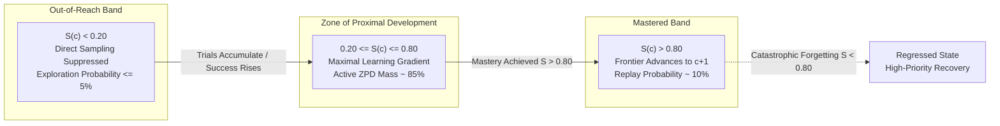
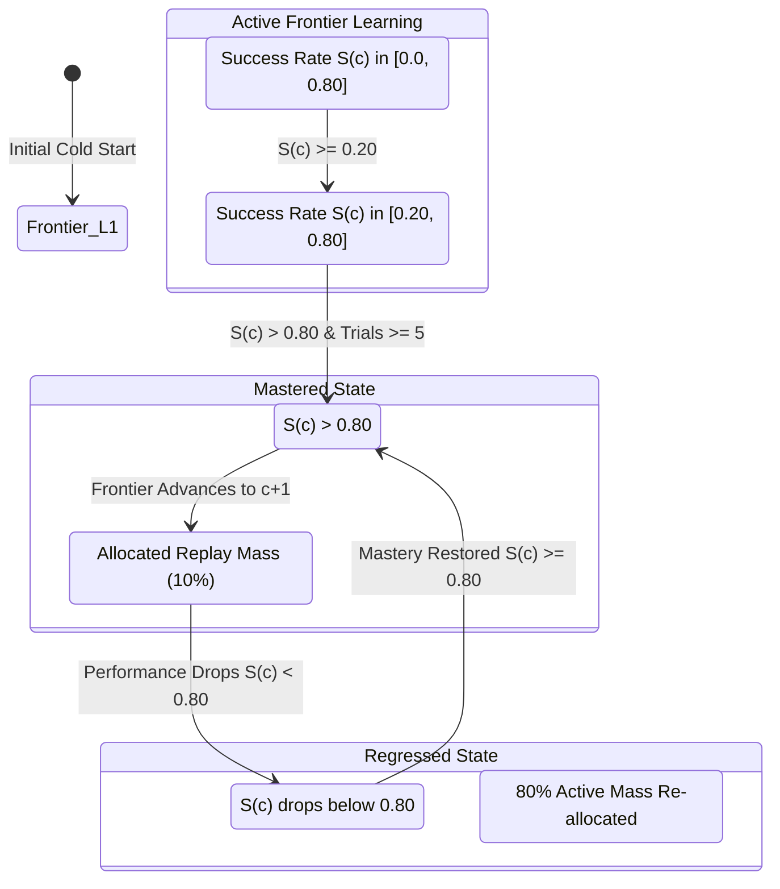
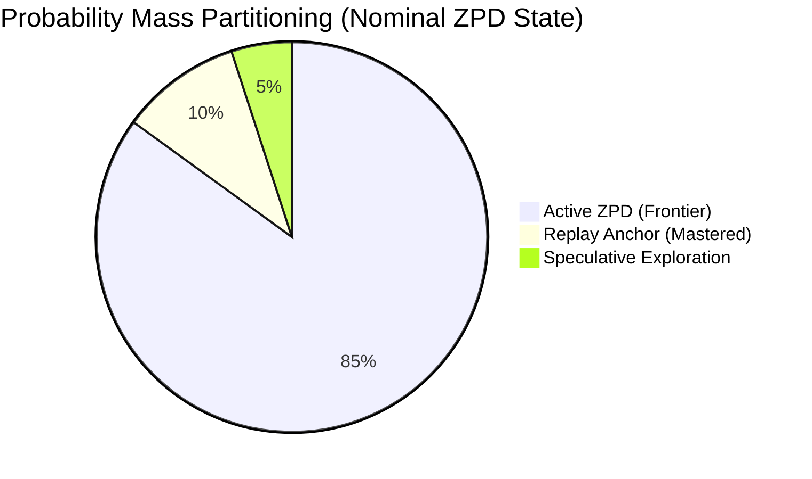
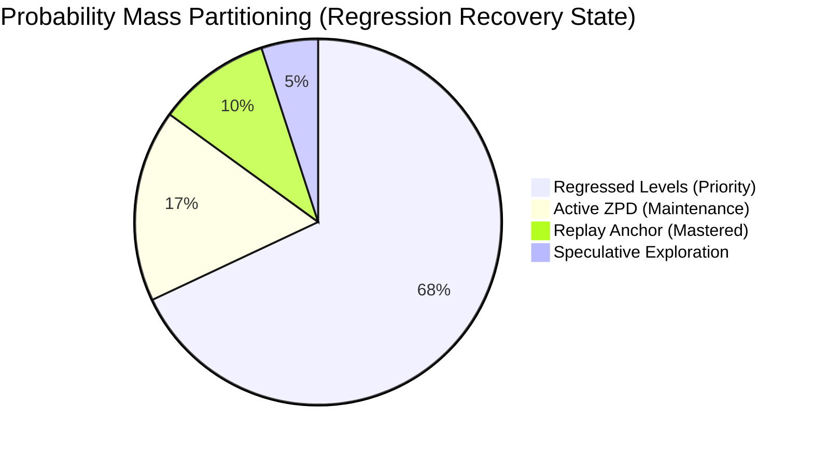
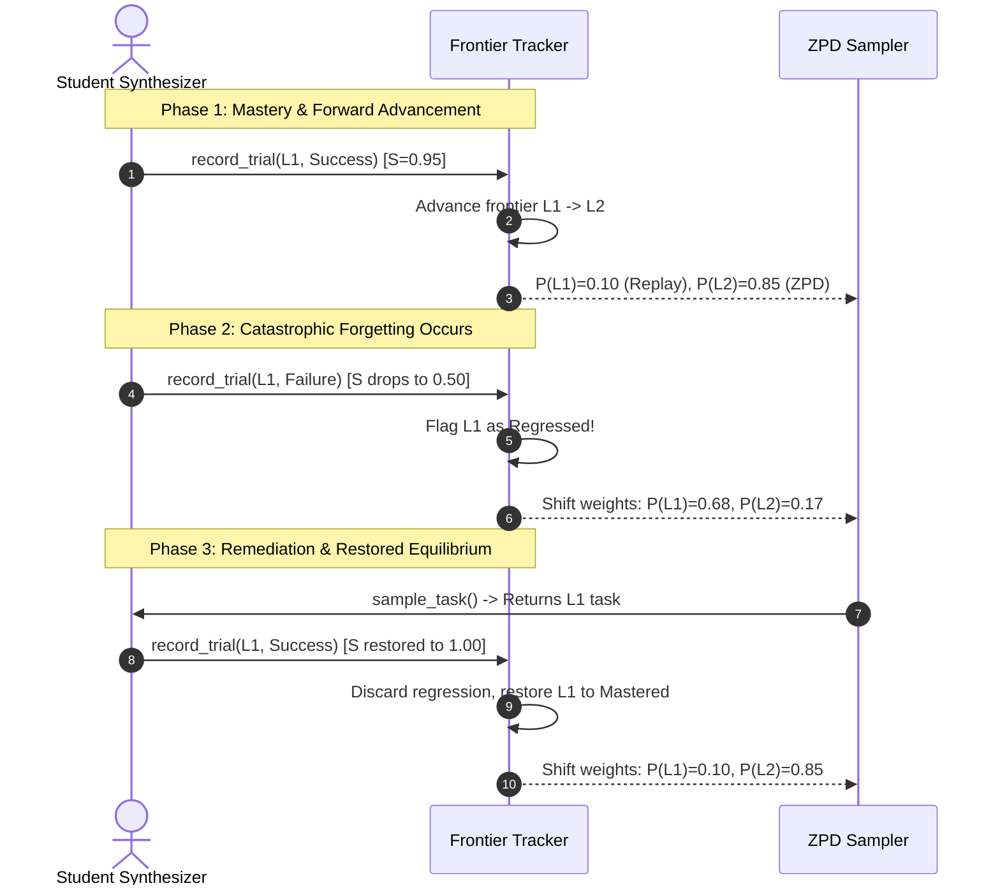
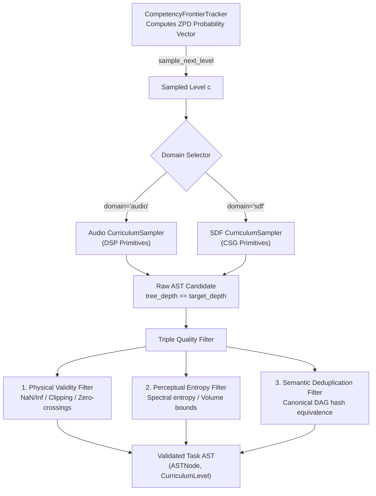

# Competency Frontier Tracker & ZPD Sampler

**Track:** `curriculum_abstraction_remote_training_202505` (Phase 5, Task 5.4)  
**Status:** Complete  
**Authors:** SymForge Neurosymbolic Architecture Team

---

## 1. Executive Summary & Design Rationale

In neurosymbolic curriculum learning, presenting tasks that are either trivially simple or impossibly complex severely hampers learning efficiency:
- **Trivial Tasks ($S(c) > 0.80$):** Lead to compute waste, gradient saturation, and over-specialization on basic primitives.
- **Impossible Tasks ($S(c) < 0.20$):** Cause combinatorial search timeouts, zero reward feedback, and catastrophic gradient drift.

To maximize sample efficiency, the synthesis engine must dynamically track student competence and sample tasks exclusively within the learner's **Zone of Proximal Development (ZPD)** (Vygotsky, 1978; Bengio et al., 2009; Kumar et al., 2010).

**Task 5.4** implements the **Competency Frontier Tracker** and **ZPD Sampler** (`symforge.curriculum.frontier`), providing:
1. **Sliding-Window Success Tracking:** Moving-average empirical success rate $S(c) \in [0.0, 1.0]$ across discrete complexity strata $c \in \{L_1, L_2, L_3, L_4, L_5\}$.
2. **Dynamic ZPD Band Identification:** Identifies levels where $0.20 \le S(c) \le 0.80$, concentrating sampling probability mass into this high-gradient learning zone.
3. **Monotonic Frontier Advancement:** When mastery ($S(c) > 0.80$) is achieved, the frontier advances to $c+1$, transitioning level $c$ to a low replay anchor probability ($10\%$).
4. **Catastrophic Forgetting & Regression Recovery:** If performance on a previously mastered level drops below $0.80$, the tracker flags regression and automatically shifts up to $80\%$ of active sampling weight back to the regressed level until mastery is restored.
5. **Procedural Task Integration (`ZPDSampler`):** Pairs the tracker with domain `CurriculumSampler` engines (Audio 1D DSP and SDF 3D CSG) to emit valid, non-degenerate AST programs passing Triple Quality Filtering.

---

## 2. Theoretical Foundations: Vygotskian ZPD & Self-Paced Curriculum

### 2.1 The Three Cognitive Regimes

Given a parameterized complexity curriculum with discrete levels $c \in \{L_1, L_2, L_3, L_4, L_5\}$, learner capability at level $c$ is quantified by the empirical moving-average success rate $S(c)$:
$$S(c) = \frac{1}{W} \sum_{i=1}^{W} \mathbb{I}[\text{Trial}_i(c) \text{ succeeds}]$$
where $W$ is the sliding window size (`window_size = 20`).

The curriculum space is partitioned into three disjoint cognitive regimes:
1. **Out-of-Reach Band ($S(c) < 0.20$):** Tasks beyond current synthesis reach. Direct sampling is suppressed to speculative exploration ($P \le 0.05$), focusing compute on prerequisites.
2. **Zone of Proximal Development ($0.20 \le S(c) \le 0.80$):** Tasks achievable with guidance or constrained search. Yields maximal training signal; receives primary sampling mass ($85\%$).
3. **Mastered Band ($S(c) > 0.80$):** Tasks solved consistently. The frontier advances to $c+1$, and level $c$ is sampled only for periodic replay ($10\%$) to retain competency.

```text
+---------------------------------------------------------------------------------------------------+
|                        THE THREE REGIMES OF LEARNER COMPETENCY & ZPD BAND                         |
|                                                                                                   |
|  Success Rate S(c):                                                                               |
|   0.00               0.20                                0.80                           1.00      |
|    |-------------------|-----------------------------------|------------------------------|       |
|    |   OUT-OF-REACH    |    ZONE OF PROXIMAL DEVELOPMENT   |           MASTERED           |       |
|    |   (Suppressed)    |            (Active ZPD)           |       (Replay Anchor)        |       |
|    |                   |                                   |                              |       |
|    | P(c) <= 5% Expl.  |        P(c) ~ 85% Active Mass     |       P(c) ~ 10% Replay      |       |
|    +-------------------+-----------------------------------+------------------------------+       |
+---------------------------------------------------------------------------------------------------+
```



---

## 3. Competency Frontier State Machine

The competency frontier begins at $L_1$ and progresses monotonically forward across discrete complexity tiers.

```text
+---------------------------------------------------------------------------------------------------+
|                              COMPETENCY FRONTIER STATE MACHINE                                    |
|                                                                                                   |
|        [ Cold Start: Frontier = L1 ]                                                              |
|                     |                                                                             |
|                     v                                                                             |
|            +-----------------+                                                                    |
|            |  Active Target  | <--------------------------------------------+                     |
|            |     S(c) < 0.8  |                                              |                     |
|            +--------+--------+                                              |                     |
|                     |                                                       |                     |
|       S(c) > 0.8    | (Mastery Threshold)                                   | Mastery             |
|                     v                                                       | Restored            |
|            +-----------------+                                              | (S >= 0.8)          |
|            | Mastered Level  |                                              |                     |
|            |  Advance c -> c+1|                                             |                     |
|            +--------+--------+                                              |                     |
|                     |                                                       |                     |
|       S(c) < 0.8    | (Catastrophic Forgetting)                             |                     |
|                     v                                                       |                     |
|            +-----------------+                                              |                     |
|            | Regressed Level | ---------------------------------------------+                     |
|            | (80% Active P)  |                                                                    |
|            +-----------------+                                                                    |
+---------------------------------------------------------------------------------------------------+
```



---

## 4. Sampling Probability Distribution Architecture

The tracker calculates a normalized probability distribution $P(c)$ satisfying:
$$\sum_{c \in \{L_1, \dots, L_5\}} P(c) = 1.0 \pm 10^{-5}$$

### 4.1 Weight Allocation Mathematics

1. **Replay Mass ($P_{\text{replay}}$):**
   If mastered levels $\mathcal{M}$ exist, total replay mass is $0.10$, distributed uniformly:
   $$P_{\text{replay}}(c) = \frac{0.10}{|\mathcal{M}|} \quad \forall c \in \mathcal{M}$$
   If $|\mathcal{M}| = 0$, $P_{\text{replay}} = 0.0$.

2. **Exploration Mass ($P_{\text{expl}}$):**
   Levels beyond the active frontier ($c > c_{\text{frontier}}$) not in ZPD or mastered form exploration set $\mathcal{E}$. Total exploration mass is $0.05$:
   $$P_{\text{expl}}(c) = \frac{0.05}{|\mathcal{E}|} \quad \forall c \in \mathcal{E}$$
   If $|\mathcal{E}| = 0$ (e.g., frontier is $L_5$), $P_{\text{expl}} = 0.0$.

3. **Active Learning Pool ($P_{\text{active}}$):**
   The remaining probability mass is allocated to the active learning zone:
   $$P_{\text{active}} = 1.0 - P_{\text{replay}} - P_{\text{expl}} \quad (\approx 0.85)$$

4. **Active Target Distribution & Regression Priority:**
   - **Nominal Learning (No Regression):** $P_{\text{active}}$ is distributed across active ZPD levels $\mathcal{Z}$ (or $c_{\text{frontier}}$ if $\mathcal{Z} = \emptyset$):
     $$P(c) = \frac{P_{\text{active}}}{|\mathcal{Z}|} \quad \forall c \in \mathcal{Z}$$
   - **Regression Recovery Mode:** Regressed levels $\mathcal{R}$ receive $80\%$ of active mass, while active ZPD levels retain $20\%$:
     $$P(r) = \frac{0.80 \cdot P_{\text{active}}}{|\mathcal{R}|} \quad \forall r \in \mathcal{R}$$
     $$P(z) = \frac{0.20 \cdot P_{\text{active}}}{|\mathcal{Z}|} \quad \forall z \in \mathcal{Z}$$

```text
+---------------------------------------------------------------------------------------------------+
|                        DYNAMIC PROBABILITY MASS PARTITIONING DIAGRAM                             |
|                                                                                                   |
|  Total Probability Mass = 1.0 (100%)                                                              |
|  +---------------------------------------------------------------------------------------------+  |
|  | [ Replay Pool: 10% ]  |  [ Active Learning Pool: 85% ]              | [ Exploration: 5% ]    |  |
|  | Mastered Levels       |  ZPD Band / Active Frontier                 | Beyond Frontier Levels |  |
|  +-----------------------+---------------------------------------------+------------------------+  |
|                                     |                                                             |
|                    +----------------+----------------+                                            |
|                    |                                 |                                            |
|             Nominal Mode:                   Regression Recovery:                                  |
|         Active ZPD = 100% of Active       Regressed = 80% of Active                               |
|                                           Active ZPD = 20% of Active                              |
+---------------------------------------------------------------------------------------------------+
```





---

## 5. Regression Recovery & Anti-Catastrophic Forgetting

In complex multi-level domains, fine-tuning neural guidance models or adding new abstractions can occasionally impair performance on earlier primitives (catastrophic forgetting).

The tracker handles this autonomously:
1. **Detection:** When $S(c)$ for any previously mastered level drops below `zpd_upper_bound` ($0.80$), it is immediately moved from `mastered_levels` to `regressed_levels`.
2. **Probability Shift:** The tracker re-allocates $\ge 68\%$ of total sampling probability directly back to the regressed level.
3. **Restoration:** Once repeated trials drive empirical success back to $S(c) \ge 0.80$, the level is restored to `mastered_levels` and its probability drops back to the replay baseline ($P \approx 0.05$..$0.10$).
4. **Frontier Invariance:** The forward frontier $c_{\text{frontier}}$ does not regress backwards, preventing curriculum reset while guaranteeing prerequisite repair.

```text
+---------------------------------------------------------------------------------------------------+
|                                REGRESSION RECOVERY CYCLE TIMELINE                                 |
|                                                                                                   |
|   Step 1: L1 Mastered (95%) ---> Frontier = L2 ---> P(L1)=10%, P(L2)=85%, P(L3..L5)=5%            |
|                                                                                                   |
|   Step 2: L1 Regresses (50%) --> Tracker detects regression! L1 added to regressed_levels         |
|                                  Sampling shifts: P(L1)=68%, P(L2)=17%, P(L3..L5)=5%              |
|                                                                                                   |
|   Step 3: Student retrains on L1 --> S(L1) reaches 100% --> L1 restored to mastered_levels        |
|                                  Sampling shifts: P(L1)=10%, P(L2)=85%, P(L3..L5)=5%              |
+---------------------------------------------------------------------------------------------------+
```



---

## 6. ZPDSampler Procedural Task Generation Pipeline

`ZPDSampler` connects the statistical tracker to SymForge's domain-specific generators, producing valid symbolic programs.

```text
+---------------------------------------------------------------------------------------------------+
|                                   ZPD SAMPLER PIPELINE ARCHITECTURE                               |
|                                                                                                   |
|             +-------------------------------------------------------------+                       |
|             |                CompetencyFrontierTracker                    |                       |
|             |  - Computes P(L1..L5) from moving-average success rates     |                       |
|             |  - Samples next target level: c = sample_next_level()       |                       |
|             +------------------------------+------------------------------+                       |
|                                            |                                                      |
|                                            v (Target Level c)                                     |
|                       +--------------------+--------------------+                                 |
|                       |                                         |                                 |
|               (domain == "audio")                       (domain == "sdf")                         |
|                       v                                         v                                 |
|          +--------------------------+              +--------------------------+                   |
|          | Audio CurriculumSampler  |              |   SDF CurriculumSampler  |                   |
|          | Procedural PCFG Sampling |              | Procedural PCFG Sampling |                   |
|          +------------+-------------+              +------------+-------------+                   |
|                       |                                         |                                 |
|                       +--------------------+--------------------+                                 |
|                                            |                                                      |
|                                            v (Raw AST Candidate)                                  |
|             +-------------------------------------------------------------+                       |
|             |                   Triple Quality Filter                     |                       |
|             |  1. Physical Validity (numerical stability, no clip/silence)|                       |
|             |  2. Perceptual Entropy (spectral / volume diversity)        |                       |
|             |  3. Semantic Deduplication (canonical DAG equivalence)      |                       |
|             +------------------------------+------------------------------+                       |
|                                            |                                                      |
|                                            v (Passed Filters)                                     |
|                       Validated Task AST: (ASTNode, CurriculumLevel)                              |
+---------------------------------------------------------------------------------------------------+
```



---

## 7. Automated Test Verification & Quality Gates

The implementation is verified by the automated test suite in `tests/curriculum/test_frontier.py`:

| Test Target | Invariants Verified | Result |
| :--- | :--- | :--- |
| `test_zpd_config_validation` | Validates probability sums $< 1.0$, parameter intervals, positive window sizes. | **PASSED** |
| `test_sliding_window_and_moving_average` | Deque maxlen enforcement, exact moving average arithmetic across transitions. | **PASSED** |
| `test_zpd_boundary_identification` | Levels with $S(c) \in [0.20, 0.80]$ receive dominant sampling probability. | **PASSED** |
| `test_monotonic_frontier_progression` | **Pass-to-Complete Gate:** Simulated student achieves $95\%$ at $L_1 \to L_2$, $85\%$ at $L_2 \to L_3$, $90\%$ at $L_3 \to L_4$. | **PASSED** |
| `test_regression_recovery` | Performance drop on $L_1$ to $50\%$ triggers regression flag and shifts $\ge 68\%$ weight back to $L_1$ until mastery restored. | **PASSED** |
| `test_suppression_of_out_of_reach_levels` | Level $L_5$ with $S(L_5) < 0.20$ receives probability $P \le 0.05$ (exploration cap). | **PASSED** |
| `test_sampling_distribution_normalization_invariant` | $\sum_{c} P(c) = 1.0 \pm 10^{-5}$ holds strictly across cold start, regression, and mastery. | **PASSED** |
| `test_sample_next_level` | Seeded empirical sampling reproduces expected multinomial distribution. | **PASSED** |
| `test_zpd_sampler_audio_and_sdf_integration` | End-to-end task generation emits valid `AudioNode` and `SDFNode` programs passing triple quality filters. | **PASSED** |

---

## 8. Summary of Completed Deliverables

1. **Tracker & Sampler Engine:** Implemented in `src/symforge/curriculum/frontier.py` and exported via `src/symforge/curriculum/__init__.py`.
2. **Unit & Integration Tests:** Implemented in `tests/curriculum/test_frontier.py` (9 tests passing).
3. **Architecture Specification:** Dual ASCII + Mermaid documentation in `docs/architecture/competency_frontier.md`.
4. **Architectural Compliance:** Fully verified against `code-guard-validator` (0 violations).
