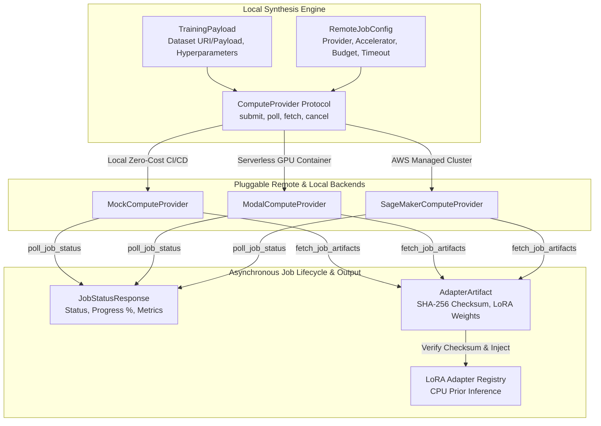
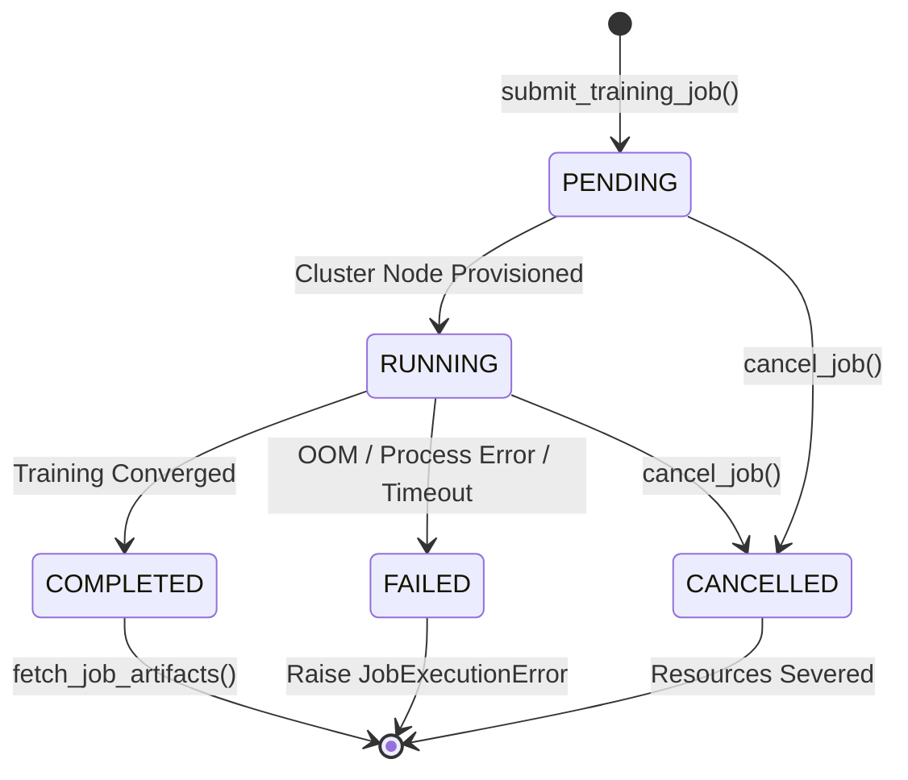

# Pluggable ComputeProvider Protocol & Data Contracts

## 1. Visão Geral e Motivação Arquitetural

No framework **SymForge**, a síntese de programas opera localmente em notebooks e estações de trabalho de desenvolvedores via busca heurística simbólica (Beam Search, A*), avaliação analítica rápida de DAGs e inferência prévia com modelos leves de prior em CPU. No entanto, o treinamento de redes neurais profundas (PDE, TGC e adaptadores LoRA de fine-tuning) exige computação intensiva acelerada por GPUs.

Para garantir **zero pegada de treinamento local** (*Zero Local Training Footprint*) e evitar acoplamento a provedores específicos de nuvem ou frameworks proprietários, o módulo `symforge.compute` estabelece uma camada de abstração assíncrona baseada em contratos estritos Pydantic e um protocolo tipado `typing.Protocol` desacoplado:

1. **Desacoplamento Total:** O motor de síntese interage exclusivamente com a interface assíncrona `ComputeProvider`, sem conhecer detalhes de SDKs (Boto3, Modal SDK, Kubernetes API).
2. **Contratos Tipados Estritos:** Payloads de treino (`TrainingPayload`), configurações de infraestrutura (`RemoteJobConfig`), telemetria de status (`JobStatusResponse`) e pesos de adaptadores (`AdapterArtifact`) possuem serialização bidirecional JSON 100% verificada com validação em tempo de execução via Pydantic v2.
3. **Integridade Criptográfica:** Todos os pesos de adaptadores LoRA gerados remotamente são validados por hashes canônicos SHA-256 (64 caracteres hexadecimais) antes de qualquer injeção no ambiente de inferência.

---

## 2. Arquitetura de Despacho Desacoplado (Decoupled Dispatch)

```text
+---------------------------------------------------------------------------------------------------+
|                                  SYMFORGE DECOUPLED COMPUTE ARCHITECTURE                          |
|                                                                                                   |
|  +-------------------------------------------------------------+                                  |
|  |                   Local Synthesis Engine                    |                                  |
|  |                                                             |                                  |
|  |  +-------------------+               +-------------------+  |                                  |
|  |  |  TrainingPayload  |               |  RemoteJobConfig  |  |                                  |
|  |  | (Data/Hyperparams)|               | (Timeout/Budget)  |  |                                  |
|  |  +---------+---------+               +---------+---------+  |                                  |
|  |            |                                   |            |                                  |
|  |            +-----------------+-----------------+            |                                  |
|  |                              v                              |                                  |
|  |             +----------------------------------+            |                                  |
|  |             |      ComputeProvider Protocol    |            |                                  |
|  |             |  (submit, poll, fetch, cancel)   |            |                                  |
|  |             +----------------+-----------------+            |                                  |
|  +------------------------------|------------------------------+                                  |
|                                 |                                                                 |
|         +-----------------------+-----------------------+                                         |
|         |                       |                       |                                         |
|         v                       v                       v                                         |
|  +--------------+       +---------------+       +-----------------+                               |
|  | Mock Provider|       | Modal Provider|       |SageMakerProvider|                               |
|  | (Local <10ms)|       | (Serverless)  |       | (AWS Managed)   |                               |
|  +------+-------+       +-------+-------+       +--------+--------+                               |
|         |                       |                        |                                        |
|         +-----------------------+------------------------+                                        |
|                                 |                                                                 |
|                                 v Asynchronous Artifacts                                          |
|                     +-----------------------+                                                     |
|                     |    AdapterArtifact    |                                                     |
|                     | (SHA-256 Checksum,    |                                                     |
|                     |  Weights URI / Bytes) |                                                     |
|                     +-----------+-----------+                                                     |
|                                 v                                                                 |
|                     +-----------------------+                                                     |
|                     |  LoRA Adapter Registry|                                                     |
|                     | (Local CPU Inference) |                                                     |
|                     +-----------------------+                                                     |
+---------------------------------------------------------------------------------------------------+
```



---

## 3. Especificação do Protocolo `ComputeProvider`

O protocolo assíncrono é definido em `symforge.compute.protocol` e marcado com `@runtime_checkable`:

```python
@runtime_checkable
class ComputeProvider(Protocol):
    """Protocol defining the asynchronous contract for remote training backends."""

    async def submit_training_job(
        self,
        payload: TrainingPayload,
        config: RemoteJobConfig,
    ) -> str:
        """Submit an asynchronous training job to the compute backend.

        Args:
            payload: Training payload containing dataset and model specifications.
            config: Remote execution environment parameters and budget limits.

        Returns:
            Unique string job_id identifier.
        """
        ...

    async def poll_job_status(self, job_id: str) -> JobStatusResponse:
        """Query the current execution status of an active or completed training job.

        Args:
            job_id: Unique job identifier returned by submit_training_job.

        Returns:
            JobStatusResponse with current status, metrics, and progress.
        """
        ...

    async def fetch_job_artifacts(
        self,
        job_id: str,
        destination_dir: Path,
    ) -> AdapterArtifact:
        """Retrieve the trained adapter artifact files once the job is COMPLETED.

        Args:
            job_id: Unique job identifier.
            destination_dir: Local directory path where artifact weights will be stored.

        Returns:
            AdapterArtifact metadata describing the stored weights.
        """
        ...

    async def cancel_job(self, job_id: str) -> bool:
        """Request cancellation of an active or pending training job.

        Args:
            job_id: Unique job identifier.

        Returns:
            True if cancellation was acknowledged/succeeded, False otherwise.
        """
        ...
```

---

## 4. Contratos de Dados Pydantic v2

Os contratos residem em `symforge.compute.contracts` e herdam de `pydantic.BaseModel` com configuração estrita (`frozen=True`, `extra="forbid"`):

### 4.1 `JobStatus` & `ComputeDomain`
- **`JobStatus`**: Enum representativo dos estados do ciclo de vida:
  - `PENDING`: Enfileirado no provedor, aguardando alocação de nó/acelerador.
  - `RUNNING`: Em execução ativa, emitindo métricas e progresso `progress_pct`.
  - `COMPLETED`: Treinamento finalizado com sucesso; artefatos disponíveis para download.
  - `FAILED`: Falha na execução (OOM, erro de script, timeout).
  - `CANCELLED`: Interrompido voluntariamente via chamada a `cancel_job`.
- **`ComputeDomain`**: Categorização do domínio de especialização (`"audio"`, `"sdf"`, `"hardware"`).

### 4.2 `TrainingPayload`
Especifica o conjunto de dados e as metas de treinamento.
- `trajectories_count: int` ($\ge 1$): Quantidade de trajetórias ou amostras.
- `domain: ComputeDomain`: Domínio de aplicação.
- `dataset_uri: Optional[str]`: URI remota (ex: `s3://...`, `https://...`, `file://...`).
- `dataset_payload: Optional[Dict[str, Any]]`: Dicionário contendo dados inline quando não for utilizada URI.
- `base_model_name: str`: Identificador do modelo base (ex: `"symforge-audio-pde-v1"`).
- `model_type: str`: Categoria arquitetural (ex: `"pde"`, `"tgc"`, `"lora"`).
- `hyperparameters: Dict[str, Any]`: Dicionário arbitrário de hiperparâmetros (lr, batch size, etc.).
- `created_at: datetime`: Timestamp UTC de criação.
- *Invariante:* Pelo menos um entre `dataset_uri` ou `dataset_payload` deve estar obrigatoriamente preenchido.

### 4.3 `RemoteJobConfig`
Parâmetros de infraestrutura e governança financeira.
- `provider_name: str`: Nome do backend (ex: `"mock"`, `"modal"`, `"sagemaker"`).
- `hardware_accelerator: str`: Tipo de acelerador (`"CPU"`, `"T4"`, `"A10G"`, `"A100"`).
- `timeout_seconds: float` ($> 0.0$): Tempo limite de execução em segundos.
- `max_retries: int` ($\ge 0$): Limite de tentativas automáticas em falhas transitórias de infraestrutura.
- `max_cost_usd: float` ($\ge 0.0$): Teto orçamentário em dólares.
- `lora_rank: int` ($\ge 1$): Dimensão de rank $r$ do adaptador LoRA.
- `lora_alpha: float` ($> 0.0$): Fator de escala $\alpha$.
- `lora_dropout: float` ($0.0 \le p \le 1.0$): Probabilidade de dropout nas camadas adaptadas.
- `tags: Dict[str, str]`: Metadados para rastreamento de custos e telemetria.

### 4.4 `JobStatusResponse`
Feedback em tempo real do processamento remoto.
- `job_id: str`: Identificador único do job.
- `status: JobStatus`: Enum do estado atual.
- `progress_pct: float` ($0.0 \le p \le 100.0$): Percentual de conclusão do job.
- `error_message: Optional[str]`: Mensagem de erro em caso de status `FAILED`.
- `started_at: Optional[datetime]`: Timestamp UTC de início do treino.
- `completed_at: Optional[datetime]`: Timestamp UTC de término do treino.
- `estimated_cost_usd: float` ($\ge 0.0$): Custo acumulado reportado pelo provedor.
- `metrics: Dict[str, float]`: Métricas numéricas (ex: `train_loss`, `val_loss`, `val_f1`).

### 4.5 `AdapterArtifact`
Metadados e transporte de pesos do adaptador compilado.
- `adapter_id: str`: Identificador único do artefato.
- `domain: ComputeDomain`: Domínio de aplicação.
- `lora_rank: int` & `lora_alpha: float`: Dimensões da parametrização LoRA.
- `target_modules: List[str]`: Módulos alvo adaptados na rede base.
- `weights_checksum: str`: Hash canônico SHA-256 de 64 caracteres hexadecimais (normalizado para minúsculas).
- `weights_uri: Optional[str]`: URI remota dos pesos.
- `weights_bytes: Optional[bytes]`: Carga binária bruta dos pesos.
- `weights_base64: Optional[str]`: Representação codificada em Base64 para serialização JSON direta.
- `file_size_bytes: int` ($\ge 0$): Tamanho em bytes do arquivo de pesos.
- `metadata: Dict[str, Any]`: Informações contextuais adicionais.

---

## 5. Máquina de Estados do Job (Job Status State Machine)

```text
+---------------------------------------------------------------------------------------------------+
|                                   JOB STATUS STATE MACHINE                                        |
|                                                                                                   |
|                      +------------------------+                                                   |
|                      |        (START)         |                                                   |
|                      +-----------+------------+                                                   |
|                                  | submit_training_job()                                          |
|                                  v                                                                |
|                      +------------------------+                                                   |
|          +---------> |        PENDING         | ---------+                                        |
|          |           +-----------+------------+          | cancel_job()                           |
|          |                       |                       |                                        |
|          | Cluster Ready         | Node Provisioned      |                                        |
|          |                       v                       |                                        |
|          |           +------------------------+          |                                        |
|          |           |        RUNNING         | ---------+                                        |
|          |           +-----+------------+-----+          |                                        |
|          |                 |            |                |                                        |
|          | Loss Converged  |            | OOM / Timeout  |                                        |
|          |                 v            v                v                                        |
|    +-----+----+      +-----------+ +----------+   +--------------+                                |
|    | (Retry)  |      | COMPLETED | |  FAILED  |   |  CANCELLED   |                                |
|    +----------+      +-----+-----+ +----+-----+   +------+-------+                                |
|                            |            |                |                                        |
|                            | fetch()    | Raise Error    | Severed                                |
|                            v            v                v                                        |
|                      +---------------------------------------+                                    |
|                      |                (END)                  |                                    |
|                      +---------------------------------------+                                    |
+---------------------------------------------------------------------------------------------------+
```



---

## 6. Robustez, Guardrails e Tratamento de Exceções

O módulo define uma hierarquia de exceções específicas derivadas de `ComputeProviderError`:

```text
ComputeProviderError (Base)
├── JobSubmissionError       (Rejeição do payload ou falta de cota)
├── JobTimeoutError          (Excedido timeout_seconds na fila ou execução)
├── ArtifactRetrievalError   (Falha no download ou divergência de checksum SHA-256)
└── JobExecutionError        (Falha do script de treino remoto ou crash de nó)
```

### 6.1 Princípios de Confiabilidade
1. **Timeouts Explícitos:** Qualquer chamada de rede remota (envio, polling, download) deve ser encapsulada com `asyncio.wait_for(..., timeout=config.timeout_seconds)`.
2. **Post-Mortem Logging:** Tratadores de exceções registram variáveis de contexto (job_id, prefixos de payload, status de conectividade) antes de reemitir erros específicos.
3. **Validação de Invariantes em Tempo de Execução:** A função auxiliar `verify_compute_provider_conformance(candidate)` valida não apenas a presença de métodos do protocolo, mas também se são funções de corrotina assíncronas válidas.
