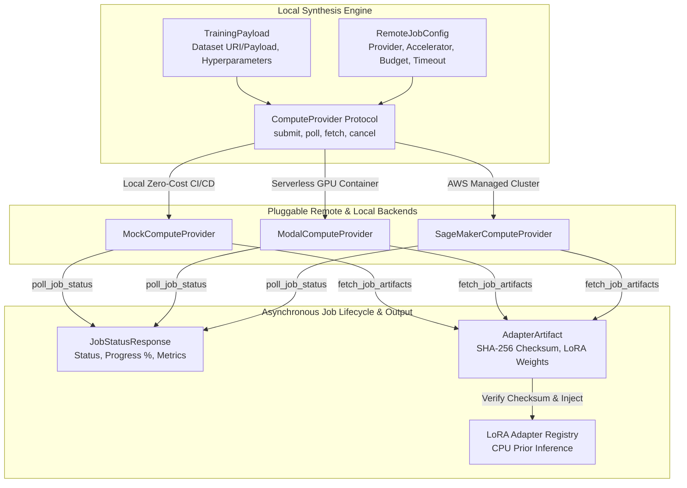
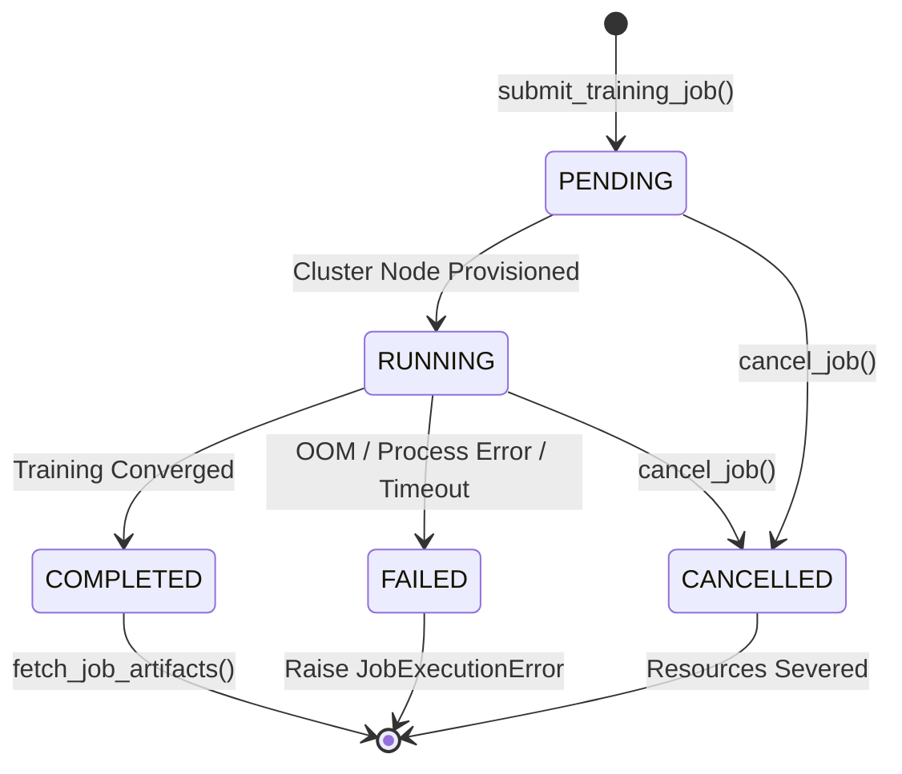

# Pluggable ComputeProvider Protocol & Data Contracts

## 1. Overview & Architectural Motivation

In the **SymForge** framework, program synthesis executes locally on developer workstations via symbolic heuristic search (Beam Search, A*), rapid analytical DAG evaluations, and lightweight CPU prior inference. However, deep neural training (PDE, TGC, and fine-tuning specialized LoRA adapters) demands GPU acceleration.

To guarantee a **Zero Local Training Footprint** and prevent tight coupling to any single cloud platform or proprietary SDK, the `symforge.compute` module establishes a decoupled asynchronous abstraction layer governed by strict Pydantic v2 contracts and a `@runtime_checkable` `typing.Protocol`:

1. **Total Decoupling:** The synthesis engine interacts exclusively with the asynchronous `ComputeProvider` interface, without importing cloud provider SDKs (Boto3, Modal SDK, Kubernetes APIs).
2. **Strict Typed Contracts:** Training payloads (`TrainingPayload`), infrastructure configurations (`RemoteJobConfig`), status telemetry (`JobStatusResponse`), and adapter weights (`AdapterArtifact`) feature 100% verified bidirectional JSON serialization with runtime schema enforcement via Pydantic v2.
3. **Cryptographic Integrity:** All remotely trained LoRA adapter weights are verified against canonical 64-character hexadecimal SHA-256 checksums prior to injection into local inference memory.

---

## 2. Decoupled Dispatch Architecture

```text
+---------------------------------------------------------------------------------------------------+
|                                  SYMFORGE DECOUPLED COMPUTE ARCHITECTURE                          |
|                                                                                                   |
|  +-------------------------------------------------------------+                                  |
|  |                   Local Synthesis Engine                    |                                  |
|  |                                                             |                                  |
|  |  +-------------------+               +-------------------+  |                                  |
|  |  |  TrainingPayload  |               |  RemoteJobConfig  |  |                                  |
|  |  | (Data/Hyperparams)|               | (Timeout/Budget)  |  |                                  |
|  |  +---------+---------+               +---------+---------+  |                                  |
|  |            |                                   |            |                                  |
|  |            +-----------------+-----------------+            |                                  |
|  |                              v                              |                                  |
|  |             +----------------------------------+            |                                  |
|  |             |      ComputeProvider Protocol    |            |                                  |
|  |             |  (submit, poll, fetch, cancel)   |            |                                  |
|  |             +----------------+-----------------+            |                                  |
|  +------------------------------|------------------------------+                                  |
|                                 |                                                                 |
|         +-----------------------+-----------------------+                                         |
|         |                       |                       |                                         |
|         v                       v                       v                                         |
|  +--------------+       +---------------+       +-----------------+                               |
|  | Mock Provider|       | Modal Provider|       |SageMakerProvider|                               |
|  | (Local <10ms)|       | (Serverless)  |       | (AWS Managed)   |                               |
|  +------+-------+       +-------+-------+       +--------+--------+                               |
|         |                       |                        |                                        |
|         +-----------------------+------------------------+                                        |
|                                 |                                                                 |
|                                 v Asynchronous Artifacts                                          |
|                     +-----------------------+                                                     |
|                     |    AdapterArtifact    |                                                     |
|                     | (SHA-256 Checksum,    |                                                     |
|                     |  Weights URI / Bytes) |                                                     |
|                     +-----------+-----------+                                                     |
|                                 v                                                                 |
|                     +-----------------------+                                                     |
|                     |  LoRA Adapter Registry|                                                     |
|                     | (Local CPU Inference) |                                                     |
|                     +-----------------------+                                                     |
+---------------------------------------------------------------------------------------------------+
```



---

## 3. `ComputeProvider` Protocol Specification

The asynchronous protocol is defined in `symforge.compute.protocol` and decorated with `@runtime_checkable`:

```python
@runtime_checkable
class ComputeProvider(Protocol):
    """Protocol defining the asynchronous contract for remote training backends."""

    async def submit_training_job(
        self,
        payload: TrainingPayload,
        config: RemoteJobConfig,
    ) -> str:
        """Submit an asynchronous training job to the compute backend.

        Args:
            payload: Training payload containing dataset and model specifications.
            config: Remote execution environment parameters and budget limits.

        Returns:
            Unique string job_id identifier.
        """
        ...

    async def poll_job_status(self, job_id: str) -> JobStatusResponse:
        """Query the current execution status of an active or completed training job.

        Args:
            job_id: Unique job identifier returned by submit_training_job.

        Returns:
            JobStatusResponse with current status, metrics, and progress.
        """
        ...

    async def fetch_job_artifacts(
        self,
        job_id: str,
        destination_dir: Path,
    ) -> AdapterArtifact:
        """Retrieve the trained adapter artifact files once the job is COMPLETED.

        Args:
            job_id: Unique job identifier.
            destination_dir: Local directory path where artifact weights will be stored.

        Returns:
            AdapterArtifact metadata describing the stored weights.
        """
        ...

    async def cancel_job(self, job_id: str) -> bool:
        """Request cancellation of an active or pending training job.

        Args:
            job_id: Unique job identifier.

        Returns:
            True if cancellation was acknowledged/succeeded, False otherwise.
        """
        ...
```

---

## 4. Pydantic v2 Data Contracts

Data contracts reside in `symforge.compute.contracts` and inherit from `pydantic.BaseModel` configured strictly (`frozen=True`, `extra="forbid"`):

### 4.1 `JobStatus` & `ComputeDomain`
- **`JobStatus`**: Enum representing lifecycle states:
  - `PENDING`: Queued at provider, awaiting node/accelerator provisioning.
  - `RUNNING`: Actively training, emitting loss metrics and `progress_pct`.
  - `COMPLETED`: Training successfully concluded; artifacts ready for retrieval.
  - `FAILED`: Execution failure (OOM, script error, timeout).
  - `CANCELLED`: Voluntarily aborted via `cancel_job`.
- **`ComputeDomain`**: Domain categorization (`"audio"`, `"sdf"`, `"hardware"`).

### 4.2 `TrainingPayload`
Specifies training datasets and task metadata:
- `trajectories_count: int` ($\ge 1$): Number of training trajectories or samples.
- `domain: ComputeDomain`: Application domain.
- `dataset_uri: Optional[str]`: Remote storage URI (e.g., `s3://...`, `https://...`, `file://...`).
- `dataset_payload: Optional[Dict[str, Any]]`: Dictionary containing inline data when remote URI is not used.
- `base_model_name: str`: Base model identifier (e.g., `"symforge-audio-pde-v1"`).
- `model_type: str`: Model architecture category (e.g., `"pde"`, `"tgc"`, `"lora"`).
- `hyperparameters: Dict[str, Any]`: Hyperparameter dictionary (lr, batch size, etc.).
- `created_at: datetime`: UTC creation timestamp.
- *Invariant:* At least one of `dataset_uri` or `dataset_payload` must be provided.

### 4.3 `RemoteJobConfig`
Infrastructure and financial governance parameters:
- `provider_name: str`: Backend identifier (e.g., `"mock"`, `"modal"`, `"sagemaker"`).
- `hardware_accelerator: str`: Accelerator hardware type (`"CPU"`, `"T4"`, `"A10G"`, `"A100"`).
- `timeout_seconds: float` ($> 0.0$): Hard execution timeout in seconds.
- `max_retries: int` ($\ge 0$): Maximum retry attempts on transient network failures.
- `max_cost_usd: float` ($\ge 0.0$): Upper spending limit in USD.
- `lora_rank: int` ($\ge 1$): Rank dimension $r$ for the LoRA adapter.
- `lora_alpha: float` ($> 0.0$): Scaling factor $\alpha$.
- `lora_dropout: float` ($0.0 \le p \le 1.0$): Dropout probability on adapted layers.
- `tags: Dict[str, str]`: Metadata tags for telemetry and cost tracking.

### 4.4 `JobStatusResponse`
Real-time execution feedback:
- `job_id: str`: Unique job identifier.
- `status: JobStatus`: Current execution status enum.
- `progress_pct: float` ($0.0 \le p \le 100.0$): Completion percentage.
- `error_message: Optional[str]`: Diagnostic failure message when status is `FAILED`.
- `started_at: Optional[datetime]`: UTC start timestamp.
- `completed_at: Optional[datetime]`: UTC completion timestamp.
- `estimated_cost_usd: float` ($\ge 0.0$): Accumulated cost reported by backend.
- `metrics: Dict[str, float]`: Numerical metrics (e.g., `train_loss`, `val_loss`, `val_f1`).

### 4.5 `AdapterArtifact`
Weight artifact metadata and transport:
- `adapter_id: str`: Unique artifact identifier.
- `domain: ComputeDomain`: Domain classification.
- `lora_rank: int` & `lora_alpha: float`: LoRA rank and alpha scaling values.
- `target_modules: List[str]`: Adapted module names in base network.
- `weights_checksum: str`: Canonical 64-character hexadecimal SHA-256 hash.
- `weights_uri: Optional[str]`: Remote download URI.
- `weights_bytes: Optional[bytes]`: Raw binary tensor payload.
- `weights_base64: Optional[str]`: Base64 encoded payload for JSON transport.
- `file_size_bytes: int` ($\ge 0$): Artifact file size in bytes.
- `metadata: Dict[str, Any]`: Contextual tags and configuration details.

---

## 5. Job Status State Machine

```text
+---------------------------------------------------------------------------------------------------+
|                                   JOB STATUS STATE MACHINE                                        |
|                                                                                                   |
|                      +------------------------+                                                   |
|                      |        (START)         |                                                   |
|                      +-----------+------------+                                                   |
|                                  | submit_training_job()                                          |
|                                  v                                                                |
|                      +------------------------+                                                   |
|          +---------> |        PENDING         | ---------+                                        |
|          |           +-----------+------------+          | cancel_job()                           |
|          |                       |                       |                                        |
|          | Cluster Ready         | Node Provisioned      |                                        |
|          |                       v                       |                                        |
|          |           +------------------------+          |                                        |
|          |           |        RUNNING         | ---------+                                        |
|          |           +-----+------------+-----+          |                                        |
|          |                 |            |                |                                        |
|          | Loss Converged  |            | OOM / Timeout  |                                        |
|          |                 v            v                v                                        |
|    +-----+----+      +-----------+ +----------+   +--------------+                                |
|    | (Retry)  |      | COMPLETED | |  FAILED  |   |  CANCELLED   |                                |
|    +----------+      +-----+-----+ +----+-----+   +------+-------+                                |
|                            |            |                |                                        |
|                            | fetch()    | Raise Error    | Severed                                |
|                            v            v                v                                        |
|                      +---------------------------------------+                                    |
|                      |                (END)                  |                                    |
|                      +---------------------------------------+                                    |
+---------------------------------------------------------------------------------------------------+
```



---

## 6. Robustness, Guardrails, and Exception Hierarchy

The module defines a strict hierarchy of domain exceptions derived from `ComputeProviderError`:

```text
ComputeProviderError (Base)
├── JobSubmissionError       (Payload rejection or quota exhaustion)
├── JobTimeoutError          (Queue or execution duration exceeded timeout_seconds)
├── ArtifactRetrievalError   (Download failure or SHA-256 checksum mismatch)
└── JobExecutionError        (Remote script failure or cluster node crash)
```

### 6.1 Reliability Guarantees
1. **Explicit Timeouts:** Every remote asynchronous call is bounded with `asyncio.wait_for(..., timeout=config.timeout_seconds)`.
2. **Post-Mortem Logging:** Exception handlers log relevant state variables (job_id, payload prefixes, connection endpoints) before raising typed exceptions.
3. **Runtime Protocol Conformance:** The `verify_compute_provider_conformance(candidate)` utility validates that candidate objects implement all protocol methods as genuine asynchronous coroutines.
