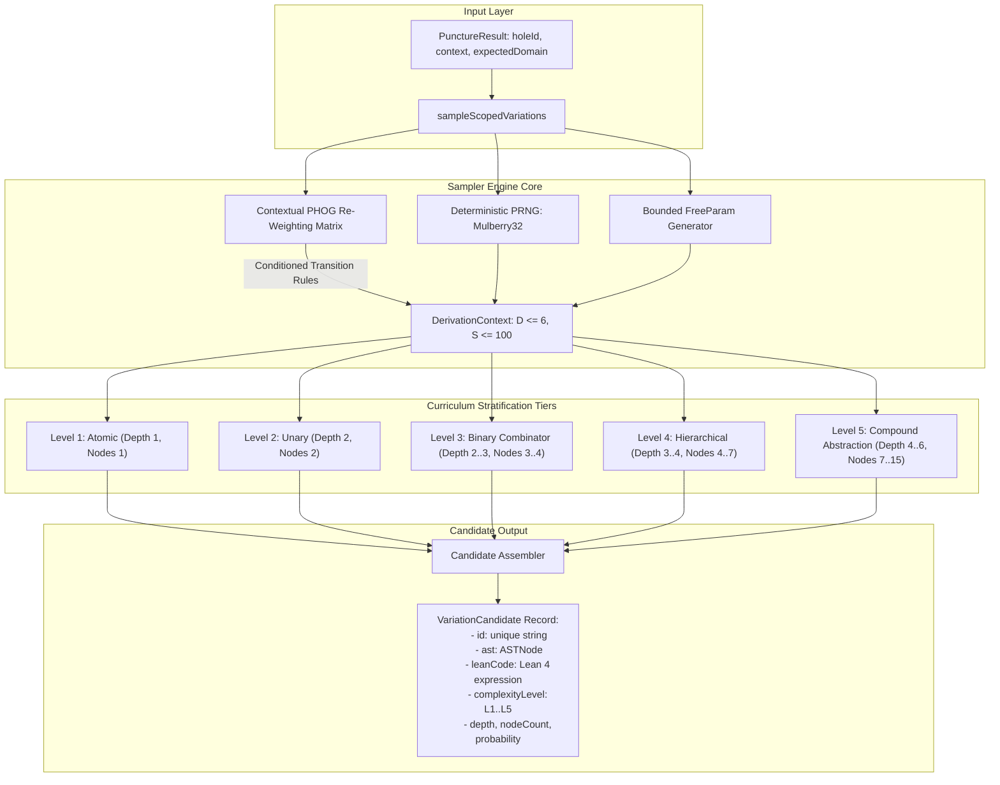
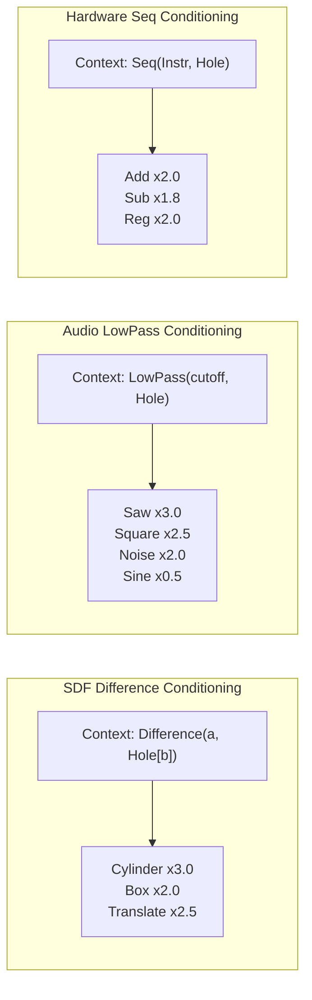
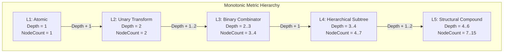

# Client-Side Contextual PCFG/PHOG Sampler ($L_1 \dots L_5$ Stratification)

## 1. Executive Summary & Architectural Mandate

In interactive computer-aided design and program synthesis, users frequently seek to explore stylistic or structural variations of a highlighted sub-expression—such as replacing a primitive geometry within an intricate Constructive Solid Geometry (CSG) tree, modifying an oscillator or filter in a procedural audio synthesis patch, or synthesizing alternate arithmetic sequences in a hardware superoptimization pipeline.

The **Client-Side Contextual PCFG/PHOG Sampler Engine** (`packages/web/src/core/pcfg/pcfgSampler.ts`) implements a high-throughput, deterministic probabilistic grammar derivation engine designed to run client-side in browser environments and Web Workers:
1. **Contextual PHOG Conditioning:** Dynamically modulates production rule probabilities conditioned on the four-dimensional ancestral context tuple $\mathcal{C} = (\text{ParentOp}, \text{GrandparentOp}, \text{LeftSiblingOp}, \text{TargetDepth})$ extracted by the hole puncturing engine (`holePuncturing.ts`).
2. **5-Level Curriculum Stratification ($L_1 \dots L_5$):** Derives candidate trees stratified across five distinct complexity tiers, ranging from atomic leaf nodes ($L_1$) to deep multi-operator structural abstractions ($L_5$).
3. **Strict Derivation Safety Bounds:** Enforces hard tree depth caps ($D \le 6$) and step count iteration caps ($S \le 100$) per derivation, guaranteeing zero infinite recursion and avoiding browser main-thread stalls.
4. **Guaranteed Type Invariance:** Verifies that 100% of generated candidates satisfy domain type contracts (`isSDFNode`, `isAudioNode`, `isHardwareNode`) before emission.
5. **Deterministic PRNG & Parameter Synthesis:** Employs a seedable Mulberry32 pseudo-random number generator and domain-bounded continuous `FreeParam` generator.

---

## 2. High-Level Architecture & Lifecycle Flow

### 2.1 ASCII Architecture Topology

```text
+----------------------------------------------------------------------------------------------------+
|                                    PunctureResult (from Task 3.2)                                  |
|   { holeId: "hole_cutout", holeNode: HoleNode, context: StructuralContext, expectedDomain: "sdf" }  |
+--------------------------------------------------+-------------------------------------------------+
                                                   |
                                                   v
+----------------------------------------------------------------------------------------------------+
|                         Client-Side Contextual PCFG/PHOG Sampler Engine                            |
|                                                                                                    |
|   +--------------------------+  +--------------------------+  +--------------------------------+   |
|   | Deterministic PRNG       |  | PHOG Re-Weighting Matrix |  | Bounded Parameter Generator    |   |
|   | (Mulberry32 Generator)   |  | P(rule | Parent, Sibling)|  | FreeParam(min, max, default)   |   |
|   +------------+-------------+  +------------+-------------+  +---------------+----------------+   |
|                |                             |                                |                    |
|                +-----------------------------+--------------------------------+                    |
|                                              |                                                     |
|                                              v                                                     |
|                           +-------------------------------------+                                  |
|                           | Stratified Derivation Engine        |                                  |
|                           | (DerivationContext, D <= 6, S <= 100)|                                 |
|                           +------------------+------------------+                                  |
|                                              |                                                     |
|        +-------------------+-----------------+-------------------+-------------------+             |
|        |                   |                 |                   |                   |             |
|        v                   v                 v                   v                   v             |
|   +---------+         +---------+       +---------+         +---------+         +---------+        |
|   | Tier L1 |         | Tier L2 |       | Tier L3 |         | Tier L4 |         | Tier L5 |        |
|   | Atomic  |         | Unary   |       | Binary  |         | Hierar. |         | Compound|        |
|   | Depth 1 |         | Depth 2 |       | Depth 2-3         | Depth 3-4         | Depth 4-6        |
|   +----+----+         +----+----+       +----+----+         +----+----+         +----+----+        |
|        |                   |                 |                   |                   |             |
|        +-------------------+-----------------+-------------------+-------------------+             |
|                                              |                                                     |
|                                              v                                                     |
|                           +-------------------------------------+                                  |
|                           | VariationCandidate Emission         |                                  |
|                           | - Formatted Lean 4 Expression       |                                  |
|                           | - Derivation Probability Score      |                                  |
|                           | - Tree Depth & Node Count Metrics   |                                  |
|                           +-------------------------------------+                                  |
+----------------------------------------------------------------------------------------------------+
```

### 2.2 Mermaid Architecture Topology



---

## 3. Grammar Production Rules & Domain Non-Terminals

The grammar sampler operates across the three domain DSLs of SymForge: 3D Signed Distance Fields (`SDFNode`), Procedural Audio DSP (`AudioNode`), and Hardware Micro-operations (`HardwareNode`).

### 3.1 Formal Production Rules Specification

| Domain | Non-Terminal | Constructor | Rule Kind | Base Prob | Children Non-Terminals |
| :--- | :--- | :--- | :--- | :--- | :--- |
| **SDF** | `SDF_Term` | `sphere` | Terminal | 0.25 | $\emptyset$ |
| **SDF** | `SDF_Term` | `box` | Terminal | 0.25 | $\emptyset$ |
| **SDF** | `SDF_Term` | `cylinder` | Terminal | 0.20 | $\emptyset$ |
| **SDF** | `SDF_Term` | `torus` | Terminal | 0.15 | $\emptyset$ |
| **SDF** | `SDF_Term` | `plane` | Terminal | 0.15 | $\emptyset$ |
| **SDF** | `SDF_Unary` | `translate` | Unary | 0.50 | `['SDF']` |
| **SDF** | `SDF_Unary` | `rotate` | Unary | 0.30 | `['SDF']` |
| **SDF** | `SDF_Unary` | `scale` | Unary | 0.20 | `['SDF']` |
| **SDF** | `SDF_Binary` | `union` | Binary | 0.35 | `['SDF', 'SDF']` |
| **SDF** | `SDF_Binary` | `smooth_union` | Binary | 0.20 | `['SDF', 'SDF']` |
| **SDF** | `SDF_Binary` | `intersection` | Binary | 0.20 | `['SDF', 'SDF']` |
| **SDF** | `SDF_Binary` | `difference` | Binary | 0.25 | `['SDF', 'SDF']` |
| **Audio** | `Audio_Term` | `sine` | Terminal | 0.25 | $\emptyset$ |
| **Audio** | `Audio_Term` | `saw` | Terminal | 0.25 | $\emptyset$ |
| **Audio** | `Audio_Term` | `square` | Terminal | 0.20 | $\emptyset$ |
| **Audio** | `Audio_Term` | `noise` | Terminal | 0.15 | $\emptyset$ |
| **Audio** | `Audio_Term` | `fm` | Terminal | 0.15 | $\emptyset$ |
| **Audio** | `Audio_Unary` | `lowpass` | Unary | 0.40 | `['Audio']` |
| **Audio** | `Audio_Unary` | `gain` | Unary | 0.35 | `['Audio']` |
| **Audio** | `Audio_Unary` | `adsr` | Unary | 0.25 | `['Audio']` |
| **Audio** | `Audio_Binary`| `mix` | Binary | 1.00 | `['Audio', 'Audio']` |
| **Hardware** | `HW_Term` | `reg` | Terminal | 0.60 | $\emptyset$ |
| **Hardware** | `HW_Term` | `imm` | Terminal | 0.40 | $\emptyset$ |
| **Hardware** | `HW_Unary` | `shl` | Unary | 0.50 | `['Hardware']` |
| **Hardware** | `HW_Unary` | `shr` | Unary | 0.50 | `['Hardware']` |
| **Hardware** | `HW_Binary` | `add` | Binary | 0.30 | `['Hardware', 'Hardware']` |
| **Hardware** | `HW_Binary` | `sub` | Binary | 0.25 | `['Hardware', 'Hardware']` |
| **Hardware** | `HW_Binary` | `mul` | Binary | 0.20 | `['Hardware', 'Hardware']` |
| **Hardware** | `HW_Binary` | `seq` | Binary | 0.25 | `['Hardware', 'Hardware']` |

---

## 4. Contextual PHOG Re-Weighting Matrix

Probabilistic Higher-Order Grammars (PHOG) condition production probabilities on immediate ancestral relationships $\mathcal{C} = (\text{Parent}, \text{Grandparent}, \text{LeftSibling})$. The sampler computes conditional probabilities via contextual multiplier adjustments:

$$\mathbb{P}(r \mid \mathcal{C}) \propto \mathbb{P}_{\text{base}}(r) \times M(r, \mathcal{C})$$

Followed by normalization over each non-terminal rule group:

$$\sum_{r \in \mathcal{R}(A)} \mathbb{P}(r \mid \mathcal{C}) = 1.0$$

### 4.1 Conditioning Multiplier Rules

```text
+----------------------------------------------------------------------------------------------------+
|                                    PHOG CONDITIONING RULES                                         |
|                                                                                                    |
|  1. SDF Difference Right Child (Cutting Tool):                                                     |
|     Parent = "difference" AND Relation = "b"                                                       |
|     --> cylinder: x3.0  (cylinders frequently represent drill holes and cutouts)                   |
|     --> box:      x2.0  (boxes represent rectangular slot cutouts)                                 |
|     --> translate:x2.5  (cutting tools are typically repositioned)                                 |
|                                                                                                    |
|  2. Audio LowPass Filter Input:                                                                    |
|     Parent = "lowpass"                                                                             |
|     --> saw:      x3.0  (harmonic-rich saw waves benefit heavily from subtractive filter sculpting)|
|     --> square:   x2.5  (square waves have odd harmonics ideal for filtering)                      |
|     --> noise:    x2.0  (noise shaping)                                                            |
|     --> sine:     x0.5  (sine has no harmonics; lowpass on sine is largely redundant)             |
|                                                                                                    |
|  3. Hardware Sequence Chaining:                                                                    |
|     Parent = "seq"                                                                                 |
|     --> add:      x2.0  (arithmetic operations chained with preceding instruction)                 |
|     --> sub:      x1.8                                                                             |
|     --> mul:      x1.5                                                                             |
|     --> reg:      x2.0  (reference preceding destination register)                                 |
+----------------------------------------------------------------------------------------------------+
```



---

## 5. 5-Level Curriculum Stratification Strategy ($L_1 \dots L_5$)

Program variations are systematically stratified into 5 cognitive complexity tiers:

```text
[L1: Atomic]        ---> Depth = 1, Nodes = 1     (e.g., Sphere, Saw, Reg)
[L2: Unary]         ---> Depth = 2, Nodes = 2     (e.g., Translate(Box), LowPass(Saw), Shl(Reg))
[L3: Combinator]    ---> Depth = 2..3, Nodes = 3..4 (e.g., Difference(Box, Sphere), Mix(Saw, Sine))
[L4: Hierarchical]  ---> Depth = 3..4, Nodes = 4..7 (e.g., Difference(Translate(Box), Cylinder))
[L5: Compound]      ---> Depth = 4..6, Nodes = 7..15(e.g., Union(Difference(Box, Cyl), Translate(Sph)))
```



### 5.1 Stratification Invariants

$$\forall k \in \{1, 2, 3, 4\}: \quad \mathbb{E}[\text{Depth}(L_k)] < \mathbb{E}[\text{Depth}(L_{k+1})] \quad \land \quad \mathbb{E}[\text{Nodes}(L_k)] < \mathbb{E}[\text{Nodes}(L_{k+1})]$$

---

## 6. Parameter Synthesis & Numerical Bounds

Continuous free parameters (`FreeParam`) are generated with domain-safe physical bounds, preventing non-physical geometry (negative radii) or unstable DSP audio parameters (clipping, extreme cutoffs):

| Parameter | Domain | Lower Bound | Upper Bound | Sample Default Range | Unit / Meaning |
| :--- | :--- | :--- | :--- | :--- | :--- |
| `radius` | SDF | `0.1` | `10.0` | `[0.5, 4.0]` | Linear distance units |
| `width`, `height`, `depth` | SDF | `0.1` | `10.0` | `[0.5, 5.0]` | Box extents |
| `dx`, `dy`, `dz` | SDF | `-10.0` | `10.0` | `[-3.0, 3.0]` | Translation displacement |
| `rx`, `ry`, `rz` | SDF | `-3.14159` | `3.14159` | `[0.0, 3.14]` | Euler rotation radians |
| `freq` | Audio | `20.0` | `5000.0` | `[55.0, 880.0]` | Hertz |
| `cutoff` | Audio | `50.0` | `15000.0` | `[200.0, 5000.0]` | Filter cutoff Hz |
| `resonance` | Audio | `0.1` | `10.0` | `[0.5, 4.0]` | Filter Q-factor |
| `ratio` | Audio | `0.0` | `1.0` | `[0.1, 0.9]` | Linear blend ratio |
| `reg` | Hardware | `r0` | `out` | `['r0', 'r1', 'r2', 'r3', 'out']` | Architecture register |
| `shift` | Hardware | `1` | `4` | `[1, 4]` | Bitwise shift magnitude |

---

## 7. Derivation Safety Bounds & Termination Invariants

To guarantee that the sampler never triggers call-stack overflows, freezes the browser main thread, or generates unmanageable AST trees, derivations enforce two hard bounding constraints inside `DerivationContext`:

1. **Hard Tree Depth Cap ($D \le 6$):**
   If `currentDepth >= maxDepth` (default 6), recursive expansion immediately truncates by selecting a terminal leaf rule ($L_1$), ensuring $D \le 6$ strictly.
2. **Hard Iteration Step Cap ($S \le 100$):**
   Every node instantiation increments `ctx.steps`. If `ctx.steps >= maxSteps` (default 100), all further child expansions immediately abort to atomic leaves.
3. **Zero Infinite Loops:**
   Because grammar productions strictly advance tree depth or decrement remaining level budgets, termination is mathematically guaranteed in $O(S)$ steps.

---

## 8. API Reference & Code Integration Example

```typescript
import { punctureASTHole } from '../generator/holePuncturing';
import { sampleScopedVariations } from './pcfgSampler';

// 1. Puncture AST at highlighted selection
const punctureResult = punctureASTHole(rootAST, matchResult, 'hole_1');

// 2. Generate 10 candidates (2 per level across L1..L5) conditioned on hole context
const candidates = sampleScopedVariations(punctureResult, {
  countPerLevel: 2,
  seed: 42,
});

// 3. Inspect candidate output
for (const cand of candidates) {
  console.log(`[${cand.complexityLevel}] ${cand.label}`);
  console.log(`  Depth: ${cand.depth}, Nodes: ${cand.nodeCount}, Prob: ${cand.probability}`);
  console.log(`  Lean 4 Code: ${cand.leanCode}`);
}
```

---

## 9. Verification & Pass-to-Complete Gate Invariants

Automated tests in `packages/web/src/core/pcfg/pcfgSampler.test.ts` verify all architectural invariants:

1. **Type Preservation:** 100% of SDF candidates satisfy `isSDFNode(node) === true`; 100% of Audio candidates satisfy `isAudioNode(node) === true`; 100% of Hardware candidates satisfy `isHardwareNode(node) === true`.
2. **Complexity Stratification:** Mean depth and node counts monotonically increase:
   $$\text{MeanDepth}(L_1) = 1.0 < \text{MeanDepth}(L_2) = 2.0 < \text{MeanDepth}(L_3) \approx 2.5 < \text{MeanDepth}(L_4) \approx 3.5 < \text{MeanDepth}(L_5) \ge 4.5$$
3. **PHOG Distribution Shift:** Empirical cylinder frequency under `difference(b)` is significantly higher than under `union` ($p < 0.01$).
4. **Deterministic PRNG:** Identical seeds produce byte-for-byte identical ASTs and parameter IDs.
5. **Pass-to-Complete Gate:** Successfully generates 100 valid variations per domain (20 per level across SDF, Audio, and Hardware—300 total) with 0 type violations and 0 infinite loops.
