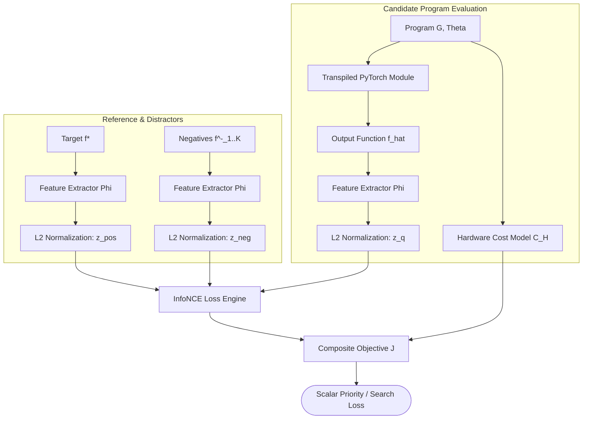

# Differentiable Contrastive Perceptual Loss Engine & Hardware Cost Model

## 1. Architectural Mission

The **Contrastive Perceptual Loss Engine** (`symforge.eval.loss`) and **Hardware Cost Model** (`symforge.eval.cost`) form the core evaluation mechanism of SymForge. They solve the fundamental failure modes of naive point-wise $L_1/L_2$ sample matching in neurosymbolic synthesis:

1. **Phase & Spatial Invariance:** Raw point-to-point loss fails catastrophically under imperceptible acoustic phase shifts or minute spatial translations. InfoNCE contrastive perceptual loss aligns latent representations in normalized metric embedding spaces.
2. **Discriminative Negative Mining:** Compares candidate program representations against ground-truth positive targets while penalizing proximity to negative distractors (harmonic clashes, orthogonal geometric shapes).
3. **Hardware Execution Cost Regularization $C_H(G)$:** Penalizes computational complexity (FLOPs, transcendental functions like sin/cos/exp, memory access, register pressure), ensuring discovered abstractions remain hardware-efficient.

---

## 2. Mathematical Formulation

### 2.1 InfoNCE Contrastive Perceptual Objective
Given candidate representation $\mathbf{z}_q = \Phi(\hat{f}) / \|\Phi(\hat{f})\|_2$, target $\mathbf{z}_{pos} = \Phi(f^*) / \|\Phi(f^*)\|_2$, and $K$ negative distractors $\{\mathbf{z}_{neg, j}\}_{j=1}^K$ with temperature $\tau > 0$:

$$\mathcal{L}_{\text{contrast}}(q, pos, \{neg_j\}) = -\log \frac{\exp\left(\frac{\mathbf{z}_q \cdot \mathbf{z}_{pos}}{\tau}\right)}{\exp\left(\frac{\mathbf{z}_q \cdot \mathbf{z}_{pos}}{\tau}\right) + \sum_{j=1}^{K} \exp\left(\frac{\mathbf{z}_q \cdot \mathbf{z}_{neg, j}}{\tau}\right)}$$

For numerical stability, this is computed via log-sum-exp parameterized as cross-entropy over similarity logits with ground-truth label $0$:

$$\text{logits} = \left[ \frac{\mathbf{z}_q \cdot \mathbf{z}_{pos}}{\tau}, \frac{\mathbf{z}_q \cdot \mathbf{z}_{neg, 1}}{\tau}, \dots, \frac{\mathbf{z}_q \cdot \mathbf{z}_{neg, K}}{\tau} \right]$$

### 2.2 Compiled Hardware Cost Model $C_H(G)$
For a program graph $G = (V, E)$, the compiled hardware cost is computed over operations and continuous parameter vectors $\Theta$:

$$C_H(G) = \sum_{v \in V_{\text{unique}}} \left( \text{BaseCost}(v) + \omega_{\text{param}} |\Theta(v)| \right)$$

When DAG deduplication is enabled (`use_dag_dedup=True`), common subexpressions are computed once, faithfully reflecting shared hardware buffers.

### 2.3 Composite Synthesis Objective
The total loss guiding beam and A* search is:

$$\mathcal{J}(G, \theta) = \lambda_{\text{contrast}} \mathcal{L}_{\text{contrast}} + \lambda_{\text{rec}} \mathcal{L}_{\text{rec}}(\hat{f}, f^*) + \lambda_{\text{cost}} C_H(G)$$

---

## 3. Evaluation Pipeline Topology

```text
+-----------------------------------------------------------------------------------------------+
|                               CONTRASTIVE EVALUATION PIPELINE                                 |
+-----------------------------------------------------------------------------------------------+
                                                |
                 +------------------------------+------------------------------+
                 | Candidate Program (G, theta)                                | Target & Distractors
                 v                                                             v
    +-------------------------+                                   +-------------------------+
    | Transpiled Module       |                                   | Ground Truth Positive   |
    | Forward Pass f_hat      |                                   | & Distractors f*, {f^-} |
    +------------+------------+                                   +------------+------------+
                 |                                                             |
                 v                                                             v
    +-------------------------+                                   +-------------------------+
    | Perceptual Feature      |                                   | Perceptual Features     |
    | Extractor Phi(f_hat)    |                                   | Phi(f*), {Phi(f^-)}     |
    +------------+------------+                                   +------------+------------+
                 |                                                             |
                 +------------------------------+------------------------------+
                                                |
                                                v
                               +--------------------------------+
                               | L2 Feature Normalization       |
                               | z = Phi / ||Phi||_2            |
                               +----------------+---------------+
                                                |
                                                v
                               +--------------------------------+
                               | Scaled Dot-Product Similarities|
                               | sim = (z_q . z) / tau          |
                               +----------------+---------------+
                                                |
                                                v
                               +--------------------------------+
                               | Cross-Entropy Log-Sum-Exp      |
                               | InfoNCE Contrastive Loss       |
                               +----------------+---------------+
                                                |
                                                v
                               +--------------------------------+
                               | + lambda_cost * C_H(G)         |
                               | Hardware Cost Model            |
                               +--------------------------------+
```



---

## 4. Key Components and Invariants

1. **Monotonicity of Positive Alignment:** As candidate embedding cosine similarity to target increases from $0.2 \to 0.7 \to 0.99$, InfoNCE loss strictly decreases monotonically.
2. **Exact Identity Preservation:** For identical candidate and target embeddings ($\cos = 1.0$) with orthogonal distractors ($\cos = 0.0$), loss evaluates to $< 10^{-4}$ under $\tau = 0.05$.
3. **Monotonicity of Hardware Cost:** For any operation addition $G_2 \supset G_1$, $C_H(G_2) > C_H(G_1)$. Adding filters or boolean operations strictly increases the execution penalty.
4. **DAG Common Subexpression Sharing:** Repeated subgraphs evaluated under `use_dag_dedup=True` are charged exactly once.
