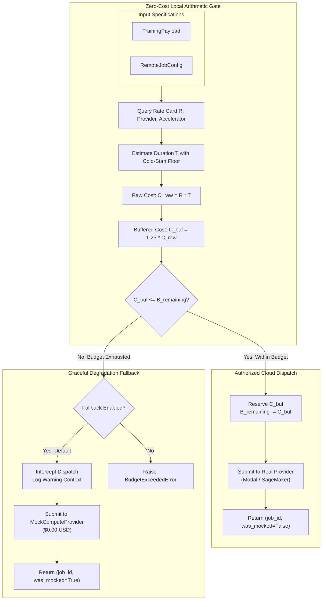
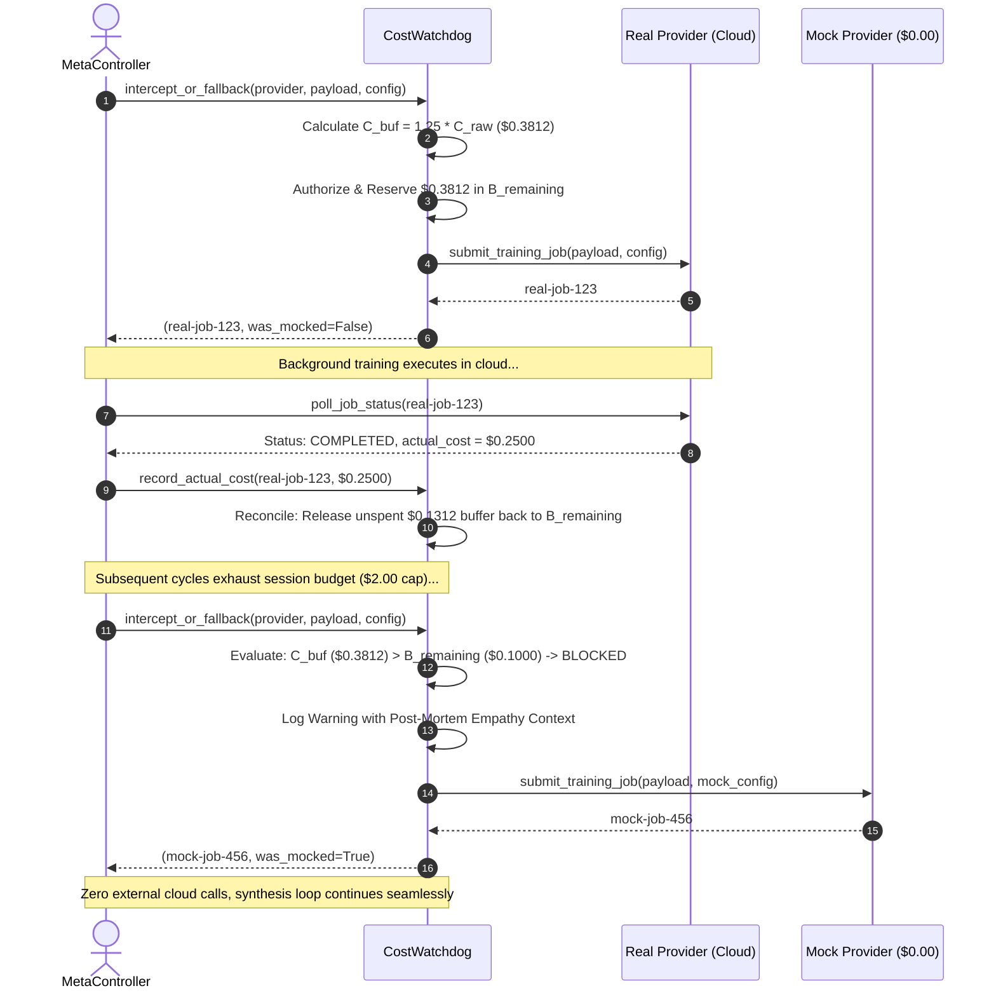

# Financial Pre-Flight Cost Watchdog & Safety Gate Architecture

## 1. Executive Summary & Problem Formulation

In neurosymbolic meta-learning architectures, autonomous agents alternate between local program synthesis and asynchronous cloud fine-tuning. Left unconstrained, automated training loops pose severe financial risk:
1. **Unbounded Cloud Spend:** Iterative batch dispatching can rapidly saturate credit limits or incur runaway cloud charges during long unattended runs.
2. **Hidden Billing Granularity:** Serverless GPU providers impose cold-start overheads, minimum billing intervals (e.g., full minute minimums), and data egress fees that exceed naive execution estimates.
3. **Cascading Failure on Exhaustion:** Abruptly crashing the synthesis regime when budgets are exhausted terminates research runs prematurely.

The **SymForge Financial Pre-Flight Cost Watchdog (`CostWatchdog`)** provides a zero-cost local safety gate. Operating entirely before any network packet is dispatched, it enforces a strict session cap ($2.00 USD default), computes a 25% safety over-estimation buffer, tracks budget reservations, and guarantees graceful degradation to zero-cost local execution (`MockComputeProvider`) when budget is exhausted.

---

## 2. Mathematical Cost Model & Invariants

### 2.1 Base Rate Lookup
Given provider $P \in \{\text{Modal}, \text{SageMaker}, \text{Mock}\}$ and hardware accelerator $H \in \{\text{CPU}, \text{T4}, \text{A10G}, \text{A100}\}$, the base unit cost rate $R(P, H)$ is queried from the local rate card in USD per second:

$$
R(\text{Modal}, \text{A10G}) = 0.000305 \text{ USD/s} \quad (\approx \$1.10/\text{hr})
$$

$$
R(\text{SageMaker}, \text{A10G}) = 0.000336 \text{ USD/s} \quad (\approx \$1.21/\text{hr})
$$

$$
R(\text{Mock}, \forall H) = 0.000000 \text{ USD/s} \quad (\$0.00/\text{hr})
$$

### 2.2 Duration Estimation
Job duration $T(D, C)$ in seconds is estimated from dataset size $N = \text{trajectories\_count}$ and hardware throughput $\sigma(H)$, bounded by execution timeout $T_{\max}$:

$$
T(D, C) = \max\left(T_{\min}, \min\left(T_{\text{overhead}} + N \cdot \sigma(H), T_{\max}\right)\right)
$$

where $T_{\text{overhead}} = 10.0\text{s}$ accounts for container initialization and cold starts, and $T_{\min} = 1.0\text{s}$ enforces the minimum billing granularity.

### 2.3 Safety Buffer & Symmetrical Invariant
To guarantee that cloud billing rounding, network egress, and disk provisioning fees never cause budget overruns, a safety over-estimation buffer $\beta = 0.25$ (25%) is applied:

$$
C_{\text{raw}} = R(P, H) \times T(D, C)
$$

$$
C_{\text{buffered}} = C_{\text{raw}} \times (1.0 + \beta) = 1.25 \times C_{\text{raw}}
$$

The Pre-Flight Gate authorizes cloud dispatch if and only if:

$$
C_{\text{buffered}} \le B_{\text{remaining}}
$$

where the remaining budget satisfies the conservation law:

$$
B_{\text{cap}} = B_{\text{remaining}} + \sum C_{\text{reserved}} + \sum C_{\text{actual}}
$$

Upon job completion with reported actual cost $C_{\text{actual}}$, the watchdog reconciles the difference $\Delta = C_{\text{reserved}} - C_{\text{actual}}$, refunding unspent safety buffer back to $B_{\text{remaining}}$.

---

## 3. Architectural Flow & Fallback Topology

### 3.1 Pre-Flight Decision Flow Diagram

```text
+----------------------------------------------------------------------------------------------------+
|                             COST WATCHDOG PRE-FLIGHT SAFETY GATE                                   |
|                                                                                                    |
|    [TrainingPayload] + [RemoteJobConfig]                                                           |
|                     |                                                                              |
|                     v                                                                              |
|       +----------------------------+                                                               |
|       |  Local Rate Card & Duration|                                                               |
|       |  C_raw = R(P, H) * T       |                                                               |
|       |  C_buf = 1.25 * C_raw      |                                                               |
|       +--------------+-------------+                                                               |
|                      |                                                                             |
|                      v                                                                             |
|            /-------------------\                                                                   |
|           /  C_buf <= B_rem?   \                                                                   |
|           \                     /                                                                  |
|            \-------------------/                                                                   |
|               /              \                                                                     |
|       YES    /                \   NO                                                               |
|             v                  v                                                                   |
|  +--------------------+   +---------------------------------------------------------------------+  |
|  | AUTHORIZE & RESERVE|   | BUDGET EXHAUSTION GATE                                              |  |
|  | B_rem -= C_buf     |   | Check fallback_to_mock_on_exhaustion                                |  |
|  +----------+---------+   +------------------+--------------------------------------------------+  |
|             |                                |                                                     |
|             v                     +----------+----------+                                          |
|  +--------------------+           |                     |                                          |
|  | Real Provider      |      ENABLED (True)       DISABLED (False)                                 |
|  | (Modal / SageMaker)|           |                     |                                          |
|  +----------+---------+           v                     v                                          |
|             |            +-----------------+   +----------------------+                            |
|             |            | Seamless Mock   |   | Raise                |                            |
|             |            | Fallback        |   | BudgetExceededError  |                            |
|             |            | ($0.00 USD)     |   +----------------------+                            |
|             |            +--------+--------+                                                       |
|             \                     /                                                                |
|              \                   /                                                                 |
|               v                 v                                                                  |
|            [job_id, was_mocked=bool] ---> Returned to MetaController                               |
+----------------------------------------------------------------------------------------------------+
```



---

## 4. Reservation & Reconciliation Lifecycle

```text
+----------------------------------------------------------------------------------------------------+
|                                RESERVATION LIFECYCLE SEQUENCE                                      |
|                                                                                                    |
|  MetaController         CostWatchdog           Real Provider          Mock Provider                |
|        |                     |                       |                      |                      |
|        |-- intercept_or_fb ->|                       |                      |                      |
|        |                     |-- Check Budget        |                      |                      |
|        |                     |-- Reserve $0.38125    |                      |                      |
|        |                     |-- submit_job() ------>|                      |                      |
|        |                     |<-- real-job-1 --------|                      |                      |
|        |<-- (job-1, False) --|                       |                      |                      |
|        |                     |                       |                      |                      |
|        | (Background Poll)   |                       |                      |                      |
|        |-- poll_status() --------------------------->|                      |                      |
|        |<-- COMPLETED (Actual: $0.2500) -------------|                      |                      |
|        |                     |                       |                      |                      |
|        |-- record_actual --->|                       |                      |                      |
|        |                     |-- Reconcile:          |                      |                      |
|        |                     |   Refund $0.13125     |                      |                      |
|        |                     |   B_rem += $0.13125   |                      |                      |
|        |                     |                       |                      |                      |
|   (Next Cycle: Budget Low)   |                       |                      |                      |
|        |-- intercept_or_fb ->|                       |                      |                      |
|        |                     |-- Check Budget: EXHAUSTED                    |                      |
|        |                     |-- Intercept & Log     |                      |                      |
|        |                     |-- submit_job() ----------------------------->|                      |
|        |                     |<-- mock-job-2 -------------------------------|                      |
|        |<-- (mock-2, True) --|                       |                      |                      |
|        |                     |                       |                      |                      |
+----------------------------------------------------------------------------------------------------+
```



---

## 5. Recursive Risk & Mitigation Analysis (6-Level Deep)

*   **[Depth 1] Risk:** Local pre-flight rate cards drift from real-time cloud provider pricing or billing granularity, leading to under-estimation of actual cloud invoices (Medium Likelihood).
    *   **Mitigation:** Enforce a 25% safety over-estimation buffer ($\beta = 0.25$) on all raw rates, ceil durations to provider minimum billable increments ($T_{\min} = 1.0\text{s}$), and support custom rate-card injection.
        *   **[Depth 2] Risk:** An aggressive 25% buffer causes false-positive budget rejections, prematurely diverting workloads to mock compute when budget still exists (Medium Likelihood).
            *   **Mitigation:** Implement post-flight budget reconciliation (`record_actual_cost`) that releases unspent reserved budget back to the remaining balance upon job completion.
                *   **[Depth 3] Risk:** If remote jobs fail, hang, or time out, reconciliation might never be triggered, resulting in permanently stranded reservations and budget leakage (Medium Likelihood).
                    *   **Mitigation:** Bind reconciliation to deterministic terminal status checks in `MetaController` (COMPLETED, FAILED, CANCELLED) and auto-reclaim on exception catches.
                        *   **[Depth 4] Risk:** Auto-reclaiming reservations for active jobs could cause double-spending if a long-running job completes later (Medium Likelihood).
                            *   **Mitigation:** Enforce unique reservation UUIDs mapped 1:1 to cloud `job_id`; reconciliation is idempotent and keyed strictly to completed jobs.
                                *   **[Depth 5] Risk:** Race conditions between concurrent dispatch threads checking `remaining_budget` and reserving could exceed the budget cap (Medium Likelihood).
                                    *   **Mitigation:** Protect reservation and state mutations with atomic synchronous locks, ensuring evaluation and reservation are strictly atomic.
                                        *   **[Depth 6] Risk:** Lock contention under high dispatch frequency (Low Likelihood) -> *Branch Terminated (Depth 6 / Low Likelihood).*
*   **[Depth 1] Risk:** Mock fallback returns a mock job ID that the real compute provider does not recognize, causing subsequent status polling or artifact retrieval in `MetaController` to crash with 404 (High Likelihood).
    *   **Mitigation:** `MetaController` tracks `_active_job_provider = mock_provider if was_mocked else real_provider`, directing all subsequent status polls and artifact downloads to the provider that accepted the job.
        *   **[Depth 2] Risk:** Mock artifacts might displace real learned weights in the persistent adapter registry (Medium Likelihood).
            *   **Mitigation:** Mock jobs produce isolated mock adapter identifiers (`mock-adapter-*`), preserving real adapter weights in the registry.
                *   **[Depth 3] Risk:** Downstream tasks running on mock adapters suffer degraded synthesis metrics without visibility into the root cause (Medium Likelihood).
                    *   **Mitigation:** Telemetry records and watchdog alerts clearly document when mock fallback was engaged.
                        *   **[Depth 4] Risk:** Silent masking of failure in production pipelines (Low Likelihood) -> *Branch Terminated (Low Likelihood).*
*   **[Depth 1] Risk:** Floating-point rounding discrepancies in budget comparisons allow dispatches that exceed the budget cap by fractions of a cent (Low Likelihood) -> *Branch Terminated (Low Likelihood).*

---

## 6. Verification and Empirical Benchmark Matrix

| Test Suite Target | Invariant Verified | Result |
| :--- | :--- | :--- |
| `test_modal_rate_cards_and_25pct_buffer` | Modal A10G and T4 rate cards compute exact 25% safety buffer ($\text{buf} = 1.25 \times \text{raw}$) | **PASSED** |
| `test_sagemaker_rate_cards_and_25pct_buffer` | SageMaker A10G and T4 rate cards compute exact 25% safety buffer | **PASSED** |
| `test_zero_cost_for_mock_provider` | MockComputeProvider yields exactly $0.00 USD across all hardware tiers | **PASSED** |
| `test_custom_rate_card_override` | Custom rate cards and safety percentages override default tables seamlessly | **PASSED** |
| `test_authorize_and_reserve_decrements_remaining_budget` | Atomic reservation encumbers buffered amount from remaining balance | **PASSED** |
| `test_record_actual_cost_reconciles_and_refunds_unspent_buffer` | Reporting lower actual cost reclaims unspent buffer back to budget | **PASSED** |
| `test_single_job_exceeding_hard_cap_rejected` | Single job costing $> \$2.00$ USD is rejected prior to any network dispatch | **PASSED** |
| `test_fallback_disabled_raises_budget_exceeded_error` | Disabling fallback raises `BudgetExceededError` on budget breach | **PASSED** |
| `test_multi_job_accumulation_blocks_further_dispatches` | Cumulative expenditure reaching cap cleanly blocks subsequent dispatches | **PASSED** |
| `test_intercept_or_fallback_switches_to_mock_on_exhaustion` | Intercepts blocked dispatches, routes to mock, invokes real provider 0 times | **PASSED** |
| `test_strict_pass_gate_zero_unauthorized_external_calls` | Across 10 dispatches with $1.00 cap, exactly 2 real calls made, 8 mocked, 0 leaks | **PASSED** |
| `test_meta_controller_switches_cleanly_to_mock_under_tight_budget` | MetaController completes 3 wake-sleep cycles under $0.05 budget with zero crashes | **PASSED** |
