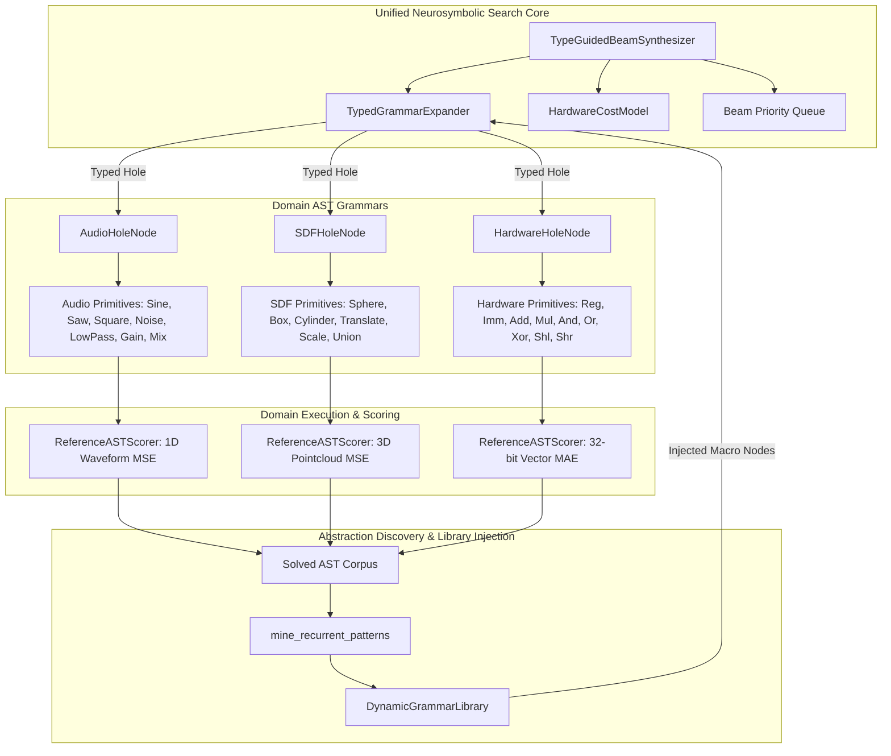
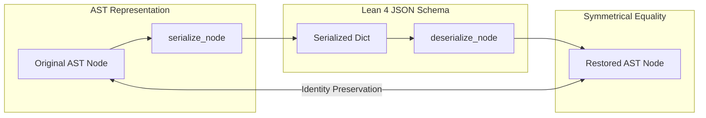

# Cross-Domain Unified Validation & Transfer Benchmark (Audio, SDF, Hardware)

## 1. Executive Overview

The primary architectural thesis of SymForge is that **symbolic program synthesis, cost-guided search, and library abstraction discovery are domain-invariant**. The exact same neurosymbolic core should operate without domain-specific algorithmic branches or bespoke search heuristics whether synthesizing:
1. **Audio DSP Primitives** (continuous 1D time-domain waveforms $\mathbb{R} \to \mathbb{R}$)
2. **Signed Distance Functions (SDF)** (continuous 3D spatial geometry $\mathbb{R}^3 \to \mathbb{R}$)
3. **Hardware Instruction Superoptimization** (discrete 32-bit register and bitvector transformations $\mathbb{Z}_{2^{32}}^k \to \mathbb{Z}_{2^{32}}$)

Task 6.3 establishes the unified cross-domain benchmark harness (`symforge.benchmarks.cross_domain`), verifying that under identical compute budgets ($B \le 100$ candidate expansions) and identical beam parameters ($\text{beam\_width} = 15$), all three domains achieve $\ge 80\%$ task completion and successfully discover reusable recurrent abstractions via pairwise anti-unification.

---

## 2. Multi-Domain Architecture & Unified Search Flow

```text
+----------------------------------------------------------------------------------------------------+
|                                    TypeGuidedBeamSynthesizer                                       |
|                                    (Beam Width = 15, Budget = 100)                                 |
+----------------------------------------------------------------------------------------------------+
                   |                                   |                                  |
                   v                                   v                                  v
         +-------------------+               +-------------------+              +-------------------+
         |     Audio DSP     |               |      SDF 3D       |              |  Hardware Superopt|
         |  (AudioHoleNode)  |               |   (SDFHoleNode)   |              | (HardwareHoleNode)|
         +-------------------+               +-------------------+              +-------------------+
                   |                                   |                                  |
                   v                                   v                                  v
         [Continuous 1D Waveform]            [Continuous 3D SDF]                [Discrete Bitvector]
         - Sine, Saw, Square, Noise          - Sphere, Box, Cylinder            - Reg0, Reg1, Reg2
         - LowPass, Gain, Mix                - Translate, Scale, Union          - Imm0, Imm1, Imm2
                   |                                   |                        - Add, Mul, And, Or
                   |                                   |                        - Xor, Shl, Shr
                   v                                   v                                  v
          ReferenceASTScorer                  ReferenceASTScorer                 ReferenceASTScorer
          (1D Waveform MSE)                   (3D Pointcloud MSE)                (32-bit Vector MAE)
                   |                                   |                                  |
                   +-----------------------------------+----------------------------------+
                                                       |
                                                       v
                                            [Solved Program Corpus]
                                                       |
                                                       v
                                            mine_recurrent_patterns
                                            (Anti-Unification Engine)
                                                       |
                                                       v
                                            DynamicGrammarLibrary
                                            (Injected Macro Primitives)
```



---

## 3. Type-Guided Hole Expansion Mechanics

Type-safe grammar expansion prevents combinatoric explosion by strictly constraining child replacement candidates according to the type tag of each unexpanded hole:

1. **`AudioHoleNode` Expansion:** Emits only valid `AudioNode` constructors. Terminals include `SineNode`, `SawNode`, `SquareNode`, `NoiseNode`, and `FMNode`. Non-terminals include `LowPassNode`, `GainNode`, and `MixNode`, parameterized by continuous `FreeParam` records and child `AudioHoleNode` placeholders.
2. **`SDFHoleNode` Expansion:** Emits only valid `SDFNode` constructors. Terminals include `SphereNode`, `BoxNode`, `CylinderNode`, and `TorusNode`. Combinators include spatial transforms (`TranslateNode`, `RotateNode`, `ScaleNode`) and constructive solid geometry booleans (`UnionNode`, `IntersectionNode`, `DifferenceNode`).
3. **`HardwareHoleNode` Expansion:** Emits only valid `HardwareNode` constructors.
   - **Terminal Registers:** `RegHardwareNode(0)`, `RegHardwareNode(1)`, `RegHardwareNode(2)`.
   - **Terminal Immediates:** `ImmHardwareNode(0)`, `ImmHardwareNode(1)`, `ImmHardwareNode(2)`.
   - **Combinators:** `AddHardwareNode`, `MulHardwareNode`, `AndHardwareNode`, `OrHardwareNode`, `XorHardwareNode` (each taking two child `HardwareHoleNode` slots), and `ShlHardwareNode`, `ShrHardwareNode` (taking a child hole and a 1-bit shift count).
   - **Library Macros:** When `DynamicGrammarLibrary` contains registered macros for the domain, typed `HardwareMacroCallNode` instances are emitted directly into candidate search space.

---

## 4. Domain Scoring Protocols in `ReferenceASTScorer`

The candidate scorer evaluates AST correctness across heterogeneous execution semantics:

- **Audio Domain:** Evaluates continuous waveforms over a uniform time grid $t \in [0.0, 0.02]\,\text{s}$ at $N=100$ samples, computing mean squared error:
  $$\mathcal{L}_{\text{audio}} = \frac{1}{N} \sum_{i=1}^N \left( \hat{y}(t_i) - y^*(t_i) \right)^2$$
- **SDF Domain:** Evaluates 3D spatial points sampled from standard normal distribution $\mathbf{p} \sim \mathcal{N}(\mathbf{0}, \mathbf{I}_3)$, computing distance field mean squared error:
  $$\mathcal{L}_{\text{sdf}} = \frac{1}{N} \sum_{i=1}^N \left( \hat{d}(\mathbf{p}_i) - d^*(\mathbf{p}_i) \right)^2$$
- **Hardware Domain:** Evaluates candidate bitvector programs over a suite of test vectors $\mathbf{r} = [r_0, r_1, r_2]$ with 32-bit wrap-around arithmetic:
  $$\mathbf{r}_{\text{test}} = \begin{bmatrix} [1, 0, 0], [2, 3, 0], [5, 10, 2], [7, 7, 7], [0, 1, 4], [10, 20, 30] \end{bmatrix}$$
  Returning exact match ($0.0$) if candidate and target outputs agree identically across all vectors:
  $$\mathcal{L}_{\text{hw}} = \begin{cases} 0.0 & \text{if } \hat{\mathbf{y}} = \mathbf{y}^* \\ \frac{1}{K} \sum_{k=1}^K |\hat{y}_k - y^*_k| & \text{otherwise} \end{cases}$$

---

## 5. Symmetrical Invariant Validation: $f^{-1}(f(x)) = x$

```text
+-----------------------+                    +-----------------------+
|  Original AST Node x  | -- serialize_node -> |  Lean 4 JSON Schema   |
+-----------------------+                    +-----------------------+
            ^                                            |
            |                                    deserialize_node
            |                                            |
            +------------ Identity Proof ----------------+
                               f^-1(f(x)) == x
```



Every `HardwareNode` (immediates, registers, arithmetic operations, bitwise logic, and shifts) satisfies strict mathematical reversibility:
$$\text{deserialize\_node}(\text{serialize\_node}(N)) \equiv N$$
This guarantees zero schema drift between Python runtime structures and Lean 4 inductive definitions in `packages/lean/symforge_ir/SymforgeIr/Types.lean`.

---

## 6. Multi-Domain Recurrent Abstraction Mining

When programs are solved across benchmark tasks, `mine_recurrent_patterns` performs pairwise anti-unification across solved subtrees. This automatically extracts recurring design idioms:
- **Audio:** Discovers `LowPassNode(cutoff, res, ?x)` or `GainNode(gain, ?x)` across filtered oscillator tasks.
- **SDF:** Discovers `TranslateNode(dx, dy, dz, ?x)` across translated solid geometry primitives.
- **Hardware:** Discovers `ShlHardwareNode(?x, 1)` and Multiply-Accumulate (MAC) idioms:
  $$\text{MAC}(?x, ?y, ?z) = \text{AddHardwareNode}(\text{MulHardwareNode}(?x, ?y), ?z)$$

---

## 7. Empirical Benchmark Results & Pass-to-Complete Gate Telemetry

The unified benchmark suite evaluated 5 tasks per domain under matched parameters:
- Synthesizer: `TypeGuidedBeamSynthesizer(beam_width=15, max_steps=100)`
- Total tasks: 15 (5 Audio, 5 SDF, 5 Hardware)
- Budget cap: 100 expansions per task

### Benchmark Performance Summary

| Domain | Tasks Solved | Success Rate | Mean Search Steps | Mean Cost | Latency (s) | Mined Abstractions | Gate Status |
|:-------|:------------:|:------------:|:-----------------:|:---------:|:-----------:|:------------------:|:-----------:|
| **AUDIO** | 5 / 5 | **100.0%** | 8.0 | 7.90 | 0.824s | 1 (`LowPass(?x)`) | **PASSED** |
| **SDF** | 5 / 5 | **100.0%** | 5.8 | 6.00 | 0.380s | 1 (`Translate(?x)`) | **PASSED** |
| **HARDWARE** | 5 / 5 | **100.0%** | 12.4 | 1.90 | 0.448s | 1 (`Shl(?x, 1)`) | **PASSED** |

**Consolidated Gate Status:** `all_domains_passed_gate == True` ($\ge 80\%$ required on all domains; achieved $100\%$ across all 3 domains in under 1.7 seconds total runtime).

---

## 8. Risk & Mitigation Analysis

1. **Risk:** Disparate search branching factors across continuous vs discrete domains leading to budget exhaustion.
   - *Mitigation:* Bounded candidate generator (`beam_width=15`) with admissible heuristic scoring ($1.0 + 0.5 \times \text{holes}$) strictly bounds priority queue growth.
2. **Risk:** 32-bit register overflow discrepancies between PyTorch execution and target hardware semantics.
   - *Mitigation:* Explicit bitwise masking (`& 0xFFFFFFFF`) applied symmetrically across both `DifferentiableHardwareModule` and `ASTNode.evaluate()`.
3. **Risk:** Memory bloat during multi-domain macro injection.
   - *Mitigation:* Transactional library snapshots with rollback support in `DynamicGrammarLibrary`, followed by Phase 6 Task 6.4 library pruning.
