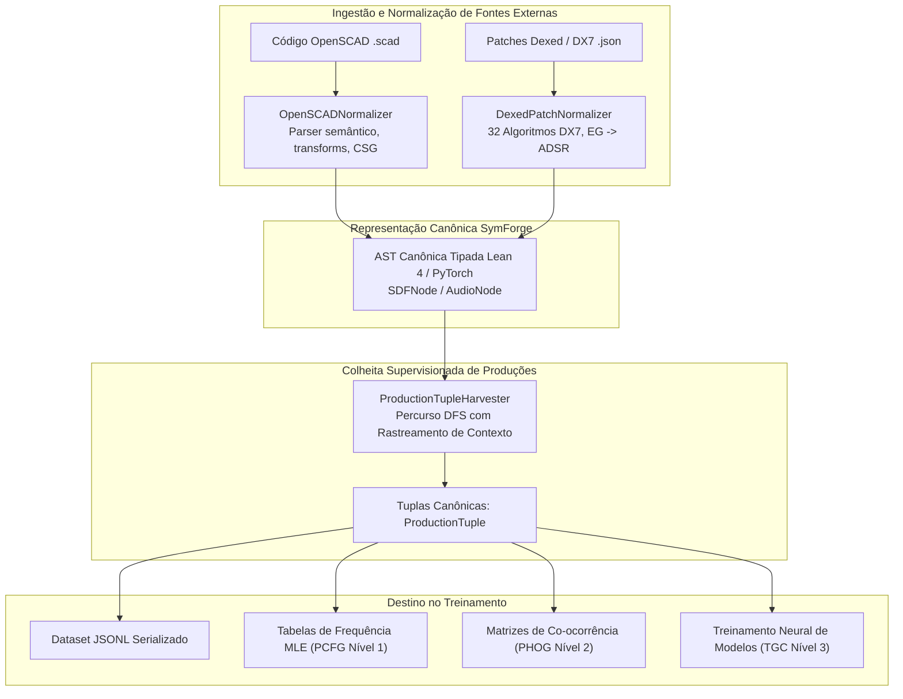

# Ingestão de Corpora Reais e Colheita de Produções Supervisionadas (OpenSCAD, Dexed e ProductionTupleHarvester)

## 1. Visão Geral e Fundamentação Teórica

Para que os modelos probabilísticos de gramática (Nível 1: PCFG e Nível 2: PHOG) e os modelos neurais de síntese (Nível 3: PDE, TGC e FPO) aprendam regras de derivação realistas e não degeneradas, o **SymForge** implementa um pipeline dual de:
1. **Normalizadores de Código de Domínio Real:** Conversores que ingerem representações externas heterogêneas — código declarativo OpenSCAD (CAD 3D / CSG) e definições de patches Dexed / Yamaha DX7 (Síntese FM 1D) — e as mapeiam isotopicamente para as árvores canônicas tipadas `SDFNode` e `AudioNode` da nossa DSL.
2. **Extrator e Colhedor de Tuplas Supervisionadas (`ProductionTupleHarvester`):** Módulo formal que percorre qualquer árvore sintática da DSL e extrai tuplas canônicas de decisão de derivação contextual:
   $$\langle \text{nonterminal}, \text{production}, \text{parent\_context}, \text{grandparent}, \text{left\_sibling}, \text{ancestor\_chain}, \text{params} \rangle$$

Esse desacoplamento garante que gramáticas probabilisticamente condicionadas capturem padrões estruturais do mundo real (como encadeamentos de furos mecânicos em CAD via `difference` ou pares de portadora-moduladora em patches FM) enquanto preservam compatibilidade total com a verificação formal em Lean 4 e a compilação diferenciável em PyTorch.

---

## 2. Pipeline de Ingestão e Colheita de Decisões Sintáticas

```text
+---------------------------------------------------------------------------------------------------+
|                     PIPELINE DE INGESTÃO DE DOMÍNIO E COLHEITA DE PRODUÇÕES                       |
|                                                                                                   |
|  [Código OpenSCAD (.scad)]                      [Patches Dexed / DX7 (.json)]                     |
|           |                                                    |                                  |
|           v                                                    v                                  |
|  +-------------------------------+             +-------------------------------+                  |
|  | OpenSCADNormalizer            |             | DexedPatchNormalizer          |                  |
|  | - Parser Recursivo Descent    |             | - Mapeador 32 Algoritmos DX7  |                  |
|  | - Avaliador Seguro de Math    |             | - Operadores FM e Portadoras  |                  |
|  | - Primitivas, Afins e CSG     |             | - Mapeador de Envelopes ADSR  |                  |
|  +---------------+---------------+             +---------------+---------------+                  |
|                  |                                             |                                  |
|                  +----------------------+----------------------+                                  |
|                                         |                                                         |
|                                         v                                                         |
|                       +-----------------------------------+                                       |
|                       |  AST Canônica Tipada SymForge     |                                       |
|                       |  (AudioNode / SDFNode com Params) |                                       |
|                       +-----------------+-----------------+                                       |
|                                         |                                                         |
|                                         v                                                         |
|                       +-----------------------------------+                                       |
|                       | ProductionTupleHarvester          |                                       |
|                       | - Percurso Pre-Order DFS          |                                       |
|                       | - Invariantes de Profundidade     |                                       |
|                       | - Rastreamento de Contexto & Tags |                                       |
|                       +-----------------+-----------------+                                       |
|                                         |                                                         |
|                    +--------------------+--------------------+                                    |
|                    |                                         |                                    |
|                    v                                         v                                    |
|     +-----------------------------+           +-----------------------------+                     |
|     | Exportação JSONL / Tuplas   |           | Estatísticas & Tabelas      |                     |
|     | Dataset de Treinamento PCFG |           | - Frequências Marginais     |                     |
|     | e Embeddings PHOG / TGC     |           | - Co-ocorrências Contexto   |                     |
|     +-----------------------------+           +-----------------------------+                     |
+---------------------------------------------------------------------------------------------------+
```



---

## 3. Especificação do Normalizador OpenSCAD (`OpenSCADNormalizer`)

O módulo `OpenSCADNormalizer` converte programas declarativos CSG em instâncias estruturadas de `SDFNode`.

### 3.1 Primitivas 3D Suportadas
- **Cubo / Paralelepípedo (`cube`):**
  - Sintaxe escalar: `cube(s);` $\implies$ `BoxNode(width=s, height=s, depth=s)`
  - Sintaxe vetorial: `cube([w, h, d]);` $\implies$ `BoxNode(width=w, height=h, depth=d)`
  - Parâmetros nomeados: `cube(size=[w, h, d], center=true);`
- **Esfera (`sphere`):**
  - Sintaxe escalar: `sphere(r);` $\implies$ `SphereNode(radius=r)`
  - Raio explícito: `sphere(r=val);`
  - Diâmetro explícito: `sphere(d=val);` $\implies \text{radius} = \text{val} / 2$
- **Cilindro (`cylinder`):**
  - Sintaxe: `cylinder(h=val, r=val);` $\implies$ `CylinderNode(radius=r, height=h)`
  - Diâmetro: `cylinder(h=val, d=val);` $\implies \text{radius} = \text{val} / 2$
  - Truncado / cônico: `cylinder(h, r1, r2);` $\implies \text{radius} = (r_1 + r_2) / 2$

### 3.2 Transformações Espaciais e Encadeamento
- **Translação (`translate([dx, dy, dz])`):** Mapeia deslocamentos euclidianos para `TranslateNode(dx, dy, dz, child)`.
- **Rotação (`rotate([rx, ry, rz])`):** Converte ângulos especificados em graus na sintaxe OpenSCAD para radianos canônicos via $\theta_{\text{rad}} = \theta_{\text{deg}} \times \frac{\pi}{180}$, gerando `RotateNode(rx, ry, rz, child)` compatível com matrizes de rotação de Euler em PyTorch autograd.
- **Escala (`scale([sx, sy, sz])` ou `scale(s)`):** Extrai o fator uniforme ou a aproximação isotrópica média $s = \frac{s_x + s_y + s_z}{3}$, gerando `ScaleNode(s, child)`.
- **Encadeamento de prefixos:** `translate(...) rotate(...) scale(...) primitiva;` é transformado em uma hierarquia de composição estrita:
  $$\text{TranslateNode}(\dots, \text{RotateNode}(\dots, \text{ScaleNode}(\dots, \text{Primitiva})))$$

### 3.3 Combinadores Booleanos CSG e Desdobramento Binário
Como a gramática SymForge é estritamente binária para operadores CSG, operações com $N > 2$ filhos sofrem desdobramento (*left-folding*):
- **União (`union() { A; B; C; }`):**
  $$\text{UnionNode}(\text{smoothness}, \text{UnionNode}(\text{smoothness}, A, B), C)$$
- **Diferença (`difference() { A; B; C; }`):**
  $$\text{DifferenceNode}(\text{DifferenceNode}(A, B), C)$$
- **Interseção (`intersection() { A; B; C; }`):**
  $$\text{IntersectionNode}(\text{IntersectionNode}(A, B), C)$$

### 3.4 Avaliação Aritmética Segura sem `eval()`
O normalizador utiliza `_SafeMathEvaluator` baseado no módulo de AST do Python, interpretando de forma estrita variáveis declaradas (`$fn = 64; side = 20; h = 2 * side;`), vetores e funções trigonométricas (`sin`, `cos`, `sqrt`, `abs`, `min`, `max`), prevenindo injeção de código e garantindo isolamento total de tempo de execução.

---

## 4. Especificação do Normalizador Dexed / DX7 (`DexedPatchNormalizer`)

O sintetizador Yamaha DX7 e seu emulador aberto Dexed organizam sua síntese FM em **6 operadores** organizados segundo **32 algoritmos de modulação**.

### 4.1 Mapeamento da Topologia de Algoritmos (1 a 32)
Para cada algoritmo:
1. **Portadoras (Carriers):** Operadores cujas saídas somam diretamente no barramento principal de áudio.
2. **Moduladoras (Modulators):** Operadores que modulam a fase/frequência de uma portadora ou de outra moduladora.
- Cada operador portador modulado é traduzido em `FMNode(carrier, mod_freq, mod_index)`.
- Cada operador portador isolado é traduzido em `SineNode(freq, phase)`.
- As portadoras resultantes são combinadas por árvores balanceadas de `MixNode(ratio=0.5, input1, input2)`.

### 4.2 Normalização de Parâmetros e Envelopes DX7
- **Frequência Operacional:** A frequência base $f_0$ (ex: $440.0\text{ Hz}$) é combinada com os multiplicadores `coarse` ($0 \dots 31$) e `fine` ($0 \dots 99$):
  $$f = f_0 \times \text{coarse\_mult} \times \left(1.0 + \frac{\text{fine}}{100.0}\right)$$
  Onde $\text{coarse\_mult} = 0.5$ se $\text{coarse} = 0$, e $\text{coarse}$ caso contrário.
- **Índice de Modulação:** O nível de saída do operador ($0 \dots 99$) é normalizado para o índice de modulação contínuo $I \in [0.0, 10.0]$:
  $$I = \frac{\text{output\_level}}{99.0} \times 10.0$$
- **Envelopes de 4 Taxas e 4 Níveis (EG $\to$ ADSR):** As taxas $R_1 \dots R_4$ e níveis $L_1 \dots L_4$ do DX7 são mapeados para tempos físicos contínuos em segundos:
  $$\text{attack} = \max\left(0.001, \frac{99 - R_1}{99} \times 2.0\right)$$
  $$\text{decay} = \max\left(0.001, \frac{99 - R_2}{99} \times 2.0\right)$$
  $$\text{sustain} = \frac{L_3}{99.0}$$
  $$\text{release} = \max\left(0.001, \frac{99 - R_4}{99} \times 3.0\right)$$
  O oscilador é então envelopado em um nó `ADSRNode(attack, decay, sustain, release, gate=oscillator)`.

---

## 5. Especificação do Colhedor de Tuplas (`ProductionTupleHarvester`)

Para cada nó $u$ da árvore de derivação, o colhedor extrai um registro unificado de decisão gramatical:

```python
@dataclass
class ProductionTuple:
    nonterminal: str           # "SDF" ou "Audio"
    production: str            # Assinatura canônica formal
    production_id: str         # Identificador da regra (ex: "sdf_difference")
    depth_from_root: int       # Distância indutiva da raiz (0, 1, 2...)
    depth_to_leaves: int       # Distância máxima até as folhas
    parent_context: list[str]  # Contexto do pai imediato (ex: ["Difference"])
    grandparent_context: str | None # Tag do avô na árvore
    left_sibling_context: str | None # Tag do irmão à esquerda imediato
    ancestor_chain: list[str]  # Caminho completo de ancestrais desde ["Root"]
    expected_type: str         # Tipo esperado do nó ("SDF" ou "Audio")
    num_free_params: int       # Quantidade de parâmetros contínuos FreeParam
    free_params: list[dict]    # Metadados e valores default de FreeParam
    children_types: list[str]  # Não-terminais esperados dos filhos
```

### Invariantes Matemáticas de Extração:
1. **Preservação de Cardinalidade:** Para qualquer árvore $G$, a quantidade total de tuplas colhidas é estritamente igual ao número de vértices da AST:
   $$|\text{harvest}(G)| = |V(G)| = G.\text{size}$$
2. **Profundidade a Partir da Raiz (`depth_from_root`):**
   $$\text{depth\_from\_root}(\text{root}) = 0$$
   $$\text{depth\_from\_root}(c) = \text{depth\_from\_root}(p) + 1 \quad \forall c \in p.\text{children}$$
3. **Profundidade até as Folhas (`depth_to_leaves`):**
   $$\text{depth\_to\_leaves}(u) = 0 \iff u.\text{children} = \emptyset$$
   $$\text{depth\_to\_leaves}(u) = 1 + \max_{c \in u.\text{children}} \text{depth\_to\_leaves}(c)$$
4. **Cadeia Ancestral e Contextos:**
   $$\text{ancestor\_chain}(\text{root}) = [\text{"Root"}]$$
   $$\text{ancestor\_chain}(c) = \text{ancestor\_chain}(p) \mathbin{\Vert} [p.\text{tag}]$$
   $$\text{parent\_context}(c) = [p.\text{tag}]$$
   $$\text{grandparent\_context}(c) = \text{ancestor\_chain}(p)[-1] \quad (\text{se } \text{depth} \ge 1)$$

---

## 6. Symmetrização e Verificação Contínua

Para garantir que o código normalizado seja diretamente utilizável e semanticamente correto:
1. **Simetria Operacional com o Transpilador Differentiable:** Toda AST gerada por `OpenSCADNormalizer` ou `DexedPatchNormalizer` é compilada via `transpile_ast_to_module` e executada em PyTorch, confirmando a propagação de gradientes e ausência de valores `NaN` ou `Inf`.
2. **Simetria com o Lean 4 Bridge:** Toda AST normalizada é serializada para o formato JSON do Lean 4 via `serialize_node` e recuperada via `deserialize_node`, preservando perfeitamente a profundidade e tamanho da árvore.
