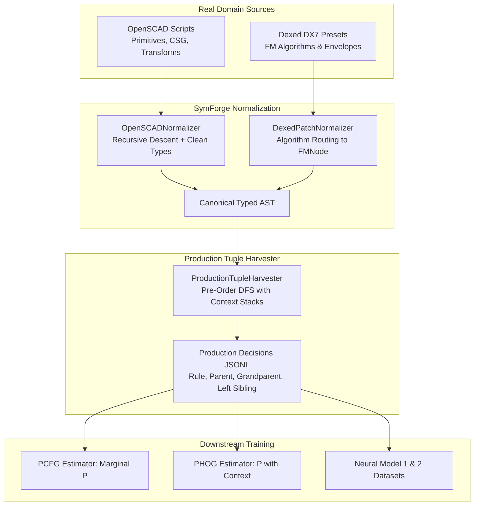

# Real Domain Code Ingestion & Supervised Production Harvester (OpenSCAD, Dexed, and ProductionTupleHarvester)

## 1. Overview and Theoretical Foundations

For probabilistic grammar models (Level 1: PCFG, Level 2: PHOG) and neural synthesis models (Level 3: PDE, TGC, FPO) to learn realistic, non-degenerate derivation distributions, **SymForge** implements a dual ingestion and extraction pipeline:
1. **Real-Domain Code Normalizers:** Parsers that ingest heterogeneous external codebases — OpenSCAD declarative code (3D CAD / CSG) and Dexed / Yamaha DX7 voice patch definitions (1D FM Synthesis) — and map them onto SymForge's canonical typed ASTs (`SDFNode` and `AudioNode`).
2. **Supervised Production Tuple Harvester (`ProductionTupleHarvester`):** A formal module that traverses any SymForge AST and extracts structured derivation decision tuples:
   $$\langle \text{nonterminal}, \text{production}, \text{parent\_context}, \text{grandparent}, \text{left\_sibling}, \text{ancestor\_chain}, \text{free\_params} \rangle$$

This decoupling ensures that probabilistic grammars capture real-world structural heuristics (e.g., mechanical drill holes via `Difference` or carrier-modulator operator pairings in FM synthesis) while preserving full compatibility with formal Lean 4 verification and differentiable PyTorch execution.

---

## 2. Ingestion & Decision Harvesting Pipeline

```text
+---------------------------------------------------------------------------------------------------+
|                     DOMAIN INGESTION & PRODUCTION HARVESTING PIPELINE                             |
|                                                                                                   |
|  [OpenSCAD Code (.scad)]                        [Dexed / DX7 Patches (.json)]                     |
|           |                                                    |                                  |
|           v                                                    v                                  |
|  +-------------------------------+             +-------------------------------+                  |
|  | OpenSCADNormalizer            |             | DexedPatchNormalizer          |                  |
|  | - Recursive Descent Parser    |             | - 32 DX7 Algorithm Mapper     |                  |
|  | - Safe Math Evaluator         |             | - FM Modulator/Carrier Graph  |                  |
|  | - Primitives, Affines, CSG    |             | - ADSR Envelope Synthesizer   |                  |
|  +---------------+---------------+             +---------------+---------------+                  |
|                  |                                             |                                  |
|                  +----------------------+----------------------+                                  |
|                                         |                                                         |
|                                         v                                                         |
|                       +-----------------------------------+                                       |
|                       |  Canonical Typed SymForge AST     |                                       |
|                       |  (AudioNode / SDFNode with Params)|                                       |
|                       +-----------------+-----------------+                                       |
|                                         |                                                         |
|                                         v                                                         |
|                       +-----------------------------------+                                       |
|                       | ProductionTupleHarvester          |                                       |
|                       | - Pre-Order DFS Traversal         |                                       |
|                       | - Exact Depth Invariants          |                                       |
|                       | - Context & Sibling Stack Tracking|                                       |
|                       +-----------------+-----------------+                                       |
|                                         |                                                         |
|                    +--------------------+--------------------+                                    |
|                    |                                         |                                    |
|                    v                                         v                                    |
|     +-----------------------------+           +-----------------------------+                     |
|     | JSONL Tuple Export          |           | Frequency Tables & Counts   |                     |
|     | (Supervised Dataset Splits) |           | (PCFG & PHOG Prior Learning)|                     |
|     +-----------------------------+           +-----------------------------+                     |
+---------------------------------------------------------------------------------------------------+
```



---

## 3. OpenSCAD Normalizer (`OpenSCADNormalizer`)

The normalizer converts human-authored OpenSCAD CAD scripts into SymForge's analytical `SDFNode` trees:

### Supported OpenSCAD Primitives & Operators:
- **Analytical 3D Shapes:**
  - `cube([w, h, d])` or `cube(s)` $\to$ `BoxNode(w/2, h/2, d/2)`
  - `sphere(r)` $\to$ `SphereNode(r)`
  - `cylinder(h=h, r=r)` $\to$ `CylinderNode(r, h)`
- **Spatial Transforms:**
  - `translate([dx, dy, dz]) { child; }` $\to$ `TranslateNode(dx, dy, dz, child)`
  - `rotate([rx, ry, rz]) { child; }` $\to$ `RotateNode(rx, ry, rz, child)`
  - `scale([sx, sy, sz]) { child; }` $\to$ `ScaleNode(sx, sy, sz, child)`
- **CSG Combinators:**
  - `union() { a; b; }` $\to$ `UnionNode(a, b)`
  - `difference() { a; b; }` $\to$ `DifferenceNode(a, b)`
  - `intersection() { a; b; }` $\to$ `IntersectionNode(a, b)`

---

## 4. Dexed / Yamaha DX7 Normalizer (`DexedPatchNormalizer`)

The DX7 synthesizer specifies a modular audio graph with 6 operators routed according to 32 canonical algorithms. `DexedPatchNormalizer` maps these operator routing matrices into SymForge's functional `AudioNode` tree:
- **Carrier vs. Modulator Routing:** Terminal output operators are mapped to audio root combinators (`MixNode` or `GainNode`), while modulating operators are nested inside `FMNode(carrier, modulator)`.
- **Envelope Synthesis:** Converts DX7 4-rate / 4-level envelopes into physical `ADSRNode(attack, decay, sustain, release)` instances.
- **Frequency Ratios:** Multiplies fundamental pitch by coarse/fine ratios to produce `FreeParam` instances for oscillator frequencies.

---

## 5. Supervised Production Tuple Harvester (`ProductionTupleHarvester`)

Traverses an AST and extracts derivation decision records:

### Schema Invariants:
- $\text{depth\_from\_root} = 0$ for root; increments by $1$ per descendant level.
- $\text{depth\_to\_leaves} = 0$ for terminal leaves; equals $\max_{c} (\text{depth\_to\_leaves}(c)) + 1$ for operators.
- $\text{parent\_context} = [\text{ParentOp}]$ or `["Root"]`.
- $\text{left\_sibling\_context}$ tracks the immediately preceding sibling under the same parent node.

### Usage Example:
```python
from symforge.data.normalizer import OpenSCADNormalizer
from symforge.data.harvester import ProductionTupleHarvester

normalizer = OpenSCADNormalizer()
ast = normalizer.parse_code("""
difference() {
    cube([10, 10, 10]);
    cylinder(h=12, r=2);
}
""")

harvester = ProductionTupleHarvester()
tuples = harvester.harvest(ast)

for t in tuples:
    print(t.depth_from_root, t.production_id, t.parent_context, t.left_sibling_context)
```
