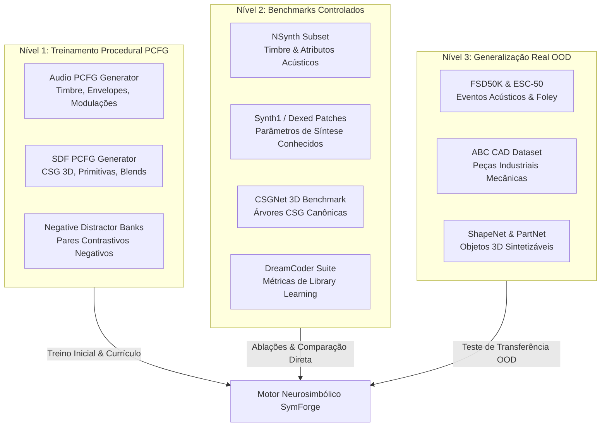
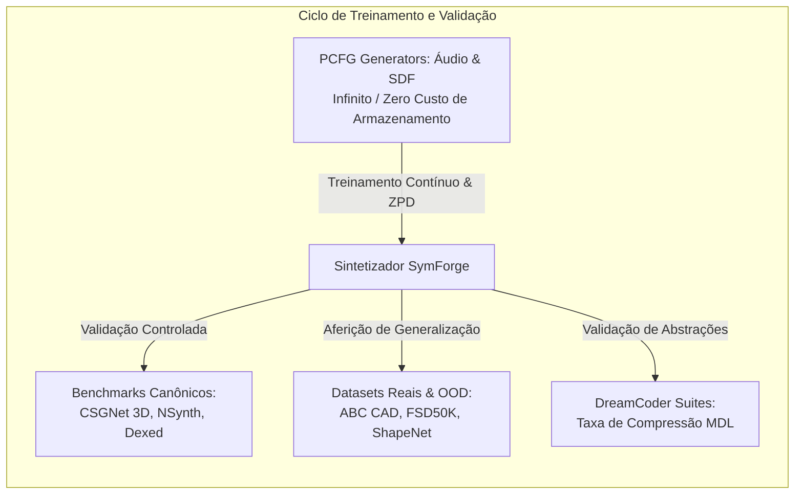

# Catálogo de Datasets e Benchmarks: Áudio, SDFs e Generalização

Este documento cataloga todos os datasets, corpora sintéticos e benchmarks relevantes para o desenvolvimento, treinamento, validação e teste dos três pilares do **SymForge**:

```text
+---------------------------------------------------------------------------------------------------+
|                              TAXONOMIA DE DATASETS DO SYMFORGE                                    |
|                                                                                                   |
|  Nível 1: Dados Procedurais PCFG       Nível 2: Benchmarks Controlados    Nível 3: Dados Reais / OOD|
|  (Treino & Currículo Sintético)        (Comparação com Baselines)        (Generalização Perceptual) |
|  -------------------------------       -------------------------------   -------------------------- |
|  - Audio-PCFG Generator                - Dexed / Synth1 Patch Corpus     - FSD50K & ESC-50          |
|  - SDF-PCFG CSG Generator              - NSynth (Acoustic & Synth Notes) - ABC CAD Dataset (1M CAD) |
|  - Synthetic Invariant Task Corpora    - CSGNet 2D/3D Synthetic Trees   - ShapeNetCore / PartNet   |
|  - Paired Contrastive Negative Banks   - DreamCoder Domain Suites        - Thingi10K Real Meshes    |
+---------------------------------------------------------------------------------------------------+
```



---

## 1. Pilar 1: Sintetizador de Áudio (1D Procedural DSP)

### 1.1 Gerador Procedural Interno: `Audio-PCFG` (Treinamento Contínuo & Currículo)
- **Tipo:** Gerador procedural estocástico em memória (zero download).
- **Conteúdo:** Programas aleatórios amostrados a partir da gramática de áudio (osciladores, envelopes ADSR, moduladores LFO/FM, filtros biquad).
- **Anotações:** AST/DAG do programa gerador, parâmetros contínuos de síntese e forma de onda renderizada em 44.1 kHz / 16 kHz.
- **Função no Projeto:** Serve como o motor do currículo adaptativo na Zona de Desenvolvimento Proximal (ZPD), gerando alvos com complexidade crescente (de tons puros a texturas percussivas e pads polifônicos).

### 1.2 NSynth (Neural Audio Synthesis Dataset - Magenta / Google Brain)
- **Origem / Referência:** [Google Magenta NSynth](https://magenta.tensorflow.org/datasets/nsynth)
- **Volume:** ~305.979 notas musicais individuais (4 segundos, 16 kHz).
- **Características:** 1.006 instrumentos musicais cobrindo 11 famílias de instrumentos (bass, brass, flute, guitar, keyboard, mallet, organ, reed, string, synth_lead, vocal) e 5 fontes acústicas (acústico, eletrônico, sintético).
- **Anotações Relevantes:** Pitch MIDI, velocity, família do instrumento, tags acústicas (*brightness, warmth, percussive, distortion, fast_decay*).
- **Uso no SymForge:** Benchmark padrão para avaliar a capacidade do sintetizador de reconstruir timbres de referência e extrair macro-primitivas de famílias instrumentais (ex: ataque percussivo para `mallet`, modulação FM para `synth_lead`).

### 1.3 Synth1 & Dexed FM Patch Corpora (Bancos de Patches de Sintetizadores Reais)
- **Origem:** Bancos comunitários abertos de patches para sintese subtrativa (Synth1) e sintese por modulação de frequência (Yamaha DX7 / Dexed).
- **Volume:** > 25.000 patches com parâmetros conhecidos.
- **Características:** Estruturas explícitas de operadores, modulações de fase, frequências carrier/modulator e envelopes.
- **Uso no SymForge:** Teste de reconstituição de parâmetros e inferência estrutural de programas analógicos/FM onde o "código fonte" (grafo de síntese) é conhecido com precisão cirúrgica.

### 1.4 FSD50K (Freesound Dataset 50K) & ESC-50
- **Origem:** [FSD50K Zenodo](https://zenodo.org/record/4060432) e [ESC-50 GitHub](https://github.com/karolpiczak/ESC-50)
- **Volume:** 51.197 clipes de áudio (FSD50K) e 2.000 gravações ambientais (ESC-50).
- **Características:** Sons ambientais, impactos, cliques mecânicos, vento, água, motores e texturas naturais.
- **Uso no SymForge:** Avaliação de generalização fora da distribuição (Out-Of-Distribution - OOD) para verificar se o framework sintetiza sons procedurais não estritamente musicais (foley, efeitos sonoros).

### 1.5 Modelos de Representação Pré-treinados (Espaço de Contraste para Perda Perceptual)
- **CLAP (Contrastive Language-Audio Pretraining - LAION / Microsoft):** Codificador acústico congelado mapeando sinais de áudio para espaço latente vetorial normalizado de 512D.
- **OpenL3 / VGGish:** Extratores de representação perceptual temporal-frequencial para ancoragem do cálculo de perda contrastiva InfoNCE.

---

## 2. Pilar 2: Sintetizador de SDFs (3D Implicit Geometry)

### 2.1 Gerador Procedural Interno: `SDF-PCFG` (Treinamento Contínuo & Currículo)
- **Tipo:** Gerador procedural estocástico em memória (zero download).
- **Conteúdo:** Expressões booleanas CSG e campos implícitos amostrados com restrições de contenção espacial e overlaps não-vazios.
- **Anotações:** Grafo DAG do programa de geometria, parâmetros contínuos de dimensão/translação e consultas de pontos espaciais com distância calculada analiticamente.
- **Função no Projeto:** Base do currículo adaptativo geométrico, escalando de formas primitivas isoladas até peças complexas com furos, chanfros e relevos.

### 2.2 ABC Dataset (A Big CAD Model Dataset)
- **Origem / Referência:** [ABC Dataset NYU](https://deep-geometry.github.io/abc-dataset/)
- **Volume:** > 1.000.000 de modelos CAD tridimensionais limpos.
- **Características:** Peças industriais e mecânicas reais com superfícies analíticas parametrizadas (planos, cilindros, cones, esferas, toros, curvas B-spline).
- **Uso no SymForge:** O padrão ouro absoluto para avaliar a fidelidade da síntese CSG e validar a redução do custo computacional ($C_H$) em hardware de renderização/CAD.

### 2.3 CSGNet Synthetic Benchmark (CSG-2D & CSG-3D)
- **Origem:** [CSGNet Paper & Code](https://github.com/Hippogriff/CSGNet)
- **Volume:** ~100.000 pares de programas CSG sintéticos e malhas/voxels renderizados.
- **Características:** Árvores sintéticas de profundidade 3 a 7 combinando cubos, esferas e cilindros com operações de união, interseção e diferença.
- **Uso no SymForge:** Baseline direto para comparação de eficiência estrutural, tempo de busca e número de nós sintetizados contra o CSGNet original.

### 2.4 ShapeNetCore & PartNet
- **Origem:** [ShapeNet.org](https://shapenet.org/) e [PartNet](https://partnet.cs.stanford.edu/)
- **Volume:** ~51.300 modelos CAD limpos distribuídos em 55 categorias comuns (cadeiras, mesas, aviões, carros), com segmentação hierárquica de partes em PartNet.
- **Uso no SymForge:** Teste de capacidade de generalização e descoberta de abstrações compostas (ex: identificar a subestrutura "pé de cadeira" ou "asa de avião" e promovê-la a macro-primitiva).

### 2.5 Thingi10K
- **Origem:** [Thingi10K Dataset](https://ten-thousand-models.appspot.com/)
- **Volume:** 10.000 malhas 3D prontas para impressão 3D criadas por designers humanos.
- **Uso no SymForge:** Teste de robustez perante geometrias orgânicas e não-ideais, testando a resiliência da perda contrastiva contra imperfeições de superfície.

### 2.6 DeepSDF Query Points Dataset
- **Origem:** Repositório oficial do DeepSDF (Park et al., CVPR 2019).
- **Conteúdo:** Milhões de pares $(\mathbf{p}, d(\mathbf{p}))$ amostrados próximos às superfícies ($\varepsilon$-boundary) de objetos ShapeNet.
- **Uso no SymForge:** Conjunto de dados padronizado para ajuste fino de parâmetros contínuos por gradiente e validação do avaliador vetorizado NumPy.

---

## 3. Pilar 3: Generalização e Meta-Aprendizado

### 3.1 DreamCoder Benchmark Suites
- **Origem:** Ellis et al., "DreamCoder: Growing generalizable, interpretable knowledge with program synthesis" (2021).
- **Domínios Incluídos:**
  - *2D Turtle Graphics (LOGO):* Desenho vetorial procedimental por primitivas de movimento e repetição.
  - *RegEx & String Manipulation:* Expressões regulares e gramáticas de transformação textual.
  - *List Processing:* Operações de ordem superior estilo Lisp (`map`, `filter`, `fold`).
- **Métricas Relevantes:** Taxa de compressão por Descrição Mínima (MDL), taxa de reutilização de bibliotecas aprendidas e velocidade de solução de tarefas inéditas.
- **Uso no SymForge:** Validação da generalização agnóstica do algoritmo de anti-unificação e expansão de gramática.

### 3.2 dPads & NEAR Evaluation Environments
- **Origem:** [dPads (NeurIPS 2023)](https://github.com/RU-Automated-Reasoning-Group/dPads) e [NEAR (ICLR 2022)](https://github.com/trishullab/near)
- **Conteúdo:** Ambientes de busca com gramáticas livres de contexto e heurísticas neurais sobre programas parciais tipados.
- **Uso no SymForge:** Baseline comparativo direto para avaliar se o uso de relaxações de produções gramaticais e busca guiada por A* supera a enumeração cega e superestruturas fixas.

### 3.3 ARC (Abstraction and Reasoning Corpus) & Mini-ARC
- **Origem:** François Chollet (2019) e Mini-ARC.
- **Conteúdo:** Tarefas de raciocínio lógico-visual que exigem inferência de transformações a partir de poucos exemplos (few-shot).
- **Uso no SymForge:** Benchmark prospectivo para testar o limite superior de generalização do framework fora de domínios contínuos físicos.

---

## 4. Matriz Comparativa de Uso no Ciclo de Vida do Projeto

```text
+-------------------------------------------------------------------------------------------------------------------------------+
|                                      MATRIZ DE APLICAÇÃO DOS DATASETS NO SYMFORGE                                              |
|                                                                                                                               |
| Dataset / Corpus          Pilar     Fase de Uso        Volume / Custo      Papel Primário no Ciclo                            |
| ------------------------  --------  -----------------  ------------------  -------------------------------------------------- |
| Audio-PCFG Generator      Áudio     Fase 1, 2, 5       Infinito / Zero     Currículo dinâmico, pares positivos/negativos      |
| SDF-PCFG Generator        SDF       Fase 1, 3, 5       Infinito / Zero     Currículo dinâmico, campos de distância sintéticos |
| NSynth (Subset)           Áudio     Fase 2, 6          ~10k amostras       Benchmark de timbres e acurácia de parâmetros      |
| Dexed / Synth1 Banks      Áudio     Fase 2             ~5k patches         Recuperação de grafos analógicos e FM conhecidos   |
| CSGNet 3D Benchmark       SDF       Fase 3, 6          ~10k árvores CSG    Comparação com estado da arte em síntese de forma  |
| ABC Dataset (Partes 0-5)  SDF       Fase 3, 6          ~50k modelos CAD    Validação em geometria mecânica realista           |
| FSD50K / ESC-50           Áudio     Fase 6             ~2k clipes          Generalização OOD para foley e texturas            |
| ShapeNetCore (Selected)   SDF       Fase 6             ~5k modelos         Descoberta de abstrações semânticas em objetos 3D  |
| DreamCoder Suite          Geral     Fase 5, 6          ~500 tarefas        Validação agnóstica de Library Learning e MDL      |
+-------------------------------------------------------------------------------------------------------------------------------+
```



---

## 5. Estratégia de Armazenamento, Cache e Execução Local Leve

Para honrar a diretriz central de **não sobrecarregar a máquina local com dados pesados ou treinamentos caros**:
1. **Prioridade Zero-Disk:** Os geradores `Audio-PCFG` e `SDF-PCFG` residem no código e são instanciados sob demanda em memória RAM (consumo $< 200 \text{ MB}$).
2. **Subsets Filtrados para CI / Testes Unitários:** Para os datasets externos (NSynth, CSGNet, ABC), serão extraídos pacotes canônicos ultraleves (ex: `tests/fixtures/nsynth_mini.npz` com 50 amostras, `tests/fixtures/csg_mini.json` com 50 árvores, totalizando $< 15 \text{ MB}$ versionados com o repositório).
3. **Download Sob Demanda para Benchmarks Pesados:** Os arquivos pesados brutos (gigas de malhas ou áudios) serão referenciados via scripts de streaming ou montagem em nuvem (S3 / Modal volumes) durante execuções despachadas, nunca bloqueando o repositório local.
