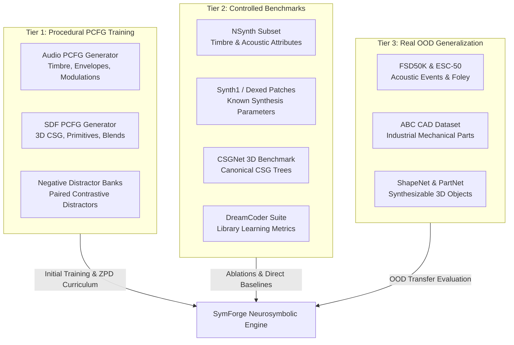
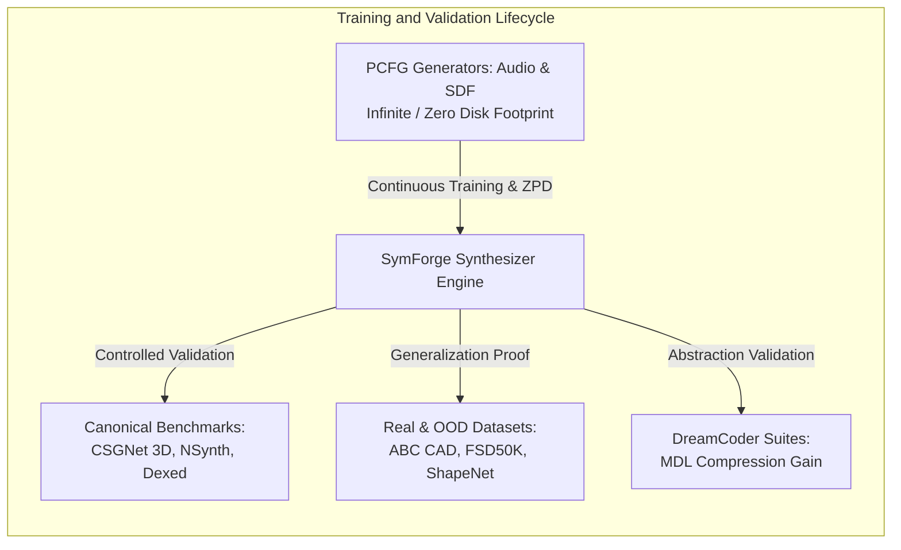

# Dataset and Benchmark Catalog: Audio, SDFs, and Generalization

This document catalogs all datasets, synthetic corpora, and benchmarks relevant to the development, training, validation, and testing of the three pillars of **SymForge**:

```text
+---------------------------------------------------------------------------------------------------+
|                              SYMFORGE DATASET TAXONOMY                                            |
|                                                                                                   |
|  Tier 1: Procedural PCFG Data          Tier 2: Controlled Benchmarks      Tier 3: Real / OOD Data |
|  (Synthetic Training & Curriculum)     (Baseline Direct Comparisons)      (Perceptual Transfer)   |
|  ---------------------------------     -----------------------------      ----------------------- |
|  - Audio-PCFG Generator                - Dexed / Synth1 Patch Corpora     - FSD50K & ESC-50       |
|  - SDF-PCFG CSG Generator              - NSynth (Acoustic & Synth Notes)  - ABC CAD Dataset (1M)  |
|  - Synthetic Invariant Task Corpora    - CSGNet 2D/3D Synthetic Trees     - ShapeNetCore / PartNet|
|  - Paired Contrastive Negative Banks   - DreamCoder Domain Suites         - Thingi10K Real Meshes |
+---------------------------------------------------------------------------------------------------+
```



---

## 1. Pillar 1: Audio Synthesizer (1D Procedural DSP)

### 1.1 In-Memory Procedural Generator: `Audio-PCFG` (Continuous Training & Curriculum)
- **Type:** In-memory stochastic procedural generator (zero download footprint).
- **Contents:** Random programs sampled from the audio domain grammar (oscillators, ADSR envelopes, LFO/FM modulators, biquad filters).
- **Annotations:** Generator program AST/DAG, continuous synthesis parameters, and rendered audio waveforms at 16 kHz / 44.1 kHz.
- **Role in SymForge:** Drives the adaptive curriculum inside the Zone of Proximal Development (ZPD), generating targets with scalable complexity (from pure tones to percussive textures and complex multi-timbral patches).

### 1.2 NSynth (Neural Audio Synthesis Dataset - Magenta / Google Brain)
- **Origin / Reference:** [Google Magenta NSynth](https://magenta.tensorflow.org/datasets/nsynth)
- **Volume:** ~305,979 individual musical notes (4 seconds, 16 kHz).
- **Characteristics:** 1,006 musical instruments spanning 11 instrument families (bass, brass, flute, guitar, keyboard, mallet, organ, reed, string, synth_lead, vocal) and 5 acoustic sources (acoustic, electronic, synthetic).
- **Relevant Annotations:** MIDI pitch, velocity, instrument family, acoustic quality tags (*brightness, warmth, percussive, distortion, fast_decay*).
- **Role in SymForge:** Standard benchmark to evaluate the synthesizer's ability to reconstruct reference acoustic timbres and discover macro-primitives across instrument families (e.g., percussive transient attacks for `mallet`, FM modulations for `synth_lead`).

### 1.3 Synth1 & Dexed FM Patch Corpora (Real Synthesizer Patch Banks)
- **Origin:** Open community patch banks for subtractive synthesis (Synth1) and frequency modulation synthesis (Yamaha DX7 / Dexed).
- **Volume:** > 25,000 patches with known ground-truth parameters.
- **Characteristics:** Explicit operator routings, phase modulations, carrier/modulator frequency ratios, and multi-stage envelopes.
- **Role in SymForge:** Exact parameter recovery and structural inference benchmark where the ground-truth "source code" (synthesis graph) is known with analytical precision.

### 1.4 FSD50K (Freesound Dataset 50K) & ESC-50
- **Origin:** [FSD50K Zenodo](https://zenodo.org/record/4060432) and [ESC-50 GitHub](https://github.com/karolpiczak/ESC-50)
- **Volume:** 51,197 audio clips (FSD50K) and 2,000 environmental recordings (ESC-50).
- **Characteristics:** Environmental sounds, mechanical impacts, water, wind, motors, and natural textures.
- **Role in SymForge:** Out-Of-Distribution (OOD) generalization evaluation to verify whether the framework can synthesize non-musical procedural sounds (foley, sound effects).

### 1.5 Pretrained Acoustic Embeddings (Contrastive Perceptual Loss Latents)
- **CLAP (Contrastive Language-Audio Pretraining - LAION / Microsoft):** Frozen acoustic encoder projecting audio waveforms into a normalized 512D latent space.
- **OpenL3 / VGGish:** Multi-resolution temporal-frequency perceptual representations for InfoNCE contrastive perceptual loss calculation.

---

## 2. Pillar 2: SDF Synthesizer (3D Implicit Geometry)

### 2.1 In-Memory Procedural Generator: `SDF-PCFG` (Continuous Training & Curriculum)
- **Type:** In-memory stochastic procedural generator (zero download footprint).
- **Contents:** CSG boolean expressions and implicit distance fields sampled under containment constraints and non-empty intersections.
- **Annotations:** Canonical DAG of the geometry program, continuous dimension/translation parameters, and analytical distance probe coordinates.
- **Role in SymForge:** Foundation of the geometric adaptive curriculum, scaling from isolated primitive shapes up to complex mechanical parts with holes, chamfers, and smooth blends.

### 2.2 ABC Dataset (A Big CAD Model Dataset - NYU)
- **Origin / Reference:** [ABC Dataset NYU](https://deep-geometry.github.io/abc-dataset/)
- **Volume:** > 1,000,000 clean 3D CAD models.
- **Characteristics:** Real industrial mechanical parts with parameterized analytical surfaces (planes, cylinders, cones, spheres, tori, B-spline curves).
- **Role in SymForge:** Absolute gold standard for validating CSG synthesis fidelity and confirming compiled hardware execution cost reduction ($C_H$) on CAD/rendering pipelines.

### 2.3 CSGNet Synthetic Benchmark (CSG-2D & CSG-3D)
- **Origin:** [CSGNet Paper & Code](https://github.com/Hippogriff/CSGNet)
- **Volume:** ~100,000 pairs of synthetic CSG programs and rendered voxel/mesh representations.
- **Characteristics:** Synthetic trees of depth 3 to 7 combining cubes, spheres, and cylinders with union, intersection, and difference operations.
- **Role in SymForge:** Direct baseline for evaluating structural search efficiency, step counts, and compiled node complexity against the original CSGNet.

### 2.4 ShapeNetCore & PartNet
- **Origin:** [ShapeNet.org](https://shapenet.org/) and [PartNet](https://partnet.cs.stanford.edu/)
- **Volume:** ~51,300 clean CAD models across 55 common categories (chairs, tables, airplanes, cars), with hierarchical part segmentations in PartNet.
- **Role in SymForge:** Evaluates abstraction discovery of semantic composite primitives (e.g., discovering "chair leg" or "airplane wing" and promoting it to a first-class macro).

### 2.5 Thingi10K
- **Origin:** [Thingi10K Dataset](https://ten-thousand-models.appspot.com/)
- **Volume:** 10,000 3D meshes designed by human makers for 3D printing.
- **Role in SymForge:** Robustness testing on non-ideal, organic geometries, verifying contrastive loss stability against surface imperfections.

### 2.6 DeepSDF Query Points Dataset
- **Origin:** Official DeepSDF repository (Park et al., CVPR 2019).
- **Contents:** Millions of coordinate pairs $(\mathbf{p}, d(\mathbf{p}))$ sampled near surfaces ($\varepsilon$-boundary) of ShapeNet objects.
- **Role in SymForge:** Standardized dataset for continuous parameter gradient descent validation and fast NumPy/PyTorch module verification.

---

## 3. Pillar 3: Generalization and Meta-Learning

### 3.1 DreamCoder Benchmark Suites
- **Origin:** Ellis et al., "DreamCoder: Growing generalizable, interpretable knowledge with program synthesis" (2021).
- **Included Domains:**
  - *2D Turtle Graphics (LOGO):* Procedural vector drawing via movement, repetition, and rotation primitives.
  - *RegEx & String Manipulation:* Regular expressions and text transformation grammars.
  - *List Processing:* Higher-order functional Lisp-style operations (`map`, `filter`, `fold`).
- **Relevant Metrics:** Minimum Description Length (MDL) compression gain, learned library reuse rate, and search speedup on held-out tasks.
- **Role in SymForge:** Validates domain-agnostic syntactic anti-unification (LGG) and dynamic grammar expansion.

### 3.2 dPads & NEAR Evaluation Environments
- **Origin:** [dPads (NeurIPS 2023)](https://github.com/RU-Automated-Reasoning-Group/dPads) and [NEAR (ICLR 2022)](https://github.com/trishullab/near)
- **Contents:** Program search environments with context-free grammars and neural heuristics over typed partial programs.
- **Role in SymForge:** Comparative baseline evaluating whether typed hole expansions with A* search outperform blind enumeration and superstructures.

### 3.3 ARC (Abstraction and Reasoning Corpus) & Mini-ARC
- **Origin:** François Chollet (2019) and Mini-ARC.
- **Contents:** Visual-logical few-shot reasoning tasks requiring procedural transformation inference.
- **Role in SymForge:** Prospective upper-bound generalization benchmark outside continuous physical modalities.

---

## 4. Lifecycle Application Matrix

```text
+-------------------------------------------------------------------------------------------------------------------------------+
|                                      DATASET APPLICATION MATRIX IN SYMFORGE                                                  |
|                                                                                                                               |
| Dataset / Source          Pillar    Active Phase       Volume / Storage    Primary Role in Lifecycle                          |
| ------------------------  --------  -----------------  ------------------  -------------------------------------------------- |
| Audio-PCFG Generator      Audio     Phases 1, 2, 5     Infinite / Zero     ZPD curriculum, contrastive positive/negative pairs|
| SDF-PCFG Generator        SDF       Phases 1, 3, 5     Infinite / Zero     ZPD curriculum, synthetic distance fields          |
| NSynth (Subset)           Audio     Phases 2, 6        ~10k samples        Timbre benchmark and continuous parameter accuracy |
| Dexed / Synth1 Banks      Audio     Phase 2            ~5k patches         Exact analog and FM graph recovery                 |
| CSGNet 3D Benchmark       SDF       Phases 3, 6        ~10k CSG trees      Direct baseline comparison in shape synthesis      |
| ABC Dataset (Chunks 0-5)  SDF       Phases 3, 6        ~50k CAD models     Realistic industrial mechanical CAD validation     |
| FSD50K / ESC-50           Audio     Phase 6            ~2k clips           OOD generalization for foley and acoustic textures |
| ShapeNetCore (Selected)   SDF       Phase 6            ~5k models          Semantic abstraction discovery in 3D objects       |
| DreamCoder Suite          General   Phases 5, 6        ~500 tasks          Domain-agnostic library learning & MDL validation  |
+-------------------------------------------------------------------------------------------------------------------------------+
```



---

## 5. Storage, Cache, and Lightweight Local Execution Strategy

To uphold the core mandate of **zero heavy local storage or compute overhead**:
1. **Zero-Disk Priority:** `Audio-PCFG` and `SDF-PCFG` generators reside entirely in memory (< 200 MB RAM allocation).
2. **Miniaturized Fixtures for Local CI/CD:** For external datasets (NSynth, CSGNet, ABC), ultra-lightweight canonical fixtures are stored in `tests/fixtures/` (`nsynth_mini.npz` with 50 samples, `csg_mini.json` with 50 trees, total size < 15 MB).
3. **On-Demand Remote Streaming:** Full raw data corpora (gigabytes of 3D meshes or audio files) are mounted remotely on cloud volumes (S3 / Modal volumes) during decoupled jobs, never burdening the local developer workspace.
