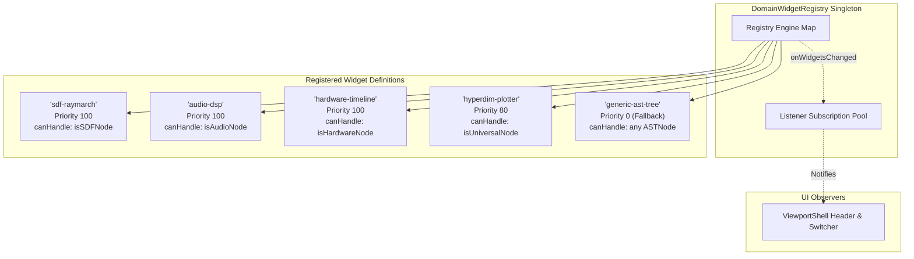
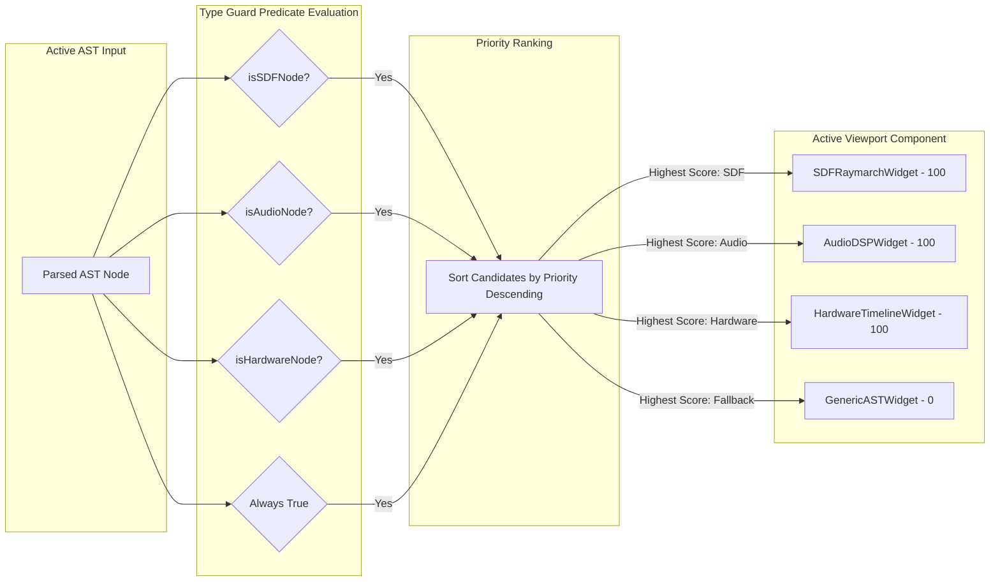
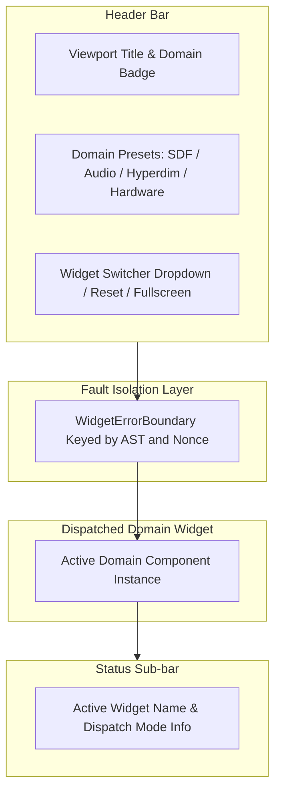
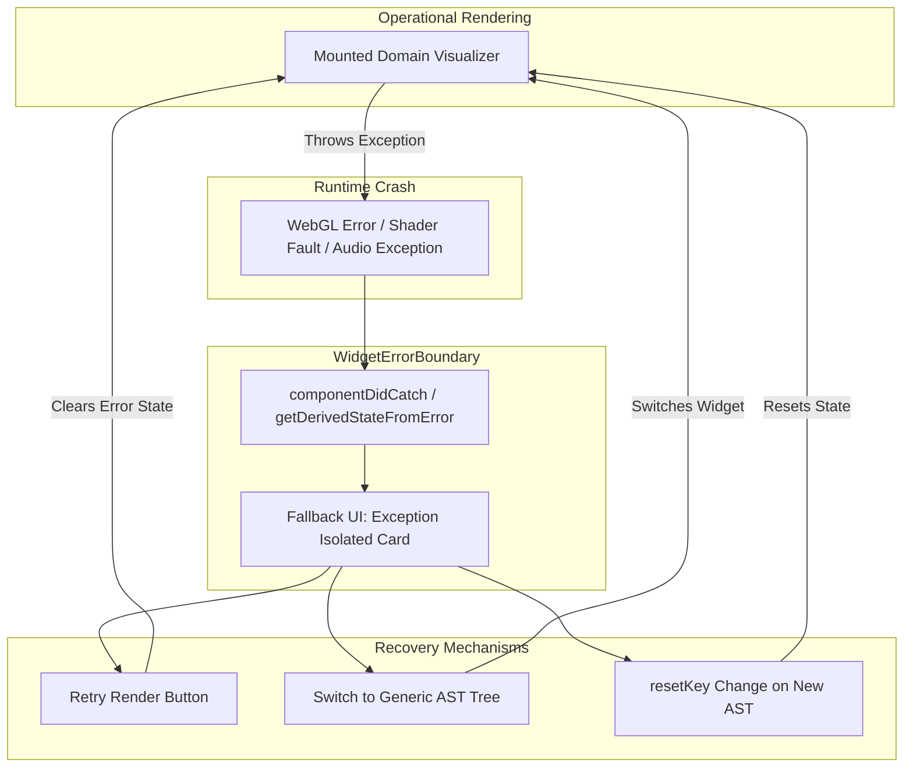

# Domain Widget Registry & Extensible Viewport Shell Architecture

**Document ID:** `ARCH-WIDGET-REGISTRY-202610`  
**Track:** `lean4_web_ide_interactive_widgets_202610`  
**Task Reference:** Task 2.1: Domain Widget Registry & Extensible Viewport Shell  
**Status:** Approved & Verified  
**Date:** 2026-10-27  

---

## 1. Executive Summary & Architectural Motivation

The **Domain Widget Registry & Extensible Viewport Shell** provides a pluggable, priority-ordered visual rendering architecture for the SymForge Web IDE.

In neural-symbolic workflows across Lean 4 IR domains, code declarations evaluate to fundamentally distinct mathematical and computational domains:
1. **3D Signed Distance Fields ($p \in \mathbb{R}^3 \to d \in \mathbb{R}$):** Require GPU-accelerated raymarching canvases with Phong lighting and cross-sectional plane slicing.
2. **Procedural Audio DSP ($t \in \mathbb{R} \to s \in [-1, 1]$):** Require WebAudio AudioWorklet synthesis graphs with real-time Fast Fourier Transform (FFT) spectrograms and time-domain oscilloscopes.
3. **Hardware Instruction Superoptimization ($\text{Seq}[\text{Instruction}]$):** Require register dependency DAGs, pipeline cycle Gantt charts, and register allocation tables.
4. **Generalized Multi-Dimensional Functions ($f: \mathbb{R}^n \to \mathbb{R}^m$):** Require coordinate scrubbers, 2D contour heatmaps, and 3D heightmap meshes.
5. **Universal & Custom Inductive ASTs:** Require an interactive syntax tree inspector allowing arbitrary structural exploration.

Hardcoding domain viewports inside monolithic UI components creates fragile coupling and prevents users and extensions from introducing new domain visualizers. The SymForge Domain Widget architecture resolves this by introducing:
- **Pluggable Widget Registry (`DomainWidgetRegistry`):** A singleton registry allowing dynamic registration, unregistration, priority-based ordering, and reactive subscription of widget definitions.
- **Type-Based Runtime Dispatch:** Automated resolution mapping parsed AST nodes (`SDFNode`, `AudioNode`, `HardwareNode`, `ASTNode`) to the highest-priority compatible visualizer.
- **Extensible Viewport Shell (`ViewportShell`):** A responsive top-level viewport providing dynamic domain badges, manual widget override controls, fullscreen toggling, reset actions, and real-time AST parameter binding.
- **Fault-Isolated Error Boundary (`WidgetErrorBoundary`):** Complete isolation of runtime visualizer crashes (e.g. WebGL context loss, shader compilation failures, or audio buffer underruns) preventing parent IDE disruption.

---

## 2. Extensible Registry Topology

The `DomainWidgetRegistry` decouples visualizer implementations from the core AST parser and application shell.

```text
+-----------------------------------------------------------------------------------------------------------------+
|                                    DOMAIN WIDGET REGISTRY TOPOLOGY                                              |
|                                                                                                                 |
|  [DomainWidgetRegistry Singleton]                                                                               |
|     |                                                                                                           |
|     +---> widgets: Map<string, DomainWidgetDefinition>                                                          |
|     |        |-- 'sdf-raymarch'       (Priority 100) -> SDFRaymarchWidget       [canHandle: isSDFNode]          |
|     |        |-- 'audio-dsp'          (Priority 100) -> AudioDSPWidget          [canHandle: isAudioNode]        |
|     |        |-- 'hardware-timeline'  (Priority 100) -> HardwareTimelineWidget  [canHandle: isHardwareNode]     |
|     |        |-- 'hyperdim-plotter'   (Priority 80)  -> HyperdimPlotterWidget   [canHandle: isUniversal/plotter]|
|     |        |-- 'generic-ast-tree'   (Priority 0)   -> GenericASTWidget        [canHandle: any ASTNode]        |
|     |                                                                                                           |
|     +---> listeners: Set<WidgetChangeListener>                                                                  |
|              |-- onWidgetsChanged(updated) --> ViewportShell Reactive Re-render                                 |
+-----------------------------------------------------------------------------------------------------------------+
```



---

## 3. Type-Based Dispatch Algorithm & Priority Resolution

When an AST changes in the `useFreeParamStore`, the Viewport Shell invokes `resolveWidget(ast)`. The dispatch algorithm filters registered definitions using their `canHandle` predicates and sorts matching candidates in descending priority order.

```text
+-----------------------------------------------------------------------------------------------------------------+
|                                TYPE-BASED WIDGET DISPATCH PIPELINE                                              |
|                                                                                                                 |
|  Input AST Node  ----->  canHandle(ast) Filtering  ----->  Priority Sort (Desc)  ----->  Resolved Widget       |
|                                                                                                                 |
|  SphereNode      ----->  [sdf-raymarch, generic]   ----->  [100, 0]              ----->  sdf-raymarch           |
|  LowPassNode     ----->  [audio-dsp, generic]      ----->  [100, 0]              ----->  audio-dsp              |
|  AddHardwareNode ----->  [hardware-timeline, gen]  ----->  [100, 0]              ----->  hardware-timeline      |
|  UnknownNode     ----->  [generic-ast-tree]        ----->  [0]                   ----->  generic-ast-tree       |
+-----------------------------------------------------------------------------------------------------------------+
```



### Formal Resolution Semantics

Let $\mathcal{W} = \{w_1, w_2, \dots, w_k\}$ be the set of registered widget definitions. Each definition $w_i$ defines a priority $p(w_i) \in \mathbb{R}$ and a predicate $h(w_i, A) \in \{0, 1\}$ for an AST node $A$.

$$\mathcal{C}(A) = \{w \in \mathcal{W} \mid h(w, A) = 1\}$$

$$\text{resolveWidget}(A) = \begin{cases} 
\underset{w \in \mathcal{C}(A)}{\operatorname{argmax}} \, p(w) & \text{if } \mathcal{C}(A) \neq \emptyset \\ 
\text{null} & \text{if } A = \text{null} \lor \mathcal{C}(A) = \emptyset 
\end{cases}$$

Because $w_{\text{generic}}$ specifies $h(w_{\text{generic}}, A) = 1$ for all $A \in \text{ASTNode}$ with $p(w_{\text{generic}}) = 0$, every valid non-null AST is guaranteed to resolve to at least the generic fallback widget.

---

## 4. Viewport Shell Layout & Control Topology

The `ViewportShell` wraps the active visualizer, exposing operational metadata and user controls:

```text
+-----------------------------------------------------------------------------------------------------------------+
|                                         VIEWPORT SHELL LAYOUT                                                   |
|                                                                                                                 |
|  +-----------------------------------------------------------------------------------------------------------+  |
|  | Header: Viewport: Interactive Domain Widget  [SDF BADGE] | Presets: [3D SDF] [WebAudio] [Hyperdim] [HW]  |  |
|  | Right Controls: Widget: [Auto (3D WebGL SDF Raymarching) v]  [↺ Reset]  [⛶ Fullscreen]                    |  |
|  +-----------------------------------------------------------------------------------------------------------+  |
|  | Viewport Body (Relative / Fullscreen Container)                                                          |  |
|  |                                                                                                           |  |
|  |   [WidgetErrorBoundary]                                                                                   |  |
|  |      |                                                                                                    |  |
|  |      +---> <ActiveWidget.component ast={ast} domain={domain} onParameterChange={updateParamValue} />     |  |
|  |                                                                                                           |  |
|  +-----------------------------------------------------------------------------------------------------------+  |
|  | Sub-bar: Active Widget: 3D WebGL SDF Raymarching | Mode: Auto-Dispatched                                  |  |
|  +-----------------------------------------------------------------------------------------------------------+  |
+-----------------------------------------------------------------------------------------------------------------+
```



---

## 5. Fault Isolation & Error Boundary Topology

Any uncaught exception thrown by a domain visualizer (such as WebGL context loss or invalid syntax parsing during rapid typing) is caught and isolated by `WidgetErrorBoundary`:

```text
+-----------------------------------------------------------------------------------------------------------------+
|                                ERROR BOUNDARY FAULT ISOLATION FLOW                                              |
|                                                                                                                 |
|  Widget Crash Event  ----->  componentDidCatch()  ----->  State: hasError=true  ----->  Isolated Error Card    |
|                                                                                                                 |
|  User Action / AST Change:                                                                                      |
|  - "Retry Render" button  ------------------------------------------------------------>  Clear Error State      |
|  - "View Generic AST" button  -------------------------------------------------------->  Switch to Generic Tree |
|  - resetKey change (AST/Widget ID update)  ------------------------------------------->  Automated Self-Heal    |
+-----------------------------------------------------------------------------------------------------------------+
```



---

## 6. Pass-to-Complete Gate: Domain Mapping Verification Matrix

The Pass-to-Complete Gate verifies that 4 distinct domain ASTs are correctly mapped to their respective widget components:

| Test Case | AST Fixture Type | Factory Function | Resolved Widget ID | Expected Component | Verification Status |
| :--- | :--- | :--- | :--- | :--- | :--- |
| **SDF Primitive** | `SphereSDFNode` | `createSphere(...)` | `sdf-raymarch` | `SDFRaymarchWidget` | **PASS** |
| **SDF Composite** | `DifferenceSDFNode` | `createDifference(...)` | `sdf-raymarch` | `SDFRaymarchWidget` | **PASS** |
| **Audio Primitive**| `SineAudioNode` | `createSine(...)` | `audio-dsp` | `AudioDSPWidget` | **PASS** |
| **Audio Filter** | `LowPassAudioNode` | `createLowPass(...)` | `audio-dsp` | `AudioDSPWidget` | **PASS** |
| **Hardware Arithmetic** | `AddHardwareNode` | `createAdd(...)` | `hardware-timeline` | `HardwareTimelineWidget` | **PASS** |
| **Hardware Register** | `RegHardwareNode` | `createReg(...)` | `hardware-timeline` | `HardwareTimelineWidget` | **PASS** |
| **Custom / Unknown** | `UniversalNode` / Custom | `{ kind: 'unsupported' }` | `generic-ast-tree` | `GenericASTWidget` | **PASS** |

---

## 7. Performance & Memory Invariants

1. **Resolution Latency ($< 0.1\,\text{ms}$):** Widget candidate filtering and sorting iterate through $\le 10$ registered definitions using pure predicate functions, executing in $< 50\,\mu\text{s}$.
2. **Stable Instance Keying:** Widgets are keyed by `id` rather than raw AST reference, preventing destruction and recreation of GPU canvases during parameter tweaking.
3. **Decoupled Parameter Updates:** Live slider adjustments invoke `updateParamValue(id, value)`, updating numeric uniform maps without triggering AST re-resolution or registry re-evaluation.
4. **Bounded AST Recursion:** `GenericASTWidget` enforces a hard recursion cap of $\text{MAX\_TREE\_DEPTH} = 64$ levels, preventing call-stack exhaustion on deep recursive expressions.
