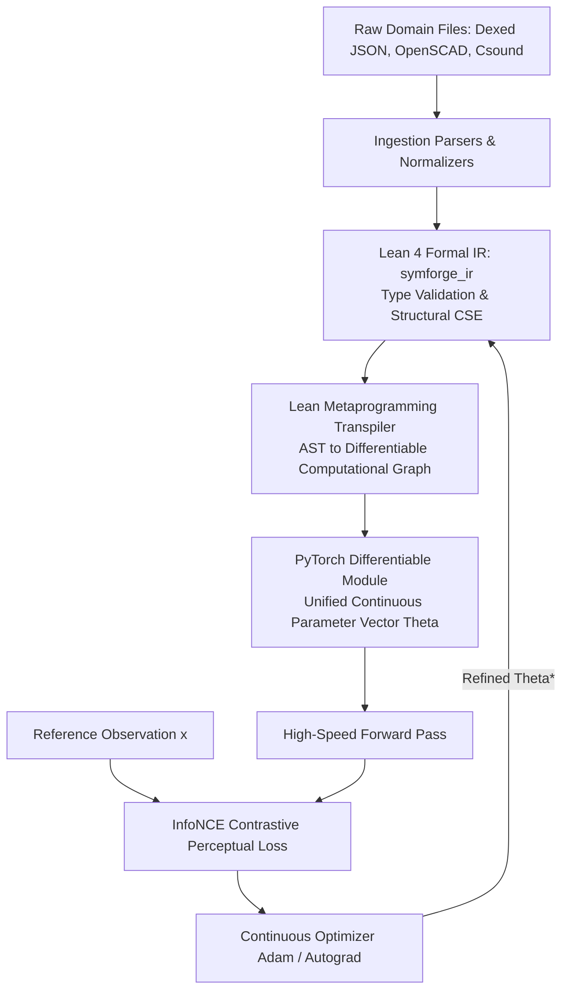

# Expanded Procedural Datasets & Lean 4 Formal IR Transpiler Architecture

This document expands the data catalog of **SymForge** to embrace a generalized formulation of "parametric procedural program synthesis", covering procedural PBR textures, hardware instruction superoptimization, and advanced acoustic synthesis. Furthermore, it details the architecture of the **Lean 4 Formal Intermediate Representation (IR) Transpiler**, which formalizes the domain grammars, verifies invariants at compile time, and compiles the computational graphs into high-speed differentiable back-ends (PyTorch/JAX).

---

## 1. Expanded Catalog: Parametric Procedural Logic Domains

The core premise of SymForge applies universally to any problem domain characterized by a **closed set of parameterized modules/primitives and free continuous parameters**, where the objective is to reconstruct a target observation under a perceptual or structural loss function.

### 1.1 Graphics: Textures, Shaders, and Procedural PBR Materials
In this domain, the objective is to compose procedural texturing operators (Perlin noise, Voronoi noise, gradients, reflection, normal/bump maps) to reproduce a reference surface material.
*   **MatSynth (Substance Designer Graphs):**
    *   *Contents:* Thousands of procedural node graphs exported from Adobe Substance 3D Designer, mapping mathematical operators to Physically Based Rendering (PBR) texture maps.
    *   *Primitives:* Noise, Blur, Blend, Color Ramp, Warp nodes.
    *   *Objective:* Discover the procedural graph that reproduces wood, metal, marble, or fabric textures from reference photographs.
*   **Shadertoy / GLSL Fragment Shaders (Shadertoy-100k Dataset):**
    *   *Contents:* Source code of procedural shaders rendering complex 2D/3D scenes directly in the browser via mathematics.
    *   *Primitives:* Analytical functions (`sin`, `fract`, `mod`), Raymarching loops, color blending operations.
    *   *Objective:* Automated shader code optimization, converting expensive loops into analytical approximations or synthesizing visual effects from prompts and images.

### 1.2 Advanced Acoustics: SFX, Foley, and Speech Synthesis (Vocoders)
*   **TorchSynth Dataset:**
    *   *Contents:* Procedural audio dataset built specifically for ML research, where modular PyTorch synthesizer graphs are stored alongside ground-truth continuous parameters.
    *   *Primitives:* Voltage-Controlled Oscillators (VCO), Voltage-Controlled Amplifiers (VCA), Voltage-Controlled Filters (VCF), Noise, ADSR envelopes.
    *   *Objective:* Inverse synthesis of complete modular synthesizer patches for sound design and electronic instruments.
*   **DDSP (Differentiable Digital Signal Processing) Corpora (VCTK, URMP):**
    *   *Contents:* Real speech recordings and acoustic instruments.
    *   *Primitives:* Harmonic additive oscillators, filtered noise generators, impulse response reverberators.
    *   *Objective:* Discover the time-varying fundamental frequency ($f_0$) trajectories and loudness envelopes that reconstruct speech or acoustic instruments.

### 1.3 Hardware Optimization and Compiler Superoptimization
Where "primitives" are CPU/GPU machine instructions and "parameters" are register indices and immediate offsets. The goal is achieving semantic equivalence to an unoptimized code block while minimizing execution latency, code size, and register pressure.
*   **BHive (Basic Block Harvested x86-64 Dataset):**
    *   *Contents:* Hundreds of thousands of real-world x86-64 basic blocks measured across microarchitectures.
    *   *Primitives:* Machine instructions (`ADD`, `MUL`, `LEA`, `MOV`, `XOR`, `SHL`, `SHR`, SIMD intrinsics).
    *   *Objective:* Instruction superoptimization. Discovering a shorter, lower-latency sequence of instructions computing the identical output function (proved semantically equivalent).
*   **TVM Tensor Programs / Halide Schedules:**
    *   *Contents:* Loop scheduling spaces for deep learning matrix multiplication kernels.
    *   *Primitives:* Loop Tiling, Unrolling, Vectorization, Caching operators.
    *   *Objective:* Discover the optimal execution schedule minimizing GPU kernel duration while preserving matrix multiplication outputs.

### 1.4 Analogous Procedural Domains
*   **Computational Chemistry / Retrosynthesis (USPTO Dataset):** Primitives are organic chemical reaction templates; parameters are temperature/catalyst conditions. Objective: synthesize the target molecule.
*   **UI Layout Synthesis (RICO Dataset):** Primitives are Flexboxes, Containers, Text, and Buttons. Parameters are paddings, margins, and colors. Objective: reconstruct an application screenshot into a procedural layout tree.

---

## 2. Lean 4 Formal IR Transpiler Architecture

To unify disparate domains (Audio, SDF, Shaders, Hardware) under a single computational framework, SymForge establishes a formal **Intermediate Representation (IR)** powered by **Lean 4**, a modern functional programming language and interactive theorem prover based on the Calculus of Inductive Constructions.

### 2.1 Why Lean 4?
1. **Dependent Types and Physical Invariants:** In Lean, domain types can enforce physical bounds at compile time, such as `Filter (cutoff : Float) (h : cutoff > 0)`, preventing numerical instability before program evaluation.
2. **Integrated Metaprogramming:** Lean 4's macro and elaboration systems (`Lean.Elab`) allow inspecting ASTs and synthesizing optimized Python/PyTorch modules directly.
3. **Symbolic Equivalence Proofs:** For hardware superoptimization and CSG boolean trees, Lean can formally prove whether program $A$ and program $B$ compute identical semantics prior to neural evaluation.

### 2.2 Formal Lean 4 Inductive Definitions

```lean
-- Definition of Free Parameters and Inductive ASTs in Lean 4
structure FreeParam where
  id : String
  min : Float
  max : Float

inductive AudioNode : Type where
  | sine (freq : FreeParam) : AudioNode
  | noise (seed : Int) : AudioNode
  | lowpass (cutoff : FreeParam) (res : FreeParam) (input : AudioNode) : AudioNode
  | mix (ratio : FreeParam) (input1 : AudioNode) (input2 : AudioNode) : AudioNode

inductive SDFNode : Type where
  | sphere (radius : FreeParam) : SDFNode
  | box (width height depth : FreeParam) : SDFNode
  | union (smoothness : FreeParam) (a b : SDFNode) : SDFNode

inductive HardwareNode : Type where
  | reg (idx : Nat) : HardwareNode
  | imm (val : UInt32) : HardwareNode
  | add (a b : HardwareNode) : HardwareNode
  | mul (a b : HardwareNode) : HardwareNode
  | shl (a : HardwareNode) (shift : Nat) : HardwareNode
```

### 2.3 The Transpiler Pipeline: Symbolic Front-End to ML Back-End

SymForge separates concerns cleanly: **Lean 4 serves as the Symbolic Front-End**, while **PyTorch/JAX serves as the Differentiable Execution Back-End**.

```text
+---------------------------------------------------------------------------------------------------+
|                                 LEAN 4 TRANSPILATION PIPELINE                                     |
|                                                                                                   |
|  [Domain Source Files] ---> [Tree-sitter / Ingestion] ---> [Lean 4 Inductive AST (symforge_ir)]   |
|                                                                           |                       |
|                                                        Metaprogramming    v Lean.Elab / Visitor   |
|                                                       +---------------------------------------+   |
|                                                       | PyTorch Module Generator              |   |
|                                                       | - Inlines operators & common nodes    |   |
|                                                       | - Consolidates Theta in R^K           |   |
|                                                       +-------------------+-------------------+   |
|                                                                           |                       |
|                                                                           v                       |
|  [Reference Target: x] ------------------------------> [Differentiable Back-End (GPU / Autograd)] |
|                                                        - Fast vectorized evaluation f_Theta(x)    |
|                                                        - InfoNCE contrastive loss backprop        |
|                                                        - Optimized Theta returned to Lean AST     |
+---------------------------------------------------------------------------------------------------+
```



#### Stage A: Symbolic Ingestion & Validation
1. An ingestion parser normalizes raw domain programs into Lean 4 inductive trees.
2. Lean 4 validates type correctness, resolves acyclic DAG references, and extracts all `FreeParam` definitions into a parameter inventory.

#### Stage B: Transpilation (Lean 4 $\to$ Differentiable PyTorch)
1. Using elaboration visitors, the transpiler traverses the AST and synthesizes an executable PyTorch `nn.Module`.
2. All free continuous parameters are flattened into a contiguous tensor $\Theta \in \mathbb{R}^K$, exposing analytical gradients for autograd.

#### Stage C: Differentiable Continuous Optimization
1. The execution engine renders $f_\Theta(\mathbf{x})$ against the reference target observation.
2. The contrastive InfoNCE loss computes gradients $\nabla_\Theta \mathcal{L}$, optimizing parameters in $\le 30$ steps.
3. The optimized continuous weights $\Theta^*$ are re-injected into the formal Lean AST.

---

## 3. Key Advantages

1. **Strict Decoupling:** Lean 4 manages grammar rules, type correctness, and discrete library discovery without numerical noise. PyTorch focuses exclusively on vectorized matrix operations and gradient descent.
2. **Robust Abstraction Discovery:** When DreamCoder discovers recurrent macro-primitives on the Lean 4 IR, the new abstractions immediately receive formal type signatures and verified inductive properties.
3. **Universal Scalability:** Supporting a new domain (such as molecular chemistry or GPU loop scheduling) requires only adding a corresponding inductive datatype in Lean 4; the synthesis, discrete search, and continuous optimization engines work out-of-the-box.
