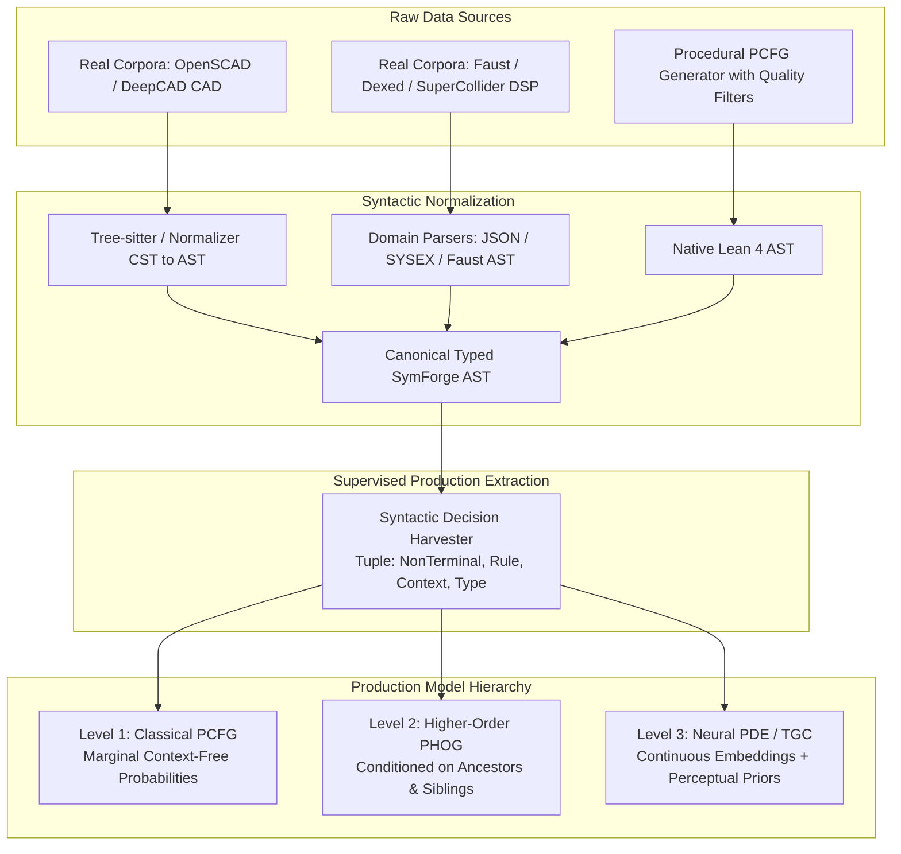
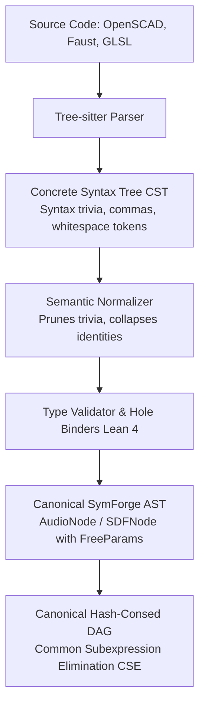
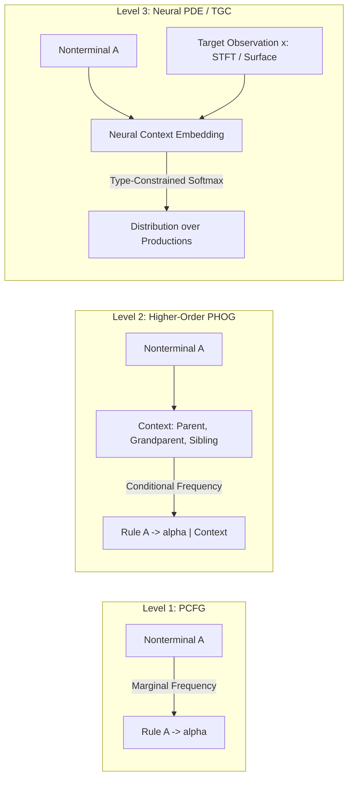
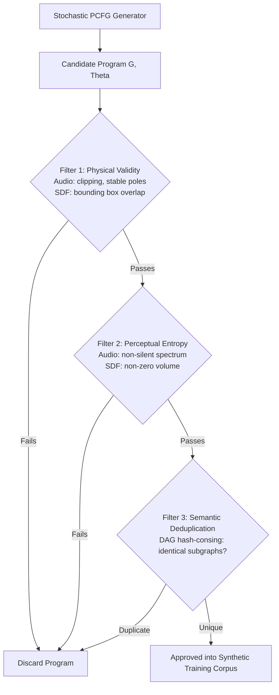

# Probabilistic Grammar Engineering: AST Extraction, PCFGs, PHOGs, and Mitigating the Synthetic Prior Trap

## 1. Overview and the Core Scientific Challenge

For **SymForge** to guide symbolic discrete search and synthesize complex procedural programs efficiently, it requires an informed probability distribution over grammatical derivations:

$$\mathbb{P}(\text{production } r \mid \text{context } c)$$

While public open-source code repositories contain terabytes of programs (e.g., *The Stack*, *CodeSearchNet*), finding **ASTs serialized exactly in the typed format required by our Lean 4 DSL** is rare. Furthermore, there is a fundamental scientific pitfall when relying solely on synthetic procedural generators:

> **The Synthetic Prior Trap (Self-Mimicry Trap):**  
> If we generate millions of synthetic trees from a grammar using uniform or arbitrary prior weights and train a PCFG or neural model directly on them, the model merely learns to **mimic the arbitrary prior chosen by the developer**. It does not learn which rules are actually useful, compact, numerically stable, or perceptually meaningful to human observers.

```text
+---------------------------------------------------------------------------------------------------+
|                            GRAMMAR INGESTION & LEARNING PIPELINE                                  |
|                                                                                                   |
|  [Real Code: OpenSCAD, Faust, Dexed, DeepCAD]       [Controlled PCFG Synthetic Generator]        |
|                         |                                             |                           |
|                         v                                             v                           |
|             +-----------------------+                     +-----------------------+               |
|             | Tree-sitter / Parsers |                     | Sampling with Triple  |               |
|             | (CST Normalization)   |                     | Quality Filters       |               |
|             +-----------+-----------+                     +-----------+-----------+               |
|                         |                                             |                           |
|                         v                                             v                           |
|             +-----------------------------------------------------------------+                   |
|             |           Canonical Typed AST (Lean 4 / SymForge AST/DAG)       |                   |
|             +--------------------------------+--------------------------------+                   |
|                                              |                                                    |
|                                              v                                                    |
|             +-----------------------------------------------------------------+                   |
|             |            Supervised Production Tuple Harvester                |                   |
|             |  (Nonterminal, Rule, Ancestors, Siblings, Types, Free Parameters)|                   |
|             +--------------------------------+--------------------------------+                   |
|                                              |                                                    |
|                   +--------------------------+--------------------------+                         |
|                   |                          |                          |                         |
|                   v                          v                          v                         |
|        +--------------------+     +--------------------+     +--------------------+               |
|        | Level 1: PCFG      |     | Level 2: PHOG      |     | Level 3: Neural    |               |
|        | (Marginal Context- |     | (Higher-Order      |     | (PDE / TGC         |               |
|        |  Free Frequencies) |     |  Conditioned AST)  |     |  Deep Embeddings)  |               |
|        +--------------------+     +--------------------+     +--------------------+               |
+---------------------------------------------------------------------------------------------------+
```



---

## 2. Taxonomy of Data Sources and Domain Corpora

To feed the grammar engine without falling into synthetic isolation, SymForge sources program structures from three complementary avenues:

### 2.1 Geometric Domain (SDF / 3D CSG)
1. **OpenSCAD Repositories (GitHub / Thingiverse):**
   - *Nature:* Purely declarative functional code combining 3D analytical primitives (`cube`, `sphere`, `cylinder`), affine transformations (`translate`, `rotate`, `scale`), and boolean CSG operations (`union`, `difference`, `intersection`).
   - *Available Volume:* Over 100,000 public OpenSCAD models.
   - *Conversion:* Tree-sitter OpenSCAD parser converts CSTs directly into SymForge's `SDFNode` class hierarchy.
2. **DeepCAD (Onshape Sequences):**
   - *Nature:* 178,238 CAD models decomposed into explicit command sequences (2D sketch, extrude, cut, revolve).
   - *Conversion:* Extrusion and cut operations map onto cubes/cylinders combined via `DifferenceNode` and `UnionNode`.
3. **Shadertoy Raymarching Collection:**
   - *Nature:* Collection of over 10,000 procedural GLSL shaders authored by human developers (e.g., Inigo Quilez distance functions).
   - *Conversion:* Math parser extracts analytical raymarching subexpressions into DSL ASTs.

### 2.2 Audio Domain (1D Procedural DSP)
1. **Dexed / Yamaha DX7 Patches (FM Synthesis):**
   - *Nature:* Over 25,000 FM synthesis patches stored in SYSEX binary or JSON format, specifying the exact operator routing graph (algorithms 1 through 32), 4-stage envelopes, and modulation indices.
   - *Conversion:* Directly maps carrier-modulator trees into `FMNode(carrier, mod)` and `MixNode`.
2. **Faust DSP Standard Libraries:**
   - *Nature:* Functional programming language for real-time DSP. Contains canonical implementations of oscillators, biquad filters, and envelopes composed via signal circuit algebra.
   - *Conversion:* Faust compiler exports intermediate JSON ASTs, mapped into `AudioNode`.
3. **SuperCollider SynthDefs & Csound Orchestras:**
   - *Nature:* Thousands of virtual analog modular synthesizer graphs shared in computational music repositories.

### 2.3 General Code & Hardware Optimization
1. **CodeSearchNet & The Stack:** Millions of open-source functions for general grammar benchmarks.
2. **BHive:** Real x86-64 basic blocks for instruction dependency graph learning and superoptimization.

---

## 3. Ingestion Pipeline: CST to Canonical AST via Tree-Sitter

Tree-sitter generates a **Concrete Syntax Tree (CST)**, retaining punctuation, trivia tokens, and formatting. SymForge runs a semantic normalization pipeline:

```text
+---------------------------------------------------------------------------------------------------+
|                            CST TO CANONICAL AST NORMALIZATION PIPELINE                            |
|                                                                                                   |
|  Source Code: OpenSCAD / Faust / Python                                                           |
|  Example: difference() { translate([0,0,10]) cube(20); sphere(5); }                               |
|                                 |                                                                 |
|                                 v                                                                 |
|  [Tree-sitter Concrete Syntax Tree (CST)]                                                         |
|  (module_call (identifier "difference") (arguments) (body (module_call ...)))                    |
|                                 |                                                                 |
|                                 v Semantic Normalizer (Prunes syntax trivia, collapses brackets)  |
|  [Untyped Intermediate AST]                                                                       |
|                                 |                                                                 |
|                                 v Type Checker & FreeParam Binders (Lean 4 Bridge)                |
|  [Canonical SymForge AST / Lean 4 Inductive Node]                                                 |
|  DifferenceNode(                                                                                  |
|    TranslateNode(CubeNode(w, h, d), [x, y, z]),                                                   |
|    SphereNode(radius)                                                                             |
|  )                                                                                                |
+---------------------------------------------------------------------------------------------------+
```



---

## 4. Supervised Production Decision Extraction Schema

For each node $u$ in an AST or canonical DAG, the extractor decomposes program construction into formal derivation tuples:

### 4.1 Production Tuple Data Schema
```json
{
  "nonterminal": "SDF",
  "production": "Difference(SDF, SDF)",
  "production_id": "sdf_difference",
  "depth_from_root": 0,
  "depth_to_leaves": 2,
  "parent_context": ["Root"],
  "grandparent_context": null,
  "left_sibling_context": null,
  "ancestor_chain": ["Root"],
  "expected_type": "SDF",
  "num_free_params": 0,
  "children_types": ["SDF", "SDF"]
}
```

For parameterized leaf nodes:
```json
{
  "nonterminal": "SDF",
  "production": "Sphere(radius: FreeParam)",
  "production_id": "sdf_sphere",
  "depth_from_root": 1,
  "depth_to_leaves": 0,
  "parent_context": ["Difference"],
  "grandparent_context": "Root",
  "left_sibling_context": "Translate",
  "ancestor_chain": ["Root", "Difference"],
  "expected_type": "SDF",
  "num_free_params": 1,
  "free_params": [
    {"id": "radius", "min_val": 0.01, "max_val": 50.0, "default_val": 1.0}
  ]
}
```

---

## 5. Grammar Model Hierarchy: PCFG vs. PHOG vs. Neural

Harvested derivation tuples power three levels of probabilistic modeling:

```text
+---------------------------------------------------------------------------------------------------+
|                               PROBABILISTIC MODELING HIERARCHY                                    |
|                                                                                                   |
|  Level 1: PCFG (Context-Free)      Level 2: PHOG (Higher-Order)       Level 3: Neural PDE / TGC   |
|  ----------------------------      ---------------------------        -------------------------   |
|  P(A -> alpha)                     P(A -> alpha | Context c)          P(A -> alpha | c, x)        |
|  - Independent of context          - Conditioned on Ancestors/Siblings- Continuous c embeddings   |
|  - Closed-form MLE calculation     - Captures nested macro patterns   - Conditioned on target x   |
|  - Stochastic baseline             - Jelinek-Mercer Backoff smoothing - Generalizes to novel trees|
+---------------------------------------------------------------------------------------------------+
```



### 5.1 Level 1: PCFG (Probabilistic Context-Free Grammar)
Production probability depends strictly on the nonterminal symbol $A$:

$$\mathbb{P}_{\text{PCFG}}(A \to \alpha) = \frac{\text{Count}(A \to \alpha) + \alpha_{\text{prior}}}{\sum_{\alpha' \in \mathcal{R}(A)} \left( \text{Count}(A \to \alpha') + \alpha_{\text{prior}} \right)}$$

- *Strength:* Closed-form analytical estimation with Laplace/Dirichlet smoothing ($\alpha_{\text{prior}} > 0$).
- *Limitation:* Does not distinguish whether an oscillator `Sine` serves as a carrier source or as a low-frequency modulator inside a filter cutoff input.

### 5.2 Level 2: PHOG (Probabilistic Higher-Order Grammar)
Conditions production choice on a **structural context path** $c = (\text{Parent}, \text{Grandparent}, \text{LeftSibling})$:

$$\mathbb{P}_{\text{PHOG}}(A \to \alpha \mid c) = \lambda_1 \frac{\text{Count}(A \to \alpha, c)}{\text{Count}(A, c)} + \lambda_2 \frac{\text{Count}(A \to \alpha, \text{Parent}(c))}{\text{Count}(A, \text{Parent}(c))} + \lambda_3 \mathbb{P}_{\text{PCFG}}(A \to \alpha)$$

Where $\lambda_1 + \lambda_2 + \lambda_3 = 1.0$ implements **Jelinek-Mercer Smoothing / Backoff**, gracefully falling back to simpler contexts when encountering rare structural environments.
- *Strength:* Learns empirical design heuristics: e.g., "Inside a `Difference` operator, the probability of the right child being a `Cylinder` is 4x higher than the global baseline (representing mechanical drill holes)".

### 5.3 Level 3: Neural Pipeline Models (PDE & TGC)
Integrates continuous sensory features $x$ (audio spectrogram or surface probe) with symbolic grammar:

$$\mathbb{P}_{\text{Neural}}(A \to \alpha \mid c, x) = \text{Softmax}\left( \frac{\mathbf{W}_A \cdot \phi(c, x)}{\tau} \right)$$

---

## 6. Mitigating the "Synthetic Prior Trap" (Self-Mimicry Prevention)

To guarantee that procedurally generated synthetic data produces **meaningful, non-trivial, and diverse** training programs:

```text
+---------------------------------------------------------------------------------------------------+
|                        TRIPLE QUALITY FILTERING PROTOCOL FOR PCFG DATA                            |
|                                                                                                   |
|  [Stochastic PCFG Generator]                                                                      |
|              |                                                                                    |
|              v                                                                                    |
|  [Candidate Program (G, Theta)]                                                                   |
|              |                                                                                    |
|              v                                                                                    |
|  +-------------------------------------+                                                          |
|  | FILTER 1: Physical Validity & Exec  | ---> Rejects clipping, dead branches, and empty booleans |
|  +-------------------------------------+                                                          |
|              |                                                                                    |
|              v                                                                                    |
|  +-------------------------------------+                                                          |
|  | FILTER 2: Perceptual Entropy        | ---> Rejects silence, DC flatline, and vanishing shapes  |
|  |           (Non-Triviality Check)    |                                                          |
|  +-------------------------------------+                                                          |
|              |                                                                                    |
|              v                                                                                    |
|  +-------------------------------------+                                                          |
|  | FILTER 3: Semantic Deduplication    | ---> Rejects semantic duplicates via Canonical DAG       |
|  |           (Hash-Consing / CSE)      |                                                          |
|  +-------------------------------------+                                                          |
|              |                                                                                    |
|              v                                                                                    |
|  [Approved Synthetic Program for Model 1, 2, and 3 Training]                                     |
+---------------------------------------------------------------------------------------------------+
```



### The Triple Quality Filtering Protocol:
1. **Physical Validity Filter:**
   - *Audio:* Signal satisfies $0.05 \le \max |s(t)| \le 1.0$ (rejects inaudible whispers and digital clipping).
   - *SDF:* Field $d(\mathbf{p})$ satisfies zero-crossing ($\exists \mathbf{p}_1, \mathbf{p}_2: d(\mathbf{p}_1) < 0 \land d(\mathbf{p}_2) > 0$) and normal unit vectors $\|\nabla d\| \approx 1.0$.
2. **Perceptual Entropy Filter:**
   - The spectral energy distribution or isosurface point cloud density must exceed a minimum Shannon entropy threshold, guaranteeing non-trivial acoustic/geometric content.
3. **Semantic Deduplication Filter (DAG Hash-Consing):**
   - Syntactically distinct trees collapsing to identical canonical DAGs (via CSE) are deduplicated, preventing trivial structural variants from skewing empirical grammar statistics.
