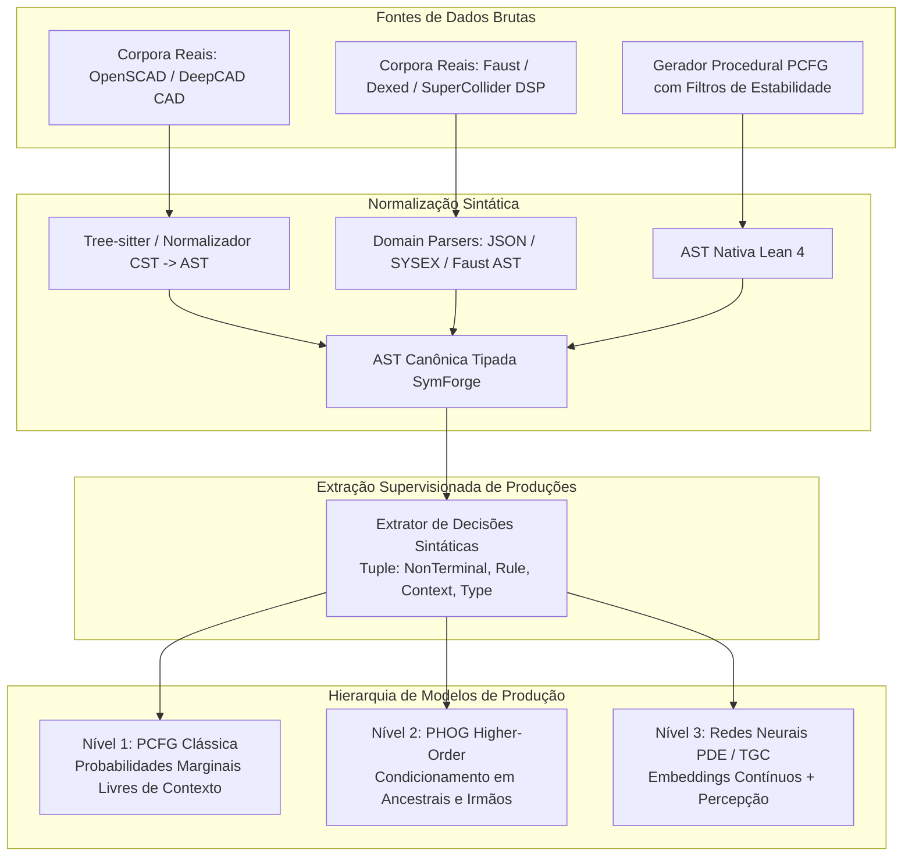
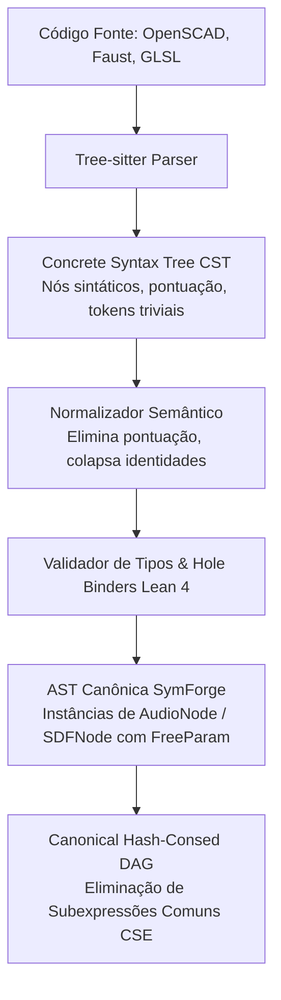
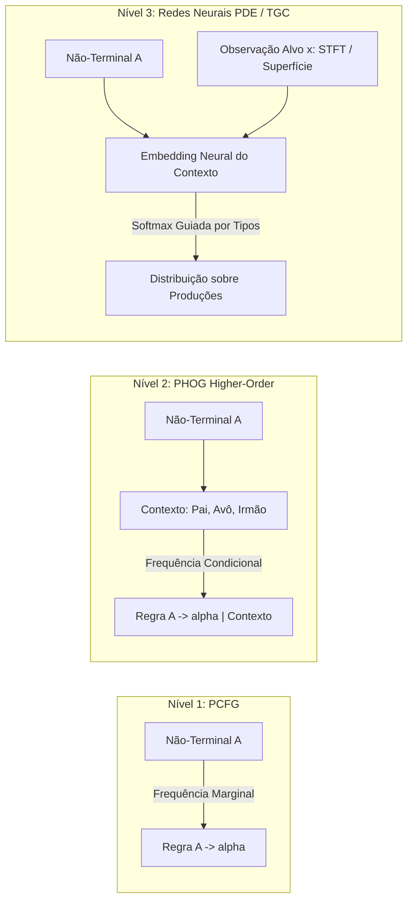
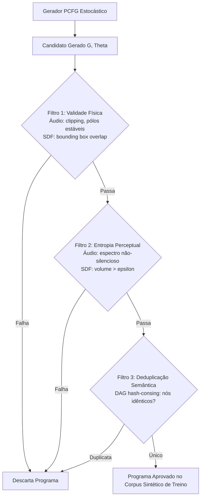

# Engenharia de Gramáticas Probabilísticas: Extração de ASTs, PCFGs, PHOGs e Mitigação do Viés Sintético

## 1. Visão Geral e o Desafio Fundamental

Para que o **SymForge** aprenda a guiar a busca simbólica e a sintetizar programas complexos de forma eficiente, ele necessita de uma distribuição de probabilidade sobre derivações gramaticais:

$$\mathbb{P}(\text{produção } r \mid \text{contexto } c)$$

Embora repositórios públicos contenham terabytes de código-fonte aberto (como *The Stack* ou *CodeSearchNet*), encontrar **ASTs serializadas exatamente no formato tipado da nossa DSL (Lean 4)** não é trivial. Além disso, existe uma armadilha científica crítica no uso exclusivo de geradores sintéticos:

> **A Armadilha do Viés Sintético (Self-Mimicry Trap):**  
> Se gerarmos milhões de árvores sintéticas a partir de uma gramática com probabilidades uniformes ou arbitrárias e treinarmos uma PCFG ou rede neural diretamente sobre elas, o modelo aprenderá apenas a **reproduzir a distribuição artificial escolhida a priori**. Isso não ensina ao modelo quais regras são úteis, eficientes, estáveis ou perceptualmente relevantes para o ser humano.

```text
+---------------------------------------------------------------------------------------------------+
|                               PIPELINE DE INGESTÃO E APRENDIZADO DE GRAMÁTICAS                    |
|                                                                                                   |
|  [Código Real: OpenSCAD, Faust, Dexed, DeepCAD]     [Gerador Sintético Controlado (PCFG)]         |
|                         |                                             |                           |
|                         v                                             v                           |
|             +-----------------------+                     +-----------------------+               |
|             | Tree-sitter / Parsers |                     | Amostragem com        |               |
|             | (CST Normalization)   |                     | Filtros de Validade   |               |
|             +-----------+-----------+                     +-----------+-----------+               |
|                         |                                             |                           |
|                         v                                             v                           |
|             +-----------------------------------------------------------------+                   |
|             |       AST Tipada Canônica (Lean 4 / SymForge AST/DAG)           |                   |
|             +--------------------------------+--------------------------------+                   |
|                                              |                                                    |
|                                              v                                                    |
|             +-----------------------------------------------------------------+                   |
|             |          Extrator de Produções Supervisionadas                  |                   |
|             |  (Não-Terminal, Regra, Ancestrais, Irmãos, Tipos, Parâmetros)  |                   |
|             +--------------------------------+--------------------------------+                   |
|                                              |                                                    |
|                   +--------------------------+--------------------------+                         |
|                   |                          |                          |                         |
|                   v                          v                          v                         |
|        +--------------------+     +--------------------+     +--------------------+               |
|        | Nível 1: PCFG      |     | Nível 2: PHOG      |     | Nível 3: Neural    |               |
|        | (Marginal Context- |     | (Higher-Order      |     | (PDE/TGC           |               |
|        |  Free Frequencies) |     |  Conditioned AST)  |     |  Deep Embeddings)  |               |
|        +--------------------+     +--------------------+     +--------------------+               |
+---------------------------------------------------------------------------------------------------+
```



---

## 2. Taxonomia de Fontes de Dados e Corpora de Domínio

Para alimentar a gramática sem cair no isolamento sintético, o SymForge estrutura sua ingestão a partir de três fontes complementares:

### 2.1 Domínio Geométrico (SDF / 3D CSG)
1. **OpenSCAD Repository Scrapers (GitHub / Thingiverse):**
   - *Natureza:* Código declarativo puramente funcional que combina primitivas 3D (`cube`, `sphere`, `cylinder`), transformações afins (`translate`, `rotate`, `scale`, `multmatrix`) e operadores booleanos (`union`, `difference`, `intersection`).
   - *Volume disponível:* Mais de 100.000 modelos OpenSCAD abertos indexados no GitHub e Thingiverse.
   - *Conversão:* Parser Tree-sitter para OpenSCAD converte o CST diretamente na hierarquia `SDFNode` da nossa DSL.
2. **DeepCAD (Sequências Onshape):**
   - *Natureza:* 178.238 modelos CAD decompostos em sequências explícitas de comandos de desenho (esboço 2D, extrusão, corte, revolução).
   - *Conversão:* Os comandos de extrusão e corte mapeiam-se isotopicamente para cilindros/cubos combinados por `DifferenceNode` e `UnionNode`.
3. **Shadertoy Raymarching Collection:**
   - *Natureza:* Coleção de mais de 10.000 shaders GLSL especializados em SDFs procedurais de autores humanos (ex: funções de distância de Inigo Quilez).
   - *Conversão:* Extrator de subexpressões matemáticas de raymarching para ASTs da DSL.

### 2.2 Domínio de Áudio (1D Procedural DSP)
1. **Bancos Dexed / Yamaha DX7 (FM Synthesis):**
   - *Natureza:* > 25.000 patches de síntese FM armazenados em formato binário SYSEX ou JSON, especificando a topologia exata dos 6 operadores (algoritmos 1 a 32), envelopes EG de 4 estágios e índices de modulação.
   - *Conversão:* Mapeador direto de grafos de modulação de frequência para árvores `FMNode(carrier, mod)`.
2. **Faust DSP Standard Libraries:**
   - *Natureza:* Linguagem de programação funcional para DSP. Contém implementações canônicas de osciladores, filtros biquad, envelopes e geradores de ruído compostos puramente por álgebra de circuitos de sinal (`:`, `,`, `<:`, `:>`).
   - *Conversão:* Compilador do Faust pode emitir a representação intermediária em JSON/XML, perfeitamente convertível para `AudioNode`.
3. **SuperCollider SynthDefs & Csound Orchestras:**
   - *Natureza:* Milhares de grafos de sintetizadores analógicos virtuais modulares compartilhados publicamente na comunidade de áudio computacional.

### 2.3 Domínio de Código Geral & Superotimização
1. **CodeSearchNet & The Stack:**
   - *Natureza:* Milhões de funções em Python, C e Rust para benchmarks de gramáticas gerais.
2. **BHive:**
   - *Natureza:* Blocos básicos Assembly x86 para treinar modelos sobre grafos de dependência de instruções e superotimização de hardware.

---

## 3. O Pipeline de Ingestão: CST para AST Canônica com Tree-sitter

O Tree-sitter gera uma **Concrete Syntax Tree (CST)**, que contém nós gramaticais brutos, pontuação, delimitadores e comentários. O SymForge implementa um pipeline formal de **CST $\to$ AST Normalizada**:

```text
+---------------------------------------------------------------------------------------------------+
|                            PIPELINE DE NORMALIZAÇÃO CST -> AST CANÔNICA                           |
|                                                                                                   |
|  Código Fonte OpenSCAD / Faust / Python                                                           |
|  Exemplo: difference() { translate([0,0,10]) cube(20); sphere(5); }                               |
|                                 |                                                                 |
|                                 v                                                                 |
|  [Tree-sitter Concrete Syntax Tree (CST)]                                                         |
|  (module_call (identifier "difference") (arguments) (body (module_call ...)))                    |
|                                 |                                                                 |
|                                 v Normalizador Semântico (Pruning de parênteses, vírgulas, whitespace)
|  [AST Não-Tipada Intermediária]                                                                   |
|                                 |                                                                 |
|                                 v Validador de Tipos & Descoberta de FreeParam (Lean 4 Bridge)    |
|  [AST Canônica SymForge / Lean 4 Inductive Node]                                                  |
|  DifferenceNode(                                                                                  |
|    TranslateNode(CubeNode(w, h, d), [x, y, z]),                                                   |
|    SphereNode(radius)                                                                             |
|  )                                                                                                |
+---------------------------------------------------------------------------------------------------+
```



---

## 4. Esquema de Extração de Produções Supervisionadas

Para cada nó $u$ presente em uma AST ou DAG canônico, o extrator decompõe o processo de construção em uma decisão de derivação formal:

### 4.1 Formato da Tupla de Decisão Gramatical
```json
{
  "nonterminal": "SDF",
  "production": "Difference(SDF, SDF)",
  "production_id": "sdf_difference",
  "depth_from_root": 0,
  "depth_to_leaves": 2,
  "parent_context": ["Root"],
  "grandparent_context": null,
  "left_sibling_context": null,
  "ancestor_chain": ["Root"],
  "expected_type": "SDF",
  "num_free_params": 0,
  "children_types": ["SDF", "SDF"]
}
```

Para uma folha com parâmetros:
```json
{
  "nonterminal": "SDF",
  "production": "Sphere(radius: FreeParam)",
  "production_id": "sdf_sphere",
  "depth_from_root": 1,
  "depth_to_leaves": 0,
  "parent_context": ["Difference"],
  "grandparent_context": "Root",
  "left_sibling_context": "Translate",
  "ancestor_chain": ["Root", "Difference"],
  "expected_type": "SDF",
  "num_free_params": 1,
  "free_params": [
    {"id": "radius", "minVal": 0.01, "maxVal": 50.0, "defaultVal": 1.0}
  ]
}
```

---

## 5. A Hierarquia de Modelos de Gramática: PCFG vs. PHOG vs. Neural

Com as tuplas de derivação extraídas, podemos instanciar e comparar três níveis progressivos de sofisticação:

```text
+---------------------------------------------------------------------------------------------------+
|                               HIERARQUIA DE MODELAGEM PROBABILÍSTICA                              |
|                                                                                                   |
|  Nível 1: PCFG (Context-Free)      Nível 2: PHOG (Higher-Order)       Nível 3: Neural PDE / TGC   |
|  ----------------------------      ---------------------------        -------------------------   |
|  P(A -> alpha)                     P(A -> alpha | Contexto c)         P(A -> alpha | c, x)        |
|  - Independente de contexto        - Condicionado em Ancestrais       - Embedding contínuo de c   |
|  - Simples, estimativa MLE         - Captura padrões aninhados        - Condicionado no alvo x    |
|  - Linha de base estocástica       - Suavização por Backoff / Dirichlet- Generaliza p/ grafos novos|
+---------------------------------------------------------------------------------------------------+
```



### 5.1 Nível 1: PCFG (Probabilistic Context-Free Grammar)
A probabilidade de aplicar a produção $A \to \alpha$ depende unicamente do símbolo não-terminal $A$:

$$\mathbb{P}_{\text{PCFG}}(A \to \alpha) = \frac{\text{Count}(A \to \alpha) + \alpha_{\text{prior}}}{\sum_{\alpha' \in \mathcal{R}(A)} \left( \text{Count}(A \to \alpha') + \alpha_{\text{prior}} \right)}$$

- *Vantagem:* Cálculo analítico trivial via Maximum Likelihood Estimation (MLE) com suavização de Laplace/Dirichlet ($\alpha_{\text{prior}} > 0$).
- *Limitação:* Não diferencia se um oscilador `Sine` está sendo instanciado como fonte sonora principal ou como modulador LFO de baixa frequência dentro de um nó de filtro.

### 5.2 Nível 2: PHOG (Probabilistic Higher-Order Grammar)
A probabilidade é condicionada em um **caminho de contexto estrutural** $c = (\text{Pai}, \text{Avô}, \text{IrmãoEsquerdo})$:

$$\mathbb{P}_{\text{PHOG}}(A \to \alpha \mid c) = \lambda_1 \frac{\text{Count}(A \to \alpha, c)}{\text{Count}(A, c)} + \lambda_2 \frac{\text{Count}(A \to \alpha, \text{Pai}(c))}{\text{Count}(A, \text{Pai}(c))} + \lambda_3 \mathbb{P}_{\text{PCFG}}(A \to \alpha)$$

Onde $\lambda_1 + \lambda_2 + \lambda_3 = 1$ é um mecanismo de **Jelinek-Mercer Smoothing / Backoff**, permitindo que o sistema caia suavemente para contextos menores quando um contexto específico é inédito.
- *Vantagem:* Aprende regras como "Dentro de uma `Difference`, a probabilidade do segundo filho ser `Cylinder` é 4x maior do que a média geral (furos mecânicos)".

### 5.3 Nível 3: Modelos Neurais da Pipeline (PDE & TGC)
Integra o sinal perceptual contínuo $x$ (espectro ou malha) com a gramática simbólica:
$$\mathbb{P}_{\text{Neural}}(A \to \alpha \mid c, x) = \text{Softmax}\left( \frac{\mathbf{W}_A \cdot \phi(c, x)}{\tau} \right)$$
- Utiliza a saída do **Modelo 1 (PDE)** que informa quais primitivas e profundidades existem no sinal de entrada para polarizar a escolha das regras do **Modelo 2 (TGC)**.

---

## 6. Mitigação da "Armadilha do Viés Sintético" (Self-Mimicry Trap)

Para garantir que o gerador sintético produza programas **relevantes, variados e não-triviais** em vez de poluição combinatória:

```text
+---------------------------------------------------------------------------------------------------+
|                        FILTRAGEM DE QUALIDADE E DIVERSIDADE DO GERADOR SINTÉTICO                  |
|                                                                                                   |
|  [Gerador Procedural PCFG]                                                                        |
|              |                                                                                    |
|              v                                                                                    |
|  [Candidato Sintético (G, Theta)]                                                                 |
|              |                                                                                    |
|              v                                                                                    |
|  +-------------------------------------+                                                          |
|  | FILTRO 1: Validade Física & Execução| ---> Descarta nós mortos, clipping e booleanos vazios   |
|  +-------------------------------------+                                                          |
|              |                                                                                    |
|              v                                                                                    |
|  +-------------------------------------+                                                          |
|  | FILTRO 2: Entropia Perceptual       | ---> Descarta silêncio, DC offset e formas invisíveis    |
|  |           (Non-Triviality Check)    |                                                          |
|  +-------------------------------------+                                                          |
|              |                                                                                    |
|              v                                                                                    |
|  +-------------------------------------+                                                          |
|  | FILTRO 3: Deduplicação Estrutural   | ---> Rejeita duplicatas semânticas via Canonical DAG     |
|  |           (Hash-Consing / CSE)      |                                                          |
|  +-------------------------------------+                                                          |
|              |                                                                                    |
|              v                                                                                    |
|  [Programa Sintético Aceito para Treinamento de Modelos 1, 2 e 3]                                 |
+---------------------------------------------------------------------------------------------------+
```



### Protocolo de Validação Tripla:
1. **Filtro de Validade Física:**
   - *Áudio:* O sinal $s(t)$ deve satisfazer $0.05 \le \max |s(t)| \le 1.0$ (rejeita áudio inaudível e áudio com saturação digital).
   - *SDF:* O campo $d(\mathbf{p})$ deve ter pelo menos um ponto onde $d(\mathbf{p}) < 0$ e normais $\|\nabla d\| \approx 1.0$ (rejeita sólidos imaginários ou degenerados).
2. **Filtro de Entropia Perceptual:**
   - A distribuição de energia no espectrograma ou na densidade de pontos da isosuperfície deve ter entropia de Shannon acima de um limiar mínimo, garantindo complexidade e riqueza acústica/geométrica.
3. **Filtro de Diversidade Estrutural (DAG Hash-Consing):**
   - Árvores que colapsam para o mesmo DAG canônico (identificadas na Fase 1 por CSE) são deduplicadas para evitar que versões triviais super-representem certas produções.

---

## 7. Integração no Roteiro da Fase 2

Este documento estabelece as diretrizes para a execução das tarefas da Fase 2:
- **Task 2.1 e 2.2:** Devem implementar os extratores de características e operadores de renderização sobre os quais os filtros de entropia perceptual atuarão.
- **Task 2.3:** O gerador `pcfg.py` deve incorporar a tripla filtragem (Física, Entropia, Diversidade) e estratificação por complexidade (L1 a L5).
- **Task 2.4:** O extrator de datasets (`harvester.py`) exportará diretamente as tuplas de decisões sintáticas no formato especificado na Seção 4, alimentando a comparação entre PCFG, PHOG e Modelos Neurais na Fase 3.
