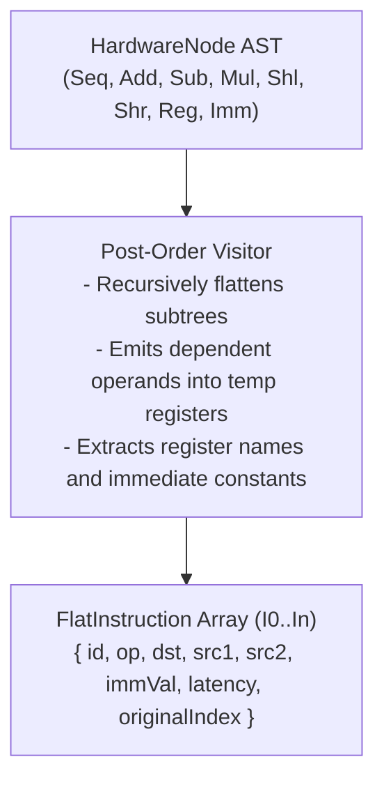
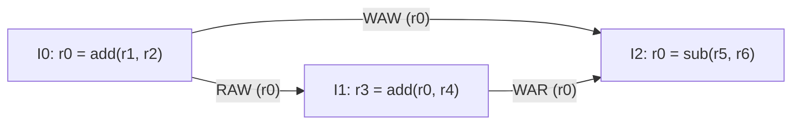
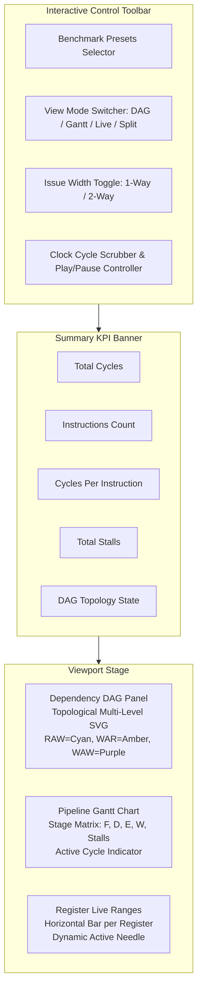

```mermaid
gantt
    title Register Live Ranges Across Execution Cycles
    dateFormat X
    axisFormat %s

    section r1 (Input)
    Active Live Range :active, 0, 2
    section r2 (Input)
    Active Live Range :active, 0, 2
    section r0 (Temp)
    Active Live Range :crit, 4, 5
    section r4 (Input)
    Active Live Range :active, 0, 5
    section r3 (Output)
    Active Live Range :done, 5, 6
```

# Hardware Instruction Sequence Visualizer & Register Pipeline Timeline

## 1. Overview & Architectural Objectives

The **Hardware Instruction Sequence Visualizer** (`packages/web/src/components/widgets/hardware/`) is an interactive domain-specific visualizer for Lean 4 hardware superoptimization programs (`HardwareNode`). It models the microarchitectural execution of discrete bitvector and arithmetic operations on a pipelined CPU, identifying data hazards, scheduling pipeline stage execution, and tracking register allocation live ranges.

The engine provides:
1. **AST Flattening & Normalization:** Converts recursive `HardwareNode` expressions and sequential compositions (`seq`) into flat, ordered assembly instruction streams with explicit register source/destination operands and microarchitectural latency attributes.
2. **Register Hazard Detection & DAG Construction:** Computes true dependencies (RAW), anti-dependencies (WAR), and output dependencies (WAW). Formally validates that the resulting dependence graph is an Acyclic Directed Graph (DAG) via Kahn's topological sort algorithm.
3. **Pipelined Execution Simulator:** Simulates multi-stage execution ($\text{Fetch} \to \text{Decode} \to \text{Execute} \to \text{Writeback}$), enforcing structural hazards (1-way scalar vs 2-way superscalar) and resolving data hazards through execution forwarding and stall bubble injection.
4. **Register Lifetime Analysis:** Determines contiguous register live ranges $[t_{\text{def}}, t_{\text{last\_use}}]$ across simulated clock cycles.
5. **Interactive UI Viewport:** Delivers synchronized multi-view inspection (Topological SVG DAG, Gantt Timeline, Register Lifetime Bars, Split View) with clock cycle scrubbing and auto-play capabilities.

---

## 2. Microarchitectural Specifications & Latency Table

The simulation models an in-order RISC pipeline with execution forwarding from the completion of the execution stage ($\text{EX}$) to the decode/execute boundary ($\text{ID/EX}$).

### 2.1 Instruction Operation Latency Table

| Opcode | Description | Microarchitecture Category | Execution Latency ($\tau$) |
| :--- | :--- | :--- | :--- |
| `add` | 32-bit Integer Addition | Integer ALU | 1 cycle |
| `sub` | 32-bit Integer Subtraction | Integer ALU | 1 cycle |
| `shl` | Logical Shift Left | Bitwise Barrel Shifter | 1 cycle |
| `shr` | Logical Shift Right | Bitwise Barrel Shifter | 1 cycle |
| `mul` | Integer Multiplier | Multi-cycle Pipelined Multiplier | 3 cycles |
| `reg` | Register Move / Ingress Load | Register File Load | 1 cycle |
| `imm` | Load Immediate Constant | Constant Generator | 1 cycle |
| `nop` | No Operation / Hole Placeholder | Control Pipeline | 1 cycle |

---

## 3. AST Flattening & Opcode Normalization

The flattening pass (`flattenHardwareAST`) recursively visits `HardwareNode` trees, traversing sequential blocks in program order and nested expressions in post-order.

### 3.1 AST Flattening Flow Diagram

```text
+-------------------------------------------------------------+
|                      HardwareNode AST                       |
|           (Seq, Add, Sub, Mul, Shl, Shr, Reg, Imm)          |
+------------------------------+------------------------------+
                               |
                               v
+-------------------------------------------------------------+
|                     Post-Order Visitor                      |
|       - Recursively flattens subtrees                       |
|       - Emits dependent operands into temporary registers   |
|       - Extracts register names and immediate constants     |
+------------------------------+------------------------------+
                               |
                               v
+-------------------------------------------------------------+
|                 FlatInstruction Array (I0..In)              |
|   { id, op, dst, src1, src2, immVal, latency, originalIndex } |
+-------------------------------------------------------------+
```



---

## 4. Register Hazard Classification & Dependency DAG

Data dependencies between earlier instruction $I$ and later instruction $J$ ($I < J$) are classified into three canonical hazard categories:

1. **RAW (Read-After-Write / True Dependency):**
   $$J \in \text{Readers}(r) \land I = \text{LatestWriter}(r, J) \implies I \xrightarrow{\text{RAW}[r]} J$$
   Instruction $J$ requires the value generated by $I$. If $I$'s execution is not complete by $J$'s nominal issue time, stall cycles must be injected.
2. **WAR (Write-After-Read / Anti-Dependency):**
   $$I \in \text{Readers}(r) \land J \in \text{Writers}(r) \implies I \xrightarrow{\text{WAR}[r]} J$$
   Instruction $J$ overwrites register $r$ previously consumed by $I$. $J$ must not overwrite $r$ before $I$ reads it.
3. **WAW (Write-After-Write / Output Dependency):**
   $$I \in \text{Writers}(r) \land J \in \text{Writers}(r) \land \text{no intervening write} \implies I \xrightarrow{\text{WAW}[r]} J$$
   Both instructions write to register $r$. Writeback order must preserve program order to maintain final register state.

### 4.1 Hazard Detection & DAG Flow

```text
+-------------------+       RAW: True Data Dependency (Cyan)
|  I0: r0 = add...  | -----------------------------------------> +-------------------+
+-------------------+                                            |  I1: r3 = add...  |
          |                                                      +-------------------+
          | WAW: Output                                                    |
          | Dependency (Purple)                                            | WAR: Anti-
          v                                                                | Dependency (Amber)
+-------------------+                                                      |
|  I2: r0 = sub...  | <----------------------------------------------------+
+-------------------+
```



---

## 5. Pipelined CPU Scheduling Engine & Stall Injection

The pipeline simulator (`schedulePipeline`) computes exact cycle timings for four sequential stages:
- **Fetch ($\text{F}$):** Fetches the instruction word into the pipeline register.
- **Decode ($\text{D}$):** Decodes opcode and arbitrates register operands. Detects data hazards.
- **Execute ($\text{E}$):** Functional unit evaluation over $\tau$ clock cycles. Multi-cycle units (multiplication) occupy $\tau = 3$ cycles ($\text{E1}, \text{E2}, \text{E3}$).
- **Writeback ($\text{W}$):** Commits the computed result to the architectural register file.

### 5.1 Multiplication Latency & Stall Bubble Injection

When an instruction depends on a prior 3-cycle multiplication instruction, operand forwarding delivers the value at $\text{executeEndCycle}(\text{MUL}) + 1$. In a 1-way scalar pipeline, this introduces exactly **2 stall cycles** ($\text{S}$) in the decode stage:

```text
Cycle:        0   1   2   3   4   5   6   7
I0 (MUL):   [ F ][ D ][ E1][ E2][ E3][ W ]
I1 (ADD):       [ F ][ D ][ S ][ S ][ E ][ W ]
```



```mermaid
gantt
    title Pipeline Stage Execution with 2-Cycle Multiplication Stall
    dateFormat X
    axisFormat %s

    section I0 (MUL r0)
    Fetch (F)       :active, 0, 1
    Decode (D)      :active, 1, 2
    Execute E1..E3  :crit, 2, 5
    Writeback (W)   :done, 5, 6

    section I1 (ADD r3)
    Fetch (F)       :active, 1, 2
    Decode (D)      :active, 2, 3
    Stalls (S)      :crit, 3, 5
    Execute (E)     :active, 5, 6
    Writeback (W)   :done, 6, 7
```

### 5.2 Microarchitectural Timing Equations

For instruction $i$ with previous instruction $i - 1$:

$$\text{decodeCycle}(i) = \max(\text{fetchCycle}(i) + 1, \text{executeStartCycle}(i - 1))$$

$$\text{operandReady}(i) = \max_{p \in \text{RAW}(i)} (\text{executeEndCycle}(p) + 1)$$

$$\text{executeStartCycle}(i) = \max(\text{decodeCycle}(i) + 1, \text{operandReady}(i), \text{executeStartCycle}(i - 1) + 1)$$

$$\text{stallCycles}(i) = \text{executeStartCycle}(i) - (\text{decodeCycle}(i) + 1)$$

$$\text{executeEndCycle}(i) = \text{executeStartCycle}(i) + \tau(i) - 1$$

$$\text{writebackCycle}(i) = \text{executeEndCycle}(i) + 1$$

$$\text{totalCycles} = \max_i(\text{writebackCycle}(i)) + 1$$

$$\text{CPI} = \frac{\text{totalCycles}}{N}$$

---

## 6. Register Lifetime & Live Range Analysis

A register $r$'s live range is defined as the closed interval $[t_{\text{start}}, t_{\text{end}}]$ across the global clock timeline:
- If $r$ is read before its first definition, it is an architectural input register: $t_{\text{start}} = 0$.
- Otherwise, $t_{\text{start}} = \text{firstWriter}(r).\text{executeEndCycle}$.
- $t_{\text{end}} = \max(\text{lastReader}(r).\text{executeStartCycle}, \text{lastWriter}(r).\text{writebackCycle})$.

### 6.1 Register Live Range Diagram

```text
Clock Cycle:   0    1    2    3    4    5    6    7
r1 (Input):   [===================] (C0..C2)
r2 (Input):   [===================] (C0..C2)
r0 (Temp):                   [=========] (C4..C5)
r4 (Input):   [==============================] (C0..C5)
r3 (Output):                                 [===] (C5..C6)
```



---

## 7. Interactive Viewport UI Architecture

The `HardwarePipelineWidget` component is built with a responsive multi-panel layout:

```text
+--------------------------------------------------------------------------------------------------+
| TOOLBAR: [Preset: Benchmark 3 v] [View: Split v] [Issue: 1-Way | 2-Way] [|<< Play >>|] [Cycle Slider] |
+--------------------------------------------------------------------------------------------------+
| KPI BANNER: Total Cycles: 7  |  Instructions: 2  |  CPI: 3.50  |  Total Stalls: 2  |  Topology: DAG  |
+--------------------------------------------------------------------------------------------------+
|                                  MAIN VIEWPORT (Split View Mode)                                 |
|  +---------------------------------------------+  +--------------------------------------------+ |
|  | LEFT: Register Dependency DAG (SVG)         |  | RIGHT: Pipeline Gantt Timeline             | |
|  | - Nodes: I0, I1, with latency badges        |  | - Table: Inst x Clock Cycles               | |
|  | - Colored Edges: RAW(cyan), WAR, WAW        |  | - Stages: F, D, E1..E3, W, Stalls          | |
|  | - Active cycle highlighted node             |  | - Vertical current cycle highlight         | |
|  |                                             |  +--------------------------------------------+ |
|  |                                             |  | BOTTOM RIGHT: Register Live Range Bars     | |
|  |                                             |  | - Horizontal lifetime bar per register     | |
|  +---------------------------------------------+  +--------------------------------------------+ |
+--------------------------------------------------------------------------------------------------+
```



---

## 8. Verification Invariants & Canonical Benchmark Suite

All 10 canonical benchmark suites satisfy strict automated testing invariants:

| Preset ID | Benchmark Name | Instructions ($N$) | Latencies & Operations | Expected Cycles (1-Way) | Expected Stalls (1-Way) | Verified Acyclic |
| :--- | :--- | :--- | :--- | :--- | :--- | :--- |
| `benchmark-1` | Simple Arithmetic Chain | 4 | 4 ALU additions/subs | 7 | 0 | **PASS** |
| `benchmark-2` | Multi-Register Parallel | 6 | Independent tracks | 9 | 0 | **PASS** |
| `benchmark-3` | MAC Multiplication Stall | 2 | 1 MUL (3c) + 1 ADD (1c) | 7 | 2 | **PASS** |
| `benchmark-4` | Bitwise Shift and Add | 3 | 2 Shifts + 1 ADD | 6 | 0 | **PASS** |
| `benchmark-5` | Register Pressure & Reuse | 4 | RAW, WAR, WAW on r0 | 9 | 0 | **PASS** |
| `benchmark-6` | Interleaved Independent | 4 | MUL hidden by 2 ALUs | 7 | 0 | **PASS** |
| `benchmark-7` | Long RAW Chain | 8 | 8-stage linear cascade | 11 | 0 | **PASS** |
| `benchmark-8` | Register Renaming Benchmark | 4 | WAW/WAR false dependencies | 9 | 2 | **PASS** |
| `benchmark-9` | Diamond Topology DAG | 4 | Split from r0, join at r5 | 7 | 0 | **PASS** |
| `benchmark-10` | Deep Complex Sequence | 12 | Mixed ALU, MUL, Shifts | 16 | 1 | **PASS** |
