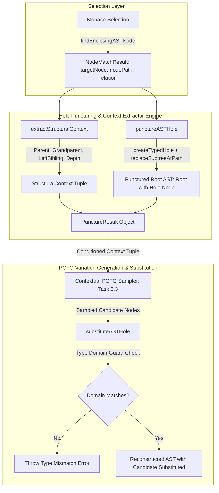
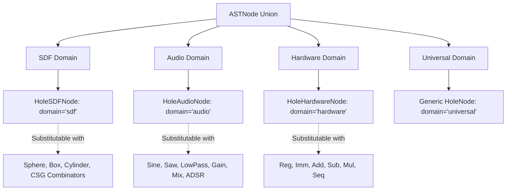
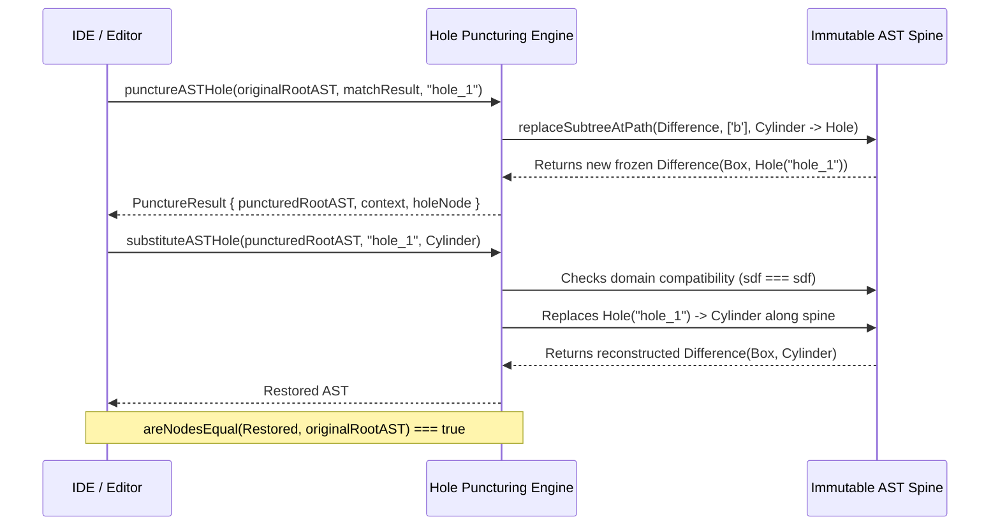

# Type Resolution, Hole Puncturing (`Hole[T]`) & Structural Context Extractor

## 1. Executive Summary & Architectural Mandate

In symbolic program synthesis and interactive computer-aided design (CAD), users frequently seek to explore variations, mutations, or optimizations over a *specific sub-expression* within a larger symbolic program—such as mutating a single primitive geometry in an intricate Constructive Solid Geometry (CSG) tree, swapping an oscillator inside a multi-stage synthesizer signal chain, or replacing an arithmetic sub-instruction in a hardware pipeline.

The **Hole Puncturing & Structural Context Extractor Engine** (`packages/web/src/core/generator/holePuncturing.ts`) establishes the formal representation for scoped sub-expression variation in SymForge:
1. **Typed Hole Puncturing ($Hole[T]$):** Surgically punctures a matched AST node $N_{\text{target}}$ inside a root AST program $T_{\text{root}}$, generating a typed placeholder `HoleNode(id, domain)` that preserves the formal input/output signature of the parent construct.
2. **Structural Context Tuple ($\mathcal{C}$):** Formally extracts the four-dimensional structural context tuple $\mathcal{C} = (\text{Parent}, \text{Grandparent}, \text{LeftSibling}, \text{Depth})$ from the AST ancestry. This tuple primes the Probabilistic Context-Free Grammar (PCFG/PHOG) sampler in Task 3.3 to condition candidate derivation probabilities on immediate surrounding syntax.
3. **Pure Functional Immutability:** Enforces zero in-place mutation. Punctured trees and subsequent substitutions are constructed via functional copying along the ancestral spine with `Object.freeze` semantics, guaranteeing that active editor documents and concurrent Web Workers maintain referential stability.
4. **Round-Trip Substitution Invariance:** Mathematically guarantees identity preservation across puncture and inverse substitution:

$$\forall T \in \mathcal{T}, \quad \forall N \subseteq T, \quad \text{substitute}\Big(\text{puncture}(T, N, h),\, h,\, N\Big) \equiv T$$

---

## 2. High-Level Architecture & Lifecycle Flow

### 2.1 ASCII Architecture Topology

```text
+--------------------------------------------------------------------------------------------------+
|                                    Monaco Editor Selection                                       |
|               User selects sub-expression: e.g. "SDFNode.cylinder (FreeParam...)"                |
+------------------------------------------------+-------------------------------------------------+
                                                 |
                                                 v
+--------------------------------------------------------------------------------------------------+
|                       NodeMatchResult (from selectionMapper.ts)                                  |
|   { targetNode: CylinderNode, nodePath: ["b"], parentRelation: "b", span: [L4:5 - L4:86] }       |
+------------------------------------------------+-------------------------------------------------+
                                                 |
                        +------------------------+------------------------+
                        |                                                 |
                        v                                                 v
+------------------------------------------------+ +-----------------------------------------------+
|         Structural Context Extractor           | |               Hole Puncturing                 |
|       extractStructuralContext(root, match)     | |         punctureASTHole(root, match, id)      |
|                                                | |                                               |
|  - parentOp: "difference"                      | |  - Creates typed HoleNode("hole_1", "sdf")    |
|  - grandparentOp: "root"                       | |  - Traverses root via replaceSubtreeAtPath    |
|  - leftSiblingOp: "box"                        | |  - Reconstructs frozen Difference(Box, Hole)  |
|  - targetDepth: 2                              | |  - Leaves original root AST untouched         |
|  - expectedDomain: "sdf"                       | |                                               |
|  - expectedType: "SDFNode"                     | |                                               |
+------------------------------------------------+ +-----------------------------------------------+
                        \                                                 /
                         \                                               /
                          v                                             v
+--------------------------------------------------------------------------------------------------+
|                                        PunctureResult                                            |
|   { holeId: "hole_1", holeNode, puncturedRootAST, originalTargetNode, context, targetSpan }       |
+------------------------------------------------+-------------------------------------------------+
                                                 |
                                                 v
+--------------------------------------------------------------------------------------------------+
|                    Client-Side Contextual PCFG/PHOG Sampler (Task 3.3)                           |
|        Derives K typed variations conditioned on (Parent, Grandparent, LeftSibling, Depth)       |
+------------------------------------------------+-------------------------------------------------+
                                                 |
                                                 v
+--------------------------------------------------------------------------------------------------+
|                          substituteASTHole(puncturedRootAST, holeId, candidate)                  |
|          Validates domain typing; inversely substitutes candidate into Hole("hole_1")             |
+--------------------------------------------------------------------------------------------------+
```

### 2.2 Mermaid Architecture Topology



---

## 3. Typed Hole Taxonomy ($Hole[T]$)

To ensure that candidate variations generated by downstream PCFG samplers satisfy domain type safety, holes are explicitly typed according to the target AST domain:

```text
                             +-------------------+
                             |     ASTNode       |
                             |   (Root Union)    |
                             +---------+---------+
                                       |
       +-------------------------------+-------------------------------+
       |                               |                               |
       v                               v                               v
+--------------+               +---------------+               +---------------+
|   SDFNode    |               |   AudioNode   |               | HardwareNode  |
| HoleSDFNode  |               | HoleAudioNode |               | HoleHardware  |
| domain='sdf' |               | domain='audio'|               |domain='hardw.'|
+--------------+               +---------------+               +---------------+
```



### 3.1 Domain Types and Formal Expected Types

| Domain (`DomainType`) | Factory Function | Formal Node Kind | Expected Type String | Allowed Replacement Node Kinds |
| :--- | :--- | :--- | :--- | :--- |
| `'sdf'` | `createSDFHole(id)` | `'hole'` (`domain: 'sdf'`) | `'SDFNode'` | `sphere`, `box`, `cylinder`, `torus`, `plane`, `translate`, `rotate`, `scale`, `union`, `smooth_union`, `intersection`, `difference` |
| `'audio'` | `createAudioHole(id)` | `'hole'` (`domain: 'audio'`) | `'AudioNode'` | `sine`, `saw`, `square`, `noise`, `adsr`, `lowpass`, `gain`, `mix`, `fm` |
| `'hardware'` | `createHardwareHole(id)` | `'hole'` (`domain: 'hardware'`) | `'HardwareNode'` | `reg`, `imm`, `add`, `sub`, `mul`, `shl`, `shr`, `seq` |
| `'universal'` | `createHole(id, domain)` | `'hole'` (`domain: 'universal'`) | `'UniversalNode'` | Any valid ASTNode |

---

## 4. Structural Context Extractor & Tuple Formulation

Downstream PCFG and PHOG language models generate subtrees conditioned on immediate syntactic context. The context extractor derives the ancestral 4-tuple:

$$\mathcal{C} = \Big( \text{ParentOp}, \;\; \text{GrandparentOp}, \;\; \text{LeftSiblingOp}, \;\; \text{TargetDepth} \Big)$$

### 4.1 Tuple Elements & Invariants

```text
[Document Level / Enclosing Scope] ───────────────────────────> Op: "root"
         │
         ▼ (Depth 1)
[Root AST Node: DifferenceNode] ──────────────────────────────> ParentOp: "difference", GrandparentOp: "root"
   ├── Child 0 (Left): BoxNode ───────────────────────────────> LeftSiblingOp for Child 1: "box"
   └── Child 1 (Right): CylinderNode (Target at Depth 2) ─────> TargetDepth: 2, ParentRelation: "b"
```

```mermaid
graph TD
    subgraph AncestryTree [Ancestral Context Hierarchy]
        R["Scope: 'root'"] --> D1["Root Node (Depth 1): DifferenceNode"]
        D1 -->|Child 'a' (Slot 0)| S0["BoxNode (Left Sibling)"]
        D1 -->|Child 'b' (Slot 1)| S1["CylinderNode (Target at Depth 2)"]
    end

    S1 -.->|Context Extracted| CTX["StructuralContext Tuple:
    parentOp: 'difference'
    grandparentOp: 'root'
    leftSiblingOp: 'box'
    targetDepth: 2
    parentRelation: 'b'"]
```

### 4.2 Ancestral Boundary Invariants

1. **Target at Root ($N = T_{\text{root}}$):**
   - $\text{targetDepth} = 1$
   - $\text{parentOp} = \text{"root"}$
   - $\text{grandparentOp} = \text{null}$
   - $\text{leftSiblingOp} = \text{null}$
   - $\text{parentRelation} = \text{null}$
2. **Target as Immediate Child of Root:**
   - $\text{targetDepth} = 2$
   - $\text{parentOp} = T_{\text{root}}.\text{kind}$
   - $\text{grandparentOp} = \text{"root"}$
   - $\text{leftSiblingOp} = \text{preceding sibling's kind, or null}$
3. **Target at Arbitrary Depth $D \ge 3$:**
   - $\text{targetDepth} = D$
   - $\text{parentOp} = N_{\text{parent}}.\text{kind}$
   - $\text{grandparentOp} = N_{\text{grandparent}}.\text{kind}$
   - $\text{leftSiblingOp} = \text{preceding sibling's kind, or null}$

---

## 5. Functional Immutable AST Substitution & Round-Trip Invariance

All subtree modifications utilize functional path rebuilding. When puncturing or substituting a node:
1. Untouched subtrees and sibling branches retain referential identity.
2. Ancestral nodes along the replacement spine are reconstructed via pure factory constructors (`createDifference`, `createTranslate`, `createMix`, `createSeq`).
3. Constructed nodes are frozen via `Object.freeze`.
4. The original root AST remains strictly unmodified.

### 5.1 ASCII Inversion Cycle

```text
Original Root AST: Difference(Box, Cylinder)
      │
      ▼ punctureASTHole(root, match, "hole_1")
Punctured Root AST: Difference(Box, Hole("hole_1"))
      │
      ▼ substituteASTHole(puncturedRoot, "hole_1", Cylinder)
Restored Root AST: Difference(Box, Cylinder)
      │
      ▼ areNodesEqual(Restored, Original)
Identity Preserved: true
```

### 5.2 Mermaid Inversion Cycle



---

## 6. Type-Directed Guardrails & Domain Compatibility Matrix

When substituting candidate subtrees into a punctured hole via `substituteASTHole`, the engine enforces static domain compatibility before performing substitution:

| Hole Domain | Candidate Domain: `sdf` | Candidate Domain: `audio` | Candidate Domain: `hardware` | Candidate Domain: `universal` |
| :---: | :---: | :---: | :---: | :---: |
| **`sdf`** | Allowed | Rejected (`Type mismatch: cannot substitute audio into sdf hole`) | Rejected (`Type mismatch: cannot substitute hardware into sdf hole`) | Allowed |
| **`audio`** | Rejected (`Type mismatch: cannot substitute sdf into audio hole`) | Allowed | Rejected (`Type mismatch: cannot substitute hardware into audio hole`) | Allowed |
| **`hardware`** | Rejected (`Type mismatch: cannot substitute sdf into hardware hole`) | Rejected (`Type mismatch: cannot substitute audio into hardware hole`) | Allowed | Allowed |
| **`universal`** | Allowed | Allowed | Allowed | Allowed |

---

## 7. Pass-to-Complete Gate Verification

The engine is validated against an exhaustive 30-case Pass-to-Complete Gate spanning all supported domains:

```text
+-------------------+---------------+---------------------------------------------------------+
| Domain            | Case Count    | Constructs Evaluated                                    |
+-------------------+---------------+---------------------------------------------------------+
| SDF               | 12 subtrees   | Sphere, Box, Cylinder, Torus, Plane, Translate, Rotate, |
|                   |               | Scale, Union, SmoothUnion, Intersection, Difference     |
+-------------------+---------------+---------------------------------------------------------+
| Audio             | 12 subtrees   | Sine, Saw, Square, Noise, FM, Gain, LowPass, ADSR, Mix, |
|                   |               | nested LowPass(Mix), Gain(LowPass), Mix(ADSR)           |
+-------------------+---------------+---------------------------------------------------------+
| Hardware          | 6 subtrees    | Reg, Imm, Add, Sub, Seq, nested Seq(Add, Mul)           |
+-------------------+---------------+---------------------------------------------------------+
```

Every case asserts:
1. Exact domain resolution: `context.expectedDomain` and `context.expectedType`.
2. Exact ancestral context tuple: `(parentOp, grandparentOp, leftSiblingOp, targetDepth, parentRelation)`.
3. Valid typed hole instantiation: `holeNode.kind === 'hole'` with matching domain.
4. Functional immutability: Original root AST unmodified.
5. Round-trip substitution invariance: `areNodesEqual(substituteASTHole(punctured, holeId, target), original) === true`.
