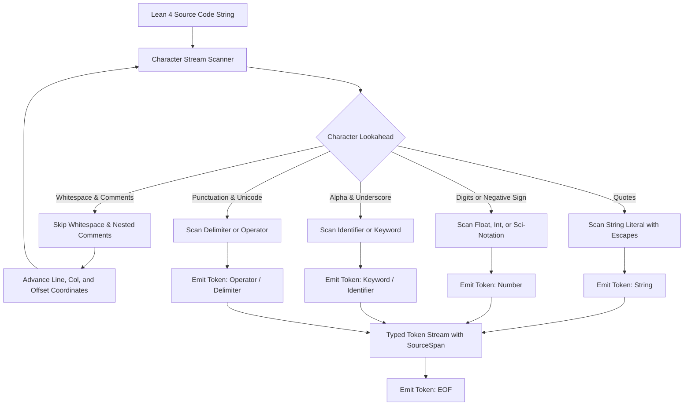
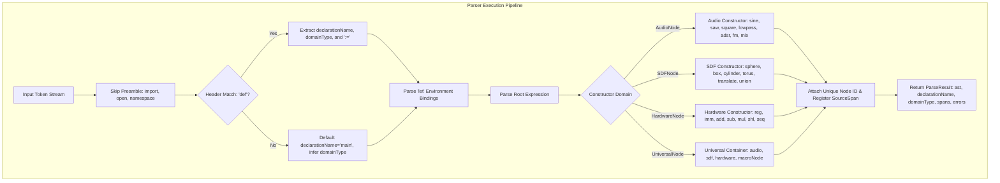
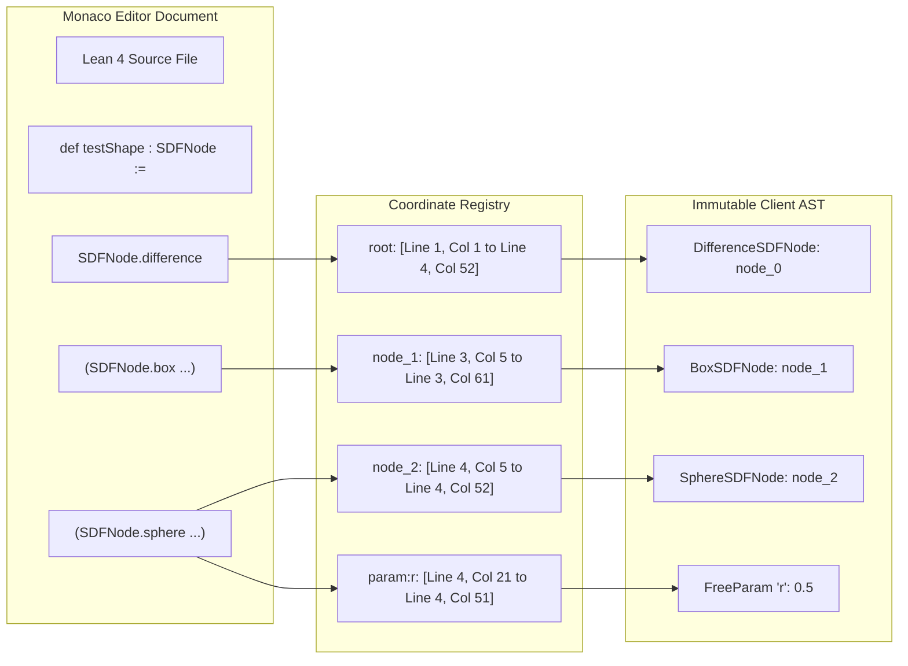
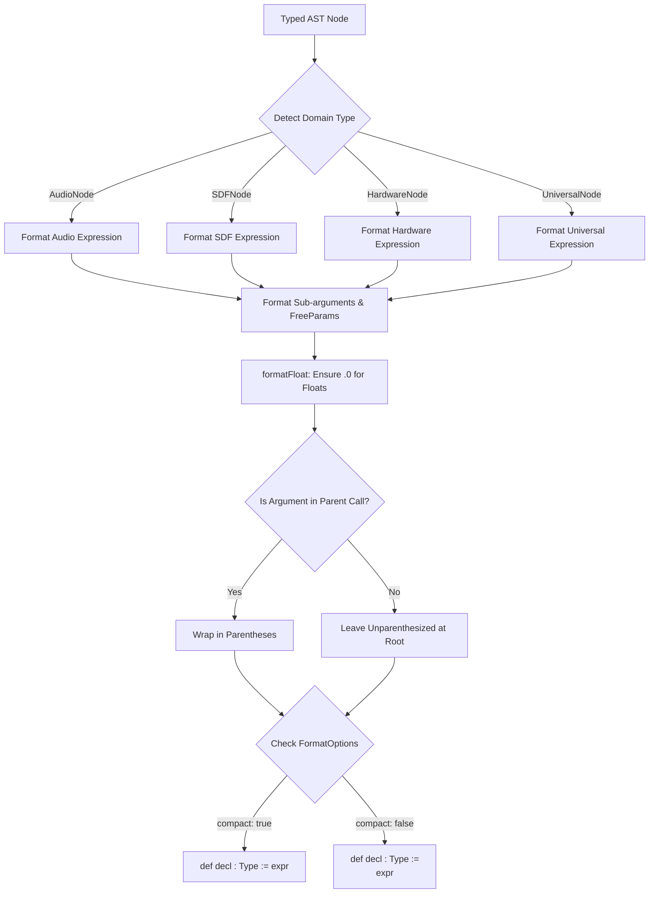
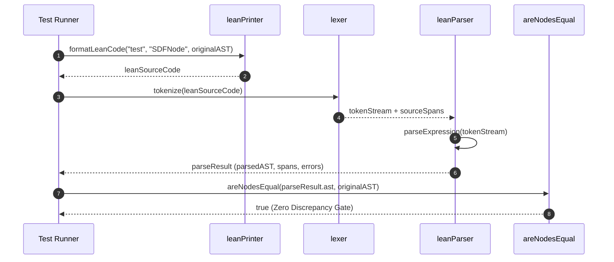

# Bidirectional Lean 4 AST Parser & Pretty-Printer Architecture

**Document ID:** `ARCH-LEAN4-PARSER-202610`  
**Track:** `lean4_web_ide_interactive_widgets_202610`  
**Task Reference:** Task 1.4: Bidirectional Lean 4 AST Parser & Pretty-Printer (Code $\leftrightarrow$ AST)  
**Status:** Approved & Verified  
**Date:** 2026-10-26  

---

## 1. Executive Summary & Architectural Overview

The SymForge Bidirectional Lean 4 AST Parser & Pretty-Printer (`packages/web/src/core/parser/`) provides a client-side recursive descent compiler pipeline that bridges human-readable Lean 4 source definitions and immutable typed AST graphs (`ASTNode`). Operating entirely in the browser runtime without external language server binaries, it guarantees:

1. **Bidirectional Isomorphism:** Complete round-trip invariance where $\text{parse}(\text{format}(ast)) \equiv ast$ verified under structural equality (`areNodesEqual`).
2. **Exact Source Coordinate Span Tracking:** Every subexpression and continuous parameter (`FreeParam`) retains exact source coordinates (`SourceSpan`) with 1-indexed line/column boundaries and 0-indexed character offsets, enabling surgical in-editor selection bounding and 1-click injection in Phase 3.
3. **Resilient Grammar Resolution:** Support for multiple Lean 4 syntactic paradigms, including fully qualified constructor calls (`SDFNode.difference`), constructor dot notation (`.difference`), direct syntax (`difference`), explicit parameters (`FreeParam.mk`), anonymous constructor brackets (`⟨"id", min, max, default⟩`), record notation (`{ id := ... }`), and shorthand positional numeric literals.

---

## 2. Lexical Grammar & Tokenization Architecture

The lexer (`packages/web/src/core/parser/lexer.ts`) streams input UTF-8 text into typed tokens (`Keyword`, `Identifier`, `Number`, `String`, `Operator`, `Delimiter`, `EOF`). Whitespace, line comments (`--`), and arbitrarily nested block comments (`/- ... /- ... -/ -/`) are stripped deterministically while maintaining exact line, column, and character offsets.

```text
+---------------------------------------------------------------------------------------------------------+
|                                    LEAN 4 LEXICAL TOKENIZER PIPELINE                                    |
|                                                                                                         |
|   Source Stream "def myShape : SDFNode := .difference (SDFNode.box 1.0 2.0 3.0) (SDFNode.sphere 0.5)"   |
|                                             |                                                           |
|                                             v                                                           |
|                       +-------------------------------------------+                             |
|                       |   Character Cursor & Coordinate Tracker   |                             |
|                       |   (startLine, startCol, offsets 0..N)     |                             |
|                       +-------------------------------------------+                             |
|                                             |                                                           |
|             +-------------------------------+-------------------------------+                           |
|             |                               |                               |                           |
|             v                               v                               v                           |
|     [Comments & Blanks]             [Literal Scanning]              [Delimiters & Ops]                  |
|     -- Line comment                 Strings: "...", escapes         :=, :, ., ->                        |
|     /- /- Nested -/ -/              Numbers: -1.5, 42, 1e-4         (, ), [, ], {, }, ⟨, ⟩              |
|                                             |                                                           |
|                                             v                                                           |
|                        +-----------------------------------------+                                      |
|                        | Typed Token Stream with Exact SourceSpan|                                      |
|                        +-----------------------------------------+                                      |
+---------------------------------------------------------------------------------------------------------+
```



---

## 3. Recursive Descent Parser & Invariant Mapping

The parser (`packages/web/src/core/parser/leanParser.ts`) implements a recursive descent grammar with explicit backtracking prevention, bounded loops, and domain-agnostic constructor resolution.

```text
+---------------------------------------------------------------------------------------------------------+
|                                  RECURSIVE DESCENT COMPILER GRAMMAR                                     |
|                                                                                                         |
|  [Preamble]          ::= ( 'import' <ident> | 'open' <ident> | 'namespace' <ident> )*                   |
|  [Declaration]       ::= 'def' <ident> [ ':' <Type> ] ':=' [ <LetBindings> ] <Expression>              |
|  [LetBindings]       ::= ( 'let' <ident> [ ':' <Type> ] ':=' <ExpressionOrParam> [ 'in' ] )*            |
|  [Expression]        ::= <ConstructorCall> | '(' <Expression> ')' | <Atom>                              |
|  [ConstructorCall]   ::= ( <QualifiedName> | '.' <Ident> | <Ident> ) <Argument>*                       |
|  [Argument]          ::= <Atom> | '(' <ExpressionOrParam> ')' | '⟨' <ParamArgs> '⟩' | '{' <Fields> '}'  |
|  [FreeParam]         ::= 'FreeParam.mk' <id> <min> <max> <default>                                      |
|                        | '⟨' <id> [','] <min> [','] <max> [','] <default> '⟩'                           |
|                        | '{' 'id' ':=' <id> ',' 'minVal' ':=' <min> ... '}'                             |
|                        | <NumberLiteral> (Auto-inferred continuous bounds)                              |
+---------------------------------------------------------------------------------------------------------+
```



---

## 4. SourceSpan Tracking & Range-to-AST Mapping

Every AST node and continuous parameter parsed is assigned a unique identifier (`node_0`, `node_1`, ..., and `param.id`). Their exact coordinates are preserved in `ParseResult.spans` and `ParseResult.nodeSpanMap`, establishing a direct bidirectional map between Monaco editor selection ranges and the underlying syntax tree.

```text
+---------------------------------------------------------------------------------------------------------+
|                                    AST RANGE COORDINATE ENCLOSURE                                       |
|                                                                                                         |
|   Source Code:                                                                                          |
|   Line 1: def testShape : SDFNode :=                                                                    |
|   Line 2:   SDFNode.difference                                                                          |
|   Line 3:     (SDFNode.box (FreeParam.mk "w" 0.1 10.0 1.0) ...)   <-- Span: Line 3 Col 5 to Line 3 Col 61|
|   Line 4:     (SDFNode.sphere (FreeParam.mk "r" 0.1 5.0 0.5))     <-- Span: Line 4 Col 5 to Line 4 Col 52|
|                                                                                                         |
|   Root Span:                                                                                            |
|   startOffset: 0, endOffset: 165 (slices full expression)                                               |
|                                                                                                         |
|   Subexpression Span:                                                                                   |
|   source.slice(paramSpan.startOffset, paramSpan.endOffset) == '(FreeParam.mk "r" 0.1 5.0 0.5)'          |
+---------------------------------------------------------------------------------------------------------+
```



---

## 5. Deterministic Lean 4 Pretty-Printer & Formatting Rules

The pretty-printer (`packages/web/src/core/parser/leanPrinter.ts`) renders typed AST nodes back into clean, idiomatic Lean 4 code. It supports:
- **Clean Indentation:** Nested indentation of subexpressions (default 2 spaces).
- **Parenthesization Invariants:** Non-atomic constructor arguments are strictly parenthesized `( ... )`, while root definitions remain unparenthesized.
- **Float Invariant Formatting:** Floating point numbers are always emitted with trailing decimals (e.g., `440.0` rather than `440`) to adhere to Lean 4 `Float` literal requirements.
- **Compact & Dot-Notation Modes:** Optional flags for single-line compression (`compact: true`) and constructor dot notation (`dotNotation: true`, emitting `.sphere` instead of `SDFNode.sphere`).

```text
+---------------------------------------------------------------------------------------------------------+
|                                    PRETTY-PRINTER TRANSFORMATION                                        |
|                                                                                                         |
|   ASTNode (SphereSDFNode)  ---------------------> formatLeanCode("myShape", "SDFNode", ast)            |
|                                                                                                         |
|   Emits Standard Indented Lean 4:                                                                       |
|   def myShape : SDFNode :=                                                                              |
|     SDFNode.sphere (FreeParam.mk "radius" 0.01 5.0 1.25)                                                |
|                                                                                                         |
|   Emits Compact Dot-Notation Lean 4:                                                                    |
|   def myShape : SDFNode := .sphere (FreeParam.mk "radius" 0.01 5.0 1.25)                                |
+---------------------------------------------------------------------------------------------------------+
```



---

## 6. Round-Trip Invariance & Symmetrical Validation

The bidirectional pipeline enforces **Symmetrical Cross-Validation** (as defined in `GEMINI.md`):

$$\text{parse}(\text{format}(ast)).ast \equiv ast$$

This invariant is verified by the **Pass-to-Complete Gate** in `packages/web/src/core/parser/leanParser.test.ts` across:
- **25 Canonical Audio Programs:** Covering primitive oscillators, FM synthesis, ADSR envelopes, lowpass filters, gain modulation, multi-branch mixes, and deep DSP graphs.
- **25 Canonical SDF Programs:** Covering primitive geometry (spheres, boxes, cylinders, tori), spatial transformations (translation, rotation, scale), and boolean CSG operations (unions, smooth unions, intersections, differences).
- **Hardware Instruction Programs:** Instruction sequences verifying register, immediate, arithmetic, shift, and sequential composition invariance.
- **Universal Container Programs:** Polymorphic wrapper nodes verifying round-trip equivalence.

```text
+---------------------------------------------------------------------------------------------------------+
|                                    SYMMETRICAL ROUND-TRIP INVARIANT                                     |
|                                                                                                         |
|       AST Node Instance [X] ----------------------- formatLeanCode --------------------> Lean 4 Code   |
|               ^                                                                               |         |
|               |                                                                               |         |
|         areNodesEqual? (Verified: true)                                                  parseLeanCode  |
|               |                                                                               |         |
|               +----------------------------- Result AST [X'] <--------------------------------+         |
+---------------------------------------------------------------------------------------------------------+
```



---

## 7. Integration Contract with In-Context Scoped Variation Generator (Phase 3)

The AST Parser and SourceSpan registry directly unlock Phase 3's Neurosymbolic In-Context Scoped Variation Generator:
1. **Range Intersection:** When the user selects a code block in Monaco Editor (`startLine`, `startCol`, `endLine`, `endCol`), the range is queried against `ParseResult.spans`.
2. **Subtree Identification:** The smallest AST node whose span completely encloses the user selection is located.
3. **Puncturing & Sampling:** The selected subtree is punctured with a typed hole (`Hole[T]`), the contextual tuple $(\text{Parent}, \text{Grandparent}, \text{LeftSibling})$ is extracted, and the PCFG sampler in the background Web Worker generates complexity-stratified variations.
4. **1-Click Replacement:** When a variation candidate is selected, its pretty-printed Lean 4 code is spliced cleanly into the editor using `span.startOffset` and `span.endOffset`.
