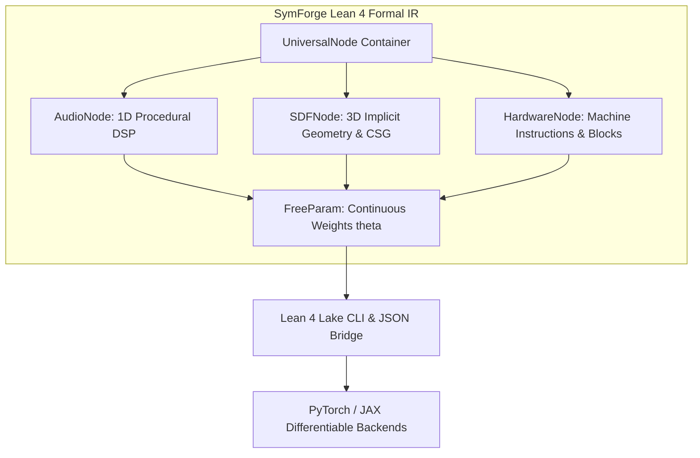

# Lean 4 Formal Intermediate Representation (SymForge.IR)

## 1. Overview & Architectural Motivation

The **SymForge Formal Intermediate Representation (IR)** serves as the canonical, mathematically verified symbolic frontend for procedural program synthesis across domains (1D DSP/audio, 3D implicit SDF geometry, and hardware superoptimization).

By implementing the inductive grammar in **Lean 4**, SymForge guarantees:
1. **Dependent Type Soundness:** Structural domain rules (e.g., input connection requirements, filter parameters, bounding domains) are statically validated.
2. **Deterministic Canonical Serialization:** Lean 4 `ToJson` and `FromJson` instances provide unambiguous AST interchange contracts between symbolic synthesizers and numerical optimizers.
3. **Provable Invariants:** Inherent acyclicity of inductive definitions and non-emptiness guarantees (`size >= 1`, `depth >= 1`).
4. **Metaprogramming Extensibility:** Enables direct elaboration of AST expressions into differentiable execution graphs in PyTorch and JAX.

---

## 2. Structural Topology & Architecture Diagram

```text
+-----------------------------------------------------------------------------------+
|                             SymForge Lean 4 Formal IR                             |
+-----------------------------------------------------------------------------------+
                                          |
        +---------------------------------+---------------------------------+
        |                                 |                                 |
        v                                 v                                 v
+------------------+             +------------------+             +------------------+
|    AudioNode     |             |     SDFNode      |             |   HardwareNode   |
| (1D DSP Timbre)  |             | (3D CSG / Geom)  |             |  (x86 / RISC-V)  |
+------------------+             +------------------+             +------------------+
        |                                 |                                 |
        +---------------------------------+---------------------------------+
                                          |
                                          v
                               +--------------------+
                               |     FreeParam      |
                               |  id, min, max, val |
                               +--------------------+
                                          |
                                          v
                               +--------------------+
                               |  symforge_cli FFI  |
                               | (JSON Bridge / IPC)|
                               +--------------------+
```



---

## 3. Inductive Grammars

### 3.1 Parameter Representation (`FreeParam`)
Continuous numerical parameters subjected to continuous gradient descent (or black-box evolutionary search) are defined as first-class records:

```lean
structure FreeParam where
  id : String
  minVal : Float
  maxVal : Float
  defaultVal : Float
  deriving Repr, BEq, Inhabited, ToJson, FromJson
```

### 3.2 Audio & 1D DSP Node (`AudioNode`)
Encompasses band-limited oscillators, envelope generators, dynamic modulators, and cascade filters:
- **Oscillators:** `sine (freq, phase)`, `saw (freq)`, `square (freq, duty)`, `noise (seed)`
- **Modulation & Synthesis:** `fm (carrier, modFreq, modIndex)`
- **Envelopes & Filters:** `adsr (attack, decay, sustain, release, gate)`, `lowpass (cutoff, resonance, input)`, `gain (gain, input)`
- **Combinators:** `mix (ratio, input1, input2)`

### 3.3 3D Implicit Geometry & CSG Node (`SDFNode`)
Represents signed distance functions:
- **Primitives:** `sphere (radius)`, `box (w, h, d)`, `cylinder (radius, height)`, `torus (major, minor)`
- **Spatial Transforms:** `translate (dx, dy, dz, child)`, `rotate (rx, ry, rz, child)`, `scale (s, child)`
- **Boolean CSG Operators:** `union (smoothness, a, b)`, `intersection (a, b)`, `difference (a, b)`

### 3.4 Hardware Superoptimization Node (`HardwareNode`)
Represents basic blocks and instruction sequences:
- **Registers & Immediates:** `reg (name)`, `imm (val)`
- **ALU Operations:** `add`, `sub`, `mul`, `shl`, `shr`
- **Control & Sequences:** `seq (first, second)`

---

## 4. Formal Proofs & Structural Verification

Lean 4 formally proves non-trivial structural invariants via inductive tactics (`cases` + `omega`):
- `theorem AudioNode.size_pos (node : AudioNode) : node.size ≥ 1`
- `theorem AudioNode.depth_pos (node : AudioNode) : node.depth ≥ 1`
- `theorem SDFNode.size_pos (node : SDFNode) : node.size ≥ 1`
- `theorem SDFNode.depth_pos (node : SDFNode) : node.depth ≥ 1`

These guarantees ensure the search engine cannot generate negative or zero-sized AST states.
