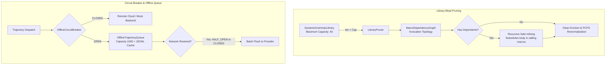
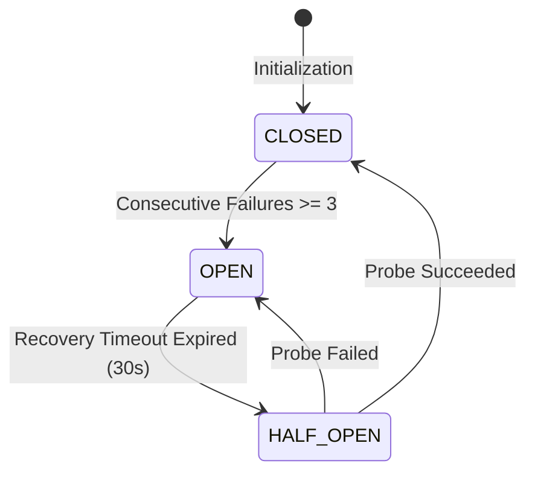

# Library Bloat Pruning & Resilient Offline Fallback

## 1. Overview and Architectural Principles

As the continual DreamCoder cycle discovers and accumulates procedural abstractions over dozens of wake-sleep iterations, the language vocabulary $\Sigma$ expands. Without strict capacity regulation, the system encounters **Library Bloat**:
- **Branching Factor Inflation:** In Beam or A* search, each open typed hole (`HoleNode`) can be expanded by any compatible rule. As $|\Sigma|$ scales to dozens or hundreds of rules, the search branching factor balloons ($O(B \cdot |\Sigma|)$), exponentially degrading synthesis throughput.
- **Cascading Breakage Risk:** Higher-order composite macros often invoke simpler macros (e.g., `macro_flanged_cylinder` calling `macro_hollow_cylinder`). Unregistering a macro without dependency tracking breaks all downstream callers.
- **Network Disruption Vulnerability:** If remote cloud GPU infrastructure (Modal, SageMaker) experiences network partitions or transient outages, local synthesis must continue seamlessly without dropping harvested trajectories.

SymForge addresses these failure modes via two resilient subsystems in `src/symforge/resilience/`:
1. **`LibraryPruner`:** Topological dependency tracker and bounded-capacity pruner with **semantic safe leaf inlining**.
2. **`OfflineCircuitBreaker` & `OfflineTrajectoryQueue`:** Three-state circuit breaker and resilient local queue with JSONL disk caching.

```text
+---------------------------------------------------------------------------------------------------+
|                        LIBRARY PRUNING & RESILIENT FALLBACK ARCHITECTURE                          |
|                                                                                                   |
|  [Grammar Expansion (Task 5.3)]                                                                   |
|                 |                                                                                 |
|                 v                                                                                 |
|  +----------------------------------------------------+                                           |
|  | DynamicGrammarLibrary (Max Capacity: 40)           |                                           |
|  | - When len(macros) > 40: triggers LibraryPruner    |                                           |
|  +-------------------------+--------------------------+                                           |
|                            |                                                                      |
|                            v                                                                      |
|  +----------------------------------------------------+                                           |
|  | MacroDependencyGraph (Directed Acyclic Graph)      |                                           |
|  | - Ranks candidates by EMA utility (usage * savings)|                                           |
|  | - Internal macro with callers -> Safe Inlining     |                                           |
|  | - Leaf macro without callers -> Clean Eviction     |                                           |
|  +----------------------------------------------------+                                           |
|                                                                                                   |
|  [Remote Dispatch (Task 6.1 / 6.2)]                                                               |
|                 |                                                                                 |
|                 v                                                                                 |
|  +----------------------------------------------------+                                           |
|  | OfflineCircuitBreaker (CLOSED -> OPEN -> HALF_OPEN)|                                           |
|  | - When consecutive failures >= 3: trips to OPEN    |                                           |
|  +-------------------------+--------------------------+                                           |
|                            |                                                                      |
|                 +----------+----------+                                                           |
|                 | CLOSED              | OPEN                                                      |
|                 v                     v                                                           |
|  +-----------------------------+  +-----------------------------------+                           |
|  | Normal Cloud Dispatch       |  | OfflineTrajectoryQueue (Cap: 1000)|                           |
|  | (Modal / SageMaker / Mock)  |  | - Local in-memory / JSONL buffers |                           |
|  +-----------------------------+  | - Synthesis continues uninterrupted|                          |
|                                   +-----------------+-----------------+                           |
|                                                     | Reconnect                                   |
|                                                     v                                             |
|                                   +-----------------------------------+                           |
|                                   | Automatic Batch Queue Flush       |                           |
|                                   +-----------------------------------+                           |
+---------------------------------------------------------------------------------------------------+
```



---

## 2. Library Pruning with Safe Leaf Inlining

### 2.1 Exponential Moving Average (EMA) Utility Metric
Each registered macro tracks historical utility:
$$\text{Score}(M) = (1 - \alpha) \cdot \text{Score}_{\text{prev}} + \alpha \cdot \left( \text{Usage}(M) \times \text{Savings}(M) \right)$$
Macros that provided early utility during initial bootstrap but fell out of frequent usage have their utility scores decayed.

### 2.2 Dependency Graph & Semantic Safe Inlining
When the lowest-utility macro $A$ is invoked by higher-order macro $B$:
1. $A$ is **never abruptly deleted**, as doing so would invalidate $B$.
2. The syntax tree of $A$ is expanded directly into $B$'s definition via `inline_macro_in_ast`.
3. Parameter slots of $A$ are promoted to direct arguments of $B$.
4. **Execution Invariance:** $\text{Exec}(B_{\text{inlined}}) \equiv \text{Exec}(B_{\text{original}})$ within $\epsilon < 10^{-5}$.
5. Once inlined across all callers, $A$ becomes a dependency leaf and is safely unregistered from the grammar, reducing vocabulary count by 1 without breaking semantic coverage.

---

## 3. Network Circuit Breaker & Offline Queue

### 3.1 Three-State Circuit Breaker
The `OfflineCircuitBreaker` enforces strict state transitions:
- **`CLOSED`:** Normal operation. All requests flow directly to the remote compute provider.
- **`OPEN`:** Tripped after 3 consecutive network failures or timeouts. Blocks remote calls immediately for a 30-second recovery timeout.
- **`HALF_OPEN`:** When the recovery timeout expires, permits a single probe request. If successful, resets to `CLOSED`. If failed, re-trips to `OPEN`.

```text
+---------------------------------------------------------------------------------------------------+
|                             CIRCUIT BREAKER STATE MACHINE                                         |
|                                                                                                   |
|          +----------------------------------------------------+                                   |
|          |                     CLOSED                         |                                   |
|          |         (Healthy provider, traffic allowed)        |                                   |
|          +-------------------------+--------------------------+                                   |
|                     ^              |                                                              |
|        Probe Success|              | 3 Consecutive Failures                                       |
|                     |              v                                                              |
|          +----------+--------------+--------------------------+                                   |
|          |                    HALF_OPEN                       |                                   |
|          |             (Recovery probe active)                |                                   |
|          +-------------------------+--------------------------+                                   |
|                     ^              |                                                              |
|        Timeout 30s  |              | Probe Fails                                                  |
|                     |              v                                                              |
|          +----------+--------------+--------------------------+                                   |
|          |                      OPEN                          |                                   |
|          |       (Network partition, route to queue)          |                                   |
|          +----------------------------------------------------+                                   |
+---------------------------------------------------------------------------------------------------+
```



### 3.2 Offline Trajectory Queue (`OfflineTrajectoryQueue`)
When the breaker is `OPEN`:
- Harvested synthesis trajectories are buffered in memory (`collections.deque(maxlen=1000)`) and appended to a local JSONL cache file.
- The meta-controller continues local synthesis with zero unhandled exceptions.
- Once connectivity is restored and the breaker enters `CLOSED`, `flush_queued_trajectories_async` flushes all buffered trajectories in asynchronous batches to the `ComputeProvider`.
