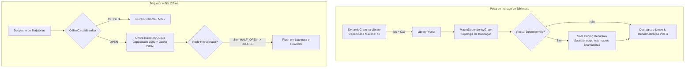
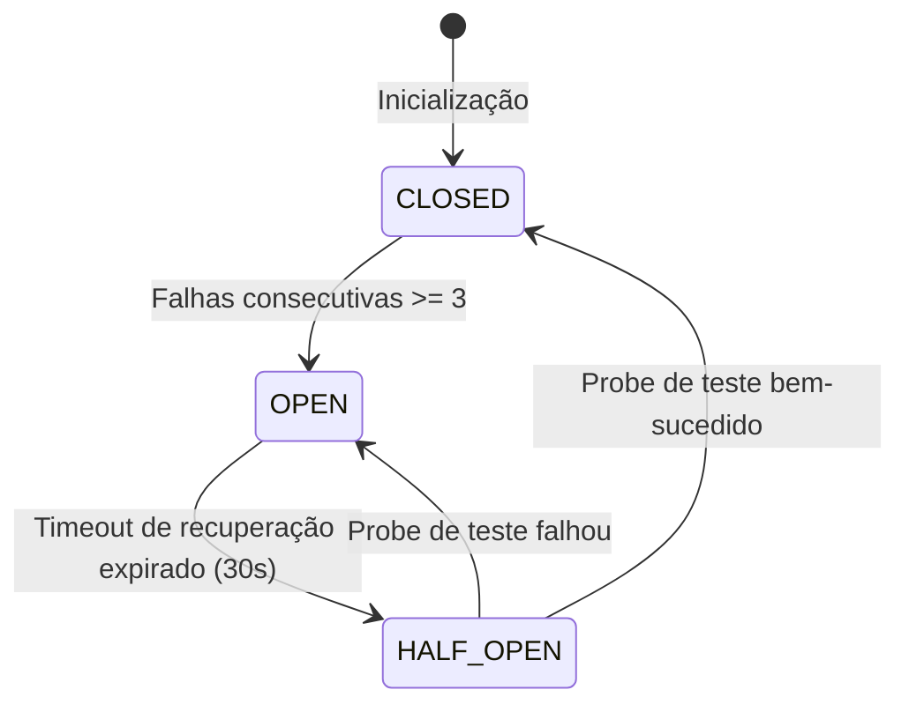

# Library Bloat Pruning & Resilient Offline Fallback

## 1. Visão Geral e Princípios Arquiteturais

À medida que o ciclo contínuo do DreamCoder descobre e acumula abstrações ao longo de dezenas de ciclos de vigília e sono, o vocabulário da linguagem procedural $\Sigma$ cresce. Sem um mecanismo de controle rigoroso, o sistema sofre de **Inchaço de Biblioteca (*Library Bloat*)**:
- **Explosão do Fator de Ramificação:** Na busca em feixe ou A*, cada buraco tipado (`HoleNode`) pode ser expandido por qualquer regra compatível. Com $|\Sigma| = 100$, o fator de ramificação infla para $O(B \cdot |\Sigma|)$, degradando a velocidade de síntese em ordem exponencial.
- **Risco de Quebra em Cadeia:** Macros de ordem superior podem invocar macros mais simples (ex: `macro_flanged_cylinder` invocando `macro_hollow_cylinder`). Desregistrar uma macro ingênua sem rastreamento quebra todas as macros dependentes.
- **Vulnerabilidade a Quedas de Rede:** Se a infraestrutura de treinamento remoto (Modal, SageMaker) sofrer instabilidade ou partição de rede, a síntese local não deve travar nem descartar trajetórias resolvidas.

O SymForge resolve esses riscos por meio de dois componentes complementares em `src/symforge/resilience/`:
1. **`LibraryPruner`:** Rastreador de dependências topológico e podador de capacidade com **inlining seguro de folhas**.
2. **`OfflineCircuitBreaker` & `OfflineTrajectoryQueue`:** Disjuntor de três estados e fila local resiliente com persistência em disco.

```text
+---------------------------------------------------------------------------------------------------+
|                            ARQUITETURA DE RESILIÊNCIA E PODA DE BIBLIOTECA                        |
|                                                                                                   |
|  [Expansão da Gramática (Task 5.3)]                                                               |
|                 |                                                                                 |
|                 v                                                                                 |
|  +----------------------------------------------------+                                           |
|  | DynamicGrammarLibrary (Capacidade Máxima: 40)      |                                           |
|  | - Se len(macros) > 40: dispara LibraryPruner       |                                           |
|  +-------------------------+--------------------------+                                           |
|                            |                                                                      |
|                            v                                                                      |
|  +----------------------------------------------------+                                           |
|  | MacroDependencyGraph (Grafo Dirigido Acíclico)     |                                           |
|  | - Ordena candidatos por utilidade EMA (uso * ganho)|                                           |
|  | - Macro interna com dependentes -> Safe Inlining   |                                           |
|  | - Macro folha sem dependentes -> Evicção & PCFG Ren|                                           |
|  +----------------------------------------------------+                                           |
|                                                                                                   |
|  [Despacho Remoto (Task 6.1 / 6.2)]                                                               |
|                 |                                                                                 |
|                 v                                                                                 |
|  +----------------------------------------------------+                                           |
|  | OfflineCircuitBreaker (CLOSED -> OPEN -> HALF_OPEN)|                                           |
|  | - Se falhas consecutivas >= 3: trips para OPEN     |                                           |
|  +-------------------------+--------------------------+                                           |
|                            |                                                                      |
|                 +----------+----------+                                                           |
|                 | CLOSED              | OPEN                                                      |
|                 v                     v                                                           |
|  +-----------------------------+  +-----------------------------------+                           |
|  | Despacho Normal em Nuvem    |  | OfflineTrajectoryQueue (Cap: 1000)|                           |
|  | (Modal / SageMaker / Mock)  |  | - Buffers locais em memória/JSONL |                           |
|  +-----------------------------+  | - Continua síntese sem travamento |                           |
|                                   +-----------------+-----------------+                           |
|                                                     | Reconnect                                   |
|                                                     v                                             |
|                                   +-----------------------------------+                           |
|                                   | Flush automático em lote          |                           |
|                                   +-----------------------------------+                           |
+---------------------------------------------------------------------------------------------------+
```



---

## 2. Poda de Biblioteca com Inlining Seguro

### 2.1 Métrica de Utilidade Baseada em EMA
Cada macro registrada rastreia seu histórico de contribuição:
$$\text{Score}(M) = (1 - \alpha) \cdot \text{Score}_{\text{anterior}} + \alpha \cdot \left( \text{Uso}(M) \times \text{Economia}(M) \right)$$
Macros que foram úteis em fases iniciais mas caíram em desuso têm sua pontuação atenuada exponencialmente.

### 2.2 Grafo de Dependências e Inlining Semântico
Se a macro de menor utilidade $A$ for invocada pela macro de ordem superior $B$:
1. $A$ **não é simplesmente apagada**, pois isso quebraria $B$.
2. O corpo sintático de $A$ é expandido diretamente dentro da definição de $B$ via `inline_macro_in_ast`.
3. Os parâmetros de $A$ tornam-se parâmetros diretos de $B$.
4. **Invariante de Execução:** $\text{Exec}(B_{\text{inlined}}) \equiv \text{Exec}(B_{\text{original}})$ dentro de $\epsilon < 10^{-5}$.
5. Uma vez inlinada em todos os seus chamadores, $A$ torna-se uma folha e pode ser removida da biblioteca, reduzindo o vocabulário em 1 regra sem perda de capacidade expressiva.

---

## 3. Disjuntor de Rede (Circuit Breaker) e Fila Offline

### 3.1 Máquina de Estados do Disjuntor
O `OfflineCircuitBreaker` implementa uma máquina de estados estrita:
- **`CLOSED`:** Operação normal. Todas as requisições fluem para o provedor de computação.
- **`OPEN`:** Disparado após $3$ falhas consecutivas de rede ou timeouts. Bloqueia chamadas externas imediatas por um período de recuperação ($30.0\text{ s}$).
- **`HALF_OPEN`:** Ao expirar o tempo de recuperação, permite uma requisição de teste (*probe*). Se for bem-sucedida, restaura o estado para `CLOSED`. Se falhar, retorna para `OPEN`.

```text
+---------------------------------------------------------------------------------------------------+
|                             MÁQUINA DE ESTADOS DO CIRCUIT BREAKER                                 |
|                                                                                                   |
|          +----------------------------------------------------+                                   |
|          |                     CLOSED                         |                                   |
|          |    (Provedor remoto saudável, tráfego liberado)    |                                   |
|          +-------------------------+--------------------------+                                   |
|                     ^              |                                                              |
|       Probe Sucesso |              | 3 Falhas Consecutivas                                        |
|                     |              v                                                              |
|          +----------+--------------+--------------------------+                                   |
|          |                    HALF_OPEN                       |                                   |
|          |          (Sondagem de recuperação ativa)           |                                   |
|          +-------------------------+--------------------------+                                   |
|                     ^              |                                                              |
|        Timeout 30s  |              | Probe Falha                                                  |
|                     |              v                                                              |
|          +----------+--------------+--------------------------+                                   |
|          |                      OPEN                          |                                   |
|          |  (Rede com partição, desvios para fila offline)    |                                   |
|          +----------------------------------------------------+                                   |
+---------------------------------------------------------------------------------------------------+
```



### 3.2 Fila de Trajetórias Offline (`OfflineTrajectoryQueue`)
Quando o disjuntor está em `OPEN`:
- As trajetórias de vigília sintetizadas são enfileiradas em memória (`collections.deque(maxlen=1000)`) e persistidas em arquivo JSONL local.
- O ciclo do meta-controlador continua rodando localmente sem exceções não-tratadas.
- Assim que o disjuntor retorna para `CLOSED`, o método `flush_to_provider` descarrega todas as trajetórias pendentes em lotes assíncronos para o `ComputeProvider`.
