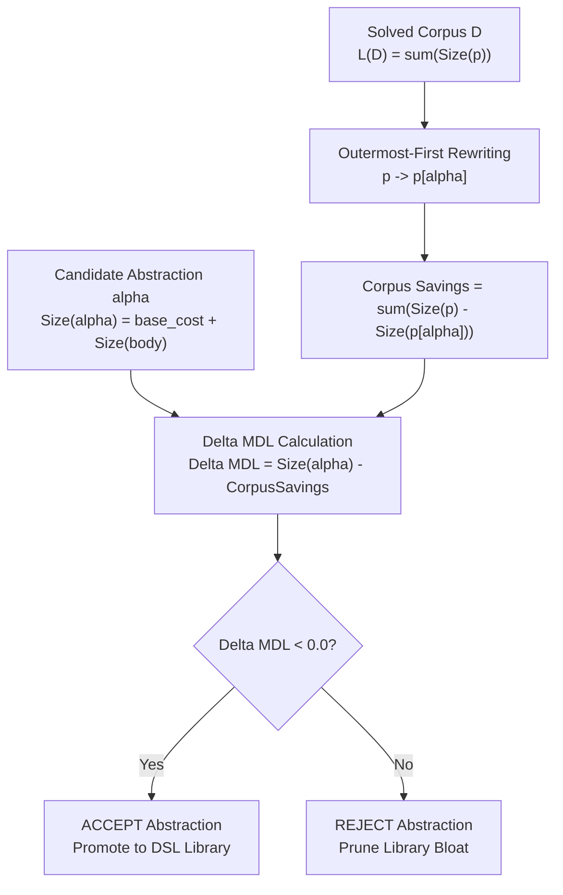
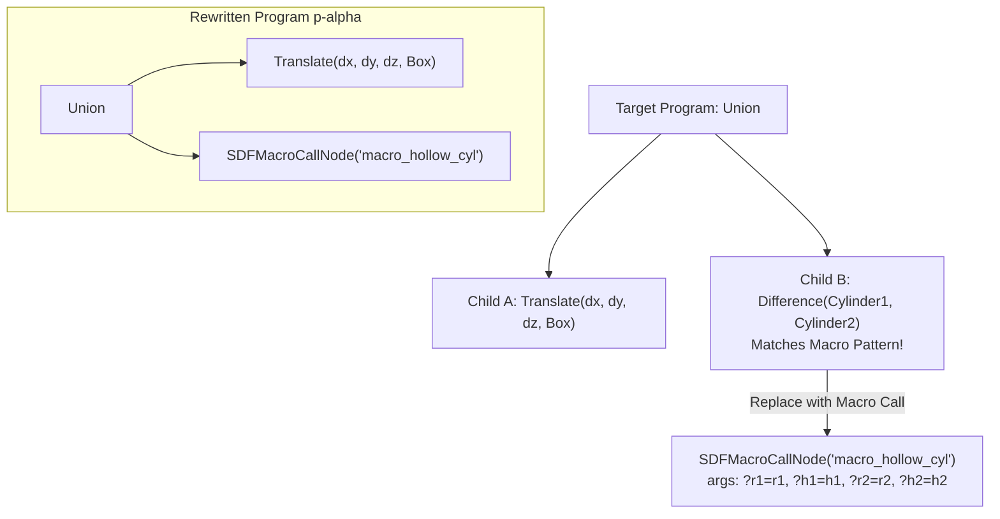

# Minimum Description Length (MDL) Compression Evaluator

**Track:** `curriculum_abstraction_remote_training_202505` (Phase 5, Task 5.2)  
**Status:** Complete  
**Authors:** SymForge Neurosymbolic Architecture Team

---

## 1. Executive Summary & Design Rationale

In neurosymbolic synthesis frameworks such as **DreamCoder**, discovering reusable abstractions ($\alpha$) accelerates synthesis by shortening program derivation length ($D$). However, unconstrained addition of discovered macros into the domain-specific language (DSL) induces **library bloat**:
- Adding macro productions expands the grammar branching factor ($B$).
- If an invented macro is used only once or covers a trivial single-node primitive, the exponential cost of searching a wider grammar exceeds any derivation depth benefit:
$$\mathcal{O}(B_{\text{new}}^{D_{\text{new}}}) \gg \mathcal{O}(B_{\text{old}}^{D_{\text{old}}})$$

The **Minimum Description Length (MDL)** evaluator implements an information-theoretic Occam's Razor to gate library expansion. A candidate abstraction discovered by anti-unification is promoted to the DSL library if and only if its introduction yields **strict net compression** of the corpus of solved programs $\mathcal{D}$:
$$\Delta \text{MDL}(\alpha) < 0$$

Single-use, redundant, or zero-utility abstractions are immediately pruned, guaranteeing bounded library growth and monotonic compression of the synthesis state space.

---

## 2. Information-Theoretic Foundations (MDL for Program Synthesis)

### 2.1 Two-Part Coding Formulation

Let $\mathcal{D} = \{p_1, p_2, \dots, p_M\}$ be a corpus of solved programs. Under the two-part coding formulation of MDL, the total description length consists of:
1. The model complexity: the size of the DSL library $\mathcal{L}$.
2. The data complexity given the model: the sum of sizes of the corpus programs represented under $\mathcal{L}$.

Before introducing candidate abstraction $\alpha$, the baseline description length is:
$$L(\mathcal{D}) = \sum_{p \in \mathcal{D}} \text{Size}(p)$$

When candidate abstraction $\alpha$ is registered in the DSL, the library expands by its definition size $\text{Size}(\alpha)$. In return, each matching occurrence of $\alpha$ within each program $p$ is rewritten into a macro call $p[\alpha]$, reducing the program size to $\text{Size}(p[\alpha])$.

The net change in total description length is:
$$\Delta \text{MDL}(\alpha) = \text{Size}(\alpha) - \sum_{p \in \mathcal{D}} \left( \text{Size}(p) - \text{Size}(p[\alpha]) \right)$$

where:
- $\text{Size}(\alpha) = \text{symbol\_base\_cost} + \text{Size}(\text{body}(\alpha))$
- $\text{CorpusSavings}(\alpha) = \sum_{p \in \mathcal{D}} (\text{Size}(p) - \text{Size}(p[\alpha]))$

```text
+---------------------------------------------------------------------------------------------------+
|                                 MDL COMPRESSION BALANCE SHEET                                     |
|                                                                                                   |
|   INITIAL CORPUS D                          CANDIDATE ABSTRACTION ALPHA                           |
|   L(D) = sum(Size(p))                       Size(alpha) = symbol_base_cost + Size(body)           |
|                                                          |                                        |
|             +--------------------------------------------+                                        |
|             |                                                                                     |
|             v                                                                                     |
|   REWRITE CORPUS: p -> p[alpha]                                                                   |
|   New Corpus Size = sum(Size(p[alpha]))                                                           |
|   Corpus Savings  = sum(Size(p) - Size(p[alpha]))                                                 |
|             |                                                                                     |
|             +--------------------+-----------------------+                                        |
|                                  |                                                                |
|                                  v                                                                |
|            NET DESCRIPTION LENGTH CHANGE: Delta MDL                                               |
|            Delta MDL = Size(alpha) - Corpus Savings                                               |
|                                  |                                                                |
|                 +----------------+----------------+                                               |
|                 |                                 |                                               |
|                 v                                 v                                               |
|       Delta MDL < Threshold             Delta MDL >= Threshold                                    |
|       (Net Compression Achieved)        (Library Bloat / Insufficient Utility)                    |
|                 |                                 |                                               |
|                 v                                 v                                               |
|         [ ACCEPT CANDIDATE ]              [ REJECT CANDIDATE ]                                    |
+---------------------------------------------------------------------------------------------------+
```



### 2.2 Acceptance Invariant & Compression Ratio

The acceptance decision is governed by:
$$\text{is\_accepted}(\alpha) \iff \Delta \text{MDL}(\alpha) < \text{threshold} \quad (\text{default: } 0.0)$$

The resulting relative compression ratio measures global dataset compaction:
$$\text{CompressionRatio}(\alpha) = \frac{L(\mathcal{D})}{L(\mathcal{D}) + \Delta \text{MDL}(\alpha)}$$

- $\text{CompressionRatio} > 1.0$: Net compression achieved (corpus shrinks).
- $\text{CompressionRatio} \le 1.0$: Description length expanded or unchanged (rejected).

---

## 3. Discrete Cost Model & Structural Accounting

Description lengths are computed through deterministic structural discrete accounting in `compute_ast_size` parameterized by `MDLConfig`:

| Configuration Parameter | Default Value | Semantic Meaning |
| :--- | :--- | :--- |
| `symbol_base_cost` | `2.0` | Base bits/tokens to declare a new production rule in the DSL |
| `node_cost` | `1.0` | Cost per operator or primitive constructor |
| `param_cost` | `1.0` | Cost per variable argument slot or continuous parameter |
| `threshold` | `0.0` | Acceptance cutoff ($\Delta \text{MDL} < \text{threshold}$) |

### 3.1 Node Accounting Rules
1. **Primitive Leaves:**
   $$\text{Size}(\text{Sphere}(r)) = \text{node\_cost} + 1 \times \text{param\_cost} = 1.0 + 1.0 = 2.0$$
   $$\text{Size}(\text{Box}(w, h, d)) = \text{node\_cost} + 3 \times \text{param\_cost} = 1.0 + 3.0 = 4.0$$
   $$\text{Size}(\text{Saw}(f)) = \text{node\_cost} + 1 \times \text{param\_cost} = 1.0 + 1.0 = 2.0$$
   $$\text{Size}(\text{Sine}(f, \phi)) = \text{node\_cost} + 2 \times \text{param\_cost} = 1.0 + 2.0 = 3.0$$

2. **Unary Transforms & Modifiers:**
   $$\text{Size}(\text{Translate}(dx, dy, dz, c)) = \text{node\_cost} + 3 \times \text{param\_cost} + \text{Size}(c) = 4.0 + \text{Size}(c)$$
   $$\text{Size}(\text{Gain}(g, x)) = \text{node\_cost} + 1 \times \text{param\_cost} + \text{Size}(x) = 2.0 + \text{Size}(x)$$

3. **Binary Combinators:**
   $$\text{Size}(\text{Difference}(a, b)) = \text{node\_cost} + \text{Size}(a) + \text{Size}(b) = 1.0 + \text{Size}(a) + \text{Size}(b)$$
   $$\text{Size}(\text{Mix}(r, a, b)) = \text{node\_cost} + 1 \times \text{param\_cost} + \text{Size}(a) + \text{Size}(b) = 2.0 + \text{Size}(a) + \text{Size}(b)$$

4. **Variables and Holes:**
   $$\text{Size}(\text{VariableNode}(?x)) = \text{param\_cost} = 1.0$$
   $$\text{Size}(\text{HoleNode}(h)) = \text{param\_cost} = 1.0$$

5. **Macro Call Invocation:**
   $$\text{Size}(\text{MacroCallNode}(m, \{a_1, \dots, a_k\})) = \text{node\_cost} + \sum_{i=1}^k \text{Size}(a_i)$$

---

## 4. Outermost-First AST Rewriting Dynamics

To prevent overlapping, conflicting, or non-deterministic subtree replacements, `rewrite_ast_with_pattern` performs **outermost-first deterministic matching**:

```text
+---------------------------------------------------------------------------------------------------+
|                            OUTERMOST-FIRST AST REWRITING DYNAMICS                                 |
|                                                                                                   |
|                                       Target Program Tree                                         |
|                                        Union(a, b)                                                |
|                                       /           \                                               |
|                   Translate(dx, dy, dz, c)      Difference(Cyl1, Cyl2)                            |
|                            |                    [ Matches Macro Pattern! ]                        |
|                        Box(w, h, d)                         |                                     |
|                                                             v                                     |
|                                                 Instantiate MacroCallNode                         |
|                                                macro_hollow_cyl(?r1, ?h1, ?r2, ?h2)               |
|                                                             |                                     |
|                                                             v                                     |
|                                      Rewritten Program Tree p[alpha]                              |
|                                        Union(a, b)                                                |
|                                       /           \                                               |
|                   Translate(dx, dy, dz, c)      SDFMacroCallNode("macro_hollow_cyl", args)        |
|                            |                                                                      |
|                        Box(w, h, d)                                                               |
+---------------------------------------------------------------------------------------------------+
```



### 4.1 Argument Extraction & Domain Typing
When a match occurs:
- Substituted arguments are mapped into a local dictionary `arguments = {var_name: substituted_val}`.
- If an argument value is itself an `ASTNode`, it is recursively rewritten before being bound to the macro call.
- The factory `make_macro_call` creates domain-typed nodes:
  - Audio domain: `AudioMacroCallNode` (inherits from `AudioNode` and `MacroCallNode`).
  - SDF domain: `SDFMacroCallNode` (inherits from `SDFNode` and `MacroCallNode`).
  - Generic: `MacroCallNode`.

This guarantees that type-checked combinators (e.g. `DifferenceNode(a: SDFNode, b: SDFNode)`) accept the rewritten child without typing violations.

---

## 5. Domain Case Studies: Audio DSP & SDF 3D CSG

### 5.1 SDF Case Study: Hollow Cylinder Macro
Consider a recurrent geometric pattern:
$$\alpha_{\text{cyl}} = \text{Difference}(\text{Cylinder}(?r_1, ?h_1), \text{Cylinder}(?r_2, ?h_2))$$

- **Macro Definition Cost:**
  - $\text{DifferenceNode}$: $1.0$
  - $\text{Cylinder}_1(?r_1, ?h_1)$: $1.0 + 2 \times 1.0 = 3.0$
  - $\text{Cylinder}_2(?r_2, ?h_2)$: $1.0 + 2 \times 1.0 = 3.0$
  - Body size $= 1.0 + 3.0 + 3.0 = 7.0$
  - $\text{Size}(\alpha_{\text{cyl}}) = \text{symbol\_base\_cost}\ (2.0) + 7.0 = 9.0$

- **Occurrence Size Reduction:**
  - Original occurrence size: $7.0$
  - Rewritten call: $\text{SDFMacroCallNode}(\alpha_{\text{cyl}}, \{?r_1, ?h_1, ?r_2, ?h_2\})$
  - Call size: $1.0\ (\text{node}) + 4 \times 1.0\ (\text{params}) = 5.0$
  - Savings per occurrence: $7.0 - 5.0 = 2.0$

- **MDL Evaluation across Corpus:**
  - For $M = 1$ program:
    $$\Delta \text{MDL} = 9.0 - 1 \times 2.0 = +7.0 > 0 \implies \mathbf{REJECTED}$$
  - For $M = 5$ programs:
    $$\Delta \text{MDL} = 9.0 - 5 \times 2.0 = -1.0 < 0 \implies \mathbf{ACCEPTED}$$

### 5.2 Audio DSP Case Study: Harmonic Mix Macro
Consider a recurrent audio pattern:
$$\alpha_{\text{mix}} = \text{Mix}(?r, \text{Sine}(?f_s, ?\phi), \text{Saw}(?f_w))$$

- **Macro Definition Cost:**
  - $\text{MixNode}$: $1.0 + 1.0\ (\text{ratio}) = 2.0$
  - $\text{SineNode}$: $1.0 + 2.0\ (\text{freq}, \text{phase}) = 3.0$
  - $\text{SawNode}$: $1.0 + 1.0\ (\text{freq}) = 2.0$
  - Body size $= 2.0 + 3.0 + 2.0 = 7.0$
  - $\text{Size}(\alpha_{\text{mix}}) = 2.0 + 7.0 = 9.0$

- **Occurrence Size Reduction:**
  - Call size: $1.0\ (\text{node}) + 4 \times 1.0\ (\text{params}) = 5.0$
  - Savings per occurrence: $7.0 - 5.0 = 2.0$

- **MDL Evaluation across Corpus:**
  - For $M = 5$ programs:
    $$\Delta \text{MDL} = 9.0 - 10.0 = -1.0 < 0 \implies \mathbf{ACCEPTED}$$

---

## 6. Symmetrical Cross-Validation & Serialization

All MDL components enforce mathematical symmetry across operations:
1. **Size Conservation Identity:**
   $$\text{compute\_ast\_size}(p) - \text{compute\_ast\_size}(p[\alpha]) \equiv \text{size\_savings}$$
2. **Lossless Lean 4 Bridge Serialization Round-Trip:**
   $$\text{deserialize\_node}(\text{serialize\_node}(\text{MacroCallNode})) == \text{MacroCallNode}$$
3. **Domain Hierarchy Invariant:**
   $$\text{isinstance}(\text{AudioMacroCallNode}, \text{AudioNode}) \equiv \text{True}$$
   $$\text{isinstance}(\text{SDFMacroCallNode}, \text{SDFNode}) \equiv \text{True}$$

---

## 7. Automated Test Matrix

The test suite in `tests/abstraction/test_mdl.py` validates all required formal properties:

| Test Case | Property / Invariant | Validation Status |
| :--- | :--- | :--- |
| `test_leaf_nodes_size` | Leaf discrete description length | Pass |
| `test_transforms_and_operators_size` | Operator and combinator description length | Pass |
| `test_variable_and_hole_nodes_size` | Parameter hole size evaluation | Pass |
| `test_macro_call_node_size` | Macro call invocation size accounting | Pass |
| `test_custom_cost_sensitivity` | Custom `MDLConfig` linear scaling | Pass |
| `test_trivial_single_use_abstraction_rejected` | Single-use macro produces $\Delta \text{MDL} \ge 0$ | Pass |
| `test_trivial_primitive_abstraction_rejected` | Trivial single-node macro produces $\Delta \text{MDL} \ge 0$ | Pass |
| `test_highly_recurrent_pattern_accepted` | Multi-use composite macro produces $\Delta \text{MDL} < 0$ | Pass |
| `test_audio_recurring_mix_benchmark` | Audio Harmonic Mix achieves positive compression | Pass |
| `test_sdf_recurring_hollow_cylinder_benchmark` | SDF Hollow Cylinder achieves positive compression | Pass |
| `test_gate_evaluates_20_candidates_filters_and_ranks` | **Pass-to-Complete Gate:** 20 candidates evaluated, only top compressors accepted | Pass |
| `test_symmetrical_size_savings_identity` | Symmetrical identity: $\text{Size}(p) - \text{Size}(p[\alpha]) == \text{savings}$ | Pass |
| `test_macro_call_serialization_roundtrip` | Symmetrical Lean 4 serialization round-trip | Pass |
| `test_domain_typing_invariance` | Preserves typed AudioNode and SDFNode inheritance | Pass |
| `test_empty_corpus` | Safe handling of empty datasets without division by zero | Pass |
| `test_recursion_depth_limit_enforced` | Contextual exception on recursive depth cap breach | Pass |
