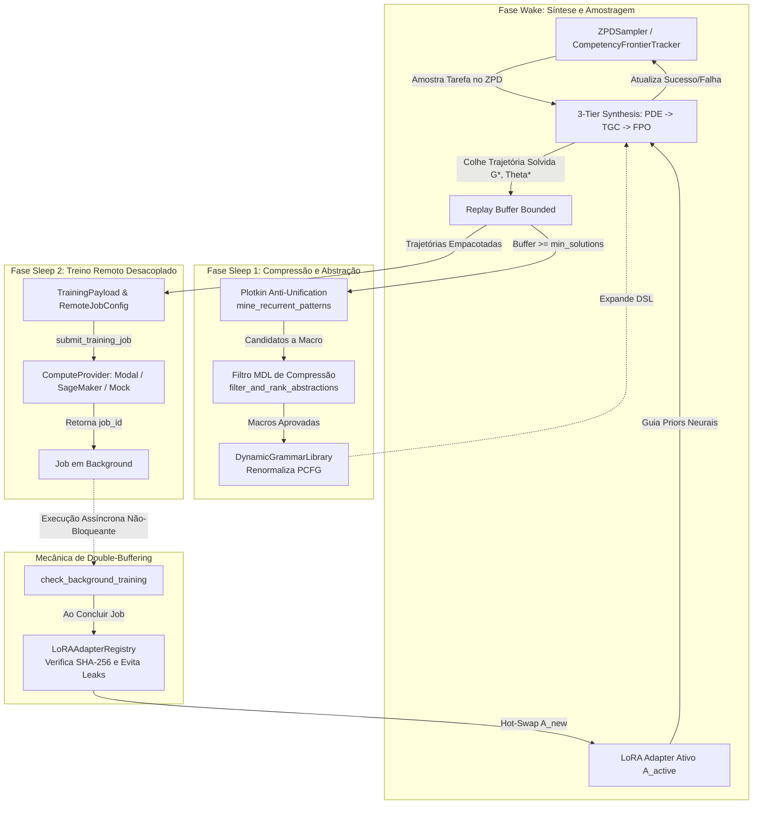
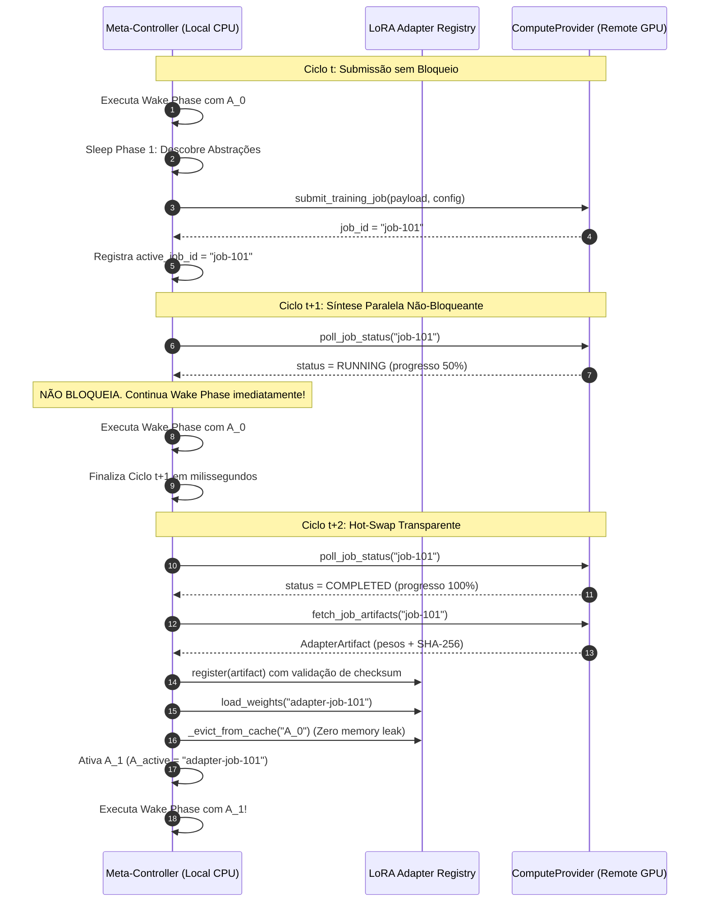
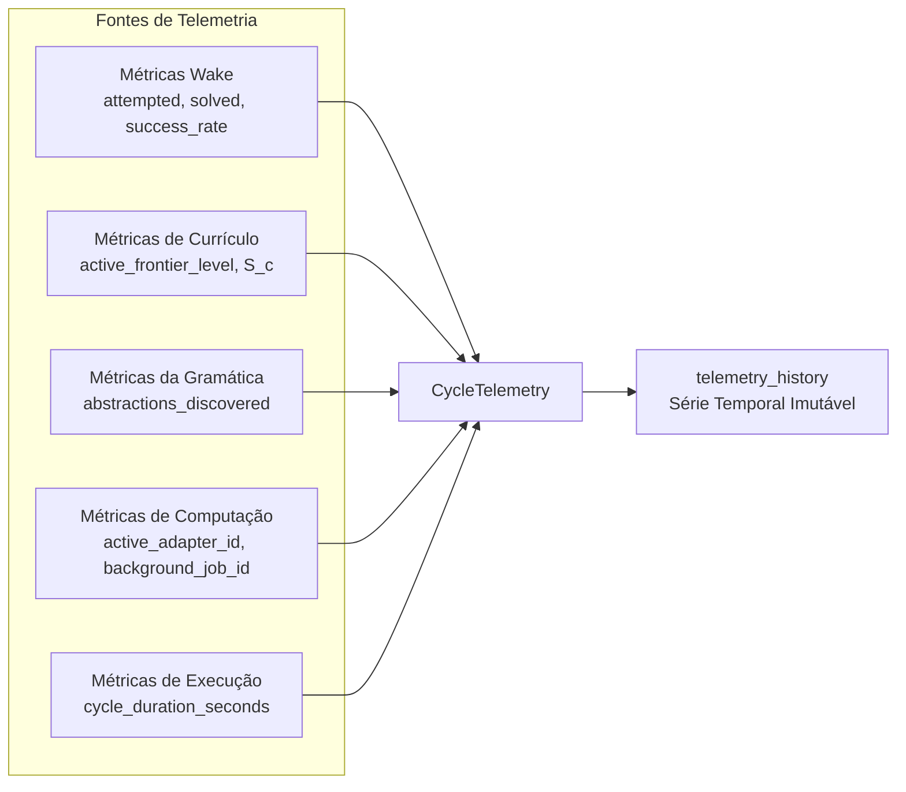

# Meta-Controller Regime Loop: Wake-Sleep Neurosymbolic Orchestration

## 1. Overview and Core Mandate

The **Meta-Controller** (`symforge.orchestration.meta_controller`) serves as the central conductor of the SymForge neurosymbolic synthesis framework. Operating at the intersection of active curriculum guidance, program synthesis, abstraction compression, and asynchronous remote compute execution, it coordinates the end-to-end **Wake-Sleep** learning regime.

The Meta-Controller harmonizes four foundational subsystems:
1. **Curriculum Frontier (ZPD):** Dynamically samples procedural synthesis tasks within the Zone of Proximal Development ($0.2 \le S(c) \le 0.8$) via `ZPDSampler` and `CompetencyFrontierTracker`.
2. **Synthesis Engine:** Executes 3-tier synthesis ($\text{PDE} \to \text{TGC} \to \text{FPO}$) on sampled target problems, harvesting solved trajectories $(G^*, \Theta^*)$ into a bounded in-memory replay buffer.
3. **DreamCoder Sleep-Compression (Sleep Phase 1):** Mines recurrent subgraphs from solved programs via Plotkin anti-unification (`mine_recurrent_patterns`), filters them using Minimum Description Length (`filter_and_rank_abstractions`), and injects accepted macro-productions into `DynamicGrammarLibrary`, dynamically renormalizing PCFG priors.
4. **Decoupled Asynchronous Compute & Double-Buffering (Sleep Phase 2):** Packages harvested trajectories into a `TrainingPayload` and dispatches non-blocking remote fine-tuning jobs to serverless GPU compute backends (`ComputeProvider`), hot-swapping new LoRA adapters in-place without stalling local synthesis.

---

## 2. High-Level Wake-Sleep Loop Architecture

```text
+----------------------------------------------------------------------------------------------------+
|                                    META-CONTROLLER REGIME LOOP                                     |
|                                                                                                    |
|    +-----------------------------+                           +--------------------------------+    |
|    |      Competency Frontier    |                           |      Replay Buffer (Bounded)   |    |
|    |    (ZPDSampler / Tracker)   |                           |    (max_replay_buffer_size)    |    |
|    +--------------+--------------+                           +---------------+----------------+    |
|                   |                                                          ^                     |
|            Sample | Tasks                                            Harvest | Solved Trajectories |
|                   v                                                          |                     |
|    +--------------+--------------+                           +---------------+----------------+    |
|    |          WAKE PHASE         |                           |         SLEEP PHASE 1          |    |
|    |  3-Tier Synthesis Engine    | ------------------------> |  Subgraph Anti-Unification     |    |
|    |     (PDE -> TGC -> FPO)     |      Accumulates >= N     |     & MDL Sleep-Compression    |    |
|    +--------------+--------------+         Solutions         +---------------+----------------+    |
|                   ^                                                          |                     |
|           Active  | Adapter (A_active)                                Injects | Macro Productions   |
|                   |                                                          v                     |
|    +--------------+--------------+                           +---------------+----------------+    |
|    |     LoRA Adapter Registry   | <------------------------ |    Dynamic Grammar Library     |    |
|    |   (Hot-Swap & Zero Leak)    |       Dispatches Jobs     |   (Renormalized PCFG Priors)   |    |
|    +--------------^--------------+                           +---------------+----------------+    |
|                   |                                                          |                     |
|         Hot-Swaps | Completed Weights                         Submits Batch  | TrainingPayload     |
|                   |                                                          v                     |
|    +--------------+--------------+                           +---------------+----------------+    |
|    |      check_background_      | <======================== |         SLEEP PHASE 2          |    |
|    |      training() Poll        |    Non-Blocking Handshake |   Asynchronous Remote Dispatch |    |
|    +-----------------------------+                           |    (ComputeProvider Protocol)  |    |
+----------------------------------------------------------------------------------------------------+
```



---

## 3. State Machine Transitions

The lifecycle of each cycle progresses through deterministic state transitions:

```text
+----------------------------------------------------------------------------------------------------+
|                                    STATE MACHINE TRANSITION FLOW                                   |
|                                                                                                    |
|  [START CYCLE]                                                                                     |
|        |                                                                                           |
|        v                                                                                           |
|  +--------------------+                                                                            |
|  | BACKGROUND_POLL    | ---- (Job Completed) ----> [HOT_SWAP_ADAPTER]                              |
|  +---------+----------+                                     |                                      |
|            | (No job / Still running / Swapped)             |                                      |
|            v <----------------------------------------------+                                      |
|  +---------+----------+                                                                            |
|  | WAKE_SYNTHESIS     | <--- Executes wake_batch_size tasks from ZPD                               |
|  +---------+----------+                                                                            |
|            |                                                                                       |
|            v                                                                                       |
|  +---------+----------+                                                                            |
|  | SLEEP_ABSTRACTION  | <--- Triggers if replay_buffer >= min_solutions                            |
|  +---------+----------+                                                                            |
|            |                                                                                       |
|            v                                                                                       |
|  +---------+----------+                                                                            |
|  | SLEEP_DISPATCH     | <--- Submits background job if enabled and no active job                   |
|  +---------+----------+                                                                            |
|            |                                                                                       |
|            v                                                                                       |
|  [EMIT TELEMETRY] ---> [CYCLE COMPLETE]                                                            |
+----------------------------------------------------------------------------------------------------+
```

```mermaid
stateDiagram-v2
    [*] --> BackgroundPoll: Início do Ciclo

    state BackgroundPoll {
        CheckActiveJob: Verifica se há job_id ativo
        CheckActiveJob --> PollStatus: job_id presente
        CheckActiveJob --> WakeSynthesis: job_id ausente
        PollStatus --> HotSwapAdapter: Status COMPLETED
        PollStatus --> LogFailure: Status FAILED / CANCELLED
        PollStatus --> WakeSynthesis: Status RUNNING / PENDING
        HotSwapAdapter --> WakeSynthesis: Registra e troca A_active
        LogFailure --> WakeSynthesis: Limpa job_id e prossegue
    }

    state WakeSynthesis {
        SampleZPD: Amostra lote de tarefas ZPD
        Synthesize: Executa síntese (PDE -> TGC -> FPO)
        RecordFrontier: Atualiza rolling success S(c)
        HarvestBuffer: Adiciona soluções ao Replay Buffer
        SampleZPD --> Synthesize --> RecordFrontier --> HarvestBuffer
    }

    WakeSynthesis --> SleepAbstraction: Fim do lote Wake

    state SleepAbstraction {
        CheckBufferThreshold: Replay Buffer >= min_solutions?
        CheckBufferThreshold --> SkipAbstraction: Não
        CheckBufferThreshold --> MinePatterns: Sim
        MinePatterns --> EvaluateMDL: Anti-unificação por pares
        EvaluateMDL --> RegisterMacro: Delta MDL < threshold
        RegisterMacro --> SleepDispatch: Injeta na Gramática
        SkipAbstraction --> SleepDispatch: Ignora fase
    }

    state SleepDispatch {
        CheckDispatchEligibility: remote_dispatch_enabled AND no active_job?
        CheckDispatchEligibility --> SkipDispatch: Não elegível
        CheckDispatchEligibility --> PackagePayload: Sim
        PackagePayload --> SubmitRemote: submit_training_job()
        SubmitRemote --> SaveJobID: Registra active_job_id
        SaveJobID --> EmitTelemetry
        SkipDispatch --> EmitTelemetry
    }

    EmitTelemetry --> [*]: Ciclo Concluído (Retorna CycleTelemetry)
```

---

## 4. Double-Buffering Mechanics

The core invariant of decoupled remote training is **Zero Local Blockage**:
- The local synthesis pipeline never waits for cloud or remote GPU training to finish.
- The synthesis loop operates continuously using the current active adapter $A_{\text{active}}$.
- Training runs in the background. When the job completes, the adapter $A_{\text{new}}$ is verified against its canonical SHA-256 checksum and loaded.
- The old adapter $A_{\text{active}}$ is evicted from cache to ensure deterministic resource severance and zero memory accumulation.

```text
+----------------------------------------------------------------------------------------------------+
|                                    DOUBLE-BUFFERING CHRONOLOGY                                     |
|                                                                                                    |
|  Timeline       Local Synthesis Engine (CPU)            Remote Compute Provider (Cloud / GPU)     |
|  -------------  --------------------------------------  ---------------------------------------   |
|  Cycle t:                                                                                          |
|                 Pre-wake: No job in flight                                                         |
|                 Wake Phase: Synthesizes with A_0                                                   |
|                 Sleep Phase 2: Dispatches Job J1 -----> Submits Job J1 (PENDING)                   |
|                 active_job_id = J1                                                                 |
|                 Cycle t terminates immediately                                                     |
|                                                                                                    |
|  Cycle t+1:                                                                                        |
|                 Pre-wake: Polls J1 (RUNNING)             Remote GPU training in progress...         |
|                 Does NOT wait; proceeds immediately                                                |
|                 Wake Phase: Synthesizes with A_0                                                   |
|                 Sleep Phase 2: J1 in flight, skips                                                 |
|                 Cycle t+1 terminates immediately                                                   |
|                                                                                                    |
|  Cycle t+2:                                                                                        |
|                 Pre-wake: Polls J1 (COMPLETED) <------- Job J1 COMPLETED                           |
|                 Downloads & verifies artifact           Artifact ready                             |
|                 Hot-swaps A_0 -> A_1 in place                                                      |
|                 active_adapter_id = A_1                                                            |
|                 Evicts A_0 from cache (Zero Leak)                                                  |
|                 Wake Phase: Synthesizes with A_1!                                                  |
+----------------------------------------------------------------------------------------------------+
```



---

## 5. Telemetry and Data Contracts

At the end of each cycle, the Meta-Controller constructs and returns an immutable `CycleTelemetry` instance:

```python
@dataclass(frozen=True)
class CycleTelemetry:
    cycle_index: int                       # Zero-based cycle index
    wake_tasks_attempted: int             # Tasks attempted during wake phase
    wake_tasks_solved: int                # Tasks successfully synthesized
    wake_success_rate: float              # Proportion solved: solved / attempted
    abstractions_discovered: int          # New macro productions registered
    active_frontier_level: CurriculumLevel # Current ZPD competency frontier
    active_adapter_id: Optional[str]      # Currently active LoRA adapter ID
    background_job_id: Optional[str]      # Remote training job ID in flight
    cycle_duration_seconds: float         # Wall-clock duration of full cycle
```

```text
+----------------------------------------------------------------------------------------------------+
|                                    TELEMETRY AND METRICS PIPELINE                                  |
|                                                                                                    |
|    +-----------------------------+                                                                 |
|    |      Wake Phase Stats       | ----+                                                           |
|    | (attempted, solved, rate)   |     |                                                           |
|    +-----------------------------+     |                                                           |
|                                        |                                                           |
|    +-----------------------------+     |                                                           |
|    |      Curriculum State       | ----+                                                           |
|    | (active_frontier_level)     |     |                                                           |
|    +-----------------------------+     |                                                           |
|                                        +---> [ CycleTelemetry Snapshot ] ---> telemetry_history    |
|    +-----------------------------+     |                                                           |
|    |    Library Learning Stats   | ----+                                                           |
|    | (abstractions_discovered)   |     |                                                           |
|    +-----------------------------+     |                                                           |
|                                        |                                                           |
|    +-----------------------------+     |                                                           |
|    |    Compute & Adapter State  | ----+                                                           |
|    | (active_adapter, job_id)    |                                                                 |
|    +-----------------------------+                                                                 |
+----------------------------------------------------------------------------------------------------+
```



---

## 6. Verification and Performance Gates

The Meta-Controller is subjected to rigorous automated verification in `tests/orchestration/test_meta_controller.py`:

| Test Case | Invariant Validated | Result |
| :--- | :--- | :--- |
| `test_single_step_lifecycle_execution` | Full wake-sleep cycle transitions, trajectory harvesting, remote dispatch | **PASSED** |
| `test_double_buffering_non_blocking_invariant` | Non-blocking execution across simulated step transitions and seamless hot-swap | **PASSED** |
| `test_multi_cycle_execution_and_pass_gate` | **Pass-to-Complete Gate:** 5 full cycles with `MockComputeProvider` in $< 2.0$s on CPU | **PASSED** (1.86s) |
| `test_remote_dispatch_disabled` | Bypasses remote job dispatch when `remote_dispatch_enabled=False` | **PASSED** |
| `test_min_solutions_for_sleep_gating` | Bypasses sleep abstraction and dispatch when buffer $< \text{min\_solutions}$ | **PASSED** |
| `test_replay_buffer_bounded_capacity` | Replay buffer adheres strictly to `max_replay_buffer_size` | **PASSED** |
| `test_failing_remote_job_resilience` | Handles remote job failures gracefully without crashing | **PASSED** |
| `test_sdf_domain_synthesis` | Operates symmetrically across the 3D SDF geometry domain | **PASSED** |
| `test_abstraction_discovery_and_grammar_expansion` | Discovers recurrent patterns and registers macros into grammar library | **PASSED** |
| `test_manual_check_background_training_call` | Standalone status poll and hot-swap invocation | **PASSED** |
| `test_async_execution_api` | Asynchronous API execution with hard timeouts | **PASSED** |
