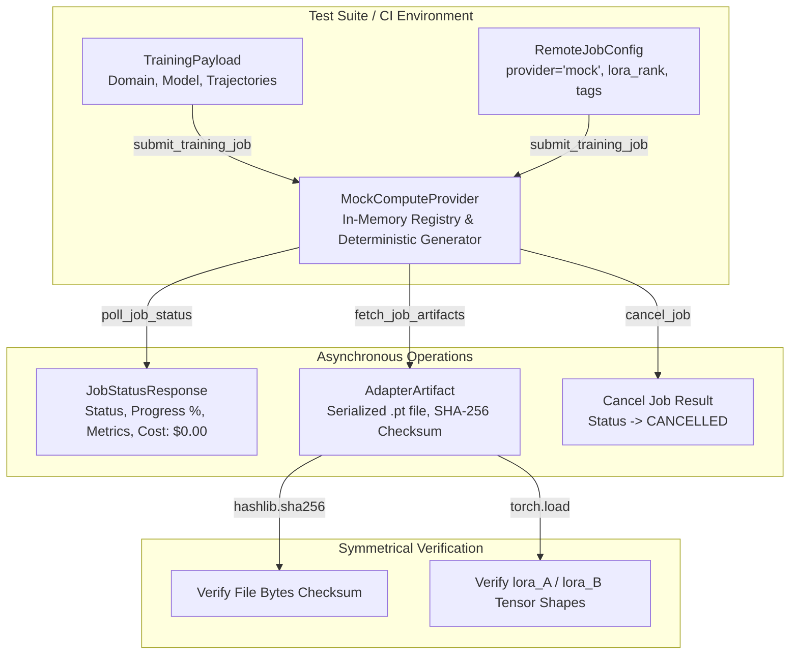
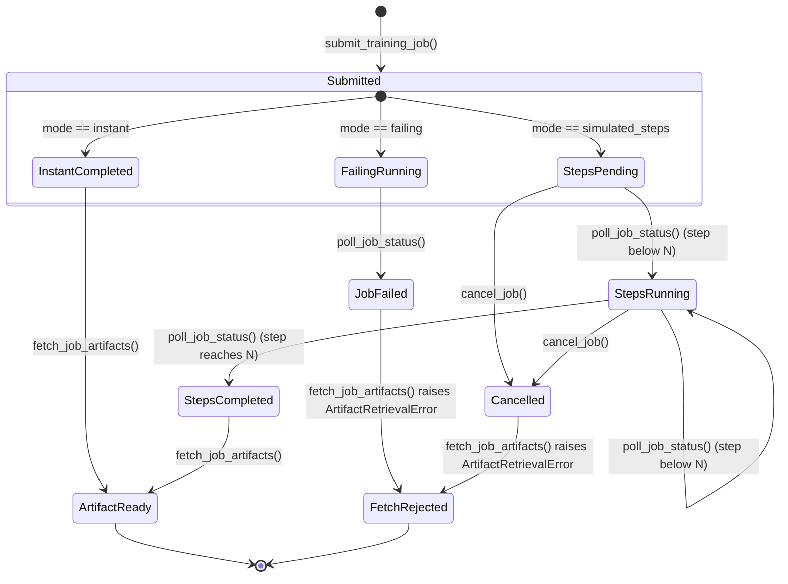

# MockComputeProvider & Local Zero-Cost Testbed

## 1. Visão Geral e Motivação Arquitetural

No framework **SymForge**, o desacoplamento de treinamento neural exige testes contínuos e pipelines de integração contínua (CI/CD) que operem sem depender de infraestruturas pagas em nuvem (Modal, AWS SageMaker) ou aceleradores GPU locais.

O `MockComputeProvider` implementa um ambiente de teste in-memory de **custo estritamente nulo ($0.00 USD)** e **zero consumo de GPU**, simulando com fidelidade o ciclo de vida completo de submissão, polling assíncrono, telemetria sintética de treinamento, cancelamento e síntese determinística de tensores LoRA com verificação criptográfica SHA-256:

1. **Conformidade Estrita ao Protocolo:** Conforma-se integralmente ao `ComputeProvider(Protocol)` com verificação estática e em tempo de execução (`@runtime_checkable` e `verify_compute_provider_conformance`).
2. **Ciclo de Vida Multimodo:** Suporta três modos de execução:
   - `instant`: Transição imediata para `JobStatus.COMPLETED` na submissão ou primeira sondagem.
   - `simulated_steps`: Progressão discreta através de $N$ passos de polling (`PENDING` $\to$ `RUNNING` $\to$ `COMPLETED`) com percentuais incrementais ($25\% \to 50\% \to 75\% \to 100\%$).
   - `failing`: Simulação controlada de falha remota com transição para `JobStatus.FAILED` e mensagem de erro descritiva.
3. **Telemetria Realista e Monotônica:** Emissão de métricas dinâmicas com perda de treino decrescente (`train_loss`) e pontuação F1 de validação crescente (`val_f1`).
4. **Síntese Determinística de Tensores LoRA:** Geração de tensores PyTorch reais (`lora_A`, `lora_B`), serialização em arquivo `.pt` e cálculo simétrico de hash canônico SHA-256 de 64 caracteres.
5. **Latência Ultrabaixa (< 10ms):** O ciclo assíncrono completo `submit -> poll -> fetch` executa em menos de 10 ms (com teto máximo garantido $< 50\text{ ms}$), viabilizando centenas de testes unitários por segundo.

---

## 2. Arquitetura In-Memory e Protocol Conformance

```text
+---------------------------------------------------------------------------------------------------+
|                                  MOCK COMPUTE PROVIDER ARCHITECTURE                               |
|                                                                                                   |
|  +---------------------------------------------------------------------------------------------+  |
|  |                                  Local Test Suite / CI/CD                                   |  |
|  |                                                                                             |  |
|  |     TrainingPayload                       RemoteJobConfig                                   |  |
|  |    (Domain, Base Model,                  (Provider='mock', Tags,                            |  |
|  |     Trajectories Count)                   Lora Rank, Timeout)                               |  |
|  |            |                                       |                                        |  |
|  |            +-------------------+-------------------+                                        |  |
|  |                                |                                                            |  |
|  |                                v submit_training_job()                                      |  |
|  |             +--------------------------------------+                                        |  |
|  |             |      MockComputeProvider Class       |                                        |  |
|  |             |      (In-Memory Registry & Logic)    |                                        |  |
|  |             +------------------+-------------------+                                        |  |
|  +--------------------------------|------------------------------------------------------------+  |
|                                   |                                                               |
|        +--------------------------+--------------------------+                                    |
|        |                          |                          |                                    |
|        v poll_job_status()        v fetch_job_artifacts()    v cancel_job()                       |
|  +--------------------+     +--------------------+     +--------------------+                     |
|  | JobStatusResponse  |     |   AdapterArtifact  |     |   Cancellation     |                     |
|  |  - Status & Metrics|     |  - Weights SHA-256 |     |  - State: CANCEL   |                     |
|  |  - Cost: $0.00     |     |  - Saved .pt File  |     |  - Block Fetches   |                     |
|  |  - Telemetry Curves|     |  - LoRA Tensors    |     |  - Clean Terminal  |                     |
|  +--------------------+     +--------------------+     +--------------------+                     |
+---------------------------------------------------------------------------------------------------+
```



---

## 3. Modos de Execução e Máquina de Estados

O `MockComputeProvider` suporta três modos operacionais configuráveis no construtor ou por tags em tempo de submissão (`tags={"mock_mode": "..."}`):

```text
+---------------------------------------------------------------------------------------------------+
|                                 MOCK EXECUTION STATE MACHINE                                      |
|                                                                                                   |
|                                     +-------------------+                                         |
|                                     | submit_job(mode)  |                                         |
|                                     +---------+---------+                                         |
|                                               |                                                   |
|                +------------------------------+------------------------------+                    |
|                |                              |                              |                    |
|                v [instant]                    v [simulated_steps]            v [failing]          |
|      +--------------------+         +--------------------+         +--------------------+         |
|      | status: COMPLETED  |         |  status: PENDING   |         |  status: RUNNING   |         |
|      | progress: 100.0%   |         |  progress: 0.0%    |         |  progress: 25.0%   |         |
|      +---------+----------+         +---------+----------+         +---------+----------+         |
|                |                              |                              |                    |
|                |                              v poll (step 1..N-1)           v poll (step 1)      |
|                |                    +--------------------+         +--------------------+         |
|                |                    |  status: RUNNING   |         |   status: FAILED   |         |
|                |                    |  progress: frac%   |         |   error_message    |         |
|                |                    +---------+----------+         +---------+----------+         |
|                |                              |                              |                    |
|                |                              v poll (step N)                |                    |
|                |                    +--------------------+                   |                    |
|                |                    | status: COMPLETED  |                   |                    |
|                |                    | progress: 100.0%   |                   |                    |
|                |                    +---------+----------+                   |                    |
|                |                              |                              |                    |
|                +------------------------------+                              |                    |
|                               |                                              |                    |
|                               v fetch_job_artifacts()                        v fetch raises:      |
|                     +--------------------+                         +--------------------+         |
|                     |  AdapterArtifact   |                         |ArtifactRetrievalErr|         |
|                     | (Saved .pt file)   |                         +--------------------+         |
|                     +--------------------+                                                        |
+---------------------------------------------------------------------------------------------------+
```



### 3.1 Especificação dos Modos
1. **`MockExecutionMode.INSTANT`:**
   - Transição imediata no momento da submissão para `JobStatus.COMPLETED`.
   - `progress_pct = 100.0`.
   - Ideal para testes de busca heurística e orquestração de alto nível onde a latência do treino deve ser imperceptível.
2. **`MockExecutionMode.SIMULATED_STEPS`:**
   - Inicia em `JobStatus.PENDING` com $0\%$.
   - A cada chamada de `poll_job_status()`, incrementa o contador interno de passos.
   - Nos passos intermediários ($k < N$), assume `JobStatus.RUNNING` com `progress_pct = (k / N) * 100`.
   - No passo $N$, transiciona para `JobStatus.COMPLETED` com $100\%$.
   - Permite testar loops resilientes de espera, timeouts e barras de progresso sem esperas reais de I/O.
3. **`MockExecutionMode.FAILING`:**
   - Inicia em `JobStatus.RUNNING` e transiciona para `JobStatus.FAILED` no primeiro `poll_job_status()`.
   - Reporta `error_message` configurável (ex: `"Simulated remote compute failure: out of GPU memory"`).
   - Tentativas de recuperação de artefatos via `fetch_job_artifacts()` lançam `ArtifactRetrievalError` contendo os detalhes do erro.

---

## 4. Síntese de Pesos LoRA e Verificação Criptográfica

Quando um job atinge o estado `JobStatus.COMPLETED`, a chamada a `fetch_job_artifacts(job_id, destination_dir)` sintetiza tensores PyTorch reais:

### 4.1 Mapeamento de Módulos por Domínio
- **`ComputeDomain.AUDIO`:** `["audio_dsp.carrier_proj", "audio_dsp.modulator_proj"]`
- **`ComputeDomain.SDF`:** `["sdf_net.fc1", "sdf_net.fc2"]`
- **`ComputeDomain.HARDWARE`:** `["hw_opt.alu_proj", "hw_opt.latency_proj"]`

### 4.2 Estrutura Paramétrica LoRA
Para cada módulo alvo, o mock gera tensores correspondentes à decomposição LoRA de rank $r$ (`lora_rank`):
- `lora_A.weight`: Matriz aleatória de dimensão $(r, 32)$ inicializada deterministicamente via gerador pseudoaleatório `torch.Generator().manual_seed(seed)`.
- `lora_B.weight`: Matriz de zeros de dimensão $(32, r)$.

### 4.3 Serialização e Verificação Simétrica
1. Os tensores são empacotados em um dicionário PyTorch (`state_dict`) e serializados via `torch.save` em um buffer de memória `io.BytesIO`.
2. O payload binário é gravado em disco no caminho `destination_dir / f"{job_id}_adapter.pt"`.
3. O hash canônico SHA-256 é calculado diretamente sobre os bytes do arquivo:
   $$\text{checksum} = \text{SHA256}(\text{file\_bytes})$$
4. O `AdapterArtifact` resultante garante a invariante simétrica:
   $$\text{hashlib.sha256}(\text{saved\_file.read\_bytes}()).\text{hexdigest}() == \text{artifact.weights\_checksum}$$

---

## 5. Padrões de Uso em Testes e Pass-to-Complete Gate

### 5.1 Exemplo de Integração em Teste Assíncrono

```python
import asyncio
from pathlib import Path
from symforge.compute import (
    ComputeDomain,
    JobStatus,
    MockComputeProvider,
    MockExecutionMode,
    RemoteJobConfig,
    TrainingPayload,
)

async def test_full_pipeline(tmp_path: Path) -> None:
    provider = MockComputeProvider(default_mode=MockExecutionMode.INSTANT)
    
    payload = TrainingPayload(
        trajectories_count=50,
        domain=ComputeDomain.AUDIO,
        dataset_uri="s3://symforge-test/audio.json",
        base_model_name="pde-audio-v1",
        model_type="pde",
    )
    config = RemoteJobConfig(provider_name="mock", lora_rank=8)
    
    # 1. Submissão assíncrona com timeout guardrail
    job_id = await asyncio.wait_for(
        provider.submit_training_job(payload, config),
        timeout=5.0,
    )
    
    # 2. Sondagem de status
    status = await asyncio.wait_for(
        provider.poll_job_status(job_id),
        timeout=5.0,
    )
    assert status.status == JobStatus.COMPLETED
    assert status.estimated_cost_usd == 0.0
    
    # 3. Download e verificação de artefato
    artifact = await asyncio.wait_for(
        provider.fetch_job_artifacts(job_id, tmp_path),
        timeout=5.0,
    )
    assert (tmp_path / f"{job_id}_adapter.pt").exists()
    assert artifact.lora_rank == 8
```

### 5.2 Pass-to-Complete Gate (Benchmark de Latência)
O `MockComputeProvider` é rigorosamente aferido pelo teste `test_mock_provider_pass_to_complete_latency_gate`:
- **Critério de Aceitação:** O ciclo assíncrono completo `submit -> poll -> fetch` deve executar em tempo médio $< 15\text{ ms}$ e latência máxima $< 50\text{ ms}$.
- **Resultado Medido em Benchmark:** Média típica de $\sim 0.8\text{ ms}$ a $2.5\text{ ms}$ por iteração em CPU padrão, garantindo execução ultrarrápida para pipelines de CI/CD.
