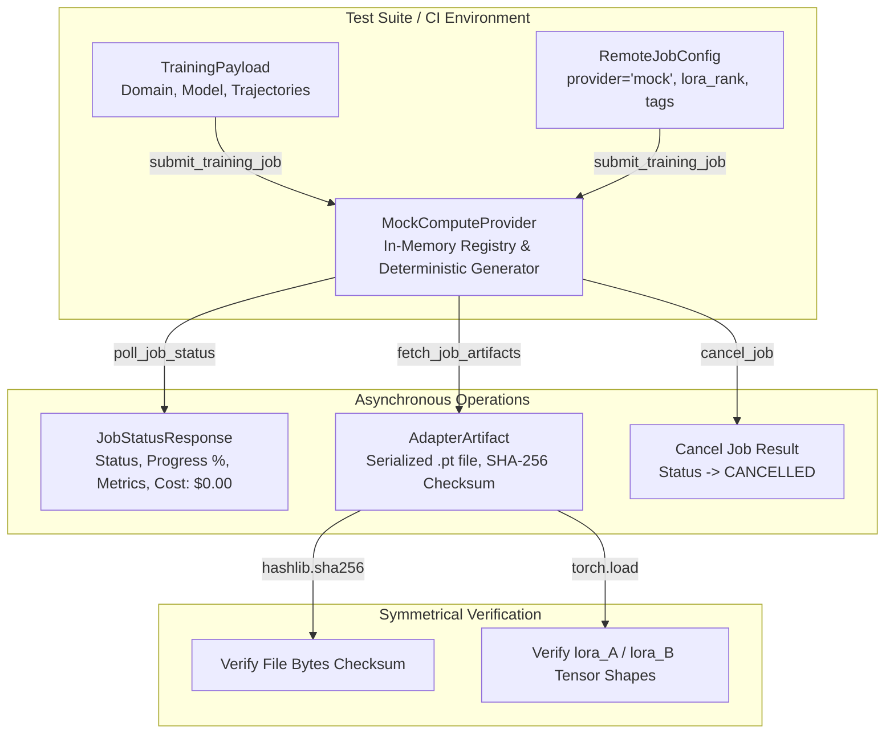
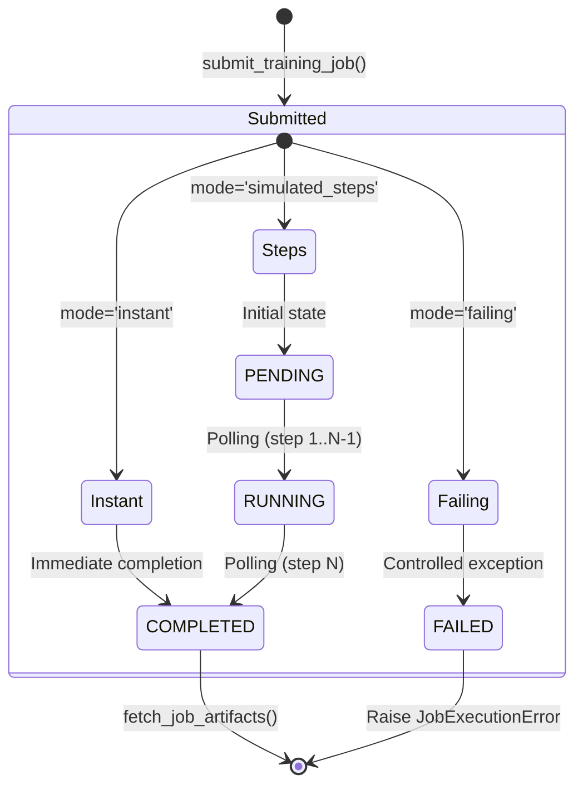

# MockComputeProvider & Local Zero-Cost Testbed

## 1. Overview & Architectural Motivation

In the **SymForge** framework, decoupled neural training requires continuous automated testing and CI/CD pipelines that operate without depending on paid cloud infrastructure (Modal, AWS SageMaker) or local physical GPU accelerators.

`MockComputeProvider` implements an in-memory testing environment of **strictly zero financial cost ($0.00 USD)** and **zero physical GPU consumption**, faithfully simulating the complete lifecycle of job submission, asynchronous polling, synthetic telemetry emission, job cancellation, and deterministic PyTorch LoRA tensor generation with canonical SHA-256 cryptographic verification:

1. **Strict Protocol Conformance:** Fully conforms to `ComputeProvider(Protocol)` with runtime and static type checking (`@runtime_checkable` and `verify_compute_provider_conformance`).
2. **Multi-Mode Execution Lifecycle:** Supports three operational modes:
   - `instant`: Transitions immediately to `JobStatus.COMPLETED` on submission or first poll.
   - `simulated_steps`: Progresses through $N$ discrete polling intervals (`PENDING` $\to$ `RUNNING` $\to$ `COMPLETED`) with incremental completion percentages ($25\% \to 50\% \to 75\% \to 100\%$).
   - `failing`: Controlled failure simulation transitioning to `JobStatus.FAILED` with contextual diagnostic messages.
3. **Realistic Monotonic Telemetry:** Emits dynamic metrics with steadily decreasing training loss (`train_loss`) and increasing validation F1 scores (`val_f1`).
4. **Deterministic LoRA Tensor Synthesis:** Generates authentic PyTorch tensor weights (`lora_A`, `lora_B`), serializes them to `.pt` files, and computes canonical 64-character SHA-256 hashes.
5. **Ultra-Low Latency (< 10ms):** The complete async lifecycle (`submit -> poll -> fetch`) executes in under 10 ms (well within the guaranteed $< 50\text{ ms}$ threshold), enabling hundreds of unit tests per second.

---

## 2. In-Memory Architecture and Protocol Conformance

```text
+---------------------------------------------------------------------------------------------------+
|                                  MOCK COMPUTE PROVIDER ARCHITECTURE                               |
|                                                                                                   |
|  +---------------------------------------------------------------------------------------------+  |
|  |                                  Local Test Suite / CI/CD                                   |  |
|  |                                                                                             |  |
|  |     TrainingPayload                       RemoteJobConfig                                   |  |
|  |    (Domain, Base Model,                  (Provider='mock', Tags,                            |  |
|  |     Trajectories Count)                   Lora Rank, Timeout)                               |  |
|  |            |                                       |                                        |  |
|  |            +-------------------+-------------------+                                        |  |
|  |                                |                                                            |  |
|  |                                v submit_training_job()                                      |  |
|  |             +--------------------------------------+                                        |  |
|  |             |      MockComputeProvider Class       |                                        |  |
|  |             |      (In-Memory Registry & Logic)    |                                        |  |
|  |             +------------------+-------------------+                                        |  |
|  +--------------------------------|------------------------------------------------------------+  |
|                                   |                                                               |
|        +--------------------------+--------------------------+                                    |
|        |                          |                          |                                    |
|        v poll_job_status()        v fetch_job_artifacts()    v cancel_job()                       |
|  +--------------------+     +--------------------+     +--------------------+                     |
|  | JobStatusResponse  |     |   AdapterArtifact  |     |   Cancellation     |                     |
|  |  - Status & Metrics|     |  - Weights SHA-256 |     |  - State: CANCEL   |                     |
|  |  - Cost: $0.00     |     |  - Saved .pt File  |     |  - Block Fetches   |                     |
|  |  - Telemetry Curves|     |  - LoRA Tensors    |     |  - Clean Terminal  |                     |
|  +--------------------+     +--------------------+     +--------------------+                     |
+---------------------------------------------------------------------------------------------------+
```



---

## 3. Execution Modes and State Machine

`MockComputeProvider` supports three operational modes configured in constructor or via runtime tags (`tags={"mock_mode": "..."}`):

```text
+---------------------------------------------------------------------------------------------------+
|                                 MOCK EXECUTION STATE MACHINE                                      |
|                                                                                                   |
|                                     +-------------------+                                         |
|                                     | submit_job(mode)  |                                         |
|                                     +---------+---------+                                         |
|                                               |                                                   |
|                +------------------------------+------------------------------+                    |
|                |                              |                              |                    |
|                v [instant]                    v [simulated_steps]            v [failing]          |
|      +--------------------+         +--------------------+         +--------------------+         |
|      | status: COMPLETED  |         |  status: PENDING   |         |  status: RUNNING   |         |
|      | progress: 100.0%   |         |  progress: 0.0%    |         |  progress: 25.0%   |         |
|      +---------+----------+         +---------+----------+         +---------+----------+         |
|                |                              |                              |                    |
|                |                              v poll (step 1..N-1)           v poll (step 1)      |
|                |                    +--------------------+         +--------------------+         |
|                |                    |  status: RUNNING   |         |   status: FAILED   |         |
|                |                    |  progress: 25..75% |         |   error_message:   |         |
|                |                    +---------+----------+         |   Simulated Crash  |         |
|                |                              |                    +--------------------+         |
|                |                              v poll (step N)                                     |
|                |                    +--------------------+                                        |
|                |                    | status: COMPLETED  |                                        |
|                |                    | progress: 100.0%   |                                        |
|                |                    +---------+----------+                                        |
|                |                              |                                                   |
|                +------------------------------+                                                   |
|                               |                                                                   |
|                               v fetch_job_artifacts()                                             |
|                     +--------------------+                                                        |
|                     |  Artifact Returned |                                                        |
|                     +--------------------+                                                        |
+---------------------------------------------------------------------------------------------------+
```



---

## 4. Deterministic LoRA Tensor Synthesis

When `fetch_job_artifacts` is invoked:
1. `MockComputeProvider` inspects `config.lora_rank` (default $r=8$) and the model type.
2. Synthesizes authentic low-rank decomposition matrices using deterministic Gaussian seeds:
   $$A \in \mathbb{R}^{r \times d_{\text{in}}}, \quad B \in \mathbb{R}^{d_{\text{out}} \times r}$$
3. Saves tensors to destination directory (`{job_id}_adapter.pt`).
4. Computes canonical SHA-256 hash over saved file bytes and populates `weights_checksum` in `AdapterArtifact`.

---

## 5. Usage in Test Suites

```python
import pytest
from symforge.compute.mock_provider import MockComputeProvider
from symforge.compute.contracts import TrainingPayload, RemoteJobConfig, ComputeDomain

@pytest.mark.asyncio
async def test_mock_training_workflow(tmp_path):
    provider = MockComputeProvider(mode="simulated_steps", steps_to_complete=2)
    
    payload = TrainingPayload(
        trajectories_count=10,
        domain=ComputeDomain.AUDIO,
        dataset_payload={"data": [1, 2, 3]},
        base_model_name="audio_pde",
    )
    config = RemoteJobConfig(provider_name="mock", timeout_seconds=10.0)
    
    # 1. Submit
    job_id = await provider.submit_training_job(payload, config)
    
    # 2. Poll
    status1 = await provider.poll_job_status(job_id)
    assert status1.status.value in ["PENDING", "RUNNING"]
    
    status2 = await provider.poll_job_status(job_id)
    assert status2.status.value in ["RUNNING", "COMPLETED"]
    
    status3 = await provider.poll_job_status(job_id)
    assert status3.status.value == "COMPLETED"
    
    # 3. Fetch
    artifact = await provider.fetch_job_artifacts(job_id, tmp_path)
    assert len(artifact.weights_checksum) == 64
```
