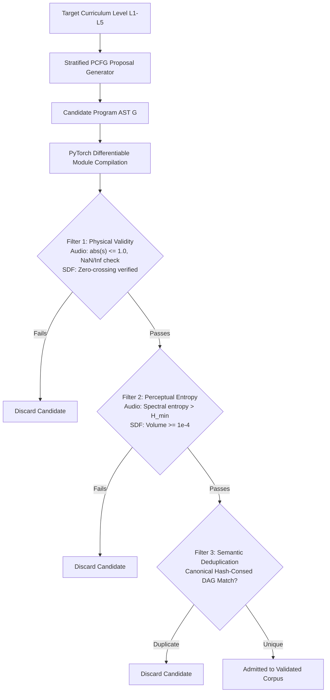

# Procedural PCFG: 5-Level Complexity Stratification & Triple Quality Filtering

## 1. Overview and Mitigating the "Synthetic Prior Trap"

In neurosymbolic program synthesis guided by Probabilistic Context-Free Grammars (PCFGs), training models directly on raw, unfiltered stochastic derivations introduces the **Synthetic Prior Trap (Self-Mimicry Trap)**. When derivations are generated without feasibility constraints, a significant portion of the sampled space collapses into physically invalid programs (such as digital audio clipping, empty geometric shapes, or non-invertible fields), perceptual trivialities (absolute silence, flat DC offsets, vanishing microscopic volumes), and semantic redundancies.

To guarantee that the synthetic training corpus is acoustically and geometrically informative, **SymForge** implements two foundational mechanisms:
1. **5-Level Complexity Stratification ($L_1$ to $L_5$):** Strict ordering of expressive power by Abstract Syntax Tree (AST) depth, enabling incremental curriculum learning.
2. **Triple Quality Filtering Protocol:** A sequential validation pipeline composed of:
   - *Filter 1: Physical Validity*
   - *Filter 2: Perceptual Entropy (Non-Triviality)*
   - *Filter 3: Semantic DAG Deduplication (Hash-Consing)*

---

## 2. Generation & Filtering Pipeline Architecture

The diagram below illustrates the stochastic proposal, differentiable compilation, triple validation, and admission cycle into the training corpus:

```text
+---------------------------------------------------------------------------------------------------+
|                   CURRICULUM STRATIFICATION & TRIPLE QUALITY FILTERING PIPELINE                   |
|                                                                                                   |
|  [Target Level: L1, L2, L3, L4, or L5]                                                            |
|                 |                                                                                 |
|                 v                                                                                 |
|  [Stratified Stochastic PCFG Generator]                                                           |
|                 |                                                                                 |
|                 v                                                                                 |
|  [Candidate AST G with Exact Depth d(G)]                                                          |
|                 |                                                                                 |
|                 +----------------------------+                                                    |
|                 | PyTorch DifferentiableModule Compilation                                        |
|                 v                                                                                 |
|  +-------------------------------------------------------------+                                  |
|  | FILTER 1: Physical Validity                                 |                                  |
|  | - Audio: clipping |s(t)| <= 1.0, NaN/Inf, silence >= 0.02   | ---> Fails: Discard Candidate    |
|  | - SDF: zero-crossing d(p1)<0 and d(p2)>0, finite values    |                                  |
|  +------------------------------+------------------------------+                                  |
|                                 | Passes                                                          |
|                                 v                                                                 |
|  +-------------------------------------------------------------+                                  |
|  | FILTER 2: Perceptual Entropy (Non-Triviality)               |                                  |
|  | - Audio: Variance > 1e-5, Shannon spectral entropy H        | ---> Fails: Discard Candidate    |
|  | - SDF: Volume V >= 1e-4, Bound contained within [-3, 3]^3   |                                  |
|  +------------------------------+------------------------------+                                  |
|                                 | Passes                                                          |
|                                 v                                                                 |
|  +-------------------------------------------------------------+                                  |
|  | FILTER 3: Semantic Canonical DAG Deduplication              |                                  |
|  | - Hash-Consing identifies identical structural subgraphs    | ---> Duplicate: Discard Candidate|
|  +------------------------------+------------------------------+                                  |
|                                 | Unique                                                          |
|                                 v                                                                 |
|  [Admitted to Validated Training Corpus: (G*, Theta*)]                                            |
+---------------------------------------------------------------------------------------------------+
```



---

## 3. The Five Discrete Complexity Levels

Complexity is formally partitioned across 5 discrete strata:

| Level | AST Depth | Audio Domain (1D DSP) | SDF Domain (3D CSG) | Parameter Count |
| :--- | :---: | :--- | :--- | :---: |
| **$L_1$** | $1$ | Isolated Oscillators (`Sine`, `Saw`, `Square`, `Noise`) | Primitive Shapes (`Sphere`, `Box`, `Cylinder`, `Torus`, `Plane`) | 1 - 2 |
| **$L_2$** | $2$ | Single Modifier (`LowPass(Osc)`, `Gain(Osc)`, `ExpDecay(Osc)`) | Spatial Transforms (`Translate(S)`, `Rotate(S)`, `Scale(S)`) | 2 - 4 |
| **$L_3$** | $3$ | Binary Combinators (`Mix(Osc, Osc)`, `FM(Osc, Osc)`) | CSG Booleans (`Union(S, S)`, `Difference(S, S)`, `Intersection(S, S)`) | 3 - 6 |
| **$L_4$** | $4$ | Nested Modulation / Filters (`LowPass(Mix, Env)`, `FM(Osc, LFO)`) | Smooth Blends (`SmoothUnion(Translate(S), S, k)`) | 5 - 8 |
| **$L_5$** | $\ge 5$ | Multi-stage Synthesis Network | Complex CAD Assemblies with Multiple Insets & Chamfers | 7+ |

---

## 4. The Triple Quality Filtering Protocol

### 4.1 Filter 1: Physical Validity
- **Audio Check:**
  - Forward evaluation over time vector $t \in [0, 2.0]$ at 16 kHz.
  - Rejects if $\max |s(t)| > 1.0$ (digital clipping prevention).
  - Rejects if $\max |s(t)| < 0.02$ (inaudible baseline).
  - Rejects if any NaN or Inf occurs.
- **SDF Check:**
  - Evaluates distance field on probe grid $\mathbf{p} \in [-3, 3]^3$.
  - Requires zero-crossing: $\min d(\mathbf{p}) < 0$ and $\max d(\mathbf{p}) > 0$.
  - Rejects unbounded non-Lipschitz distance fields or NaN/Inf values.

### 4.2 Filter 2: Perceptual Entropy (Non-Triviality)
- **Audio Check:**
  - Computes FFT magnitude spectrum and Shannon spectral entropy:
    $$H_{\text{spec}} = -\sum_{k} p_k \log_2(p_k + \varepsilon) \quad \text{where} \quad p_k = \frac{|X[k]|^2}{\sum_j |X[j]|^2}$$
  - Rejects signals with $H_{\text{spec}} < 0.1$ (flat DC lines or single unmodulated carrier spikes).
- **SDF Check:**
  - Computes approximate voxel volume $V \approx \int_{\mathbf{p}} \mathbb{I}[d(\mathbf{p}) \le 0] \, d\mathbf{p}$.
  - Requires $V \ge 10^{-4}$ and requires that the bounding radius $R_{\text{bound}} \le 3.0$.

### 4.3 Filter 3: Semantic DAG Deduplication (Hash-Consing)
- Converts candidate AST into canonical Directed Acyclic Graph via `ast_to_dag` (`src/symforge/core/dag.py`).
- Identifies structural and commutative equivalences (e.g., `Union(A, B) == Union(B, A)`).
- Rejects candidate if its canonical DAG hash was already admitted in the current generation batch.

---

## 5. Usage Example

```python
from symforge.core.curriculum import CurriculumSampler, CurriculumLevel

# Initialize sampler with triple filtering enabled
sampler = CurriculumSampler(seed=42)

# 1. Sample a single validated program at a specific level
audio_ast = sampler.sample_program(domain="audio", level=CurriculumLevel.L2)

# 2. Generate a batch of 100 unique, validated derivations
sdf_batch = sampler.sample_batch(domain="sdf", level=CurriculumLevel.L3, batch_size=100)

# 3. Generate a complete curriculum dataset spanning all levels (L1 to L5)
full_curriculum = sampler.generate_curriculum_dataset(
    domain="audio",
    samples_per_level=50,
)
```
