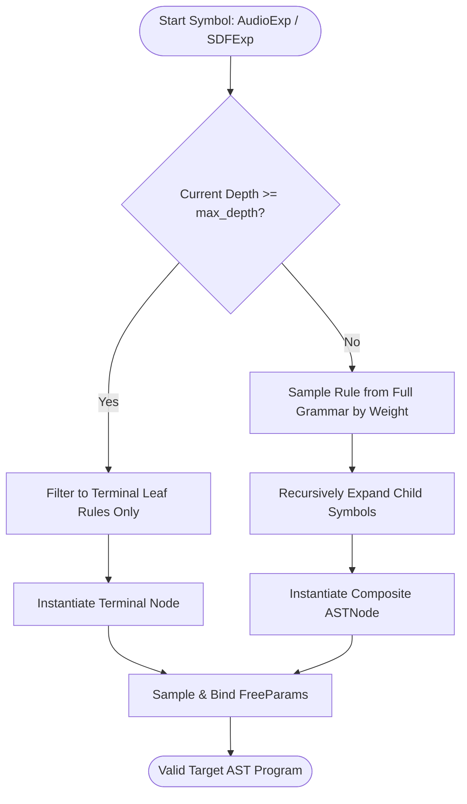

# Probabilistic Context-Free Grammar (PCFG) Synthetic Task Generator

## 1. Architectural Mission

The **PCFG Synthetic Task Generator** (`symforge.core.pcfg.PCFGTaskGenerator`) drives curriculum learning and neurosymbolic training by procedurally sampling target tasks of controlled structural depth, diversity, and complexity without external dataset bottlenecks.

Key functional capabilities:
1. **Weighted Stochastic Production Rules:** Probabilistic dispatch over non-terminal and terminal production rules across audio and 3D geometric domains.
2. **Strict Depth Bounding & Loop Safety:** Dynamic pruning forcing terminal rule selection when `current_depth >= max_depth`, mathematically precluding non-terminating expansions.
3. **Seeded Determinism:** Reproducible sampling guaranteeing benchmark stability across training epochs.

---

## 2. Derivation Flow & Grammar Topology

```text
+---------------------------------------------------------------+
|             PCFGTaskGenerator(domain, seed)                   |
+---------------------------------------------------------------+
                                |
                   sample(max_depth = D)
                                |
                                v
               +--------------------------------+
               | Current Depth < max_depth?     |
               +----------------+---------------+
                                |
                +---------------+---------------+
                | YES                           | NO
                v                               v
    +------------------------+      +------------------------+
    | Select Non-Terminal or |      | Force Terminal Rule    |
    | Terminal Rule (by w)   |      | (Leaf Primitives Only) |
    +-----------+------------+      +-----------+------------+
                |                               |
                +---------------+---------------+
                                |
                                v
               +--------------------------------+
               | Recursively Expand Subtrees    |
               +----------------+---------------+
                                |
                                v
               +--------------------------------+
               | Instantiate Typed ASTNode &    |
               | Bind Sampled FreeParam Values  |
               +--------------------------------+
```



---

## 3. Production Rules & Domain Coverage

### 3.1 Audio Domain
- **Compound Rules ($w$):**
  - `LowPass` ($w = 0.3$): Single-pole filter modulation.
  - `Gain` ($w = 0.2$): Amplitude scaling.
  - `Mix` ($w = 0.2$): 2-operator linear interpolation.
- **Terminal Rules ($w$):**
  - `Sine` ($w = 0.25$), `Saw` ($w = 0.25$), `Square` ($w = 0.15$), `FM` ($w = 0.15$).

### 3.2 SDF 3D Geometric Domain
- **Compound CSG Rules ($w$):**
  - `Union` ($w = 0.3$): Polynomial smooth blend.
  - `Intersection` ($w = 0.15$): Spatial clipping.
  - `Difference` ($w = 0.15$): Subtractive volume carving.
  - `Translate` ($w = 0.2$): Spatial affine offset.
- **Terminal Rules ($w$):**
  - `Sphere` ($w = 0.35$), `Box` ($w = 0.3$), `Cylinder` ($w = 0.2$), `Torus` ($w = 0.15$).
