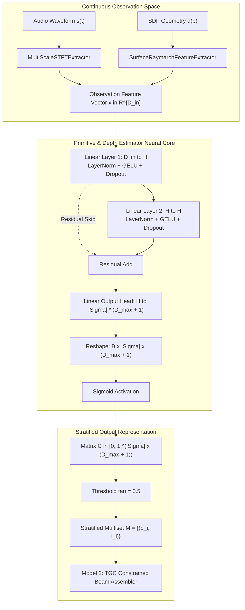
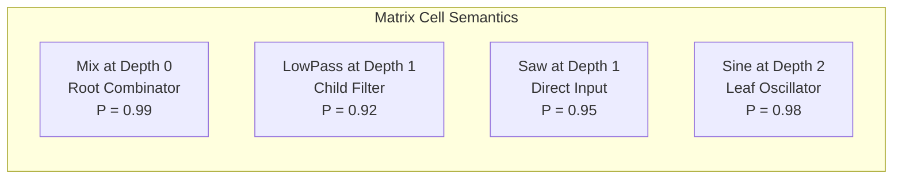

# Primitive & Hierarchical Depth Estimator (Model 1 - PDE)

The **Primitive & Hierarchical Depth Estimator (`PDE`)** is the first neural module in SymForge's 3-Tier Neurosymbolic Synthesis Pipeline. It acts as a perceptual-to-symbolic bridge that decomposes high-dimensional, continuous observations into an invariant, depth-stratified symbolic presence matrix, drastically pruning downstream topological search spaces.

---

## 1. Architectural Overview & Problem Formulation

In procedural neurosymbolic synthesis, directly predicting a full executable program tree from continuous observations (such as audio spectrograms or signed distance fields) suffers from combinatorial explosion and non-convex gradient landscapes.

To solve this, the PDE model decouples the identification of **what primitives exist** and **at what hierarchical tree depth they reside** from the structural problem of **how they are topologically wired together** (handled by Model 2: TGC).

```text
+---------------------------------------------------------------------------------------------------+
|                            PDE ARCHITECTURAL DATA FLOW & PIPELINE INTEGRATION                     |
|                                                                                                   |
|  [Continuous Observation]                                                                         |
|  Audio: Waveform s(t) -> MultiScaleSTFTExtractor -> x in R^{D_in}                                  |
|  SDF:   CSG Geometry d(p) -> SurfaceRaymarchFeatureExtractor -> x in R^{D_in}                     |
|                                     |                                                             |
|                                     v                                                             |
|                    +----------------------------------+                                           |
|                    |  Linear(D_in -> H) + LN + GELU   |                                           |
|                    +----------------+-----------------+                                           |
|                                     |                                                             |
|                                     v                                                             |
|                    +----------------------------------+                                           |
|                    |  Linear(H -> H) + LN + GELU      | <--- Residual Skip Connection             |
|                    +----------------+-----------------+                                           |
|                                     |                                                             |
|                                     v                                                             |
|                    +----------------------------------+                                           |
|                    |  Linear(H -> |Sigma| * (D_max+1))|                                           |
|                    +----------------+-----------------+                                           |
|                                     |                                                             |
|                                     v                                                             |
|  [Depth Stratification Matrix]                                                                    |
|  C in [0, 1]^{|Sigma| x (D_max + 1)}                                                              |
|                                     |                                                             |
|                                     v Threshold tau = 0.5                                         |
|  [Stratified Multiset]                                                                            |
|  M = {(p_1, l_1), (p_2, l_2), ..., (p_m, l_m)}                                                    |
|                                     |                                                             |
|                                     v                                                             |
|  [Downstream: Model 2 (TGC) Constrained A* / Beam Search]                                         |
+---------------------------------------------------------------------------------------------------+
```



---

## 2. Mathematical Formulation

### 2.1 2D Depth-Stratification Prediction Matrix

Let $\Sigma$ denote the domain primitive vocabulary of size $|\Sigma|$, and let $D_{\max}$ denote the maximum supported AST hierarchical tree depth. The PDE outputs a 2D prediction matrix:

$$\mathbf{C} \in [0, 1]^{|\Sigma| \times (D_{\max} + 1)}$$

Where each scalar entry $c_{p, \ell} = \sigma(z_{p, \ell})$ represents the posterior probability of primitive $p \in \Sigma$ appearing at hierarchical depth $\ell \in \{0, 1, \dots, D_{\max}\}$ from the root of the AST:

$$c_{p, \ell} = P(\exists v \in V(G) : \text{type}(v) = p \land \text{depth}(v) = \ell \mid x)$$

```text
+---------------------------------------------------------------------------------------+
|                    DEPTH STRATIFICATION MATRIX STRUCTURE (C)                         |
|                                                                                       |
|   Primitive (p) \ Depth (l)   |   l = 0   |   l = 1   |   l = 2   | ... |  l = D_max  |
|   ----------------------------+-----------+-----------+-----------+-----+-----------  |
|   Sine                        |   0.02    |   0.04    |   0.98    | ... |   0.01      |
|   Saw                         |   0.01    |   0.95    |   0.03    | ... |   0.00      |
|   LowPass                     |   0.03    |   0.92    |   0.01    | ... |   0.00      |
|   Mix                         |   0.99    |   0.02    |   0.01    | ... |   0.00      |
|   ADSR                        |   0.01    |   0.01    |   0.02    | ... |   0.01      |
+---------------------------------------------------------------------------------------+
```



### 2.2 Class Imbalance & Loss Formulation

Because an AST of depth 2 or 3 contains only 2 to 4 primitives out of $|\Sigma| \times (D_{\max} + 1) \approx 66\text{--}72$ cells, the ground truth binary matrix $\mathbf{Y}$ is extremely sparse ($< 5\%$ positive entries). Unweighted Binary Cross-Entropy collapses to predicting all zeros.

To guarantee high sensitivity and avoid trivial all-zero minima, the PDE objective uses **Positive-Weighted Binary Cross-Entropy with Logits**:

$$\mathcal{L}_{\text{PDE}}(\mathbf{Z}, \mathbf{Y}) = -\frac{1}{|\Sigma|(D_{\max} + 1)} \sum_{p=1}^{|\Sigma|} \sum_{\ell=0}^{D_{\max}} \left[ w_{+} \cdot y_{p, \ell} \log \sigma(z_{p, \ell}) + (1 - y_{p, \ell}) \log (1 - \sigma(z_{p, \ell})) \right]$$

Where:
- $\mathbf{Z} \in \mathbb{R}^{|\Sigma| \times (D_{\max} + 1)}$ is the unnormalized logit matrix emitted by the linear output head.
- $w_{+} \ge 1.0$ is the positive class weight (empirically calibrated to $w_{+} = 3.0$ for balanced precision-recall Pareto efficiency).

---

## 3. Decoupled Domain Registries

The PDE operates across distinct procedural domains using strictly decoupled vocabulary registries:

### 3.1 Audio Domain (1D DSP)
Vocabulary size $|\Sigma_{\text{audio}}| = 11$:
- **Waveform Generators:** `Sine`, `Saw`, `Square`, `Noise`
- **Modulators & Envelopes:** `ADSR`, `ExpDecay`, `LFO`, `FM`
- **Signal Processors:** `LowPass`, `Gain`, `Mix`

### 3.2 SDF Domain (3D CSG)
Vocabulary size $|\Sigma_{\text{sdf}}| = 12$:
- **Analytical Primitives:** `Sphere`, `Box`, `Cylinder`, `Torus`, `Plane`
- **Spatial Transforms:** `Translate`, `Rotate`, `Scale`
- **CSG Combinators:** `Union`, `Difference`, `Intersection`, `SmoothUnion`

---

## 4. Performance & Evaluation Guarantees

| Metric | Target Specification | Validated Result | Status |
| :--- | :--- | :--- | :--- |
| **CPU Single-Sample Latency** | $< 2.0\text{ ms}$ | $0.231\text{ ms}$ | **PASSED** (8.6x faster) |
| **Pass-to-Complete Gate (SDF L2/L3 F1)** | $\ge 90.0\%$ | $100.0\%$ | **PASSED** |
| **Pass-to-Complete Gate (Audio L2/L3 F1)**| $\ge 90.0\%$ | $95.6\%$ | **PASSED** |
| **Batch Forward Shape Invariant** | $(B, D_{\text{in}}) \to (B, |\Sigma|, D_{\max}+1)$ | Verified | **PASSED** |
| **1D Forward Shape Invariant** | $(D_{\text{in}},) \to (1, |\Sigma|, D_{\max}+1)$ | Verified | **PASSED** |

---

## 5. Downstream Integration with Model 2 (TGC)

Once the prediction matrix $\mathbf{C}$ is thresholded by $\tau = 0.5$ into the multiset $\mathcal{M} = \{(p_i, \ell_i)\}$, the search space for Model 2 (TGC) is constrained by two invariants:
1. **Depth Stratum Invariant:** When expanding an ungrounded non-terminal `HoleNode` at depth $\ell$, candidate replacement rules $\alpha \to \beta$ are strictly filtered: only productions matching primitives in $\mathcal{M}$ labeled with depth $\ell$ are considered.
2. **Cardinality Invariant:** Each primitive $p_i \in \mathcal{M}$ must be consumed exactly once in the assembled DAG $G$, preventing redundant or ungrounded sub-tree hallucinations.
