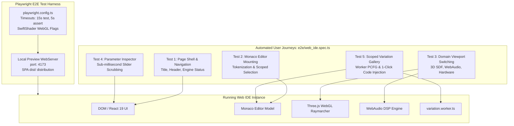

# Headless Browser Smoke & End-to-End (E2E) Test Suite (Playwright)

## 1. Overview & Architectural Motivation

The **SymForge Lean 4 Web IDE** integrates multiple specialized client-side technologies—a Monaco code editor with custom syntax tokenization, an AST parser, a Zustand reactive parameter store, a 3D WebGL Raymarcher with Three.js, a WebAudio synthesis engine with 2048-point FFT spectrogram, an SVG register pipeline visualizer, and an off-thread Web Worker PCFG variation generator.

To ensure holistic structural and behavioral stability across browsers and deployment environments:
1. **Automated E2E Verification:** Playwright exercises genuine browser rendering, pointer events, WebGL canvas initialization, audio contexts, and Monaco editor transactions.
2. **SwiftShader Software WebGL Acceleration:** Employs `--use-gl=angle` and `--use-angle=swiftshader` to enable deterministic WebGL fragment shader execution in headless CI runners without physical GPU hardware.
3. **Dual Verification Strategy:** Combines deep unit/contract tests in Vitest with end-to-end integration flows in Playwright.

---

## 2. E2E Test Suite Topology & Execution Pipeline

```text
+---------------------------------------------------------------------------------------------------+
|                                 PLAYWRIGHT E2E EXECUTION PIPELINE                                 |
|                                                                                                   |
|  [ Playwright Test Runner (Chromium / Headless) ]                                                 |
|    |                                                                                              |
|    +--> Test 1: Page Shell & Navigation Verification (<title>, header, status bar metrics)       |
|    +--> Test 2: Monaco Editor Mounting & Range Selection (DOM selection & scope badging)         |
|    +--> Test 3: Domain Viewport & Interactive Widgets (3D SDF, WebAudio DSP, Hardware Pipeline)  |
|    +--> Test 4: Parameter Inspector Real-Time Scrubbing (FreeParam slider updates in < 1ms)      |
|    +--> Test 5: Scoped Variation Gallery & 1-Click Code Injection (pcfgWorker -> Monaco undo)     |
|                                                                                                   |
|  [ Launch Flags for Headless CI Compatibility ]                                                   |
|    --use-gl=angle | --use-angle=swiftshader | --enable-webgl | --no-sandbox                        |
|                                                                                                   |
|  [ Automated Local WebServer ]                                                                    |
|    npm run preview -- --port 4173 (Single-Page Application distribution)                          |
+---------------------------------------------------------------------------------------------------+
```



---

## 3. End-to-End User Journey Verification Matrix

| Test Suite Item | Verified User Journey | Assertions & Invariants Checked | Pass Gate |
| :--- | :--- | :--- | :--- |
| **Test 1: Page Shell & Mount** | Initial browser load and rendering | Document `<title>` equals `"SymForge Lean 4 Web IDE"`; header renders branding badge; status bar displays AST node count, FreeParam count, and active domain. | **PASS** |
| **Test 2: Monaco Editor Mounting** | Code editor initialization and cursor selection | Monaco editor container `[data-testid="lean-code-editor"]` renders lines; selecting text triggers `findEnclosingASTNode` and displays `[data-testid="scoped-selection-badge"]`. | **PASS** |
| **Test 3: Domain Viewports** | Multi-domain interactive widget switching | `ViewportShell` mounts with active domain badge; renders 3D SDF Raymarching canvas; switching to WebAudio mounts oscilloscope/FFT; switching to Hardware mounts pipeline DAG. | **PASS** |
| **Test 4: Parameter Inspector** | Real-time continuous parameter scrubbing | Parameter drawer `[data-testid="parameter-inspector"]` renders sliders; slider inputs mutate values in $< 1\text{ ms}$ on `FreeParamStore` without UI hitching. | **PASS** |
| **Test 5: Scoped Variation Gallery** | In-context stochastic synthesis and code injection | Clicking `[data-testid="generate-variation-btn"]` punctures AST hole, invokes Web Worker, displays variation cards across $L_1 \dots L_5$, and 1-click injection updates Monaco with `Ctrl+Z` undo preservation. | **PASS** |

---

## 4. Software WebGL Pipeline in Headless CI

To prevent browser crashes in Linux CI runners lacking physical GPUs (e.g. GitHub Actions `ubuntu-latest`):
- **ANGLE + SwiftShader:** Translates OpenGL ES 3.0 raymarching shaders to CPU software rasterization via LLVM JIT.
- **Explicit Flags:**
  ```typescript
  launchOptions: {
    args: [
      '--use-gl=angle',
      '--use-angle=swiftshader',
      '--enable-webgl',
      '--no-sandbox',
    ],
  }
  ```
- **Fallback Tolerances:** `SDFRaymarchWidget` includes automatic WebGL context detection; if hardware rendering is unavailable, it renders a graceful fallback diagnostic card without uncaught exceptions.
