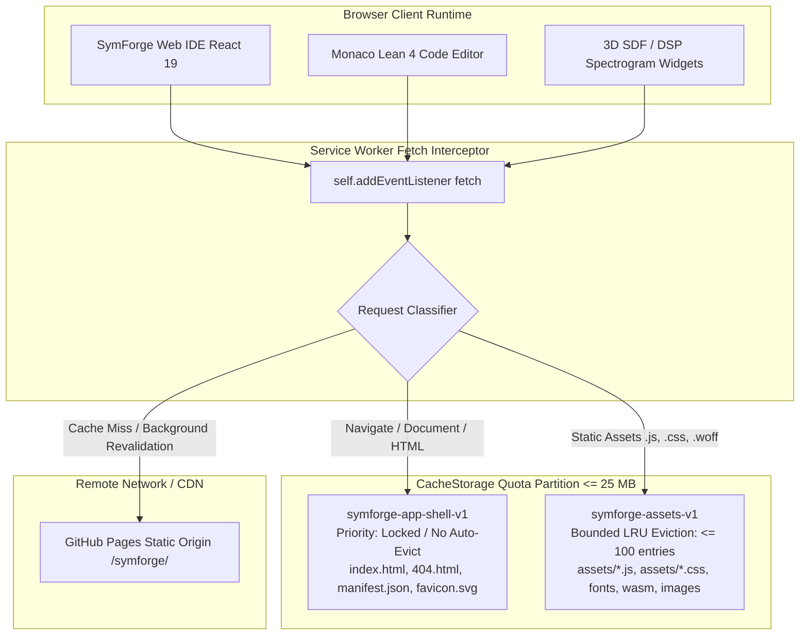
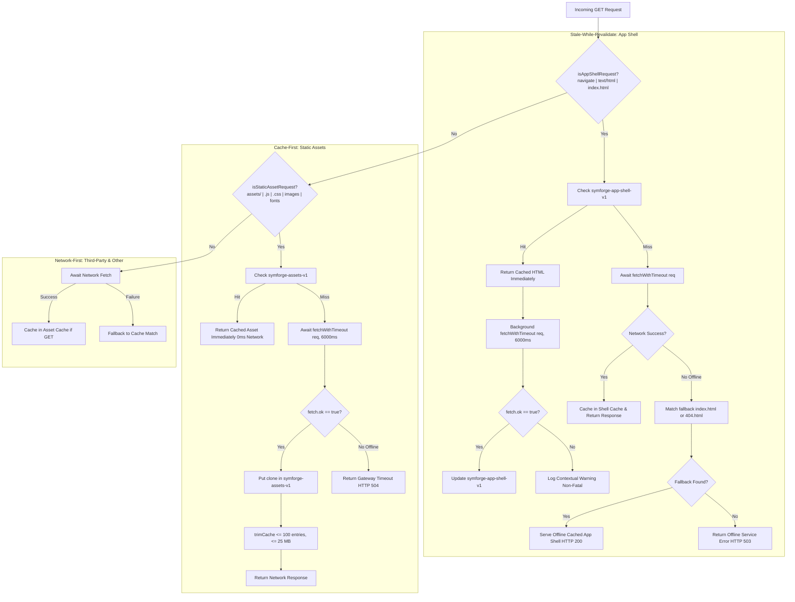
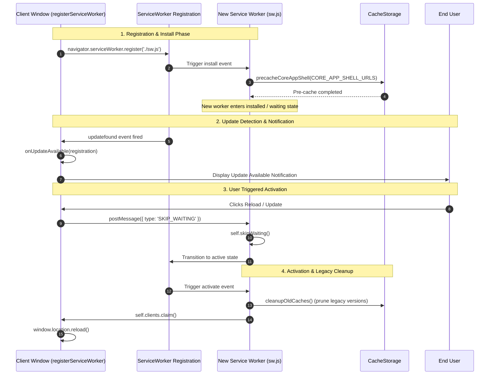

# Progressive Web App (PWA) Offline Caching & Service Worker Architecture

## 1. Overview & Architectural Motivation

The **SymForge Lean 4 Web IDE** is engineered to operate as a completely autonomous, serverless, and offline-capable single-page application. For researchers, computer musicians, and hardware engineers synthesizing programs in field environments without active internet connectivity, the application must guarantee:
1. **Zero-Latency Application Launch:** Pre-cached application shell assets are served instantly from CacheStorage with zero network dependency.
2. **Dual-Strategy Request Routing:**
   - **App Shell (HTML/Documents):** *Stale-While-Revalidate with Offline Fallback* ensuring instantaneous rendering while background updates fetch asynchronously.
   - **Static Assets (JS/CSS/Fonts):** *Cache-First with Network Fallback* guaranteeing deterministic execution of heavy compiled chunks (Monaco Editor, Three.js, Web Worker).
3. **Storage Quota Bounding & LRU Eviction:** Strict memory budget limits ($\le 25\text{ MB}$, $\le 100$ asset entries) prevent browser `QuotaExceededError` exceptions.
4. **Subpath & GitHub Pages Portability:** Dynamic base path resolution supporting both relative paths (`./`) and subpath hosting (`/symforge/`).

---

## 2. Service Worker Routing Topology & Cache Partitioning

```text
+---------------------------------------------------------------------------------------------------+
|                                  BROWSER CLIENT RUNTIME                                           |
|  +---------------------------+  +---------------------------+  +-------------------------------+  |
|  | SymForge App UI (React 19)|  | Monaco Lean 4 Code Editor |  | Domain Widgets (3D SDF / DSP) |  |
|  +-------------+-------------+  +-------------+-------------+  +---------------+---------------+  |
+----------------|------------------------------|--------------------------------|------------------+
                 | HTTP Requests                | Script / Worker Loads          | Shader / Assets
                 v                              v                                v
+---------------------------------------------------------------------------------------------------+
|                            SERVICE WORKER FETCH INTERCEPTOR (sw.js)                               |
|                     +-----------------------------------------------+                             |
|                     | Request Classifier (isAppShell vs isAsset)   |                             |
|                     +-----------------------+-----------------------+                             |
+---------------------------------------------|-----------------------------------------------------+
                          |                   |                   |
       App Shell (HTML)   |                   | Static Assets     | External / Non-GET
                          v                   v                   v
+-----------------------------------+  +--------------------+  +------------------------------------+
| CACHE: symforge-app-shell-v1      |  | CACHE: assets-v1   |  | REMOTE ORIGIN / GITHUB PAGES       |
| - Priority: Locked (No evict)     |  | - Bounded LRU:     |  | (https://username.github.io/       |
| - index.html, 404.html            |  |   Max 100 entries  |  |  symforge/)                        |
| - manifest.json, favicon.svg      |  |   Max 25 MB quota  |  |                                    |
| - Stale-While-Revalidate Strategy |  | - Cache-First      |  | - Network-First Fallback           |
+-----------------------------------+  +--------------------+  +------------------------------------+
```



---

## 3. Dual-Strategy Request Routing Pipeline

```text
                                [ Incoming HTTP Request ]
                                            |
                                            v
                             < Is App Shell / Navigation? >
                                   /                \
                           (Yes)  /                  \  (No)
                                 v                    v
              +-----------------------------+   < Is Static Asset? >
              | Stale-While-Revalidate      |        /          \
              | (symforge-app-shell-v1)     | (Yes) /            \ (No)
              +-----------------------------+      v              v
                 /                       \      [ Cache-First ]  [ Network-First ]
           (Cache Hit)              (Cache Miss)       |                 |
                |                        |        (Match cache)    (Fetch network)
         [ Return cached ]       [ Await network ]     |                 |
         [ HTML instantly]               |        (Miss: Fetch     (Fall back to
                |                  (Fail: Serve    & trim cache)    cache if down)
         [ Revalidate in ]         offline index)
         [ background    ]
```



---

## 4. Service Worker Lifecycle & PWA Update Gating Loop



---

## 5. Quota Bounding & LRU Eviction Policy

To prevent browser quota exhaustion (`QuotaExceededError`) on mobile or storage-constrained devices, `sw.js` implements a non-blocking FIFO/LRU cache eviction mechanism:

1. **Namespace Isolation:** The core application shell (`symforge-app-shell-v1`) is strictly protected against eviction. Only dynamic runtime entries in `symforge-assets-v1` are eligible for eviction.
2. **Entry Cap Enforcement:** When the number of cached assets exceeds $N_{\text{max}} = 100$, the oldest entries are evicted via `cache.delete(keys[i])`.
3. **Loop Capping Guardrail:** Enforces an explicit limit ($\min(\text{excess}, 30)$) on every eviction cycle, preventing thread stalls in adherence to Code Guard standards.
