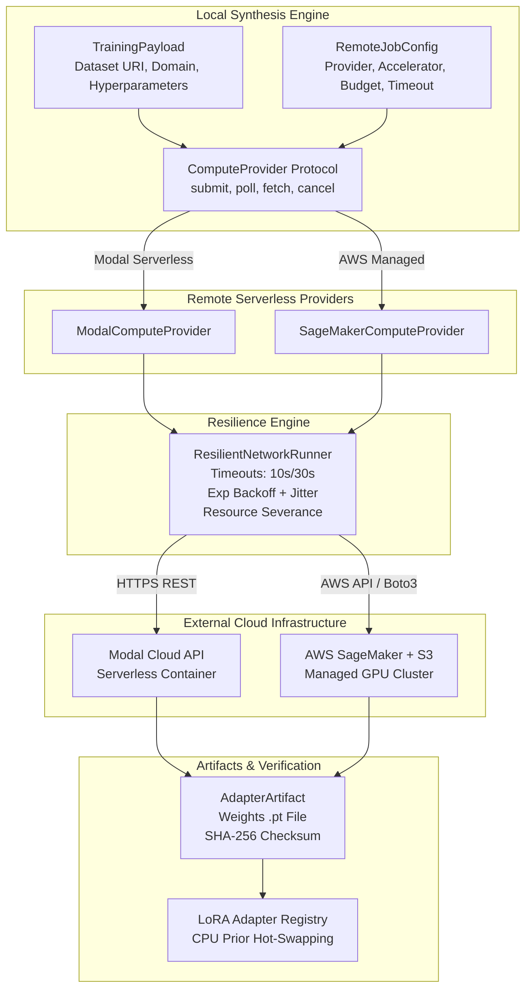
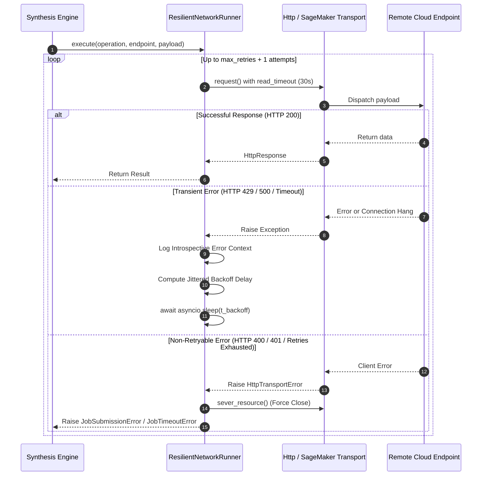
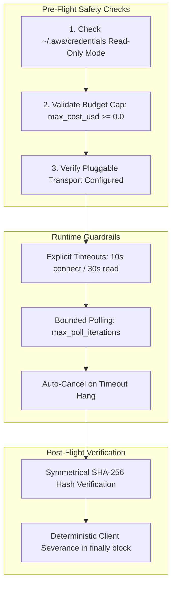

# Remote Serverless GPU Providers (Modal & SageMaker) with Async Resilient Loops

## 1. Visão Geral e Motivação Arquitetural

No framework **SymForge**, a síntese de programas opera localmente em CPUs de desenvolvimento por meio de busca heurística simbólica (Beam Search, A*), avaliação analítica de DAGs e inferência prévia com modelos leves. No entanto, o treinamento de redes neurais profundas (PDE, TGC e fine-tuning de adaptadores LoRA) demanda aceleradores de hardware de alta capacidade (GPUs A10G, A100).

Para viabilizar **zero pegada de treinamento local** (*Zero Local Training Footprint*) em escala produtiva, o módulo `symforge.compute` estende a interface assíncrona `ComputeProvider` com dois provedores de computação remota:
1. **`ModalComputeProvider`:** Integração com infraestrutura de containers *serverless* da plataforma Modal, despachando tarefas de treinamento efêmeras com tempo de subida em segundos e tarifação granular por segundo de GPU.
2. **`SageMakerComputeProvider`:** Integração com o ecossistema corporativo AWS SageMaker e Amazon S3 para orquestração de instâncias de treino gerenciadas (`ml.g5.xlarge`, `ml.p4d.24xlarge`), com controle estrito de políticas IAM e salvaguardas de credenciais.

Ambos os provedores operam sob o motor unificado **`ResilientNetworkRunner`**, que encapsula todas as interações de rede em malhas assíncronas com **timeouts explícitos**, **backoff exponencial com jitter aleatório**, **teto rígido de iterações** e **decepação determinística de conexões** (*resource severance*).

---

## 2. Arquitetura de Despacho Remoto (Remote Dispatch Architecture)

```text
+---------------------------------------------------------------------------------------------------+
|                            SYMFORGE REMOTE DISPATCH ARCHITECTURE                                  |
|                                                                                                   |
|  +-------------------------------------------------------------+                                  |
|  |                   Local Synthesis Engine                    |                                  |
|  |                                                             |                                  |
|  |  +-------------------+               +-------------------+  |                                  |
|  |  |  TrainingPayload  |               |  RemoteJobConfig  |  |                                  |
|  |  | (Data/Hyperparams)|               | (Timeout/Budget)  |  |                                  |
|  |  +---------+---------+               +---------+---------+  |                                  |
|  |            |                                   |            |                                  |
|  |            +-----------------+-----------------+            |                                  |
|  |                              v                              |                                  |
|  |             +----------------------------------+            |                                  |
|  |             |      ComputeProvider Protocol    |            |                                  |
|  |             |  (submit, poll, fetch, cancel)   |            |                                  |
|  |             +----------------+-----------------+            |                                  |
|  +------------------------------|------------------------------+                                  |
|                                 |                                                                 |
|         +-----------------------+-----------------------+                                         |
|         |                                               |                                         |
|         v                                               v                                         |
|  +------------------------------+               +-------------------------------+                 |
|  |     ModalComputeProvider     |               |   SageMakerComputeProvider    |                 |
|  |  (Serverless Container API)  |               |  (AWS SageMaker + Amazon S3)  |                 |
|  +--------------+---------------+               +---------------+---------------+                 |
|                 |                                               |                                 |
|                 +-----------------------+-----------------------+                                 |
|                                         |                                                         |
|                                         v                                                         |
|                     +---------------------------------------+                                     |
|                     |        ResilientNetworkRunner         |                                     |
|                     |  - Connect Timeout (10s)              |                                     |
|                     |  - Read Timeout (30s)                 |                                     |
|                     |  - Exponential Backoff + Jitter       |                                     |
|                     |  - Hard Iteration Caps (max_retries)  |                                     |
|                     |  - Deterministic Resource Severance   |                                     |
|                     +-------------------+-------------------+                                     |
|                                         |                                                         |
|                 +-----------------------+-----------------------+                                 |
|                 |                                               |                                 |
|                 v HTTPS REST API                                v AWS SigV4 / Boto3               |
|      +----------------------+                       +-----------------------+                     |
|      | Modal Container Farm |                       | AWS SageMaker Cluster |                     |
|      | (A10G / T4 GPU Pool) |                       | (ml.g5 / S3 Output)   |                     |
|      +----------+-----------+                       +-----------+-----------+                     |
|                 |                                               |                                 |
|                 +-----------------------+-----------------------+                                 |
|                                         |                                                         |
|                                         v Asynchronous Artifacts                                  |
|                             +-----------------------+                                             |
|                             |    AdapterArtifact    |                                             |
|                             |  - SHA-256 Checksum   |                                             |
|                             |  - LoRA Weights (.pt) |                                             |
|                             +-----------+-----------+                                             |
|                                         v                                                         |
|                             +-----------------------+                                             |
|                             | LoRA Adapter Registry |                                             |
|                             | (Local CPU Inference) |                                             |
|                             +-----------------------+                                             |
+---------------------------------------------------------------------------------------------------+
```



---

## 3. Mecanismo da Malha de Resiliência (Resilience Loop Mechanics)

Toda chamada de rede assíncrona executada pelos provedores remotos passa pelo método `execute` do `ResilientNetworkRunner`. A execução obedece à máquina de estados de tolerância a falhas:

```text
+---------------------------------------------------------------------------------------------------+
|                                 RESILIENT LOOP EXECUTION FLOW                                     |
|                                                                                                   |
|                           +-------------------------------+                                       |
|                           | Start Operation (Attempt = 1) |                                       |
|                           +---------------+---------------+                                       |
|                                           |                                                       |
|                                           v                                                       |
|                     +-------------------------------------------+                                 |
|                     | Execute with asyncio.wait_for(timeout=30s)|                                 |
|                     +---------------------+---------------------+                                 |
|                                           |                                                       |
|                     +---------------------+---------------------+                                 |
|                     |                                           |                                 |
|                     v [Success]                                 v [Exception / Timeout]           |
|           +-------------------+               +-----------------------------------+               |
|           | Return Result (T) |               | Introspective "Post-Mortem" Log   |               |
|           +-------------------+               | (Op, Endpoint, Status, Attempt)   |               |
|                                               +-----------------+-----------------+               |
|                                                                 |                                 |
|                                       +-------------------------+-------------------------+       |
|                                       |                                                   |       |
|                                       v [Transient & Attempt <= max_retries]              v [Fail]|
|                     +-----------------------------------+               +-----------------------+ |
|                     | Compute Backoff Delay with Jitter |               | Sever Client Resource | |
|                     | t = min(t_max, t_base * 2^a) + j  |               | (aclose / close)      | |
|                     +-----------------+-----------------+               +-----------+-----------+ |
|                                       |                                             |             |
|                                       v await asyncio.sleep(delay)                  v             |
|                     +-----------------------------------+               +-----------------------+ |
|                     | Increment Attempt (a += 1)        |               | Raise Domain Error    | |
|                     | Repeat Loop                       |               | (JobSubmissionError / | |
|                     +-----------------------------------+               |  JobTimeoutError)     | |
|                                                                         +-----------------------+ |
+---------------------------------------------------------------------------------------------------+
```



### 3.1 Classificação de Erros Transitórios vs. Não-Recuperáveis
- **Erros Transitórios (Retryable):**
  - Códigos HTTP: `429` (Rate Limited / Throttled), `500` (Internal Server Error), `502` (Bad Gateway), `503` (Service Unavailable), `504` (Gateway Timeout).
  - Exceções de rede: `asyncio.TimeoutError`, `TimeoutError`, `ConnectionError`, `OSError`.
  - Exceções AWS: `ThrottlingException`, `RequestLimitExceeded`, `ProvisionedThroughputExceededException`.
- **Erros Fatais (Non-Retryable):**
  - Códigos HTTP: `400` (Bad Request / Schema Inválido), `401` (Unauthorized / Token Inválido), `403` (Forbidden / Sem Cota), `404` (Not Found), `422` (Unprocessable Entity).
  - Violações de orçamento: `max_cost_usd < 0.0`.
  - Falhas de integridade criptográfica: divergência entre SHA-256 reportado e calculado.

---

## 4. Formulação Matemática do Exponential Backoff com Jitter Uniforme

Para mitigar rajadas concorrentes e evitar o problema da debandada (*thundering herd problem*) durante picos de indisponibilidade ou *throttling* de APIs em nuvem, o atraso de espera $t_{\text{backoff}}$ entre tentativas consecutivas é regido pela fórmula matemática:

$$t_{\text{backoff}}(\text{attempt}) = \min\left(t_{\max},\; t_{\text{base}} \cdot 2^{\text{attempt}}\right) + \text{uniform}(0, \text{jitter})$$

Onde:
- $\text{attempt} \in \{0, 1, \dots, \text{max\_retries}-1\}$ representa o índice da tentativa de retentativa (base 0).
- $t_{\text{base}} = 0.5\text{ s}$ é o atraso base inicial.
- $t_{\max} = 10.0\text{ s}$ é o teto máximo de espera (*backoff cap*).
- $\text{jitter} = 0.25\text{ s}$ é a amplitude da perturbação estocástica uniformemente distribuída $\mathcal{U}(0, \text{jitter})$.

### 4.1 Tabela de Delays Teóricos

| Tentativa ($a$) | Componente Exponencial ($t_{\text{base}} \cdot 2^a$) | Teto ($\min$) | Jitter $\mathcal{U}(0, 0.25)$ | Intervalo Efetivo $t_{\text{backoff}}$ |
|:---------------:|:----------------------------------------------------:|:-------------:|:-----------------------------:|:--------------------------------------:|
| 0 (1º Retry)    | $0.5 \cdot 2^0 = 0.50\text{ s}$                      | $0.50\text{ s}$ | $[0.00, 0.25]\text{ s}$       | $[0.50, 0.75]\text{ s}$                |
| 1 (2º Retry)    | $0.5 \cdot 2^1 = 1.00\text{ s}$                      | $1.00\text{ s}$ | $[0.00, 0.25]\text{ s}$       | $[1.00, 1.25]\text{ s}$                |
| 2 (3º Retry)    | $0.5 \cdot 2^2 = 2.00\text{ s}$                      | $2.00\text{ s}$ | $[0.00, 0.25]\text{ s}$       | $[2.00, 2.25]\text{ s}$                |
| 3 (4º Retry)    | $0.5 \cdot 2^3 = 4.00\text{ s}$                      | $4.00\text{ s}$ | $[0.00, 0.25]\text{ s}$       | $[4.00, 4.25]\text{ s}$                |
| 4 (5º Retry)    | $0.5 \cdot 2^4 = 8.00\text{ s}$                      | $8.00\text{ s}$ | $[0.00, 0.25]\text{ s}$       | $[8.00, 8.25]\text{ s}$                |
| $\ge 5$         | $0.5 \cdot 2^a \ge 16.0\text{ s}$                    | $10.00\text{ s}$| $[0.00, 0.25]\text{ s}$       | $[10.00, 10.25]\text{ s}$              |

---

## 5. Limites Rígidos de Segurança e Salvaguardas Financeiras

```text
+---------------------------------------------------------------------------------------------------+
|                                   FINANCIAL & SAFETY GUARDRAILS                                   |
|                                                                                                   |
|  +---------------------------------------------------------------------------------------------+  |
|  | 1. Strict Credentials Safeguard:                                                            |  |
|  |    ~/.aws/credentials is treated as STRICT READ-ONLY. No mutation or deletion permitted.    |  |
|  +---------------------------------------------------------------------------------------------+  |
|  | 2. Pre-Flight Financial Gating:                                                             |  |
|  |    config.max_cost_usd is strictly validated prior to cloud dispatch (rejects negative).   |  |
|  +---------------------------------------------------------------------------------------------+  |
|  | 3. Hard Polling Iteration Cap:                                                              |  |
|  |    poll_until_complete caps iterations at max_poll_iterations (default 120).                |  |
|  |    Triggers auto-cancel on timeout: cancel_job(job_id) -> raises JobTimeoutError.           |  |
|  +---------------------------------------------------------------------------------------------+  |
|  | 4. Deterministic Resource Severance:                                                        |  |
|  |    All open HTTP sessions, connections, and pools are forcefully closed in finally blocks.  |  |
|  +---------------------------------------------------------------------------------------------+  |
|  | 5. Symmetrical Checksum Verification:                                                       |  |
|  |    SHA-256 of downloaded LoRA weights verified against reported checksum before loading.    |  |
|  +---------------------------------------------------------------------------------------------+  |
+---------------------------------------------------------------------------------------------------+
```



---

## 6. Mapeamento de Estados e Ciclo de Vida do Job

### 6.1 Mapeamento Modal $\to$ `JobStatus`
| Status Bruto Modal | Status Canônico SymForge (`JobStatus`) | Descrição Semântica |
|:-------------------|:--------------------------------------:|:--------------------|
| `"queued"`, `"pending"` | `JobStatus.PENDING` | Tarefa aguardando provisionamento de container. |
| `"running"`, `"in_progress"` | `JobStatus.RUNNING` | Container ativo executando épocas de treino. |
| `"completed"`, `"success"`, `"done"` | `JobStatus.COMPLETED` | Treino convergiu e artefato LoRA está pronto. |
| `"failed"`, `"error"`, `"oom"` | `JobStatus.FAILED` | Falha de execução (OOM, erro no script). |
| `"cancelled"`, `"stopped"` | `JobStatus.CANCELLED` | Cancelamento requisitado pelo cliente. |

### 6.2 Mapeamento AWS SageMaker $\to$ `JobStatus`
| Status SageMaker (`TrainingJobStatus`) | Status Canônico SymForge (`JobStatus`) | Descrição Semântica |
|:---------------------------------------|:--------------------------------------:|:--------------------|
| `"InProgress"` | `JobStatus.RUNNING` | Job em processamento no cluster gerenciado. |
| `"Completed"` | `JobStatus.COMPLETED` | Job finalizado com sucesso; artefatos no S3. |
| `"Failed"` | `JobStatus.FAILED` | Treinamento falhou no contêiner SageMaker. |
| `"Stopped"`, `"Stopping"` | `JobStatus.CANCELLED` | Job interrompido via chamada `StopTrainingJob`. |

---

## 7. Verificação de Integridade Criptográfica dos Pesos LoRA

Para prevenir que conexões truncadas ou transferências corrompidas injetem tensores inválidos no motor de inferência local:
1. O download do artefato (via HTTP Base64 da API Modal ou S3 GetObject do SageMaker) calcula o hash canônico SHA-256 de 64 caracteres hexadecimais:
   $$\text{checksum} = \text{SHA256}(\text{weights\_bytes})$$
2. Se o provedor reportar um hash prévio (`weights_checksum`), o sistema realiza uma verificação simétrica exata:
   $$\text{reported\_checksum.lower}() == \text{calculated\_checksum}$$
3. Caso haja divergência, uma exceção `ArtifactRetrievalError` é imediatamente disparada, o arquivo corrompido é removido e os recursos de rede são decepados.
