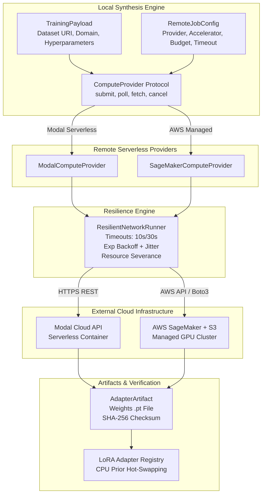
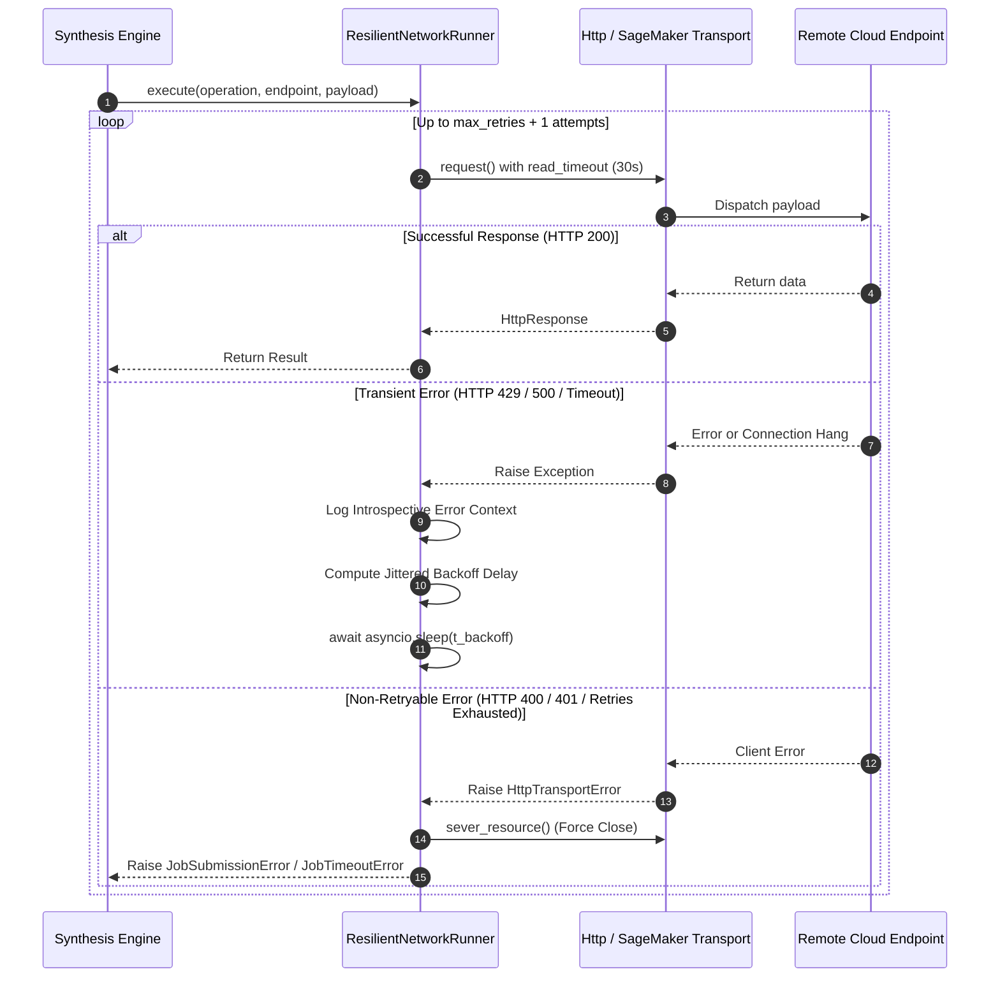
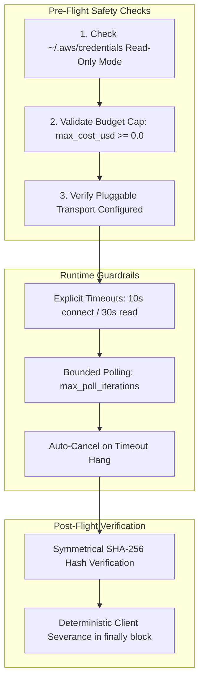

# Remote Serverless GPU Providers (Modal & SageMaker) with Async Resilient Loops

## 1. Overview & Architectural Motivation

In the **SymForge** framework, program synthesis executes locally on developer workstation CPUs via symbolic heuristic search (Beam Search, A*), analytical DAG evaluations, and lightweight prior model inference. However, deep neural training (PDE, TGC, and continuous LoRA adapter fine-tuning) demands GPU accelerators (A10G, A100).

To enable a production-scale **Zero Local Training Footprint**, the `symforge.compute` module extends the asynchronous `ComputeProvider` interface with two remote compute providers:
1. **`ModalComputeProvider`:** Integrates with Modal's serverless container infrastructure, dispatching ephemeral training jobs with rapid startup times and granular per-second GPU billing.
2. **`SageMakerComputeProvider`:** Integrates with AWS SageMaker and Amazon S3 to orchestrate enterprise managed GPU clusters (`ml.g5.xlarge`, `ml.p4d.24xlarge`), backed by strict IAM governance and credential safeguards.

Both providers execute on top of the unified **`ResilientNetworkRunner`**, which wraps all network interactions in asynchronous loops featuring **explicit dual timeouts**, **exponential backoff with randomized jitter**, **hard iteration caps**, and **deterministic resource severance** in `finally` blocks.

---

## 2. Remote Dispatch Architecture

```text
+---------------------------------------------------------------------------------------------------+
|                            SYMFORGE REMOTE DISPATCH ARCHITECTURE                                  |
|                                                                                                   |
|  +-------------------------------------------------------------+                                  |
|  |                   Local Synthesis Engine                    |                                  |
|  |                                                             |                                  |
|  |  +-------------------+               +-------------------+  |                                  |
|  |  |  TrainingPayload  |               |  RemoteJobConfig  |  |                                  |
|  |  | (Data/Hyperparams)|               | (Timeout/Budget)  |  |                                  |
|  |  +---------+---------+               +---------+---------+  |                                  |
|  |            |                                   |            |                                  |
|  |            +-----------------+-----------------+            |                                  |
|  |                              v                              |                                  |
|  |             +----------------------------------+            |                                  |
|  |             |      ComputeProvider Protocol    |            |                                  |
|  |             |  (submit, poll, fetch, cancel)   |            |                                  |
|  |             +----------------+-----------------+            |                                  |
|  +------------------------------|------------------------------+                                  |
|                                 |                                                                 |
|         +-----------------------+-----------------------+                                         |
|         |                                               |                                         |
|         v                                               v                                         |
|  +------------------------------+               +-------------------------------+                 |
|  |     ModalComputeProvider     |               |   SageMakerComputeProvider    |                 |
|  |  (Serverless Container API)  |               |  (AWS SageMaker + Amazon S3)  |                 |
|  +--------------+---------------+               +---------------+---------------+                 |
|                 |                                               |                                 |
|                 +-----------------------+-----------------------+                                 |
|                                         |                                                         |
|                                         v                                                         |
|                     +---------------------------------------+                                     |
|                     |        ResilientNetworkRunner         |                                     |
|                     |  - Connect Timeout (10s)              |                                     |
|                     |  - Read Timeout (30s)                 |                                     |
|                     |  - Exponential Backoff + Jitter       |                                     |
|                     |  - Hard Iteration Caps (max_retries)  |                                     |
|                     |  - Deterministic Resource Severance   |                                     |
|                     +-------------------+-------------------+                                     |
|                                         |                                                         |
|                 +-----------------------+-----------------------+                                 |
|                 |                                               |                                 |
|                 v HTTPS REST API                                v AWS SigV4 / Boto3               |
|      +----------------------+                       +-----------------------+                     |
|      | Modal Container Farm |                       | AWS SageMaker Cluster |                     |
|      | (A10G / T4 GPU Pool) |                       | (ml.g5 / S3 Output)   |                     |
|      +----------+-----------+                       +-----------+-----------+                     |
|                 |                                               |                                 |
|                 +-----------------------+-----------------------+                                 |
|                                         |                                                         |
|                                         v Asynchronous Artifacts                                  |
|                             +-----------------------+                                             |
|                             |    AdapterArtifact    |                                             |
|                             |  - SHA-256 Checksum   |                                             |
|                             |  - LoRA Weights (.pt) |                                             |
|                             +-----------+-----------+                                             |
|                                         v                                                         |
|                             +-----------------------+                                             |
|                             | LoRA Adapter Registry |                                             |
|                             | (Local CPU Inference) |                                             |
|                             +-----------------------+                                             |
+---------------------------------------------------------------------------------------------------+
```



---

## 3. Resilience Loop Mechanics

Every remote asynchronous network call executed by cloud providers passes through the `execute` method of `ResilientNetworkRunner`:

```text
+---------------------------------------------------------------------------------------------------+
|                                 RESILIENT LOOP EXECUTION FLOW                                     |
|                                                                                                   |
|                           +-------------------------------+                                       |
|                           | Start Operation (Attempt = 1) |                                       |
|                           +---------------+---------------+                                       |
|                                           |                                                       |
|                                           v                                                       |
|                     +-------------------------------------------+                                 |
|                     | Execute with asyncio.wait_for(timeout=30s)|                                 |
|                     +---------------------+---------------------+                                 |
|                                           |                                                       |
|                     +---------------------+---------------------+                                 |
|                     |                                           |                                 |
|                     v [Success]                                 v [Exception / Timeout]           |
|           +-------------------+               +-----------------------------------+               |
|           | Return Result (T) |               | Introspective "Post-Mortem" Log   |               |
|           +-------------------+               | (Op, Endpoint, Status, Attempt)   |               |
|                                               +-----------------+-----------------+               |
|                                                                 |                                 |
|                                       +-------------------------+-------------------------+       |
|                                       |                                                   |       |
|                                       v [Transient & Attempt <= max_retries]              v [Fail]|
|                     +-----------------------------------+               +-----------------------+ |
|                     | Compute Backoff Delay with Jitter |               | Sever Client Resource | |
|                     | t = min(t_max, t_base * 2^a) + j  |               | (aclose / close)      | |
|                     +-----------------+-----------------+               +-----------+-----------+ |
|                                       |                                             |             |
|                                       v await asyncio.sleep(delay)                  v             |
|                     +-----------------------------------+               +-----------------------+ |
|                     | Increment Attempt (a += 1)        |               | Raise Domain Error    | |
|                     | Repeat Loop                       |               | (JobSubmissionError / | |
|                     +-----------------------------------+               |  JobTimeoutError)     | |
|                                                                         +-----------------------+ |
+---------------------------------------------------------------------------------------------------+
```



### 3.1 Transient vs. Non-Retryable Error Classification
- **Transient (Retryable) Errors:**
  - HTTP Status Codes: `429` (Rate Limited / Throttled), `500` (Internal Server Error), `502` (Bad Gateway), `503` (Service Unavailable), `504` (Gateway Timeout).
  - Network Exceptions: `asyncio.TimeoutError`, `TimeoutError`, `ConnectionError`, `OSError`.
  - AWS Exceptions: `ThrottlingException`, `RequestLimitExceeded`, `ProvisionedThroughputExceededException`.
- **Fatal (Non-Retryable) Errors:**
  - HTTP Status Codes: `400` (Bad Request / Schema Violation), `401` (Unauthorized / Invalid Token), `403` (Forbidden / Quota Exceeded), `404` (Not Found), `422` (Unprocessable Entity).
  - Budget Violations: `max_cost_usd < 0.0`.
  - Cryptographic Verification Failures: Mismatch between reported and computed SHA-256 hash.

---

## 4. Exponential Backoff with Uniform Jitter

To prevent thundering herd spikes during cloud outages, the backoff delay $t_{\text{backoff}}$ between consecutive attempts is mathematically defined as:

$$t_{\text{backoff}}(\text{attempt}) = \min\left(t_{\max},\; t_{\text{base}} \cdot 2^{\text{attempt}}\right) + \text{uniform}(0, \text{jitter})$$

Where:
- $\text{attempt} \in \{0, 1, \dots, \text{max\_retries}-1\}$ represents the zero-indexed retry attempt.
- $t_{\text{base}} = 0.5\text{ s}$ is the base delay.
- $t_{\max} = 10.0\text{ s}$ is the backoff cap.
- $\text{jitter} = 0.25\text{ s}$ is the stochastic perturbation spread $\mathcal{U}(0, \text{jitter})$.

### 4.1 Theoretical Delay Table

| Attempt ($a$) | Exponential Component ($t_{\text{base}} \cdot 2^a$) | Cap ($\min$) | Jitter $\mathcal{U}(0, 0.25)$ | Effective Interval $t_{\text{backoff}}$ |
|:-------------:|:----------------------------------------------------:|:------------:|:-----------------------------:|:---------------------------------------:|
| 0 (1st Retry) | $0.5 \cdot 2^0 = 0.50\text{ s}$                      | $0.50\text{ s}$| $[0.00, 0.25]\text{ s}$       | $[0.50, 0.75]\text{ s}$                 |
| 1 (2nd Retry) | $0.5 \cdot 2^1 = 1.00\text{ s}$                      | $1.00\text{ s}$| $[0.00, 0.25]\text{ s}$       | $[1.00, 1.25]\text{ s}$                 |
| 2 (3rd Retry) | $0.5 \cdot 2^2 = 2.00\text{ s}$                      | $2.00\text{ s}$| $[0.00, 0.25]\text{ s}$       | $[2.00, 2.25]\text{ s}$                 |
| 3 (4th Retry) | $0.5 \cdot 2^3 = 4.00\text{ s}$                      | $4.00\text{ s}$| $[0.00, 0.25]\text{ s}$       | $[4.00, 4.25]\text{ s}$                 |
| 4 (5th Retry) | $0.5 \cdot 2^4 = 8.00\text{ s}$                      | $8.00\text{ s}$| $[0.00, 0.25]\text{ s}$       | $[8.00, 8.25]\text{ s}$                 |
| $\ge 5$       | $0.5 \cdot 2^a \ge 16.0\text{ s}$                    | $10.00\text{ s}$| $[0.00, 0.25]\text{ s}$      | $[10.00, 10.25]\text{ s}$               |

---

## 5. Security Guardrails & Financial Caps

```text
+---------------------------------------------------------------------------------------------------+
|                                   FINANCIAL & SAFETY GUARDRAILS                                   |
|                                                                                                   |
|  +---------------------------------------------------------------------------------------------+  |
|  | 1. Strict Credentials Safeguard:                                                            |  |
|  |    ~/.aws/credentials is treated as STRICT READ-ONLY. No mutation or deletion permitted.    |  |
|  +---------------------------------------------------------------------------------------------+  |
|  | 2. Pre-Flight Financial Gating:                                                             |  |
|  |    config.max_cost_usd is strictly validated prior to cloud dispatch (rejects negative).   |  |
|  +---------------------------------------------------------------------------------------------+  |
|  | 3. Hard Polling Iteration Cap:                                                              |  |
|  |    poll_until_complete caps iterations at max_poll_iterations (default 120).                |  |
|  |    Triggers auto-cancel on timeout: cancel_job(job_id) -> raises JobTimeoutError.           |  |
|  +---------------------------------------------------------------------------------------------+  |
|  | 4. Deterministic Resource Severance:                                                        |  |
|  |    All open HTTP sessions, connections, and pools are forcefully closed in finally blocks.  |  |
|  +---------------------------------------------------------------------------------------------+  |
|  | 5. Symmetrical Checksum Verification:                                                       |  |
|  |    SHA-256 of downloaded LoRA weights verified against reported checksum before loading.    |  |
|  +---------------------------------------------------------------------------------------------+  |
+---------------------------------------------------------------------------------------------------+
```



---

## 6. Status Mapping and Job Lifecycle

### 6.1 Modal Raw Status $\to$ `JobStatus`
| Raw Modal Status | Canonical SymForge Status (`JobStatus`) | Semantic Description |
|:-----------------|:---------------------------------------:|:---------------------|
| `"queued"`, `"pending"` | `JobStatus.PENDING` | Task queued awaiting container provisioning. |
| `"running"`, `"in_progress"` | `JobStatus.RUNNING` | Active container executing training epochs. |
| `"completed"`, `"success"`, `"done"` | `JobStatus.COMPLETED` | Training converged; LoRA artifact ready. |
| `"failed"`, `"error"`, `"oom"` | `JobStatus.FAILED` | Execution failed (OOM, script exception). |
| `"cancelled"`, `"stopped"` | `JobStatus.CANCELLED` | Aborted upon client cancellation request. |

### 6.2 AWS SageMaker Status $\to$ `JobStatus`
| SageMaker Status (`TrainingJobStatus`) | Canonical SymForge Status (`JobStatus`) | Semantic Description |
|:--------------------------------------|:---------------------------------------:|:---------------------|
| `"InProgress"` | `JobStatus.RUNNING` | Job training on managed GPU cluster. |
| `"Completed"` | `JobStatus.COMPLETED` | Job successfully finished; artifacts stored in S3. |
| `"Failed"` | `JobStatus.FAILED` | Training script error or instance failure. |
| `"Stopped"`, `"Stopping"` | `JobStatus.CANCELLED` | Job aborted via `StopTrainingJob`. |

---

## 7. Cryptographic Integrity Verification of LoRA Weights

To prevent truncated downloads or corrupted weights from being ingested into local inference memory:
1. Upon artifact retrieval (via Modal Base64 HTTP response or SageMaker S3 GetObject), the download runner computes the canonical SHA-256 hash:
   $$\text{checksum} = \text{SHA256}(\text{weights\_bytes})$$
2. The runner verifies identity against the reported checksum:
   $$\text{reported\_checksum.lower}() == \text{calculated\_checksum}$$
3. Any mismatch triggers an immediate `ArtifactRetrievalError`, discards the corrupt file, and severs transport handles.
