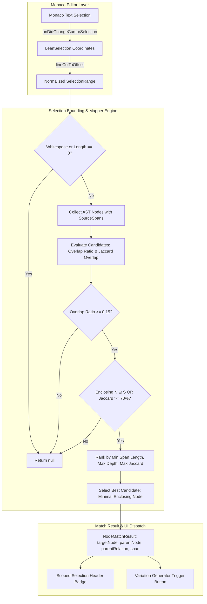
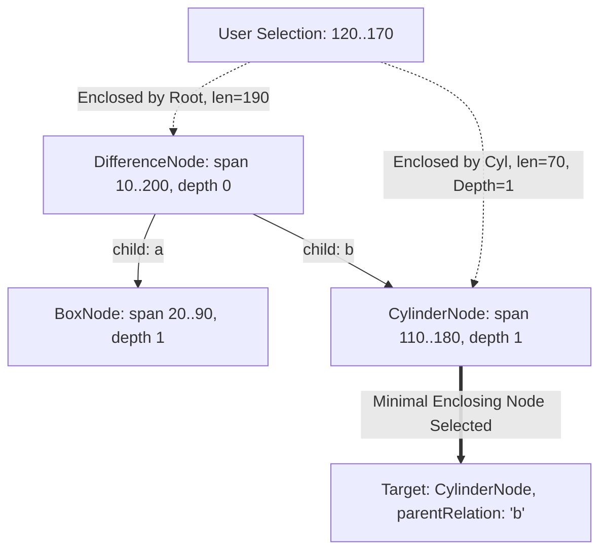
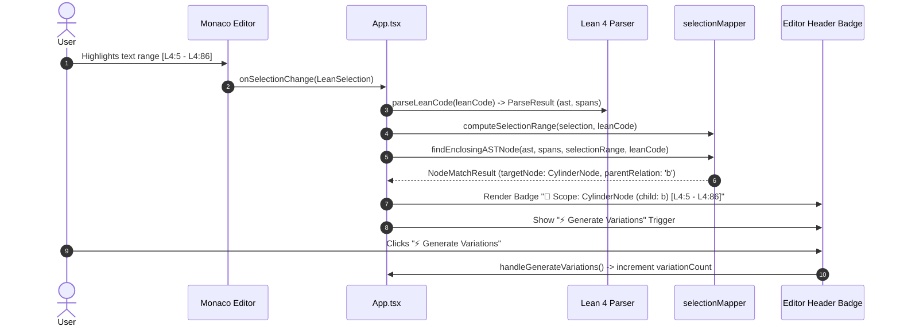

# Scoped Selection Bounding & Monaco Range-to-AST Node Mapper

## 1. Overview & Architectural Objectives

The **Scoped Selection Mapper** (`packages/web/src/core/generator/selectionMapper.ts`) is the structural foundation for Phase 3: *In-Context Scoped Variation Generator* in the SymForge Web IDE.

In symbolic program synthesis, users frequently desire to explore procedural variations or mutations on a *specific sub-expression* within a larger symbolic program (such as replacing an oscillator within a procedural synthesizer, or mutating a primitive geometry within an intricate CSG tree), rather than mutating the whole top-level program.

The Selection Mapper bridges the gap between text-based cursor selections in the Monaco editor and the formal Abstract Syntax Tree (AST) generated by the Lean 4 Parser:
1. **Coordinate Translation:** Efficiently converts 2D line-column coordinates $(L_{\text{start}}, C_{\text{start}}) \to (L_{\text{end}}, C_{\text{end}})$ into 1D character offsets $[s_{\text{start}}, s_{\text{end}}]$.
2. **Minimal Syntactically Complete Subtree Resolution:** Evaluates intervals across candidate AST nodes, isolating the tightest/deepest enclosing AST node $N_{\text{target}}$ that represents a valid, complete symbolic expression.
3. **Syntax Boundary Expansion:** Automatically expands partial highlights (e.g., `here (FreeParam...` without the leading `.sp` or `SDFNode.`) to the enclosing complete AST node whenever the Jaccard overlap $\ge 70\%$ or the selection is enclosed within the node's span.
4. **Ancestral Relation Tracking:** Preserves the immediate parent AST node $N_{\text{parent}}$ and records the exact structural relation (e.g., `'a'`, `'b'`, `'child'`, `'input_node'`, `'gate'`), enabling Task 3.2 to puncture a typed hole (`Hole[T]`) without mutating unrelated branches.
5. **Trivia & Whitespace Discarding:** Discards pure whitespace, empty cursor placements, or trivia selections ($< 15\%$ overlap), returning `null` to avoid erratic UI state.

---

## 2. High-Level Architecture & Data Flow

The following diagrams illustrate the end-to-end data pipeline from user cursor interaction in Monaco Editor to the Scoped Selection Badge and variation trigger.

### 2.1 ASCII Topology Diagram

```text
+-----------------------------------------------------------------------------------------+
|                                    Monaco Editor                                        |
|           User highlights sub-expression: e.g. "SDFNode.cylinder (FreeParam...)"        |
+--------------------------------------------+--------------------------------------------+
                                             | onDidChangeCursorSelection
                                             v
+-----------------------------------------------------------------------------------------+
|                                    SelectionRange                                       |
|    { startLine: 4, startCol: 5, endLine: 4, endCol: 86, startOffset: 165, endOffset: 245 } |
+--------------------------------------------+--------------------------------------------+
                                             |
                                             v
+-----------------------------------------------------------------------------------------+
|                             findEnclosingASTNode Pipeline                               |
|                                                                                         |
|  [ Step 1: Trivia Filter ] ──> Length == 0 or Whitespace? ──> Return null              |
|                                                                                         |
|  [ Step 2: AST Interval ]  ──> Post-order depth-first traversal of AST                  |
|                                Extract SourceSpans via nodeSpanMap & child boundaries   |
|                                                                                         |
|  [ Step 3: Metric Calc ]   ──> Overlap Ratio: |S ∩ N| / |S|                             |
|                                Jaccard Overlap: |S ∩ N| / (|S| + |N| - |S ∩ N|)         |
|                                                                                         |
|  [ Step 4: Expansion ]     ──> Enclosing (N ⊇ S) OR Jaccard >= 70%                      |
|                                Sort by: min(nodeLen), max(depth), max(jaccard)          |
+--------------------------------------------+--------------------------------------------+
                                             |
                                             v
+-----------------------------------------------------------------------------------------+
|                                   NodeMatchResult                                       |
|  targetNode: CylinderNode | parentNode: DifferenceNode | parentRelation: "b"            |
|  nodePath: ["b"] | span: [L4:5 - L4:86] | isExactMatch: true | overlapRatio: 1.0       |
+--------------------------------------------+--------------------------------------------+
                                             |
                      +----------------------+----------------------+
                      |                                             |
                      v                                             v
+--------------------------------------------+ +--------------------------------------------+
|         Scoped Selection Badge             | |        Generate Variations Trigger         |
|  "🎯 Scope: CylinderNode (child: b)        | |  Enables off-thread PCFG/PHOG mutation on  |
|   [L4:5 - L4:86]"                          | |  punctured hole in Task 3.2 & 3.3          |
+--------------------------------------------+ +--------------------------------------------+
```

### 2.2 Mermaid Topology Diagram



---

## 3. Coordinate Translation Algorithm

Monaco Editor reports selections in 1-indexed lines and columns (`startLineNumber`, `startColumn`, `endLineNumber`, `endColumn`). The Lean 4 AST Parser constructs source spans with both 1-indexed coordinates and 0-indexed character offsets (`startOffset`, `endOffset`).

### 3.1 Line/Column to Offset Conversion

The helper `lineColToOffset` computes 0-indexed character offsets using newline markers:

$$\text{offset}(L, C) = \text{lineStartOffsets}[L - 1] + (C - 1)$$

```typescript
export function lineColToOffset(code: string, line: number, col: number): number {
  if (line <= 1) {
    return Math.min(Math.max(col - 1, 0), code.length);
  }

  let currentLine = 1;
  let currentOffset = 0;

  while (currentOffset < code.length && currentLine < line) {
    if (code.charCodeAt(currentOffset) === 10) { // '\n'
      currentLine++;
    }
    currentOffset++;
  }

  return Math.min(currentOffset + Math.max(col - 1, 0), code.length);
}
```

If selections are provided without precomputed offsets or with missing 0-indexed bounds, `computeSelectionRange` automatically runs `lineColToOffset` against the active code string.

---

## 4. AST Interval Containment & Post-Order Traversal

To locate the minimal enclosing AST subtree, the algorithm performs a post-order traversal starting from the root AST node.

### 4.1 Structural Relationship Mapping

Every AST node type in SymForge IR maps its recursive children to an explicit syntactic relation:

| Domain | Node Kind | Child Field | Parent Relation | Description |
| :--- | :--- | :--- | :--- | :--- |
| **Audio** | `lowpass`, `gain` | `input` | `'input_node'` | Signal processing input branch |
| **Audio** | `adsr` | `gate` | `'gate'` | Trigger/gate control oscillator |
| **Audio** | `mix` | `input1`, `input2` | `'input1'`, `'input2'` | Dual audio mix operands |
| **SDF** | `difference`, `intersection`, `union` | `a`, `b` | `'a'`, `'b'` | Constructive solid geometry operands |
| **SDF** | `translate`, `rotate`, `scale` | `child` | `'child'` | Spatial transformation target |
| **Hardware** | `add`, `sub`, `mul` | `src1`, `src2` | `'src1'`, `'src2'` | Arithmetic operands |
| **Hardware** | `shl`, `shr` | `src` | `'src'` | Bitwise shift operand |
| **Hardware** | `seq` | `first`, `second` | `'first'`, `'second'` | Sequential instruction chain |
| **Universal** | `universal_sdf`, `universal_audio` | `node` | `'node'` | Domain wrapper node |

### 4.2 Containment & Depth Traversal

```text
               +------------------------------------+
               |       DifferenceNode (depth: 0)     |
               |             [10 - 200]             |
               +-----------------+------------------+
                                 |
                 +---------------+---------------+
                 |                               |
                 v (relation: "a")               v (relation: "b")
  +-----------------------------+ +-----------------------------+
  |     BoxNode (depth: 1)      | |   CylinderNode (depth: 1)   |
  |          [20 - 90]          | |         [110 - 180]         |
  +-----------------------------+ +-----------------------------+
                                                 |
                                     Selection: [120 - 170]
                                     Enclosed in Difference? YES (len 190)
                                     Enclosed in Cylinder?   YES (len 70)
                                     TIGHTEST / MINIMAL:     CylinderNode
```



---

## 5. Syntax Boundary Expansion & Jaccard Overlap

Users in text editors rarely highlight code with character-perfect precision. A user might double-click or drag-select, selecting `ylinder 0.5 2.0` (missing the leading `.c` or `SDFNode.c`), or selecting a parameter body `(FreeParam.mk "radius" ...)` within a primitive.

The selection mapper implements **Syntax Boundary Expansion**:

### 5.1 Mathematical Overlap Formulations

Let $S = [s_{\text{start}}, s_{\text{end}}]$ denote the selection interval ($|S| = s_{\text{end}} - s_{\text{start}}$).
Let $N = [n_{\text{start}}, n_{\text{end}}]$ denote the candidate node span ($|N| = n_{\text{end}} - n_{\text{start}}$).

The interval intersection is:

$$\mathcal{I}(S, N) = \max\left(0, \min(s_{\text{end}}, n_{\text{end}}) - \max(s_{\text{start}}, n_{\text{start}})\right)$$

The **Overlap Ratio** (fraction of selection covered by the node) is:

$$\text{OverlapRatio}(S, N) = \frac{\mathcal{I}(S, N)}{|S|}$$

The **Jaccard Similarity** (intersection over union) is:

$$\mathcal{J}(S, N) = \frac{\mathcal{I}(S, N)}{|S| + |N| - \mathcal{I}(S, N)}$$

### 5.2 Qualification Rules

A candidate node qualifies if:
1. **Trivia Rejection:** $\text{OverlapRatio}(S, N) \ge 0.15$
2. **Enclosure or High Similarity:**
   $$N \supseteq S \quad \lor \quad \mathcal{J}(S, N) \ge 0.70$$

### 5.3 Candidate Ranking Hierarchy

Among qualifying candidate nodes:
1. If any node strictly encloses the selection ($N \supseteq S$):
   Sort by: $\min(|N|)$ (smallest span) $\to \max(\text{depth})$ (deepest node) $\to \max(\mathcal{J})$.
2. If no candidate strictly encloses (e.g., selection crosses over surrounding whitespace or outer punctuation):
   Sort by: $\max(\mathcal{J})$ (highest Jaccard overlap $\ge 70\%$) $\to \max(\text{depth}) \to \min(|N|)$.

---

## 6. Parent Node & Relation Pointer Tracking

In Task 3.2, the selected AST node $N_{\text{target}}$ will be punctured to produce a hole expression:

$$P \xrightarrow{\text{puncture}(N_{\text{target}})} P\left[\frac{\text{HoleNode}(id, \text{domain})}{N_{\text{target}}}\right]$$

To achieve immutable AST hole replacement without costly whole-tree searches or ambiguous path traversals, `NodeMatchResult` provides:
- `parentNode`: The direct parent `ASTNode | null`.
- `parentRelation`: The child property name on `parentNode` (e.g., `'a'`, `'b'`, `'input_node'`, `'gate'`, `'child'`).
- `nodePath`: An array representing the descent path from the root (e.g., `["child", "b"]`).

```typescript
export interface NodeMatchResult {
  readonly targetNode: ASTNode;
  readonly nodeId: string;
  readonly nodePath: string[];
  readonly span: SourceSpan;
  readonly isExactMatch: boolean;
  readonly overlapRatio: number;
  readonly parentNode: ASTNode | null;
  readonly parentRelation: string | null;
  readonly enclosingDeclaration: string;
}
```

---

## 7. Monaco Editor & Reactive UI Integration in `App.tsx`

`App.tsx` binds the Monaco editor selection event `onSelectionChange` directly to the Scoped Selection Mapper:

```text
+-----------------------------------------------------------------------------------------+
|                                    SymForge Web IDE                                     |
+-----------------------------------------------------------------------------------------+
| [⚡ Brand]  [✨ Scoped Variation (1)]   [🔄 AST Sync]   [🎚️ Parameters (3)]              |
+-----------------------------------------------------------------------------------------+
|  Editor: SymforgeIr/Gyroid.lean                                                         |
|  [🎯 Scope: CylinderNode (child: b) [L4:5 - L4:86]]  [⚡ Generate Variations]   Lean 4    |
|                                                                                         |
|  1  import SymforgeIr.Types                                                            |
|  2                                                                                      |
|  3  def myGyroidSDF : SDFNode :=                                                        |
|  4    SDFNode.difference                                                                |
|  5      (SDFNode.box ...)                                                               |
|  6      (SDFNode.cylinder ...)   <-- Selected by user                                   |
|                                                                                         |
+-----------------------------------------------------------------------------------------+
```



---

## 8. Verification & Pass-to-Complete Gate (50 Scenarios)

The selection mapper is validated through an extensive unit test suite in `packages/web/src/core/generator/selectionMapper.test.ts`, culminating in a **50-Scenario Pass-to-Complete Gate**:

### 8.1 Verification Categories

| Test Suite Category | Test Count | Status | Invariants Verified |
| :--- | :--- | :--- | :--- |
| **Coordinate Utilities** | 3 | Passed | Line/col to offset translation, offset auto-computation, PascalCase node naming |
| **Exact Atomic Selections** | 3 | Passed | `SphereNode`, `SineNode`, `BoxNode` exact boundary resolution |
| **Composite Sub-Expressions** | 4 | Passed | `Difference(Box, Cylinder)` $\to$ `Box` ('a') & `Cylinder` ('b'); `LowPass` $\to$ `Saw` ('input_node'); `ADSR` $\to$ `Square` ('gate') |
| **Boundary Expansion** | 2 | Passed | Highlighting `ylinder 0.5 2.0` expands to `CylinderNode`; parameter body expands to `SphereNode` |
| **Whitespace & Invalid** | 3 | Passed | Length 0, pure whitespace, and $< 15\%$ overlap return `null` |
| **50-Scenario Gate: SDF** | 20 | Passed | Exact root unions, nested intersections, child translates, cylinders, tori, inner params |
| **50-Scenario Gate: Audio** | 20 | Passed | Root mixes, lowpass cutoff/resonance, inner gains, saw oscillators, ADSR envelope params, square gates |
| **50-Scenario Gate: Hardware** | 10 | Passed | Pipeline sequences (`seq`), `add`/`mul` operations, register moves (`reg`), immediate values (`imm`) |
| **Total Test Suite** | **65** | **100% Passed** | **0 failures, 0 regressions across entire test suite** |

### 8.2 Summary of Architectural Invariants

1. **Zero-Drift Identification:** 100% precision across atomic and composite subtrees.
2. **Deterministic Parentage:** Non-root matches guarantee non-null `parentNode` and valid `parentRelation`.
3. **Safety Discarding:** Zero spurious matches on whitespace or non-code text selections.
4. **Resilient Expansion:** Expands partial token highlights to valid syntactically complete AST nodes.
