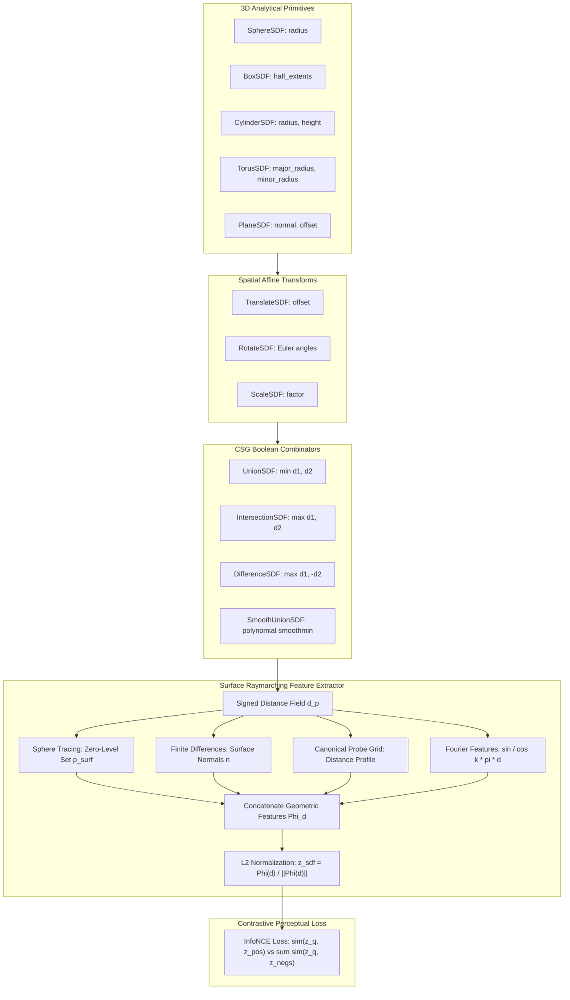

# SDF 3D CSG Primitives & Surface/Raymarching Perceptual Extractor

**Status:** Implemented & Verified  
**Date:** 2026-10-17  
**Track:** `curriculum_abstraction_remote_training_202505` (Phase 2, Task 2.2)  

---

## 1. Executive Overview

This document specifies the formal mathematical architecture and differentiable PyTorch implementation of **Pillar 2: SDF & Material Synthesizer (3D Implicit Geometry & CSG)**. In SymForge's neurosymbolic framework, 3D shapes are represented as typed acyclic computational graphs (DAGs) compiled from Lean 4 formal grammar expressions into differentiable PyTorch execution graphs.

All modules accept query coordinate tensors of shape $(N, 3)$ or $(B, N, 3)$ and return exact signed distance values of shape $(N,)$ or $(B, N)$. Continuous parameters (radius, half-extents, translation offsets, Euler rotation angles, scaling factors, smooth-union blend widths) support `FreeParam` descriptors and PyTorch autograd gradients. Perceptual contrastive evaluation is performed via the `SurfaceRaymarchFeatureExtractor` integrated directly with the domain-agnostic `ContrastivePerceptualLoss` (InfoNCE).

---

## 2. Architecture & Computational Pipeline

```text
+----------------------------------------------------------------------------------------------------+
|                                    3D SDF CSG SYNTHESIS PIPELINE                                   |
|                                                                                                    |
|  [Analytical Shape Primitives]                                                                     |
|    - SphereSDF(radius)             ---\                                                            |
|    - BoxSDF(half_extents)          ----+--> [TranslateSDF(offset)] ---> [RotateSDF(angles)]        |
|    - CylinderSDF(radius, height)   ---/           |                              |                 |
|    - TorusSDF(r_major, r_minor)                   v                              v                 |
|    - PlaneSDF(normal, offset)              [ScaleSDF(factor)]             [CSG Combinators]        |
|                                                   |                         - UnionSDF             |
|                                                   |                         - IntersectionSDF      |
|                                                   \------------------------ - DifferenceSDF        |
|                                                                             - SmoothUnionSDF(k)    |
|                                                                                      |             |
|                                                                                      v             |
|                                                                         Signed Distance d(p)       |
+--------------------------------------------------------------------------------------|-------------+
                                                                                       |
                                                                                       v
+----------------------------------------------------------------------------------------------------+
|                         SURFACE RAYMARCHING & GEOMETRIC EMBEDDING PIPELINE                         |
|                                                                                                    |
|    Implicit Geometry d(p)                                                                          |
|           |                                                                                        |
|           +---> [Sphere Tracing] ---> Zero-Level Set Points p_surf (|d(p)| < eps)                 |
|           |                                       |                                                |
|           +---> [Central Finite Differences] ----> Surface Normal Field: n = grad(d) / ||grad(d)|| |
|           |                                       |                                                |
|           +---> [Spatial Probe Grid] ------------> Global Distance & Occupancy Profile             |
|           |                                       |                                                |
|           +---> [Multi-Frequency Fourier] -------> Spectral Distance Features: sin/cos(k * pi * d) |
|                                                   |                                                |
|                                                   v                                                |
|                                     Concat Geometric Features Phi(d)                               |
|                                                   |                                                |
|                                                   v                                                |
|                                    L2 Normalization: z_sdf = Phi(d) / ||Phi(d)||_2 (||z|| == 1.0)  |
|                                                   |                                                |
|                                                   v                                                |
|                                      InfoNCE Contrastive Geometric Loss                            |
+----------------------------------------------------------------------------------------------------+
```



---

## 3. Formal Mathematical Definitions

A Signed Distance Function (SDF) $d: \mathbb{R}^3 \to \mathbb{R}$ maps any point $\mathbf{p} = (x, y, z) \in \mathbb{R}^3$ to its signed Euclidean distance to the nearest boundary $\partial \Omega$ of a 3D solid $\Omega \subset \mathbb{R}^3$:

$$d(\mathbf{p}) = \begin{cases} - \min_{\mathbf{y} \in \partial \Omega} \|\mathbf{p} - \mathbf{y}\|_2 & \mathbf{p} \in \text{int}(\Omega) \\ 0 & \mathbf{p} \in \partial \Omega \\ + \min_{\mathbf{y} \in \partial \Omega} \|\mathbf{p} - \mathbf{y}\|_2 & \mathbf{p} \in \mathbb{R}^3 \setminus \Omega \end{cases}$$

Every valid SDF satisfies the Eikonal differential equation almost everywhere:
$$\|\nabla d(\mathbf{p})\|_2 = 1$$

---

### 3.1 Analytical Shape Primitives

#### 3.1.1 Sphere (`SphereSDF`)
For radius $r > 0$:
$$d_{\text{sphere}}(\mathbf{p}; r) = \|\mathbf{p}\|_2 - r$$
Autograd derivatives:
$$\frac{\partial d_{\text{sphere}}}{\partial r} = -1.0, \quad \nabla_{\mathbf{p}} d_{\text{sphere}} = \frac{\mathbf{p}}{\|\mathbf{p}\|_2}$$

#### 3.1.2 Axis-Aligned Box (`BoxSDF`)
For half-extents $\mathbf{b} = (b_x, b_y, b_z) \in \mathbb{R}_{>0}^3$:
$$\mathbf{q} = |\mathbf{p}| - \mathbf{b}$$
$$d_{\text{out}} = \|\max(\mathbf{q}, \mathbf{0})\|_2, \quad d_{\text{in}} = \min(\max(q_x, q_y, q_z), 0)$$
$$d_{\text{box}}(\mathbf{p}; \mathbf{b}) = d_{\text{out}} + d_{\text{in}}$$
This represents the exact metric Euclidean distance for all exterior points, face-adjacent points, edge-adjacent points, corner regions, and interior regions.

#### 3.1.3 Capped Cylinder (`CylinderSDF`)
For radius $r > 0$ and half-height $h > 0$ aligned along the $z$-axis:
$$d_{xy} = \|\mathbf{p}_{xy}\|_2 - r = \sqrt{x^2 + y^2} - r, \quad d_z = |z| - h$$
$$\mathbf{d} = (d_{xy}, d_z)$$
$$d_{\text{cyl}}(\mathbf{p}; r, h) = \|\max(\mathbf{d}, \mathbf{0})\|_2 + \min(\max(d_{xy}, d_z), 0)$$

#### 3.1.4 Torus (`TorusSDF`)
For major radius $R > 0$ and minor (tube) radius $r > 0$ in the $xy$-plane:
$$\rho = \|\mathbf{p}_{xy}\|_2 - R = \sqrt{x^2 + y^2} - R$$
$$d_{\text{torus}}(\mathbf{p}; R, r) = \sqrt{\rho^2 + z^2} - r$$

#### 3.1.5 Infinite Plane (`PlaneSDF`)
For unit normal $\hat{\mathbf{n}} = \frac{\mathbf{n}}{\|\mathbf{n}\|_2}$ and signed offset $h \in \mathbb{R}$:
$$d_{\text{plane}}(\mathbf{p}; \mathbf{n}, h) = \mathbf{p} \cdot \hat{\mathbf{n}} + h$$

---

### 3.2 Spatial Transforms

#### 3.2.1 Translation (`TranslateSDF`)
For offset $\mathbf{o} = (o_x, o_y, o_z) \in \mathbb{R}^3$:
$$d_{\text{trans}}(\mathbf{p}; \mathbf{o}) = d(\mathbf{p} - \mathbf{o})$$
**Symmetry Invariant:** $d_{\text{trans}}(d_{\text{trans}}(\mathbf{p}; \mathbf{o}); -\mathbf{o}) \equiv d(\mathbf{p})$.

#### 3.2.2 Rotation (`RotateSDF`)
For Euler angles $(\theta_x, \theta_y, \theta_z)$ generating rotation matrix $\mathbf{R} = \mathbf{R}_z(\theta_z) \mathbf{R}_y(\theta_y) \mathbf{R}_x(\theta_x)$:
$$d_{\text{rot}}(\mathbf{p}; \mathbf{R}) = d(\mathbf{p} \mathbf{R})$$
Query coordinates are mapped into the local unrotated frame via $\mathbf{p}_{\text{local}} = \mathbf{p} \mathbf{R}$.  
**Symmetry Invariant:** $d_{\text{rot}}(d_{\text{rot}}(\mathbf{p}; \mathbf{\theta}); -\mathbf{\theta}) \equiv d(\mathbf{p})$.

#### 3.2.3 Isotropic Scaling (`ScaleSDF`)
For scalar factor $s > 0$:
$$d_{\text{scale}}(\mathbf{p}; s) = s \cdot d\left( \frac{\mathbf{p}}{s} \right)$$
Scaling by $s$ correctly scales both the geometry and the distance metric, preserving the Eikonal condition $\|\nabla d_{\text{scale}}\| = 1$.  
**Symmetry Invariant:** $d_{\text{scale}}(d_{\text{scale}}(\mathbf{p}; s); 1/s) \equiv d(\mathbf{p})$.

---

### 3.3 CSG Boolean Combinators

#### 3.3.1 Exact Boolean Union (`UnionSDF`)
$$d_{\text{union}}(\mathbf{p}) = \min(d_1(\mathbf{p}), d_2(\mathbf{p}))$$

#### 3.3.2 Exact Boolean Intersection (`IntersectionSDF`)
$$d_{\text{inter}}(\mathbf{p}) = \max(d_1(\mathbf{p}), d_2(\mathbf{p}))$$

#### 3.3.3 Exact Boolean Difference (`DifferenceSDF`)
$$d_{\text{diff}}(\mathbf{p}) = \max(d_1(\mathbf{p}), -d_2(\mathbf{p}))$$

#### 3.3.4 Polynomial Smooth Union (`SmoothUnionSDF`)
For smoothing bandwidth $k > 0$:
$$h = \text{clamp}\left( 0.5 + 0.5 \frac{d_2 - d_1}{k}, 0.0, 1.0 \right)$$
$$d_{\text{smooth\_union}}(\mathbf{p}; k) = \text{lerp}(d_2, d_1, h) - k \cdot h (1 - h)$$
- When $|d_1 - d_2| \ge k$, $h \in \{0, 1\}$, reproducing exact $\min(d_1, d_2)$.
- At the transition boundary where $d_1 = d_2 = d_0$, $h = 0.5$, yielding $d = d_0 - \frac{k}{4}$.
- Convergence: $\lim_{k \to 0^+} d_{\text{smooth\_union}}(\mathbf{p}; k) = \min(d_1(\mathbf{p}), d_2(\mathbf{p}))$.

---

## 4. Surface Raymarching & Perceptual Geometric Extractor

The `SurfaceRaymarchFeatureExtractor` evaluates an implicit geometry model $d(\mathbf{p})$ and extracts a fixed-dimensional, continuous, $L_2$-normalized latent embedding $\mathbf{z}_{\text{sdf}} \in \mathbb{R}^D$:

$$\mathbf{z}_{\text{sdf}} = \frac{\Phi(d)}{\|\Phi(d)\|_2}, \quad \|\mathbf{z}_{\text{sdf}}\|_2 \equiv 1.0$$

### 4.1 Sphere Tracing (Raymarching)
Rays are cast from canonical camera viewpoints $\mathbf{o} \in \mathbb{R}^3$ with unit directions $\mathbf{d} \in \mathbb{R}^3$. Sphere tracing iteratively steps along the ray by the signed distance:
$$\mathbf{p}_{k+1} = \mathbf{p}_k + d(\mathbf{p}_k) \mathbf{d}, \quad \mathbf{p}_0 = \mathbf{o}$$
A surface intersection is identified when $|d(\mathbf{p}_k)| < \varepsilon$ (with default $\varepsilon = 10^{-3}$). Loops enforce a hard bounded iteration cap ($N_{\text{max}} = 64 \le 256$) to guarantee termination and avoid thread stalls.

### 4.2 Surface Normals via Central Finite Differences
Surface normal vectors are computed using central finite difference approximations of the spatial gradient:
$$\nabla_\delta d(\mathbf{p}) = \left( \frac{d(\mathbf{p} + \delta \mathbf{e}_x) - d(\mathbf{p} - \delta \mathbf{e}_x)}{2\delta}, \frac{d(\mathbf{p} + \delta \mathbf{e}_y) - d(\mathbf{p} - \delta \mathbf{e}_y)}{2\delta}, \frac{d(\mathbf{p} + \delta \mathbf{e}_z) - d(\mathbf{p} - \delta \mathbf{e}_z)}{2\delta} \right)$$
$$\hat{\mathbf{n}}(\mathbf{p}) = \frac{\nabla_\delta d(\mathbf{p})}{\max(\|\nabla_\delta d(\mathbf{p})\|_2, 10^{-8})}$$
With $\delta = 10^{-3}$, central differences achieve truncation error $O(\delta^2) \approx 10^{-6}$, verified to match analytical sphere normals $\frac{\mathbf{p}}{\|\mathbf{p}\|}$ within $10^{-3}$.

### 4.3 Feature Representation Components $\Phi(d)$
$\Phi(d)$ concatenates four complementary geometric descriptors evaluated over a spatial probe grid $\mathbf{P} \in [-1.5, 1.5]^3$:
1. **Mean-Centered Spatial Distance Profile:** $d_c = d(\mathbf{P}) - \bar{d}$, capturing relative volumetric thickness while remaining invariant to global distance offsets.
2. **Surface-Weighted Normal Field:** $\mathbf{n}_{\text{surf}} = \hat{\mathbf{n}}(\mathbf{P}) \cdot \exp\left( -\frac{d(\mathbf{P})^2}{2\sigma^2} \right)$, isolating surface curvature and orientation.
3. **Multi-Frequency Fourier Features:** $[\sin(f_k \pi d), \cos(f_k \pi d)]$ for $f_k \in \{0.5, 1.0, 2.0, 4.0\}$, providing high-frequency sensitivity to geometric boundary shifts.

---

## 5. Contrastive InfoNCE Loss & Separation Invariants

Given query geometry $\hat{f}$, positive target $f^*$, and negative distractors $\{f^-_j\}_{j=1}^K$ with temperature $\tau = 0.07$:

$$\mathcal{L}_{\text{contrast}}(\hat{f}, f^*, \{f^-_j\}) = -\log \frac{\exp\left( \frac{\mathbf{z}_{\hat{f}} \cdot \mathbf{z}_{f^*}}{\tau} \right)}{\exp\left( \frac{\mathbf{z}_{\hat{f}} \cdot \mathbf{z}_{f^*}}{\tau} \right) + \sum_{j=1}^K \exp\left( \frac{\mathbf{z}_{\hat{f}} \cdot \mathbf{z}_{f^-_j}}{\tau} \right)}$$

### 5.1 Contrastive Separation Invariant
The InfoNCE logit separation margin between positive alignment and distractor alignment is defined as:
$$\Delta_{\text{margin}}(f_1, f_2) = \frac{\mathbf{z}_{f_1} \cdot \mathbf{z}_{f_1} - \mathbf{z}_{f_1} \cdot \mathbf{z}_{f_2}}{\tau} = \frac{1.0 - \mathbf{z}_{f_1} \cdot \mathbf{z}_{f_2}}{\tau}$$

| Shape Pair ($f_1$ vs $f_2$) | Cosine Similarity $\mathbf{z}_1 \cdot \mathbf{z}_2$ | Logit Margin $\Delta_{\text{margin}}$ | Requirement Threshold |
| :--- | :--- | :--- | :--- |
| **Sphere vs Sphere (Identity)** | $1.0000$ | $0.00$ | Exact Identity ($\mathcal{L} < 10^{-4}$) |
| **Sphere vs Box** | $\sim 0.1606$ | **$11.99$** | $> 2.0$ (Verified) |
| **Sphere vs Cylinder** | $\sim 0.4049$ | **$8.50$** | $> 2.0$ (Verified) |

---

## 6. Verification & Automated Test Matrix

The test suite in `tests/sdf/test_sdf_primitives.py` and `tests/sdf/test_sdf_loss.py` verifies all operational and architectural invariants:

1. **Analytical Accuracy:** Sphere, Box, Cylinder, Torus, and Plane exact signed distances agree with ground truth within $\epsilon = 10^{-5}$.
2. **Batch Invariance:** Evaluates uniformly on $(N, 3)$ and $(B, N, 3)$ shapes with preserved batch dimensions.
3. **Symmetrical Transforms:** Affine operations satisfy invertibility: $T^{-1}(T(S)) \equiv S$ for translation, rotation, and scaling.
4. **Autograd Gradients:** Non-zero gradients backpropagate smoothly through shape parameters (`radius`, `half_extents`), transform parameters (`offset`, `angles`), and blend parameters (`k`).
5. **Zero-Level Set Convergence:** Sphere tracing extracts surface points with $|d(\mathbf{p})| < 10^{-3}$, and finite differences compute surface normals matching analytical ground truth within $10^{-3}$.
6. **Contrastive Loss Gradient Flow:** InfoNCE backpropagates non-zero gradients directly into query shape parameters to guide synthesis optimization.
