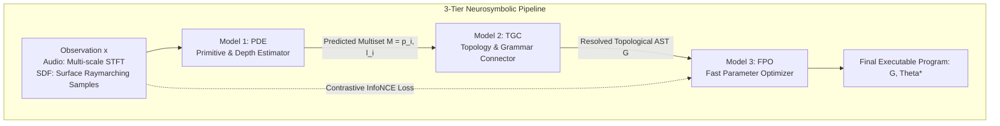
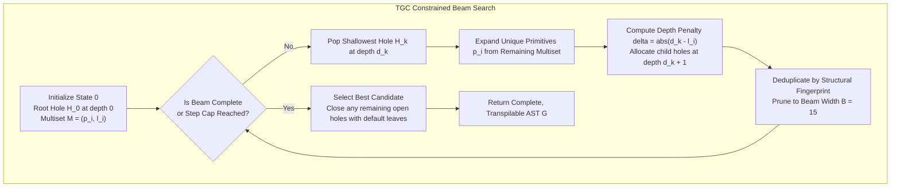
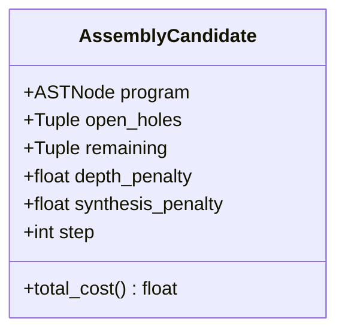

# Model 2 (TGC) - Topology & Grammar Connector

This document details the architectural specification, formal state representations, algorithmic mechanisms, and pruning strategies for **Model 2: Topology & Grammar Connector (TGC)** in the SymForge 3-tier neurosymbolic synthesis framework.

---

## 1. Architectural Role in the 3-Tier Pipeline

In SymForge, program synthesis is partitioned into three decoupled stages:

```text
+--------------------------------------------------------------------------------------------------+
|                                    3-TIER NEUROSYMBOLIC PIPELINE                                 |
|                                                                                                  |
|   [Observation x]                                                                                |
|          |                                                                                       |
|          v                                                                                       |
|   +------------------------------------+                                                         |
|   | MODEL 1: PDE                       |                                                         |
|   | Primitive & Depth Estimator        |                                                         |
|   +-----------------+------------------+                                                         |
|                     |                                                                            |
|                     | Multiset: M = {(p_i, l_i)}                                                 |
|                     v                                                                            |
|   +------------------------------------+                                                         |
|   | MODEL 2: TGC                       |  <--- [Focus of this document]                          |
|   | Topology & Grammar Connector       |                                                         |
|   +-----------------+------------------+                                                         |
|                     |                                                                            |
|                     | Typed AST: G in L(Gamma)                                                   |
|                     v                                                                            |
|   +------------------------------------+                                                         |
|   | MODEL 3: FPO                       |                                                         |
|   | Fast Parameter Optimizer           |                                                         |
|   +-----------------+------------------+                                                         |
|                     |                                                                            |
|                     v                                                                            |
|   [Final Executable Program: (G, Theta*)]                                                        |
+--------------------------------------------------------------------------------------------------+
```



### Problem Formulation
- **Input:** Shuffled multiset of predicted primitives with hierarchical depth strata:
  $$\mathcal{M} = \left\{ (p_1, \ell_1), (p_2, \ell_2), \dots, (p_m, \ell_m) \right\}$$
  where $p_i \in \Sigma_{\text{primitives}}$ and $\ell_i \in \{0, 1, \dots, D_{\max}\}$.
- **Output:** Fully connected, type-safe Abstract Syntax Tree (AST) $G \in \mathcal{L}(\Gamma)$ where every open hole is substituted by concrete nodes with freshly initialized `FreeParam` instances.
- **Latency Guarantee:** Assembly evaluates in $< 50\text{ ms}$ per program (empirically $< 1\text{ ms}$).

---

## 2. Supported Domain Vocabularies

TGC supports both procedural synthesis domains with symmetrical arity hierarchies:

| Domain | Terminals (Arity 0) | Unary Modifiers (Arity 1) | Binary Combinators (Arity 2) |
|---|---|---|---|
| **Audio (1D DSP)** | `Sine`, `Saw`, `Square`, `Noise`, `FM`, `LFO` | `LowPass`, `Gain`, `ADSR`, `ExpDecay` | `Mix` |
| **SDF (3D CSG)** | `Sphere`, `Box`, `Cylinder`, `Torus`, `Plane` | `Translate`, `Rotate`, `Scale` | `Union`, `SmoothUnion`, `Difference`, `Intersection` |

---

## 3. Constrained Beam Search Algorithm

The assembly procedure operates via a type-guided, depth-constrained beam search:

```text
+--------------------------------------------------------------------------------------------------+
|                                    TGC BEAM SEARCH WORKFLOW                                      |
|                                                                                                  |
|   1. Initialize Root Hole State:                                                                 |
|      State_0 = (T = Hole_0, Holes = [(H_0, depth=0)], Remaining = M, cost = 0)                   |
|                                                                                                  |
|   2. Loop until complete or step_limit (Beam Width = B):                                         |
|      For each Candidate in Beam:                                                                 |
|         a. Pop shallowest hole (H_k, d_k)                                                        |
|         b. Group unique (p_i, l_i) in Remaining                                                  |
|         c. For each unique primitive p_i:                                                        |
|              - Calculate depth penalty: delta = |d_k - l_i|                                      |
|              - Allocate arity(p_i) child holes at depth (d_k + 1)                                |
|              - Substitute H_k in tree T with instantiated node(p_i)                              |
|              - Decrement count of (p_i, l_i) in Remaining                                        |
|              - New Cost = Cost + delta                                                           |
|         d. Fallback: If no valid match, close H_k with default leaf (penalty +10)                |
|                                                                                                  |
|   3. Prune & Deduplicate:                                                                        |
|      - Hash by structural fingerprint: Key = (Fingerprint(T), Remaining)                         |
|      - Retain top B candidates with lowest total cost                                            |
|                                                                                                  |
|   4. Terminate:                                                                                  |
|      - Return complete AST G with lowest cost (all remaining holes closed by fallback leaves)    |
+--------------------------------------------------------------------------------------------------+
```



---

## 4. State Representation and Priority Function

Each search node is represented by an immutable state tuple:

$$\mathcal{S} = \langle T, \mathcal{H}, \mathcal{M}_{\text{rem}}, c_{\text{depth}}, c_{\text{synth}}, s \rangle$$

- $T$: Partial AST with 0 or more `HoleNode` leaves.
- $\mathcal{H} = [ (h_1, d_1), (h_2, d_2), \dots ]$: Ordered sequence of open hole identifiers and their hierarchical tree depths $d_k$.
- $\mathcal{M}_{\text{rem}}$: Remaining unconsumed primitive-depth pairs from the input multiset.
- $c_{\text{depth}} = \sum |d_k - \ell_i|$: Accumulated depth deviation penalty.
- $c_{\text{synth}}$: Penalty for synthesizing fallback leaves when the multiset is incomplete.
- $s$: Expansion step index.

### Priority Cost Function
To rank candidate states in the beam:

$$f(\mathcal{S}) = c_{\text{depth}} + c_{\text{synth}} + 0.5 \cdot |\mathcal{H}| + 1.5 \cdot |\mathcal{M}_{\text{rem}}|$$

- When a tree is complete ($|\mathcal{H}| = 0$ and $|\mathcal{M}_{\text{rem}}| = 0$) with exact depth alignment, $f(\mathcal{S}) = 0.0$ (globally optimal solution).

```text
+--------------------------------------------------------------------------------------------------+
|                                    TGC STATE REPRESENTATION                                      |
|                                                                                                  |
|  AssemblyCandidate                                                                               |
|  +--------------------------------------------------------------------------------------------+  |
|  |  program:            ASTNode (Partial tree with HoleNode instances)                        |  |
|  |  open_holes:         ((h_1, d_1), (h_2, d_2), ...) [Ordered shallowest-first]              |  |
|  |  remaining:          ((p_1, l_1), (p_2, l_2), ...) [Unconsumed multiset]                   |  |
|  |  depth_penalty:      sum(|d_hole - l_primitive|)                                           |  |
|  |  synthesis_penalty:  penalties for fallback leaf generation                                |  |
|  |  step:               current expansion counter                                             |  |
|  +--------------------------------------------------------------------------------------------+  |
|                                                                                                  |
|  Priority Score: TotalCost = depth_penalty + synthesis_penalty + 0.5*|Holes| + 1.5*|Remaining|    |
+--------------------------------------------------------------------------------------------------+
```



---

## 5. Pruning and Deduplication Rules

1. **Non-redundant Multiset Grouping:** When multiple identical `(primitive, depth)` items exist in `remaining`, only one branch is expanded per distinct pair for a given hole.
2. **Structural Fingerprint Hashing:** Candidates are deduplicated in the beam pool using a lightweight structural key:
   $$\text{Key} = \left( \text{Fingerprint}(T), \mathcal{M}_{\text{rem}} \right)$$
   where $\text{Fingerprint}(T)$ recursively tracks operator names and hole IDs without continuous floating-point serialization overhead.
3. **Depth Ceiling:** If $d_k \ge D_{\max}$ (default: 6), non-terminal expansions (operators with arity $\ge 1$) are prohibited, forcing terminal closure.
4. **Safety Iteration Cap:** Hard loop cap on beam iterations ensures termination even on adversarial inputs.

---

## 6. Symmetrical Transpilation and Parameter Isolation

Every assembled AST produces globally unique `FreeParam` IDs via a monotonic factory counter:
$$\text{id} = \texttt{tgc\_\{counter\}\_\{param\_name\}}$$

This guarantees:
1. **Zero Parameter Collisions:** Downstream transpilation via `transpile_ast_to_module` maps each parameter to an independent index in PyTorch `nn.Parameter` vector $\Theta$.
2. **Instant Differentiability:** The resulting `DifferentiableAudioModule` or `DifferentiableSDFModule` executes forward and autograd backward passes without numerical instability.
