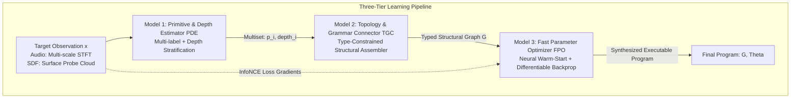
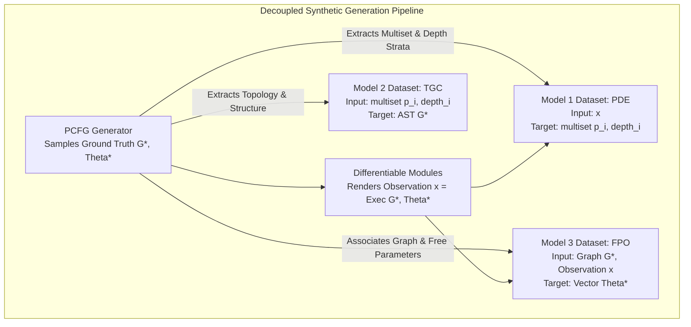
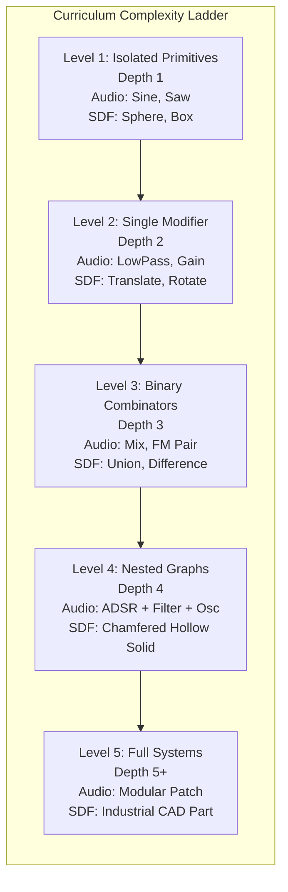

# Three-Tier Neurosymbolic Synthesis Architecture & Parallel Curriculum (Audio & SDF)

This document specifies the neurosymbolic learning strategy of **SymForge**, decomposing program synthesis into a modular pipeline of three specialized neural models. The pipeline is trained in a fully decoupled manner with PCFG synthetic data stratified by complexity order, operating simultaneously on **Audio (1D DSP)** and **SDF (3D CSG)** domains.

---

## 1. Overview of the Three-Tier Pipeline

Rather than treating program synthesis as an end-to-end monolithic black box (which suffers from combinatorial explosion and optimization instabilities), SymForge decomposes the problem into **three orthogonal decisions**:

```text
+---------------------------------------------------------------------------------------------------+
|                               THREE-TIER NEUROSYMBOLIC PIPELINE                                   |
|                                                                                                   |
|  [Target Observation: x]                                                                          |
|         |                                                                                         |
|         v                                                                                         |
|  +-------------------------------------+                                                          |
|  | MODEL 1: Primitive & Depth          | ---> Predicts: Primitive Multiset {(p_i, depth_i)}        |
|  | Estimator (PDE)                     |      (Which modules exist and at what hierarchy level)   |
|  +-------------------------------------+                                                          |
|         |                                                                                         |
|         v                                                                                         |
|  +-------------------------------------+                                                          |
|  | MODEL 2: Topology & Grammar         | ---> Predicts: Valid Typed Structural Graph G in L(Gamma)|
|  | Connector (TGC)                     |      (How primitives connect without parameter noise)     |
|  +-------------------------------------+                                                          |
|         |                                                                                         |
|         v                                                                                         |
|  +-------------------------------------+                                                          |
|  | MODEL 3: Fast Continuous Parameter  | ---> Optimizes: Continuous Parameter Vector Theta in R^K |
|  | Optimizer (FPO)                     |      (Fast warm-start regression + autograd descent)     |
|  +-------------------------------------+                                                          |
|         |                                                                                         |
|         v                                                                                         |
|  [Completed Program: (G, Theta)]                                                                  |
+---------------------------------------------------------------------------------------------------+
```



---

## 2. Mathematical Specification of the Three Models

### 2.1 Model 1: Primitive & Hierarchical Depth Estimator (PDE)
- **Input:** Target observation $x$ (Multi-scale STFT spectrogram for audio, or stratified surface/normal probe samples for SDF).
- **Output:** Multiset of primitives annotated with their hierarchical depth level in the syntax tree:
  $$\mathcal{M} = \left\{ (p_1, \ell_1), (p_2, \ell_2), \dots, (p_m, \ell_m) \right\}$$
  Where $p_i \in \Sigma_{\text{primitives}}$ and $\ell_i \in \{0, 1, \dots, D_{\max}\}$ denotes the tree depth from root (0) to leaf.
- **Role in the System:** Drastically constrains the combinatorial search space for Model 2. Knowing that a target contains `[LowPass (depth 0), Sine (depth 2), Saw (depth 2), Mix (depth 1)]` narrows candidate trees down from millions to a handful of type-valid permutations.

### 2.2 Model 2: Topology & Grammar Connector (TGC)
- **Input:** Stratified multiset $\mathcal{M} = \{(p_i, \ell_i)\}$ predicted by Model 1.
- **Output:** Valid typed Abstract Syntax Tree (AST) or Canonical DAG $G \in \mathcal{L}(\Gamma)$.
- **Mechanism:**
  - Formulated as a type-guided beam search assembler over hole expansions (`HoleNode`), where candidate expansions must consume primitives matching the required depth stratum.
- **Key Advantage:** Learns grammar syntax and composition **without continuous parameter noise**, focusing purely on structural validity.

### 2.3 Model 3: Fast Parameter Optimizer (FPO)
- **Input:** Assembled structural graph $G$ and target observation $x$.
- **Output:** Optimal continuous parameter configuration $\Theta^* = \{\theta_1, \theta_2, \dots, \theta_K\}$.
- **Two-Stage Hybrid Strategy:**
  1. *Neural Warm-Start:* A lightweight regressor predicts an initial estimate $\Theta_0$ conditioned on $G$ and $x$.
  2. *Differentiable Autograd Refinement:* Using the differentiable PyTorch modules synthesized by the Lean 4 transpiler (`DifferentiableAudioModule` / `DifferentiableSDFModule`), runs 10 to 30 gradient descent steps with box projection:
     $$\Theta_{t+1} = \Pi_\Omega\left( \Theta_t - \eta \nabla_\Theta \mathcal{L}_{\text{contrast}}\left( \text{Exec}(G, \Theta_t), x \right) \right)$$
  - Because the topology is already exact, the parameter loss landscape is locally smooth and convex, converging in milliseconds.

---

## 3. Decoupled Synthetic Data Generation via PCFG

Because the procedural PCFG generator (`PCFGTaskGenerator`) samples ground-truth pairs $(G^*, \Theta^*)$, training datasets can be harvested **100% independently** for each of the three models:

```text
+---------------------------------------------------------------------------------------------------+
|                           DECOUPLED DATASET GENERATION VIA PCFG                                   |
|                                                                                                   |
|                                    +--------------------+                                         |
|                                    |   PCFG Generator   |                                         |
|                                    +---------+----------+                                         |
|                                              |                                                    |
|                                 Samples Ground-Truth (G*, Theta*)                                 |
|                                              |                                                    |
|                      +-----------------------+-----------------------+                            |
|                      |                       |                       |                            |
|                      v                       v                       v                            |
|           +--------------------+  +--------------------+  +--------------------+                  |
|           | Model 1 Dataset    |  | Model 2 Dataset    |  | Model 3 Dataset    |                  |
|           | (PDE)              |  | (TGC)              |  | (FPO)              |                  |
|           |--------------------|  |--------------------|  |--------------------|                  |
|           | Input: x = f(G*)   |  | Input: {(p, l)}    |  | Input: G*, x       |                  |
|           | Target: {(p_i, l_i)}| | Target: G*         |  | Target: Theta*     |                  |
|           +--------------------+  +--------------------+  +--------------------+                  |
+---------------------------------------------------------------------------------------------------+
```



---

## 4. Complexity-Ordered Exploration (ZPD Curriculum)

The grammar is explored systematically across **five discrete complexity layers**:

```text
+---------------------------------------------------------------------------------------------------+
|                                 COMPLEXITY-ORDERED CURRICULUM LADDER                              |
|                                                                                                   |
|  Level  Tree Depth    Audio Domain (1D DSP)                SDF Domain (3D CSG)                    |
|  -----  ------------  -----------------------------------  -----------------------------------    |
|  L1     Depth = 1     Sine(f), Saw(f), Noise()             Sphere(r), Box(w,h,d), Cylinder(r,h)   |
|  L2     Depth = 2     LowPass(Sine, cutoff), Gain(Saw, g)  Translate(Sphere, [x,y,z]), Scale(Box) |
|  L3     Depth = 3     Mix(Sine, Saw, ratio), FM(Sine, LFO) Union(Sphere, Box), Difference(Box,Cyl)|
|  L4     Depth = 4     LowPass(Mix(Saw, Noise), ADSR)       SmoothUnion(Translate(Sphere), Box, k) |
|  L5     Depth = 5+    Multi-stage Modular Synthesizer      Complex CAD Assembly with Chamfers     |
+---------------------------------------------------------------------------------------------------+
```



---

## 5. Parallel Domain Progression: Audio vs. SDF

Developing both domains in parallel provides critical empirical insights into cross-domain synthesis:
1. **Empirical Difficulty Asymmetries:**
   - *Audio (1D DSP):* Additive phase interference and spectral masking make primitive recognition (PDE) more challenging at higher complexity, while signal routing topology is predominantly linear.
   - *SDF (3D CSG):* Spatial occlusion and non-commutative boolean operators (`Difference(A, B) != Difference(B, A)`) increase structural assembly ambiguity (TGC), but surface probes yield sharp geometric features for primitive identification.
2. **Unified Code Reuse:**
   - The exact same `PrimitiveDepthEstimator`, `TopologyGrammarConnector`, and `FastParameterOptimizer` engines execute across both domains, parameterized purely by domain configuration and vocabulary.
