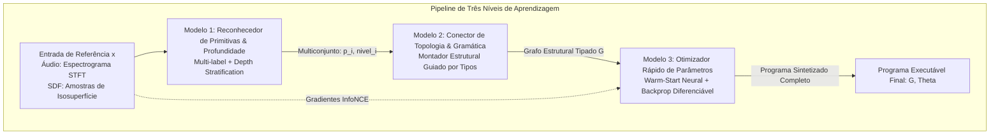
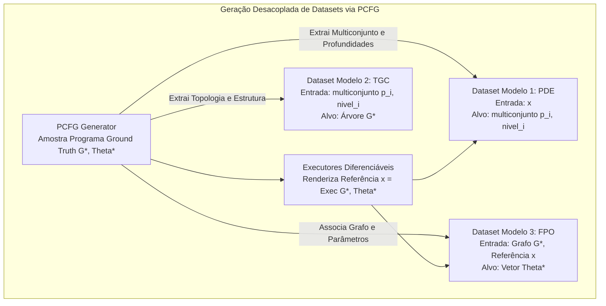
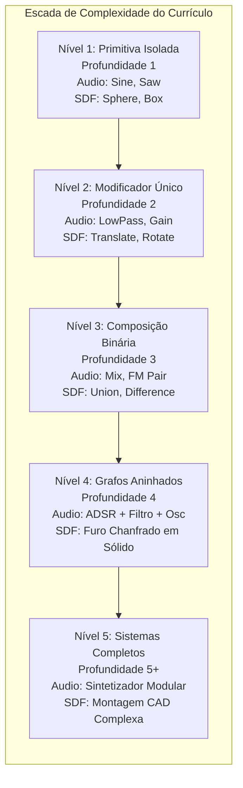

# Arquitetura Neurosimbólica em Três Níveis e Currículo Paralelo (Áudio & SDF)

Este documento especifica a estratégia de aprendizagem neurosimbólica do **SymForge**, decompondo o problema de síntese em uma pipeline modular de três modelos especializados, treinados de forma desacoplada com dados sintéticos gerados por PCFG estratificados por ordem de complexidade, operando simultaneamente sobre os domínios de **Áudio (1D DSP)** e **SDF (3D CSG)**.

---

## 1. Visão Geral da Pipeline em Três Níveis

Em vez de tratar a síntese de programas como uma caixa-preta ponta a ponta (o que sofre de explosão combinatória e instabilidade numérica), o SymForge decompõe a tarefa em **três decisões ortogonais**:

```text
+---------------------------------------------------------------------------------------------------+
|                               PIPELINE NEUROSIMBÓLICA EM TRÊS NÍVEIS                              |
|                                                                                                   |
|  [Entrada de Referência]                                                                          |
|         x                                                                                         |
|         |                                                                                         |
|         v                                                                                         |
|  +-------------------------------------+                                                          |
|  | MODELO 1: Reconhecedor de           | ---> Prediz: Multiconjunto de Primitivas {(p_i, nivel_i)}|
|  | Primitivas & Nível de Profundidade  |      (Quais módulos existem e em que estrato da árvore)  |
|  +-------------------------------------+                                                          |
|         |                                                                                         |
|         v                                                                                         |
|  +-------------------------------------+                                                          |
|  | MODELO 2: Conector de Topologia     | ---> Prediz: Grafo Estrutural Tipado G in L(Gamma)       |
|  | & Montador de Gramática             |      (Como as primitivas e operadores se conectam)       |
|  +-------------------------------------+                                                          |
|         |                                                                                         |
|         v                                                                                         |
|  +-------------------------------------+                                                          |
|  | MODELO 3: Otimizador & Ajustador    | ---> Otimiza: Vetor de Parâmetros Contínuos Theta in R^K |
|  | Rápido de Parâmetros Contínuos      |      (Ajuste fino via gradiente/regressão instantânea)   |
|  +-------------------------------------+                                                          |
|         |                                                                                         |
|         v                                                                                         |
|  [Programa Executável Final: (G, Theta)]                                                          |
+---------------------------------------------------------------------------------------------------+
```



---

## 2. Especificação Matemática dos Três Modelos

### 2.1 Modelo 1: Reconhecedor de Primitivas e Nível Hierárquico (PDE - Primitive & Depth Estimator)
- **Entrada:** Observação de referência $x$ (Espectrograma multi-escala STFT em áudio ou nuvem estratificada de distâncias/normais em SDF).
- **Saída:** Multiconjunto de primitivas rotuladas com seus respectivos níveis de profundidade na árvore sintática:
  $$\mathcal{M} = \left\{ (p_1, \ell_1), (p_2, \ell_2), \dots, (p_m, \ell_m) \right\}$$
  Onde $p_i \in \Sigma_{\text{primitives}}$ e $\ell_i \in \{0, 1, \dots, L_{\max}\}$ denota a distância hierárquica da raiz (nível 0) até a folha.
- **Função no Sistema:** Reduz drasticamente o espaço de busca combinatória do Modelo 2. Saber que o alvo contém `[LowPass (nível 0), Sine (nível 2), Saw (nível 2), Mix (nível 1)]` restringe o número de árvores possíveis de milhões para poucas permutações válidas pela gramática.

### 2.2 Modelo 2: Conector de Topologia e Montador de Gramática (TGC - Topology & Grammar Connector)
- **Entrada:** Multiconjunto estratificado $\mathcal{M} = \{(p_i, \ell_i)\}$ gerado pelo Modelo 1.
- **Saída:** Árvore Sintática Abstrata (AST) ou Grafo Acíclico Direcionado (DAG) tipado $G \in \mathcal{L}(\Gamma)$.
- **Mecanismo:** 
  - O modelo atua como um preenchedor de restrições gramaticais. Como os nós de nível mais alto (próximos de 0) são operadores de composição externa (ex: filtros ou uniões CSG) e os nós de nível mais profundo são folhas de sinal/geometria primitiva, a montagem é formulada como uma busca $A^*$ restrita por tipos onde a expansão de buracos (`HoleNode`) só pode consumir primitivas pertencentes ao estrato correto.
- **Vantagem:** O Modelo 2 aprende a sintaxe e a semântica da linguagem **sem ruído contínuo**, focando unicamente na validade estrutural.

### 2.3 Modelo 3: Ajustador Rápido de Parâmetros Contínuos (FPO - Fast Parameter Optimizer)
- **Entrada:** Grafo estrutural resolvido $G$ e a observação de referência $x$.
- **Saída:** Configuração ideal dos parâmetros livres $\Theta^* = \{\theta_1, \theta_2, \dots, \theta_K\}$.
- **Estratégia Híbrida (Duas Etapas):**
  1. *Warm-Start Neural:* Uma rede leve regressora prediz uma estimativa inicial $\Theta_0$ condicionada em $G$ e nos extratos de $x$.
  2. *Refinamento Diferenciável Instantâneo:* Utilizando os módulos `DifferentiableAudioModule` e `DifferentiableSDFModule` (implementados na Fase 1), executam-se de 10 a 30 passos de gradiente descendente com autograd sobre a perda contrastiva InfoNCE:
     $$\Theta_{t+1} = \Theta_t - \eta \nabla_\Theta \mathcal{L}_{\text{contrast}}\left( \text{Exec}(G, \Theta_t), x \right)$$
  - Como a topologia já está matematicamente correta, a superfície de erro em $\Theta$ é localmente suave e convexa, convergindo em milissegundos.

---

## 3. Geração Desacoplada de Dados Sintéticos via PCFG

Como o gerador probabilístico PCFG (`PCFGTaskGenerator`) conhece a gramática e gera instâncias canônicas $(G^*, \Theta^*)$, podemos extrair datasets de treinamento **100% independentes** para cada um dos três modelos:

```text
+---------------------------------------------------------------------------------------------------+
|                           FLUXO DE GERAÇÃO INDEPENDENTE DE DADOS VIA PCFG                         |
|                                                                                                   |
|                                    +--------------------+                                         |
|                                    |   PCFG Generator   |                                         |
|                                    +---------+----------+                                         |
|                                              |                                                    |
|                                 Amostra (G*, Theta*) Ground Truth                                 |
|                                              |                                                    |
|                      +-----------------------+-----------------------+                            |
|                      |                       |                       |                            |
|                      v                       v                       v                            |
|           +--------------------+  +--------------------+  +--------------------+                  |
|           | Dataset Modelo 1   |  | Dataset Modelo 2   |  | Dataset Modelo 3   |                  |
|           | (PDE)              |  | (TGC)              |  | (FPO)              |                  |
|           |--------------------|  |--------------------|  |--------------------|                  |
|           | Entrada: x = f(G*) |  | Entrada: {(p, l)}  |  | Entrada: G*, x     |                  |
|           | Alvo: {(p_i, l_i)} |  | Alvo: G*           |  | Alvo: Theta*       |                  |
|           +--------------------+  +--------------------+  +--------------------+                  |
+---------------------------------------------------------------------------------------------------+
```



### Propriedades da Geração:
1. **Treinamento do Modelo 1 (PDE):** O modelo aprende a "escutar" ou "enxergar" as impressões digitais de cada primitiva (ex: o decaimento espectral de um `LowPass` ou a descontinuidade de contorno de um `Box`) e sua posição relativa na mistura.
2. **Treinamento do Modelo 2 (TGC):** Treinamento puramente simbólico. Pode ser treinado massivamente em CPU (gerando milhões de árvores por minuto) sem sequer renderizar imagens ou sons.
3. **Treinamento do Modelo 3 (FPO):** Treina o regressor inicial e valida as taxas de aprendizado e schedules do otimizador por gradiente.

---

## 4. Exploração por Ordem de Complexidade (Currículo ZPD)

A gramática não é explorada de forma cega ou irrestrita. Ela é dividida em **camadas estritas de complexidade** que regem tanto o treinamento quanto a busca:

```text
+---------------------------------------------------------------------------------------------------+
|                                 CURRÍCULO POR ORDEM DE COMPLEXIDADE                               |
|                                                                                                   |
|  Nível  Profundidade  Domínio Áudio (1D DSP)               Domínio SDF (3D CSG)                   |
|  -----  ------------  -----------------------------------  -----------------------------------    |
|  L1     Prof = 1      Sine(f), Saw(f), Noise()             Sphere(r), Box(w,h,d), Cylinder(r,h)   |
|  L2     Prof = 2      LowPass(Sine, cutoff), Gain(Saw, g)  Translate(Sphere, [x,y,z]), Scale(Box) |
|  L3     Prof = 3      Mix(Sine, Saw, ratio), FM(Sine, LFO) Union(Sphere, Box), Difference(Box,Cyl)|
|  L4     Prof = 4      LowPass(Mix(Saw, Noise), ADSR)       SmoothUnion(Translate(Sphere), Box, k) |
|  L5     Prof = 5+     Sintetizador Polifônico Completo     Peça Mecânica CAD com Furos e Chanfros |
+---------------------------------------------------------------------------------------------------+
```



---

## 5. Abordagem Paralela: Áudio vs. SDF

Executar os dois domínios **em paralelo** desde a Fase 2 oferece um valor científico e prático fundamental:
1. **Comparabilidade de Dificuldade:**
   - *Áudio (1D):* A sobreposição aditiva (interferência de fase e harmônicos) dificulta a identificação das primitivas pelo Modelo 1, mas a topologia do Modelo 2 é frequentemente mais rasa e orientada a fluxos de sinal em série.
   - *SDF (3D):* A oclusão espacial e os operadores de corte booleano (`Difference`, `Intersection`) tornam a topologia do Modelo 2 mais intrincada, mas a identificação de superfícies pelo Modelo 1 pode ser auxiliada por descontinuidades geométricas claras.
2. **Validação Cruzada de Algoritmos:**
   - Se uma técnica de busca ou arquitetura neural funcionar bem em áudio mas falhar em SDF (ou vice-versa), sabemos imediatamente se a limitação reside no domínio físico ou no algoritmo de generalização.
3. **Reutilização Total de Código:**
   - A mesma classe `TypedGrammarExpander`, `PCFGTaskGenerator`, `ContrastivePerceptualLoss` e a mesma lógica do Modelo 1/2/3 atendem ambos os domínios, alterando apenas a gramática instanciada (`AudioNode` vs `SDFNode`).
