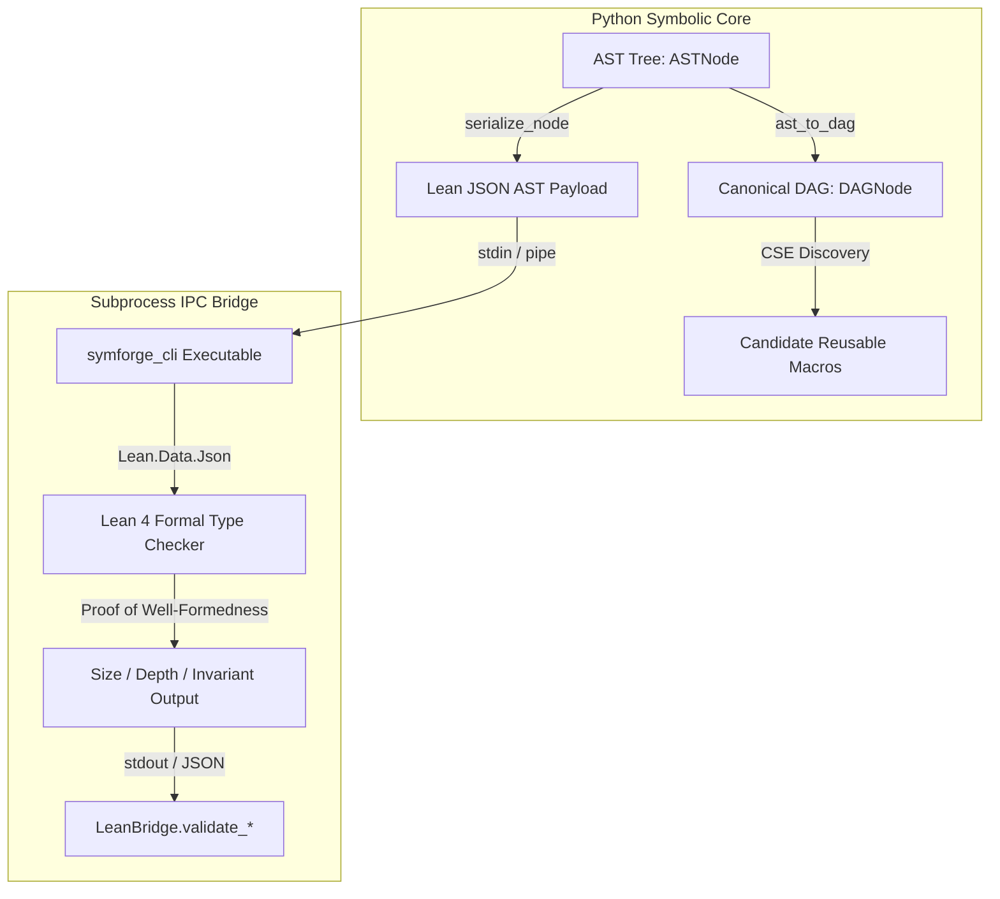

# Typed AST, Canonical DAG & Python-Lean Bridge

## 1. Architectural Overview

The **SymForge Typed AST & Canonical DAG** architecture forms the structural backbone of our program synthesis framework. It provides:
1. **Strongly Typed Immutable Representations:** AST nodes in Python (`symforge.core.ast`) that mirror Lean 4 inductive types with mathematical fidelity.
2. **Hash-Consed Canonical DAG:** Automatic common subexpression elimination (`symforge.core.dag`) which converts tree-structured ASTs into directed acyclic graphs where identical subtrees share object identity.
3. **Subprocess IPC Lean Bridge:** High-throughput, timeout-bounded IPC bridge (`symforge.core.bridge.LeanBridge`) validating program validity and serialization contracts against Lean 4's formal compiler.

---

## 2. Structural Topology & Data Flow

```text
+-----------------------+              +-----------------------+
|  Python AST Tree      |              |  Lean 4 Inductive IR  |
| (symforge.core.ast)   |              | (SymforgeIr.Types)    |
+-----------+-----------+              +-----------+-----------+
            |                                      ^
            | serialize_node()                     | JSON Parsing
            v                                      |
+-----------+-----------+              +-----------+-----------+
| Lean JSON AST Schema  | === IPC ===> |  symforge_cli Exec    |
| (Canonical Data Pipe) | <== STDOUT = | (Lean 4 Metaprogram)  |
+-----------+-----------+              +-----------------------+
            |
            v ast_to_dag()
+-----------------------+
|  Canonical DAG Node   |
| (Common Subexpr Elim) |
+-----------------------+
```



---

## 3. Core Components

### 3.1 Immutable AST (`symforge.core.ast`)
- Encapsulates continuous `FreeParam` definitions with strict bounds `[min_val, max_val]`.
- Implements tree properties: `size`, `tree_depth`, and recursive `collect_params()`.
- Supports bidirectional serialization (`serialize_node` and `deserialize_node`) with Lean 4 inductive JSON representations.

### 3.2 Canonical DAG & CSE (`symforge.core.dag`)
- `ast_to_dag(node)` computes deterministic structural signatures:
  `tag(params=[...], children=[...])`
  and deduplicates isomorphic branches into shared pointers.
- `common_subexpression_elimination(dag)` identifies subgraphs referenced multiple times, which act as immediate candidates for abstraction discovery (DreamCoder-style macro extraction).

### 3.3 Lean Bridge (`symforge.core.bridge`)
- Manages the `symforge_cli` lifecycle with explicit process timeouts (`10.0s`) and environment path injection (`/home/racoci/.elan/bin`).
- Verifies round-trip identity across 1,000 procedural programs.
